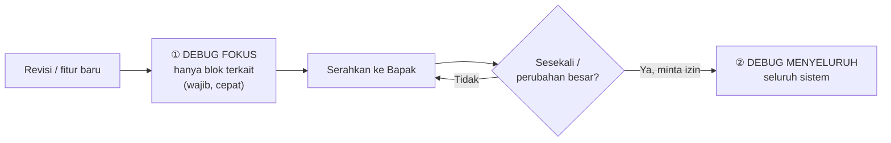
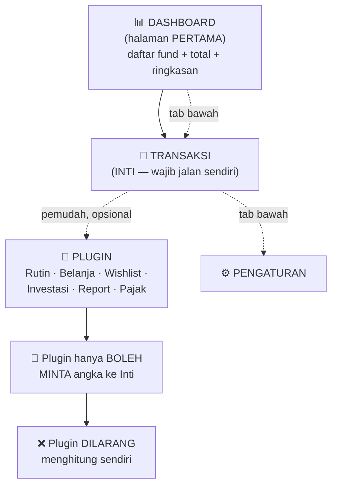
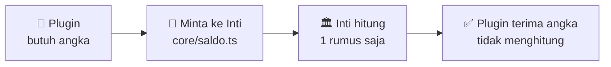
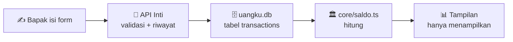
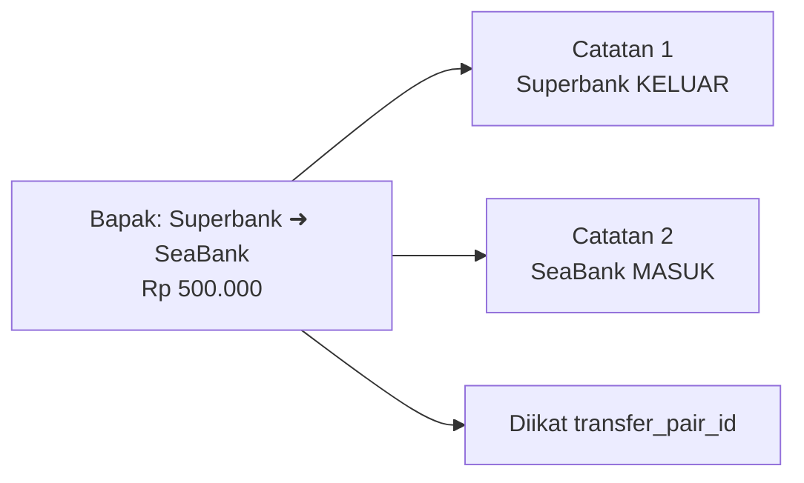
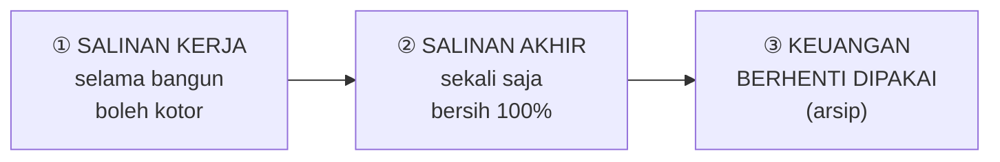
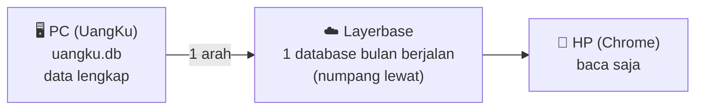
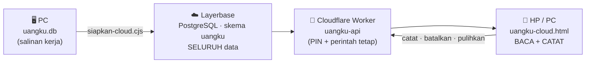
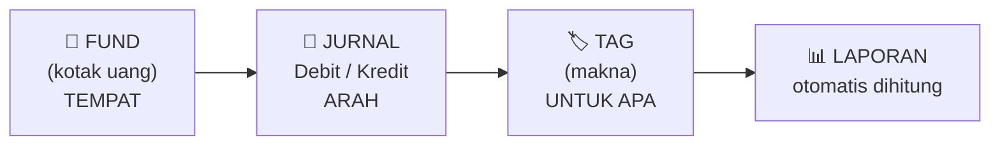
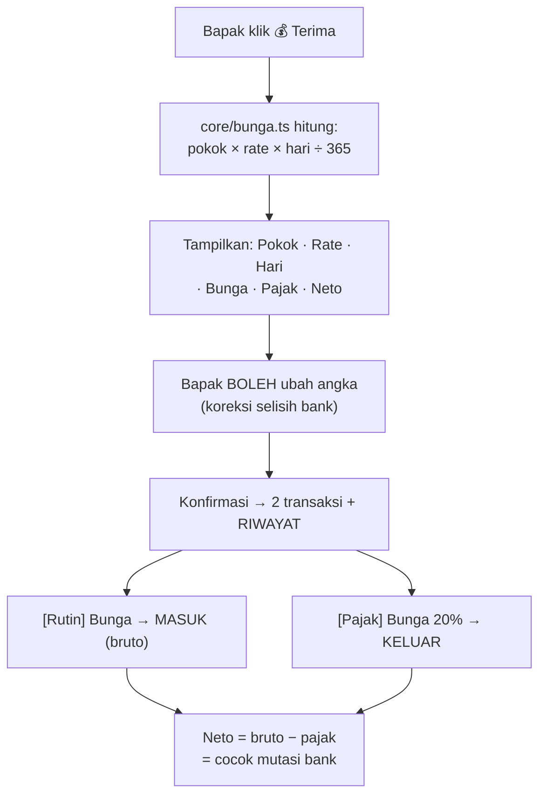

# 🧠 AGENTS.md — Otak UangKu

> **Untuk siapa:** **AI** yang mengerjakan UangKu. **WAJIB dibaca setiap sesi sebelum kerja.**
> **Dibuat:** 25 September 2026 · **Diperbarui:** 13 Oktober 2026
> **Status:** 🎉 **SIAP DIPAKAI SETIAP HARI** — https://suwandhih.github.io/uangku/uangku-cloud.html (PIN ada di berkas `PIN-UangKu.txt`)
> Data server **IDENTIK 100%** dengan `c:\data\keuangan` · 99 uji lolos · bisa dibaca **dan dicatat** dari PC maupun HP
> **Pasangan dokumen ini:** `rencanakerja.md` (papan order + rencana + konsep detail Bapak)
> **Asal konsep:** sistem lama `c:\data\keuangan` — **hanya konsep & metode yang dibawa**, bukan kodenya

---

## 🧭 ATURAN MAIN UMUM (disalin dari proyek Peta Dunia — berlaku untuk semua proyek Bapak)

> Disalin **8 Oktober 2026** dari C:\data\Peta dunia\agents.md.
> Bagian **F** (khusus peta) dan **I** (khusus MapLibre) **TIDAK** disalin — tidak berlaku untuk UangKu.
> Di proyek ini papan order ada di 
encanakerja.md **bagian 1**.
## 🔴 3 ATURAN PALING PENTING (ingat ini dulu, selalu)

> ⚡ **1. JANGAN mulai apa pun tanpa aba-aba dari Bapak.**
> ⚡ **2. BACA ULANG seluruh berkas ini SETIAP SESI** — bukan asumsi, bukan "mungkin".
> ⚡ **3. JANGAN tinggalkan sampah di script.** → lihat bagian **F**.
> ⚡ **4. JANGAN mengubah sistem UangKu yang sudah siap pakai** (aturan 13 Okt 2026, Bagian 2).

---

## A. Aturan tentang BERKAS

| # | Aturan |
|---|--------|
| **A1** | Proyek wajib punya 5 dokumen di atas. Tidak boleh kurang. |
| **A2** | `agents.md` = hanya aturan. |
| **A3** | **`agents.md` tidak boleh ditumbuhi riwayat.** Kalau memanjang → aturan tenggelam & tidak dipatuhi. |
| **A4** | `rencanakerja.md` = papan order. Sudah dikerjakan → **✅**. Masih proses → **tugas AI atas arahan Bapak**. |
| **A5** | `prompt.md` = konsep, supaya proyek **bisa dilanjutkan ATAU dibangun ulang seluruhnya** tanpa AI ini. |
| **A6** | `CHANGELOG.md` = merekam semua kejadian. |
| **A7** | `panduan.md` = panduan manusia, **bahasa biasa, bukan teknis**. |
| **A8** | Tidak boleh ada file sampah. |
| **A9** | Tidak boleh ada isi duplikat. |

---

## B. Aturan tentang CARA KERJA AI

| # | Aturan |
|---|--------|
| **B1** | Baca `agents.md` dulu setiap mulai sesi. |
| **B2** | **Jangan mulai apa pun tanpa aba-aba Bapak.** |
| **B3** | **Order dicatat dulu di `rencanakerja.md`** (butir per butir, status ⬜), **baru dikerjakan SATU PER SATU**. |
| **B4** | Order banyak → dicatat semua dulu, dikerjakan **satu butir per giliran**: selesai → uji → lapor → lanjut. |
| **B5** | **WAJIB beri perkiraan waktu** sebelum mulai ("±3 menit"). Lebih lama → **kabari**, jangan diam. |
| **B6** | **Tampilkan posisi "n dari m"** untuk pekerjaan besar. |
| **B7** | **Fitur baru = tahap dulu** (a, b, c…) → Bapak bilang "proses" → baru dikerjakan. |
| **B8** | **Perbaikan error = langsung kerjakan**, tetap backup dulu. |
| **B9** | Kalau ragu understanding permintaan → **TANYA dulu**, jangan menebak. |
| **B10** | "Rapikan / harusnya sama seperti…" = **perbaiki TINGKAT SETARA**, ❌ bukan menghapus. Permintaan sama ke-2× → **berhenti menambal**, baca ulang. |
| **B11** | **Tiap selesai satu butir → lapor ke Bapak** sebelum lanjut butir berikutnya. |

---

## C. Aturan tentang UJI / DEBUGGING ⏱️

> *"Saya tidak mau menunggu lama tanpa kejelasan."*

| # | Aturan |
|---|--------|
| **C1** | **WAJIB uji sendiri dulu** sebelum minta Bapak tes. |
| **C2** | **Uji HANYA pada bagian yang direvisi** — ❌ bukan seluruh aplikasi. |
| **C3** | **Uji penuh ❌ TIDAK dijalankan tanpa izin Bapak** — sebut perkiraan waktunya dulu. |
| **C4** | Uji hanya blok yang berhubungan dengan revisi. |
| **C5** | **Uji bermasalah & lama → jangan ulangi cara yang sama.** Ganti pendekatan atau hentikan. |
| **C6** | **Lapor** selalu menyebut: blok uji mana + hasilnya ("K17-01…K17-12: 12 uji, 0 gagal"). |
| **C7** | **Uji tampilan pakai `getComputedStyle`**, bukan sekadar "elemennya ada". |
| **C8** | **Uji PC + HP.** Kalau revisi menyentuh tampilan → uji di **keduanya**. |

---

## D. Aturan tentang DOKUMEN

| # | Aturan |
|---|--------|
| **D1** | **❌ Jangan update dokumen di tengah perbaikan.** |
| **D2** | **Update dokumen SEKALI setelah masalah benar-benar selesai** (akhir sesi). **Keputusan Bapak 8 Okt 2026:** semua revisi/penambahan dalam satu sesi dikerjakan dulu, dokumen (papan order + CHANGELOG + agents) diperbarui **sekali di akhir**. Update tiap butir dilarang karena memakan 20–30 menit. |
| **D3** | Aturan/putusan baru → catat **sekali**, bukan berulang. |
| **D4** | **Satu hal hanya boleh muncul di satu tabel** di papan order. |
| **D5** | Papan order **selalu disortir** (yang paling atas = dikerjakan dulu). |

---

## E. Aturan KEAMANAN DATA

| # | Aturan |
|---|--------|
| **E1** | **Backup dulu** sebelum setiap perubahan penting → folder `backups/`. |
| **E2** | **TIDAK PERNAH** menghapus data secara destructive. Perlu hapus → bertahap + backup. |
| **E3** | **Data yang diisi Bapak sendiri = inti aplikasi** → tidak boleh hilang saat ada perubahan. |
| **E4** | **TIDAK PERNAH** cascade delete. Selalu `UPDATE ... WHERE`. |

---


## F. 🗑️ ATURAN SAMPAH DI SCRIPT

> *"Jika ada revisi/perbaikan, **tidak meninggalkan sampah pada script**. Jika ada script
> yang perlu disimpan, buatkan file baru `catatanAI.md` — jadi script AI bisa ditempatkan
> pada file itu **untuk sementara**."*

| # | Aturan | Pelaksanaan |
|---|--------|-----------|
| **F1** | ❌ **DILARANG** meninggalkan kode lama di script dengan alasan *"supaya bisa revert"* | Kode tak terpakai **harus dihapus** dari script |
| **F2** | Kalau memang perlu disimpan | **Pindahkan ke `catatanAI.md`** — buat berkasnya kalau belum ada |
| **F3** | Fitur dihapus permanen | Arsipkan ke `backups/` — ❌ jangan tinggalkan di script utama |
| **F4** | Hapus harus **menyeluruh** | Kode + gaya + uji + catatan dokumen yang menyebutnya ikut dibersihkan |
| **F5** | Catatan dokumen yang **bertentangan** dengan keadaan nyata | Wajib dibersihkan |

⚠️ **Kenapa:** kode tak terpakai yang tertinggal di script ⇒ AI berikutnya akan **meniru**-nya ⇒
sistem makin lama makin rusak tanpa disadari.

---

## G. Aturan PAPAN ORDER (`rencanakerja.md` bagian 1)

Tanda: ✅ selesai · 🔨 sedang · ⬜ belum · ⚠️ bermasalah · ⏳ antre · 🟡 perlu diperdalam ·
⚪ belum diputuskan · ⏸️ ditahan · ❌ dibuang

| Tabel | Isi |
|-------|-----|
| **A. KASUS BELUM SELESAI** | per kasus + butir ✅/⬜ + tanggal |
| **B. ANTREAN KERJA** | sudah disetujui, belum mulai, **bersortir** |
| **C. IDE** | 🟡 perlu diperdalam · ⏸️ ditahan · ❌ dibuang |
| **D. SELESAI** | arsip + tanggal, terbaru di atas |

1. Selesai satu **butir** → ✅ + **tanggal**.
2. Butir **terakhir** ✅ → kasusnya dipindah ke **D. SELESAI**.
3. **Ide disetujui** → pindah ke **B**, barisnya **dihapus dari C**.
4. **Dibatalkan** → pindah ke ❌ dibuang + alasan.
5. **Satu hal hanya boleh muncul di satu tabel.**

Perintah Bapak: `papan` · `kerjakan X` · `tunda X` · `buang X` · `selesai X`

---


---

## 0. 🚨 ATURAN WAJIB — BACA SEBELUM APA PUN

> Aturan ini berlaku untuk **AI mana pun**. Tidak ada pengecualian, tidak ada tafsiran lain.
> **Kalau ragu → tanya Bapak dulu, jangan menebak.**

### 🥇 ATURAN PALING DASAR — pahami ini dulu

> **Koreksi Bapak (25 Sep 2026):**
>> *"transaksi di buat dasar itu benar .. tapi **tampilan pertama adalah dashboard**.. kemudian kedalam transaksi ..
>> sisa adalah plugin < mengapa di sebut plugin karena **tanpa plugin transaksi bisa tetap input semua transaksi**..
>> hanya repot.. apalagi juga transaksi tsb sudah bersifat rutin yg akan diinput setiap hari sama terus..
>> maka adanya plugin itu **mempermudah saja**.. jadi yg harus di selesaikan **transaksi**.. ini harus dipahami..
>> jadi **plugin rutin boleh di masukkan boleh tidak**.. jika ditempelkan pekerjaan rutin menjadi lebih mudah..
>> dan yg lain seperti itu."*

| Hal | Aturan |
|---|---|
| **1** | **Dashboard = tampilan PERTAMA** (yang dilihat saat aplikasi dibuka) |
| **2** | Dari Dashboard → **masuk ke Transaksi** |
| **3** | **Transaksi = INTI.** **Wajib** bisa berdiri sendiri tanpa plugin apa pun |
| **4** | **Plugin = OPSIONAL.** Boleh dipasang, boleh tidak |
| **5** | Kalau **semua plugin dilepas** → Transaksi **tetap bisa input semua** transaksi. Hanya **lebih repot** |
| **6** | **Plugin = pemudah kerja.** Contoh: Rutin → tagihan yang sama terus tiap hari tidak perlu diisi ulang |
| **7** | 🎯 **Yang WAJIB diselesaikan lebih dulu = TRANSAKSI** |

**Cara menjelaskan dengan contoh:**

```
Tanpa plugin Rutin:
  Bapak harus input manual "Galon Air Rp 18.000" SETIAP KALI beli
  → bisa, tapi repot

Dengan plugin Rutin:
  Isi sekali → sistem ingatkan → klik Bayar → selesai
  → pekerjaan rutin jadi mudah

Jadi plugin itu TAMBAHAN KEMUDAHAN, bukan syarat agar transaksi jalan.
```

### 🥈 ATURAN KEDUA — pahami TAG

> **Kalimat Bapak (25 Sep 2026):**
>> *"tag itu banyak trik.. harus pelajari.. semua rumah, Pribadi, Hewan, Mobil itu posisi selalu Kredit..
>> jadi tag itu tanda pada sistem untuk melakukan proses yg berbeda.. silahkan dipelajari..
>> **ini inti dari konsep transaksi berkerja**.. tag ini berguna sampai reporting"*

| # | Aturan |
|---|---|
| **1** | **Tag bukan sekadar label** — tag = **penanda proses** |
| **2** | Tag menentukan **3 hal**: ① arah jurnal (D/K) · ② proses khusus (pajak · transfer pasangan · pengingat) · ③ perlakuan di laporan |
| **3** | 🔴 **4 tag DUA ARAH** — Transfer · Pinjam · Hutang · Reimburse → arah **tidak boleh** diisi otomatis dari tag |
| **4** | **11 tag lainnya** → arah **selalu** dari tag (Rumah/Pribadi/Pet/Mobil = **selalu Kredit**) |
| **5** | Tag salah → **seluruh proses & laporan salah** |

> 📊 **Terbukti dari 1.596 transaksi:** Rumah (77 tx) · Pribadi (125 tx) · Pet (28 tx) · Mobil (1 tx)
> semuanya **hanya Kredit**. Ini membuktikan ucapan Bapak.
> 📌 Rincian lengkap: `rencanakerja.md` **Bagian 9.14** · `prompt.md` Bagian 5.

### A. ⏱️ Waktu & Cara Kerja

| # | Aturan | Keterangan |
|---|---|---|
| **A1** | **Sebut perkiraan waktu SEBELUM mulai** | Mis. "3 menit", "10 menit", "1 sesi (±1,5 jam)" |
| **A2** | **Patuhi waktu itu** | Kalau ternyata lebih lama → **kabari Bapak**, jangan diam |
| **A3** | **JANGAN ulangi cara yang sama yang gagal** | Cara sama = keadaan sama = seperti berputar tak maju |
| **A4** | **Tersangkut > 2× percobaan → HENTIKAN** | Cari jalan lain, lalu lapor Bapak |
| **A5** | **Uji HANYA bagian yang diubah** | Jangan uji seluruh aplikasi tanpa izin Bapak |
| **A6** | **Menulis dokumen = tanpa uji** | Catatan tidak perlu dites |
| **A7** | 🔍 **DEBUG DULU sebelum serahkan ke Bapak** | Lihat aturan lengkap di **Bagian A2** di bawah |
| **A8** | 📢 **JANGAN biarkan layar chat seperti freeze** | Lihat aturan lengkap di **Bagian A3** di bawah |

---

### 🔍 A2. WAJIB DEBUG DULU — sebelum Bapak menguji (25 Sep 2026)

> **Kalimat Bapak:**
>> *"ini atauran yg penting ditambahkan.. setelah selesai revisi atau buat baru **harus km debugging terlebih dahulu
>> sebelum saya tes**.. dan catatan apa yg harus di debugging **fokus pada yg di revisi atau sistem baru**..
>> jangan ke seluruhnya.. **debugging keseluruhan perlu tapi sesekali** jangan setiap kali revisi kecil
>> saya harus tunggu lama karena km debuging keseluruhan sistem.. tunggu kelamaan"*

#### 🎯 Dua jenis debug — jangan dicampur

| Jenis | Kapan | Cakupan | Waktu | Izin Bapak? |
|---|---|---|---|---|
| **① DEBUG FOKUS** | **SETIAP** revisi / fitur baru | **HANYA** yang direvisi/dibuat + yang bersinggungan langsung | detik–1 menit | ❌ tidak perlu, **wajib** jalan |
| **② DEBUG MENYELURUH** | **SESEKALI** saja (mis. sebelum salinan akhir, sebelum rilis, setelah perubahan besar) | seluruh sistem | bisa lama | ✅ **butuh izin** + sebut waktu |



#### 📋 Cara melakukan DEBUG FOKUS (7 langkah)

| # | Langkah |
|---|---|
| **1** | Tulis **daftar fokus**: apa yang direvisi/dibuat (mis. "Source Fund: tombol ＋, urutan angka") |
| **2** | Tulis **yang bersinggungan langsung**: fungsi/berkas yang ikut terpanggil revisi itu |
| **3** | ❌ **JANGAN** sentuh/uji bagian yang tidak berhubungan |
| **4** | Jalankan **pemeriksa galat** (`get_errors`) pada berkas yang diubah |
| **5** | Jalankan **uji nyata** pada blok itu saja (mis. 1 aksi + 1 periksa hasil) |
| **6** | Periksa **hal yang paling mudah rusak**: ① tampilan meluber? ② teks salah? ③ angka salah? ④ tombol tidak jalan? |
| **7** | Laporkan: **apa diuji · hasilnya · yang belum diuji** — lalu bilang siap dites Bapak |

#### ✅ Yang harus selalu diperiksa saat DEBUG FOKUS

| Hal | Cara cepat |
|---|---|
| **Galat kode** | `get_errors` pada berkas yang diubah |
| **Tampilan meluber** | Ukur `scrollWidth - clientWidth` pada wadah — harus ≤ 0 |
| **Tombol berfungsi** | Klik, lihat apakah hasilnya berubah |
| **Teks berganti bahasa** | Kalau menyentuh tulisan: uji ID → EN → ID |
| **Angka tidak berubah** | Bandingkan dengan angka pembanding (`prompt.md` Bagian 16) |
| **Script mati** | Hapus yang tidak dipakai (aturan C12) |

#### ⏱️ Batas waktu

| Kondisi | Aturan |
|---|---|
| Debug fokus | **≤ 1 menit** untuk revisi kecil. Lebih dari itu → ganti cara |
| Gagal 2× dengan cara sama | **HENTIKAN** — cari cara lain (aturan A3/A4) |
| Debug menyeluruh | **Sebut perkiraan waktu** + **minta izin** dulu |

#### 🗒️ Catatan yang wajib ditulis setelah debug

```
🔍 FOKUS DEBUG — <tanggal> — <apa yang direvisi>
   Fokus uji   : <blok yang diuji>
   Cara uji    : <perintah / aksi>
   Hasil       : ✅ lolos / ⚠️ ada masalah: ...
   Belum diuji : <bagian lain yang TIDAK diuji> — perlu uji menyeluruh nanti
   Siap dites  : ya / belum (alasan)
```

> 📌 Catatan ini ditulis di **laporan chat** (dan ke `rencanakerja.md` kalau revisinya penting).
> **Bapak harus tahu mana yang sudah diuji dan mana yang belum.**

---

### 📢 A3. JANGAN BIARKAN CHAT SEPERTI FREEZE (25 Sep 2026)

> **Kalimat Bapak:**
>> *"setiap kali ada revisi atau buat sistem baru.. jangan biarkan layar chat seolah2 freeze ..
>> saya perlu km tulis terus.. supaya saya tau masih hidup .. bisa jadi komputer saya error
>> tapi karena freeze saya tidak tau"*

#### Aturan

| # | Aturan |
|---|---|
| **1** | **Tulis kalimat pendek SEBELUM setiap langkah** — mis. *"Mencari sisa kata Indonesia…"*, *"Menambal kamus…"*, *"Menguji tombol…"* |
| **2** | ❌ **JANGAN** diam lama tanpa tulisan — Bapak tidak bisa tahu apakah masih hidup |
| **3** | ❌ **JANGAN** mengerjakan 5 langkah tanpa kabar lalu melapor sekali di akhir |
| **4** | **Sebut kemajuan bertahap**: sudah berapa dari berapa |
| **5** | Kalau satu langkah **butuh lama** (> 30 detik) → tulis dulu: *"Ini agak lama, saya sedang …"* |
| **6** | Kalau menemukan **hal tak terduga** → tulis segera, jangan disimpan |
| **7** | Kalau **gagal** → tulis apa yang gagal + apa rencana berikutnya (jangan diam) |

#### Contoh yang BENAR

```
✅ Mencari sisa kata Indonesia di tulisan English…
✅ Ketemu 7 baris. Ternyata 4 hanya "Total" (kata Inggris juga), 1 bug nyata: "pajak".
✅ Menambahkan entri kamusnya…
✅ Menguji ulang… hasil: dari 7 → 2 sisa (keduanya nama kolom database, memang harus tetap).
✅ Selesai. Lanjut ke butir berikutnya: aturan debugging.
```

#### Contoh yang SALAH

```
❌ (diam 5 menit)
❌ Selesai, semua sudah dikerjakan.     ← Bapak tidak tahu apa yang terjadi
❌ Mengerjakan 5 revisi tanpa kabar di tengah
```

> 🎯 **Alasan:** Bapak harus duduk menunggu. Kalau layar diam, dia tidak bisa membedakan
> **"AI masih bekerja"** dengan **"komputer saya error"**. Tulisan pendek = tanda sistem hidup.

### B. 💾 Data & Keamanan

| # | Aturan | Keterangan |
|---|---|---|
| **B1** | **BACKUP DULU** sebelum menyentuh data | Tidak ada pengecualian |
| **B2** | 🔴 **`keuangan.db` = PRODUKSI — HANYA DIBACA** | **DILARANG** `INSERT` / `UPDATE` / `DELETE` / `ALTER` / `DROP` |
| **B3** | **UangKu bekerja di `uangku.db`** (salinan) | Di salinan **bebas** — tidak memengaruhi produksi |
| **B4** | **JANGAN ganti nama 8 tag + 7 fund istimewa** | Sampai kolom `code` dipakai penuh |
| **B5** | **Tag = penentu makna** | Salah tag = **seluruh laporan salah**. Baca `rencanakerja.md` Bagian 9 |
| **B6** | **Salinan 1 arah**: keuangan → UangKu | **Tidak pernah** balik |
| **B7** | **`keuangan.db` punya WAL 4 MB** | Salinan **wajib** lewat **API backup SQLite** / `.backup` CLI, **jangan** copy file mentah |
| **B8** | 🧹 **Data coba-coba di UangKu WAJIB dihapus** sebelum salinan akhir | Supaya history keuangan masuk **bersih & identik 100%** |
| **B9** | **Keuangan masih hidup selama pembangunan** | Bapak tetap update di `c:\data\keuangan` — data akan bertambah, **itu memang disengaja** |

### C. 🏗️ Membangun Aplikasi
| # | Aturan |
|---|---|
| **C1** | **Transaksi = INTI** — wajib jalan **tanpa** plugin. Rutin/Belanja/Wishlist/Investasi/Report/Pajak = **PLUGIN (opsional, pemudah)** |
| **C2** | Saldo **hanya** dihitung di `core/saldo.ts` — plugin **dilarang** menghitung sendiri |
| **C3** | Tanggal bulan **hanya** di `core/periode.ts` — jangan tulis `date >=` di plugin |
| **C4** | Logika pakai **`code`**, bukan nama (nama boleh berganti bahasa) |
| **C5** | Setiap plugin **punya uji sendiri** — 1 perintah = tahu masih benar |
| **C6** | 🔴 **SEMUA input · edit · hapus HARUS BISA DIKEMBALIKAN** (rollback) |
| **C7** | Bunga & pajak: hitung **dalam SEN (integer)**, rumus **hanya** di `core/bunga.ts`, **dilarang** pakai angka cadangan diam-diam |
| **C8** | 🎨 **Warna hitam-putih** — warna hanya untuk tanda penting / peringatan |
| **C9** | 🔒 Plugin **dilarang** menyentuh tabel transaksi langsung — **minta** ke Inti |
| **C10** | 🖥️ Rancang untuk **layar 50%** (±960 px) — rapatkan, bisa dilipat, info penting di atas |
| **C11** | 📊 **Dashboard = halaman pertama** — begitu aplikasi dibuka, yang terlihat **Dashboard**. Isinya (urutan 25 Sep 2026): **① daftar Sumber fund + saldo akhir** (semua fund) → ② peringatan saldo minimum → ③ total semua fund + Tersedia/Diblokir/Titipan → ④ Ringkasan → ⑤ Bunga & pajak → ⑥ Transaksi terbaru |
| **C19** | 🔗 **SATU TAMPILAN = SATU FUNGSI, DIPAKAI BERSAMA.** Kalau hal yang sama tampil di dua tempat (mis. kartu fund di **Dashboard** dan **Daftar Fund**), **wajib** memakai pembuat yang **sama** — dilarang menulis dua versi. Alasan: dua versi pasti **berbeda diam-diam** → **bug nyata 25 Sep**: Dashboard 3 kolom vs Daftar Fund 4 kolom padahal lebar layar sama. Contoh benar: `kartuFund(f)` + `kisiFund(wadah)` di `uangku.html` |
| **C20** | ⬅️ **PINDAH HALAMAN = TAB BAWAH SAJA** (`Dashboard · Transaksi · Pengaturan`). Tombol pintas di dalam halaman **dihapus** supaya tidak dobel (keputusan Bapak 25 Sep: *"di dashboard masih ada menu Lihat semua transaksi, dihapus saja.. pakai menu paling bawah"*) |
| **C12** | 🧹 **PERBAIKAN = BACKUP + HAPUS script mati.** Setiap perbaikan **wajib**: ① backup dulu · ② script salah/lama **DIHAPUS**, **bukan** dibiarkan |
| **C13** | 🌐 **Bahasa Indonesia sebagai bawaan** — semua istilah & kalimat bisa diganti ke English |
| **C14** | 🔒 **Tampilan yang sudah disetujui Bapak = BEKU** — tidak diubah/diganti saat develop |
| **C15** | 🔢 **Urutan pakai ANGKA (`sort_order`)** — bukan tombol naik/turun. Bapak: *"jika beri nomor urut.. sistem selalu menempatkan 1,2,3,4 user tinggal atur urutannya saja"*. Berlaku untuk fund **dan** tag |
| **C16** | 📖 **Istilah ditulis sebagai DAFTAR ISTILAH**, bukan "contoh istilah". Semua padanan ID↔EN ada di `prompt.md` Bagian 6 |
| **C17** | 🧹 **HAPUS SCRIPT MATI = BAGIAN DARI "UPDATE"** (Bapak, 25 Sep 2026). Kalau membuat sistem baru/berkas baru → **berkas lama yang digantikan WAJIB DIHAPUS** pada saat yang sama. Dilarang menyisakan dua versi logika hidup bersama. **Contoh nyata:** setelah `tools/salinan-kerja.cjs` dibuat, `tools/baca-keuangan.cjs` + `tools/hitung-saldo.cjs` + `tools/hasil-baca-keuangan.json` **DIHAPUS** (duplikat — bisa bikin perhitungan kacau kalau salah satu dijalankan). |
| **C18** | 📱 **`uangku.html` = versi HP (Android)** — berkas **MANDIRI**: tanpa server, tanpa internet, tanpa `node_modules`. Data disuntik oleh `tools/siapkan-data.cjs` ke dalam `<script id="data-uangku">`. **Hanya untuk MELIHAT** (baca saja) — mencatat tetap di komputer. Angka **WAJIB** memakai aturan yang sama dengan `core/saldo.ts`. |

### D. 📝 Cara Melapor

| # | Aturan |
|---|---|
| **D1** | ⚪ *(digantikan keputusan Bapak 8 Okt — lihat aturan D1/D2 di bagian ATURAN MAIN UMUM)* |
| **D2** | Lapor singkat: **apa dikerjakan · uji apa · hasilnya** |
| **D3** | Ada yang belum beres → tandai ⚠️ + tulis alasannya. **Jangan dihapus** |
| **D4** | Ide baru → masukkan ke **tabel C. IDE** di papan order |

### 🔴 C12 — Kenapa script mati WAJIB dihapus

> **Kalimat Bapak (25 Sep 2026):**
>> *"ini penting masukkan dalam aturan.. jika ada perbaikan tentu **harus backup** terutama sistem..
>> jadi perbaikan **bukan membiarkan script yg salah masih ada didalam harus dihapus**..
>> supaya tidak menjadi masalah pada saat banyak revisi sana sini.. malah **script yg seharusnya mati
>> jadi hidup tanpa diharapkan**.. mengakibatkan **perhitungan kacau** dan sebagainya."*

| # | Aturan |
|---|---|
| **1** | **BACKUP DULU** sebelum perbaikan (terutama sistem/database) |
| **2** | Script **salah / lama / tidak dipakai** → **DIHAPUS**, bukan dibiarkan |
| **3** | **JANGAN** biarkan dua versi logika hidup bersama |
| **4** | Kalau script mati **hidup kembali** tanpa disengaja → **perhitungan kacau** |
| **5** | Setelah perbaikan → **periksa** tidak ada sisa script lama yang masih terpanggil |

**Kenapa ini penting:** sistem lama punya **42 salinan rumus saldo** + **32 titik baca nama tag** +
**3 tempat rumus pajak**. Semua itu **sisa script yang seharusnya sudah mati** — dan justru itulah
akar semua bug. Di UangKu: **satu logika = satu berkas**. Yang lama **dihapus**.

---

## 1. 🎯 Apa Itu UangKu (dan apa BUKAN)

### Kalimat kunci Bapak (25 Sep 2026)

> *"sistem keuangan ini dibangun ulang.. memasukan sistem keuangan lama **berupa konsep atau metode saja**..
> tapi untuk konsep UangKu ini adalah **tampilan baru**.. dan tentu ada **konsep baru** pula..
> itu tujuan UangKu di bangun **bukan copy paste 100%** dari keuangan.. **(karena tidak ada gunanya copy paste)**
> yg dimasukkan **konsep**."*

### Tabel pembeda — jangan sampai salah paham

| | ✅ YANG DIBAWA | ❌ YANG **TIDAK** DIBAWA |
|---|---|---|
| **Kode** | — | ❌ Semua file `.ts` / `.tsx` sistem lama |
| **Tabel & kolom** | ✅ Skema sama (agar data bisa masuk) | ❌ Kolom baru yang tidak perlu |
| **Isi data** | ✅ 1.597 transaksi + saldo (via salinan) | ❌ — |
| **Metode** | ✅ Rumus saldo, aturan bulan, tag, pajak, bunga, rutin, transfer | ❌ Cara menulis rumus berulang di 42 tempat |
| **Aturan bisnis** | ✅ 5 tag dikecualikan, tag Hutang = pengingat, aturan emas belanja | ❌ Nama tag lama yang sudah tidak ada |
| **Tampilan** | ✅ Susunan informasi yang Bapak butuhkan | ❌ Layout, warna-warni, font, modal besar |
| **Bug & pelajaran** | ✅ Daftar bug + penyebabnya (Bagian 8) | ❌ Bug-nya sendiri |

### 🆕 Konsep BARU yang belum ada di sistem lama

| # | Konsep baru | Kenapa |
|---|---|---|
| 1 | **Inti + Plugin** dengan batas tegas | Sistem lama rumusnya tersebar 42 titik → sumber semua bug |
| 2 | **Kolom `code`** pada tag & fund | Agar nama boleh diganti bahasa tanpa merusak laporan |
| 3 | **Multi-bahasa istilah keuangan** | Bapak minta (Indonesia ↔ Inggris, dst) |
| 4 | 🔴 **Rollback / Riwayat menyeluruh** | *"sangat penting dari seluruh arti sistem ini"* |
| 5 | **Aksi berantai bisa dibatalkan sekaligus** | Rutin bayar = transaksi + pajak + jadwal + transfer pasangan |
| 6 | **Jejak perhitungan bunga** (hitungan sistem vs angka bank) | Selisih sen jadi jelas, koreksi tidak melelahkan |
| 7 | **Metode pembulatan bisa dipilih** per rutin | Meniru cara bank masing-masing |
| 8 | **Salinan 3 lapis + pembukti sidik jari** | Angka UangKu terbukti sama dengan keuangan |
| 9 | **Tampilan hitam-putih + layar 50%** | Kebutuhan kerja harian Bapak |
| 10 | **Tombol [Doc]** — dokumen bisa dibaca dari dalam aplikasi | Bapak tidak perlu buka file `.md` |
| 11 | **Versi HP (Chrome) + sinkronisasi lewat Layerbase** | Cek uang saat di luar rumah |
| 12 | **Jembatan cloud (Layerbase)** = perantara PC ↔ HP | "Numpang lewat" saja — **bukan** tempat menyimpan data utama |

---

## 2. 📍 Posisi Pekerjaan Sekarang (25 Sep 2026)

> 🔴 **Diperbarui 13 Okt 2026.** Keadaan sebelumnya (25 Sep) sudah tidak berlaku.

| Hal | Keadaan |
|---|---|
| **🎉 UangKu SIAP DIPAKAI** | ✅ **13 Okt 2026** — Bapak mencatat setiap hari di **https://suwandhih.github.io/uangku/uangku-cloud.html** (PIN ada di berkas `PIN-UangKu.txt`), dari **PC maupun HP** |
| **Kode (PC)** | ✅ `server/core/` 5 berkas (`uang` · `periode` · `saldo` · `bunga` · `aturan`) + `server/db/index.ts` + `server/uji/` 5 berkas uji. **99 uji LOLOS** (`npm run uji`) · `npm run cek` bersih |
| **`uangku-cloud.html`** | ✅ **BARU 13 Okt** — halaman yang dipakai Bapak. **Seluruh kode tampilan `uangku.html` dipakai APA ADANYA**; yang berganti hanya ① sumber data (server) ② tempat simpan (server). Ditambah gerbang PIN + layar Riwayat + menu Bulan Baru. **Aman masuk repo publik** (tanpa data keuangan) |
| **`uangku.html`** | ✅ versi HP lama — **mandiri**, data disuntik `tools/siapkan-data.cjs`. **Baca saja**. 🔴 **TIDAK boleh masuk repo publik** (memuat data asli) |
| **`data/uangku.db`** | ✅ salinan kerja — **1.889 tx · 21 fund · 20 tag · 225 snapshot · 63 rutin · 1.817 riwayat** |
| **Server (Layerbase)** | ✅ **PostgreSQL** — skema `uangku`. **IDENTIK 100%** dengan `keuangan.db` (dibuktikan `tools/cek-sama-cloud.cjs`) |
| **Worker** | ✅ `uangku-api.suwandhih.workers.dev` — perantara aman. BACA: bulan · bukaBulan · dashboard · fund · tag · snapshot · transaksi · saldo · ringkasan · riwayat. TULIS: catat · ubah · batalkan · pulihkan |
| **GitHub** | ✅ repo **publik** `suwandhih/uangku` · GitHub Pages aktif · 34 berkas, **tanpa rahasia & tanpa data keuangan** |
| **`design/ui-hp.html`** | ⚠️ Mockup HP — 🔒 **BEKU** (C14), sudah tertinggal dari kenyataan |
| **`prompt.md`** | ✅ cetak biru (17 bagian) — ⚠️ bagian 15–16 masih keadaan 25 Sep |
| **`agents.md`** | ✅ dokumen ini (otak + aturan kerja) |
| **`rencanakerja.md`** | ✅ papan order (4 tabel) + 17 bagian konsep |
| **`CHANGELOG.md`** | ✅ catatan perubahan untuk Bapak (terbaru di atas) |
| **`panduan.md`** | ✅ panduan pemakaian, bahasa awam + diagram |
| **Aplikasi PC (server lokal)** | ⬜ **BELUM ADA** — tidak diperlukan lagi; halaman cloud sudah bisa mencatat dari PC |
| **Keuangan** | ⏸️ **Bapak berhenti memakainya** (13 Okt). Kalau masih ada catatan baru di sana → jalankan `salinan-kerja.cjs` lalu `siapkan-cloud.cjs --ulang` |
| **Perintah penting** | `npm run uji` (99 uji) · `npm run cek` · `node tools\salinan-kerja.cjs` (keuangan → uangku.db) · `node tools\siapkan-cloud.cjs --ulang` (uangku.db → server) · `node tools\cek-sama-cloud.cjs` (pembukti identik) · `node tools\bangun-cloud.cjs` (susun halaman cloud) · `npx wrangler deploy -c cloudflare/wrangler.toml` (unggah Worker) |

### 🔴 Aturan baru 13 Okt 2026 — WAJIB dipatuhi

| # | Aturan |
|---|---|
| **1** | **JANGAN mengubah sistem UangKu yang sudah siap pakai.** Kode tampilan dipakai apa adanya. Yang boleh diganti hanya **sumber data** dan **tempat simpan** |
| **2** | **Setiap awal bulan** → **Pengaturan → 📅 Bulan Baru → Buka bulan baru**. Tanpa ini Bapak **tidak bisa mencatat** (bulan baru belum punya saldo awal). Dashboard akan mengingatkan sendiri |
| **3** | **Setelah data keuangan berubah** → `salinan-kerja.cjs` → `siapkan-cloud.cjs --ulang` → `cek-sama-cloud.cjs` (harus **IDENTIK 100%**) |
| **4** | **Jangan menaruh angka saldo asli / nama fund asli** di berkas yang masuk repo publik (termasuk alat pemeriksa) |
| **5** | **`uangku.html` · `lab-uang2.html` · `data/` · `.env`** → 🔴 **DILARANG** masuk repo (sudah dijaga `.gitignore`) |
| **6** | 🔴 **PIN = 745702. DILARANG MENGUBAH PIN TANPA PERINTAH BAPAK.** Lihat aturan **10** di bawah |
| **7** | 🔴 **TAG BAWAAN FORM = tag pertama yang mengunci arah** (mis. `Rumah`), **BUKAN** `Transfer`. `Transfer` adalah tag **dua arah** yang tidak mengunci D/K → kalau Bapak lupa mengganti tag, catatan tersimpan sebagai Transfer dan **hilang dari Ringkasan** (bug nyata 13 Okt 2026) |
| **8** | 🔴 **Kalau Bapak mengeluh "saldo beda dengan bank"** → **periksa TAG dulu**, bukan rumusnya. Tag `Transfer` pada belanja biasa = penyebab paling sering |
| **10** | 🔴🔴 **PIN DILARANG DIUBAH TANPA PERINTAH BAPAK.**<br/>**Kalimat Bapak (13 Okt 2026):** *"jangan ubah2 pin .. kan tidak ada rumusan bagaimana saya tau km ubah pin.. pakai pin yg sudah jelas tidak ada orang yg tau dan ingat 745702 sudah ya jangan di ubah2"*<br/>**PIN yang berlaku: `745702`** — tertulis di `PIN-UangKu.txt`.<br/>**Aturan:**<br/>① **JANGAN PERNAH** mengganti PIN atas inisiatif sendiri — sekalipun alasannya keamanan<br/>② Kalau AI menilai PIN perlu diganti → **TANYA BAPAK DULU**, jangan langsung ganti<br/>③ Kalau Bapak sendiri yang minta ganti → baru ganti, lalu **perbarui `PIN-UangKu.txt`** dan **beri tahu PIN barunya di chat**<br/>④ PIN ada di **DUA tempat** — `.env` (`LB_PIN`) dan secret Cloudflare (`PIN`). Ganti harus **keduanya**, kalau tidak → Bapak tidak bisa masuk |
| **9** | 🔴 **ANGKA SALDO JANGAN DISINGKAT.** Bapak: *"jangan 25,5jt ini tidak memberi informasi yg tepat.. seharusnya ditulis 26.504.730,59"*. `rpRingkas()` sekarang = `rp2()` (angka penuh sampai sen). Angka panjang boleh **patah di titik ribuan**, **jangan** dipotong `…` |
| **11** | 🧾 **BARIS JURNAL = SATU BARIS SAJA** (permintaan Bapak 13 Okt 2026). Susunan: **fund · tag · D/K · harga · ✕**. Fund ditulis **3 huruf** (`SINGKAT_FUND` + `singkatFund()`), tag emoji+3 huruf, D/K 1 huruf, **harga mengambil seluruh sisa lebar**. Lebar kolom dihitung `aturLebarBaris()` dari **lebar baris yang diukur**, bukan dari lebar jendela. Layar ≤ 340 px → kelas `tl-sempit` merapatkan jarak & padding. 🔴 **Singkatan fund HANYA untuk tampilan** — nilai `<option>` tetap **nama lengkap** supaya data & laporan tidak berubah |
| **15** | 🔁 **PLUGIN RUTIN: KLIK = LANGSUNG TRANSAKSI.** Pola jurnal disimpan **sekali** saat membuat rutin (1–3 baris). Setiap jatuh tempo Bapak cukup **klik notifikasi** — **tidak mengetik form lagi**. 🔴 Pengingat **H-n** dari `remind_before_days` (Bapak pilih). 🔴 Barang habis pakai (galon, token PLN) → pakai rumus **Weighted Moving Average** (`recurring.ts` baris 975–1027); selisih **≤ 2 hari diabaikan**, **> 3 hari → hitung ulang**. 🔴 **PENGINGAT HANYA DI HALAMAN RUTIN** — Dashboard **tidak** menampilkan peringatan; Dashboard hanya menampilkan item yang **Bapak pilih sendiri** (`monitor=1`) dengan nama + sisa hari. Rincian: `rencanakerja.md` **Bagian 18** |
| **16** | 🧩 **SEMUA SELAIN TRANSAKSI = PLUGIN (OPSIONAL).** Kalimat Bapak 13 Okt: *"sistem ini tidak hanya transaksi.. tentu ada beberapa fitur.. hanya fitur2 lainnya berupa plugin artinya boleh dipake atau tidak.. sistem tetap bekerja.. fitur plugin hanya mempermudah entri data lebih cepat"*. **Datanya SUDAH ada di server** (rutin 63 · belanja 43 · wishlist 7 · investasi 7 · audit 1.820 · catatan 118) — hanya **layarnya** yang belum. 🔴 **Jangan pernah** membuat Inti (Transaksi) bergantung pada plugin |
| **13** | 💰 **ANGKA SELALU 2 DESIMAL** (keputusan Bapak 13 Okt 2026: *"apakah angka di sediakan desimal 2 digit minimal"* → **Ya**). `rp2()` **selalu** menulis `,00` — `10.000` → `10.000,00`. Kotak angka melengkapi `,00` saat **selesai** mengetik (event `change`), **bukan** saat mengetik. 🔴 Jangan kembalikan ke "hanya kalau ada sen" |
| **14** | 🔄 **SETIAP LAYAR YANG PUNYA GRID WAJIB DIGAMBAR ULANG SAAT `resize`.** Bug nyata 13 Okt 2026: handler `resize` tidak memanggil `gbrDash()`, sehingga jumlah kolom kartu fund tetap memakai lebar layar **sebelumnya** → kartu jadi 5 kolom @ 50 px → angka saldo **patah 2 baris**. Kalau menambah layar baru yang memakai `hitungKolom`, **tambahkan juga** ke handler `resize` |
| **12** | 📐 **FUND & TAG WAJIB CUKUP LEBAR — PANAH PULLDOWN HARUS TERLIHAT** (usulan Bapak 13 Okt 2026: *"sumber sampai terlihat pulldown bisa terlihat dan tag juga dapat ruang yg cukup 3 digit terlihat"*). Lebar minimum: **fund 46 px · tag 58 px · D/K 38 px · hapus 26 px · harga 78 px** (cukup untuk `100.000.000,00`). `padding-right:14px` pada fund & tag supaya panah **▾** tidak terpotong. 🔴 **Jangan pernah mengecilkan fund/tag sampai panahnya hilang** — Bapak jadi tidak tahu kotak itu bisa dibuka |

### ⚠️ Dokumen sumber yang sudah dihapus — di mana isinya sekarang

| Dokumen lama | Isinya dipindah ke |
|---|---|
| `konsepTag.md` | `rencanakerja.md` **Bagian 9** |
| `konsepBunga.md` | `rencanakerja.md` **Bagian 10** |
| `konsepbaru.md` | `rencanakerja.md` **Bagian 4, 5, 6, 7** |
| `panduan.md`, `panduankeuangan.md` | `rencanakerja.md` **Bagian 5, 6, 7** (perilaku modul) |
| `analisakeuangan.md`, `perbaikanTag.md` | `rencanakerja.md` **Bagian 9** + `agents.md` **Bagian 8** |
| `rencanakerja-lama.md` | `rencanakerja.md` **Bagian 14** (arsip) |
| `renanakeuangan2.md`, `catatankosong.md` | `rencanakerja.md` **Bagian 7** + **Bagian 14** |
| `SistemKeamanan.md` | `rencanakerja.md` **Bagian 15** |
| `agents.md` (lama) | `agents.md` ini |

> 📌 Salinan asli **semua** dokumen lama tetap ada di `c:\data\keuangan` — tidak hilang.

---

## 3. 🏗️ Arsitektur: Inti + Plugin



> ⬅️ **Pindah halaman = TAB BAWAH saja** (aturan C20): `Dashboard · Transaksi · Pengaturan`.
> Tidak ada tombol pintas di dalam halaman.

### Pembagian tugas

| Bagian | Modul | Boleh diubah? |
|---|---|---|
| 🏛️ **INTI** | **Transaksi** (dasar — **wajib jalan sendiri**), Fund, Jurnal, Tag, Kunci Bulan, Audit, Backup, Pengaturan, Login, **Riwayat** | Hati-hati — semua bergantung ke sini |
| 📊 **TAMPILAN AWAL** | **Dashboard** — halaman **pertama** yang dibuka: daftar sumber fund + saldo akhir, total, ringkasan, bunga & pajak, transaksi terbaru | Bebas — hanya membaca angka dari Inti |
| 🧩 **PLUGIN (opsional)** | **Report**, Rutin, Belanja, Wishlist, Investasi, Hutang, Pajak, HP/Sync | **Bebas** — boleh dipasang, boleh tidak |

> 🔑 **Inti dari istilah "plugin":** Plugin itu **pemudah**, bukan penopang.
> Lepas **semua** plugin → UangKu **tetap bisa** mencatat semua transaksi. Hanya **lebih repot**.
> Karena itu yang **wajib selesai lebih dulu = Transaksi**.

### Kenapa Transaksi jadi inti

| Alasan | Penjelasan |
|---|---|
| Semua modul **bermuara** ke transaksi | Rutin bayar → transaksi · Belanja proses → transaksi · Wishlist → transaksi |
| Semua laporan **membaca** transaksi | Report, Dashboard, Investasi — tabel yang sama |
| Semua saldo **berasal** dari transaksi | Saldo Awal + Debit − Kredit |

### Core (5 berkas — satu-satunya tempat aturan)

| Berkas | Isi | Yang dilarang di tempat lain |
|---|---|---|
| `core/saldo.ts` | Rumus saldo | ❌ Menulis `SUM(CASE WHEN type='D' ...)` di plugin |
| `core/periode.ts` | Aturan tanggal & bulan | ❌ Menulis `date >= '2026-09-01'` di plugin |
| `core/bunga.ts` | Bunga, pajak, pembulatan (sen) | ❌ Menulis rumus bunga/pajak di plugin |
| `core/uang.ts` | Pembulatan, format Rp | ❌ `Math.round` liar di plugin |
| `core/aturan.ts` | Validasi (min saldo, tanggal, transfer diri) | ❌ Validasi ganda tak konsisten |

### Contoh nyata bedanya

```
❌ CARA LAMA (42 salinan — sumber bug):
   Plugin menulis sendiri:
   SELECT SUM(CASE WHEN type='D' THEN amount ELSE -amount END)
   FROM transactions WHERE date >= '2026-09-01'     ← lupa batas akhir → SALAH

✅ CARA BARU (1 sumber kebenaran):
   Plugin berkata: "Inti, tolong saldo SeaBank bulan September"
   Inti menjawab: 271.337
```

> 🎯 Kalau aturan berubah → perbaiki **1 berkas** → **semua** halaman otomatis benar.

### Struktur folder yang dituju

```
C:\data\UangKu\
  ├── agents.md            ← otak + aturan kerja (file ini)
  ├── rencanakerja.md      ← papan order + rencana + konsep (peta induk)
  ├── prompt.md            ← cetak biru (untuk AI mana pun)
  ├── CHANGELOG.md         ← catatan perubahan (untuk Bapak)
  ├── panduan.md           ← panduan pemakaian versi HP (bahasa awam)
  ├── uangku.html          ← 📱 versi HP (Android) — berkas MANDIRI, baca saja
  ├── package.json · tsconfig.json
  │
  ├── data/
  │   └── uangku.db        ← 📋 SALINAN KERJA — aplikasi bekerja di sini
  │       uangku-data.json ← hasil antara siapkan-data.cjs (diperiksa saja)
  │   (keuangan.db tetap di c:\data\keuangan\data\ — 🔴 HANYA DIBACA)
  │
  ├── design/
  │   └── ui-hp.html       ← 🔒 mockup tampilan HP (BEKU)
  │
  ├── server/
  │   ├── db/     index.ts
  │   ├── core/   uang.ts · periode.ts · saldo.ts · bunga.ts · aturan.ts
  │   └── uji/    alat.ts · uji-uang.ts · uji-periode.ts · uji-bunga.ts · uji-saldo.ts
  │
  ├── tools/
  │   ├── salinan-kerja.cjs    ← keuangan → uangku.db (.backup, BACA SAJA)
  │   ├── siapkan-data.cjs     ← uangku.db → suntik ke uangku.html
  │   └── periksa-ringkasan.ts ← pembanding angka
  │
  ⬜ BELUM ADA (rencana): server/routes/ · server/plugins/ · src/ (halaman PC)
```

> 🧹 **Aturan C17:** kalau ada berkas baru menggantikan yang lama → **yang lama DIHAPUS**
> pada saat yang sama. (Bukti nyata 25 Sep: `tools/baca-keuangan.cjs` +
> `tools/hitung-saldo.cjs` + `hasil-baca-keuangan.json` dihapus karena duplikat.)

### 📱 Berkas versi HP

| Berkas | Isi |
|---|---|
| `uangku.html` | **Aplikasi versi HP (Android)** — berkas **MANDIRI**: tanpa server, tanpa internet, tanpa `node_modules`. Buka lewat Chrome. **Baca saja** |
| `tools/siapkan-data.cjs` | **Alat pengisi data** — membaca `uangku.db` (BACA SAJA) lalu menyuntik angkanya ke dalam `uangku.html`. Jalankan: `node tools\siapkan-data.cjs` |
| `data/uangku-data.json` | Data antaranya (untuk diperiksa; bukan untuk dibuka user) |

**Cara pakai (dijelaskan ke Bapak):**
```
1. Di komputer:  node tools\siapkan-data.cjs
2. Kirim uangku.html ke HP (WhatsApp/Telegram/kabel)
3. Di HP: buka dengan Chrome  →  UangKu langsung jalan
```

> 🔑 **Aturan angka:** `siapkan-data.cjs` **WAJIB** memakai aturan yang sama dengan
> `core/saldo.ts` — batas bulan **awal DAN akhir**, `deleted_at IS NULL`,
> `is_historical=0`, dan `(tag IS NULL OR tag NOT IN (5 tag))`.
> Kalau tidak → angka HP beda dengan angka PC. **Itu bug, bukan beda tampilan.**

### 🔲 Daftar Fund & Tag = KARTU GRID (bukan baris panjang)

> **Permintaan Bapak (25 Sep 2026):** *"perbaiki semua fund: superbank seabank dll berjejer.
> dan ini kemungkinan akan bertambah.. sedang yg ada sudah tidak mencukupi.
> jadi usulan adalah [Sumber Fund] < klik tabel grid 4 kolom horisontal.. vertikal tergantung
> berapa banyak.. **tujuan bisa terlihat ke seluruh semua fund**"*
>
> **Keputusan lanjutan Bapak:** *"tidak harus 4kolom .. 3 kolom kah?"* lalu
> *"coba nama fund dipotong saja.. biar muat.. sepertinya tidak terlalu sulit mengenali nama walau terpotong"*
> → **nama fund BOLEH DIPOTONG dengan `…`** (2 baris) supaya lebih banyak kolom muat.

| # | Aturan |
|---|---|
| **1** | Daftar fund & tag ditampilkan sebagai **kartu kecil dalam grid**, bukan baris panjang ke bawah |
| **2** | **Tujuannya: SEMUA fund terlihat sekaligus** walau jumlahnya bertambah (sekarang 18, akan bertambah) |
| **3** | **Jumlah kolom dihitung dari lebar tersedia** — sasaran ±78 px per kartu, **batas paling sempit 96 px** (⚠️ dulu 72 px → kartu terlalu sempit: angka `22.057.864,95` turun baris & "Superbank" terpotong `Superba/nk`) |
| **4** | ✅ **Nama fund BOLEH DIPOTONG dengan `…`** setelah 2 baris (keputusan Bapak). Nama **lengkap** tetap bisa dibaca lewat **① tooltip (tekan lama) ② halaman Detail ③ penyaring di Transaksi** |
| **5** | 🔴 **ANGKA JANGAN DIPOTONG** — angka terpotong bisa **salah baca** (mis. `22.057.864` terbaca `22.057`). Angka hanya boleh **patah di titik ribuan** (`<wbr>`) |
| **6** | Lencana **🔒 diblokir / 👥 titipan DITARUH DI DEPAN** baris keterangan — supaya **tidak ikut terpotong** (tanda ini penting) |
| **7** | **3 kolom untuk HP** (360–430 px) · 4–5 kolom untuk layar lebar. Bapak bisa memilih **Otomatis / 3 / 4 / 5** |
| **8** | **Total saldo ditaruh DI ATAS** grid (aturan C10 — info penting di atas) |
| **9** | ⚠️ Perhitungan lebar **wajib memakai lebar isi grid (tanpa padding halaman)** — kalau padding ikut dihitung, kolom kelebihan satu → kartu terlalu sempit (bug nyata 25 Sep) |
| **10** | 🔴 **Jumlah kolom WAJIB SAMA di semua tempat** (Daftar Fund · Dashboard · chip Transaksi). Caranya: setiap halaman **mengirim wadahnya sendiri** ke `hitungKolom(pilih, wadah)`. **Dilarang** memakai cadangan lebar yang berbeda → **bug nyata 25 Sep: Dashboard 3 kolom vs Daftar Fund 4 kolom** |
| **11** | 🔄 **Daftar fund muncul di DUA tempat** — **Paling atas Dashboard** (permintaan Bapak 25 Sep: *"di posisi paling atas sumber fund dengan saldo akhir"*, **semua 18 fund tanpa di-hide**) **dan** halaman Pengaturan → Daftar Fund. Keduanya memakai **satu pembuat kartu yang sama** (`kartuFund` + `kisiFund`) |

**Hasil ukur (25 Sep 2026 — sudah diuji, setelah perbaikan 96 px):**

| Lebar layar | Kolom | Kartu | Angka utuh | Nama terpotong | Meluber |
|---|---|---|---|---|---|
| 320 px | 2 | 139 px | ✅ | 0 dari 18 | 0 |
| 360 px | **3** | 104 px | ✅ | 0 dari 18 | 0 |
| **390 px (HP umum)** | **3** | **114 px** | ✅ | 0 dari 18 | 0 |
| 560 px | 5 | 100 px | ✅ | 0 dari 18 | 0 |
| **960 px (layar 50% Bapak)** | **5** | **180 px** | ✅ | **0 dari 18** | 0 |

> ✅ **Dashboard = Daftar Fund** (jumlah kolom sama) — terbukti di 390 px (**3/3**), 560 px (**5/5**), 960 px (**5/5**).
> ✅ **Angka 0 beda** dari hitungan langsung `DATA.fund` — Superbank **22.057.864,95** tampil persis.

**Cara pakai di HP:** Pengaturan → 💰 **Daftar Fund** / 🏷️ **Daftar Tag**.

### 🔄 Jumlah kolom BERLAKU DI TIGA TEMPAT

> **Permintaan Bapak (25 Sep 2026):** *"di transaksi > source fund yg berjejer diubah grid..
> mirip pengaturan source fund.. jadi di pengaturan source fund misal 4,
> semua transaksi untuk menu tampil 4 grid"*
>
> **Revisi lanjutan (25 Sep 2026):** *"karena di transaksi itu ruang kerja perlu ruang yg se efektif
> mungkin.. all funds > grid (source fund).. klik all funds > unhide source fund > pilih source fund >
> klik superbank > grid hide dan all funds di timpa superbank"*

| # | Aturan |
|---|---|
| **1** | **Chip source fund di halaman Transaksi = GRID** — bukan deretan geser ke samping |
| **2** | 🔴 **Hemat ruang:** yang tampak HANYA **SATU baris** — nama fund yang sedang dipilih (atau "Semua Fund") |
| **3** | Klik baris itu → **grid fund TERBUKA** · pilih satu fund → **grid MENUTUP lagi**, barisnya berganti nama fund itu |
| **4** | Baris kepala menampilkan: **ikon + nama fund + saldo ringkas + ▴/▾** |
| **5** | Jumlah kolom grid **SAMA** dengan pengaturan **Daftar Fund** (`kolomFund`) — berlaku untuk **Dashboard**, **Daftar Fund**, dan **chip Transaksi** |
| **6** | 🔴 **Wajib diuji:** pilih kolom di Pengaturan → periksa tempat lain **sama** (bukti: 8/8 uji sama · Dashboard 3/3 · 5/5 · 5/5) |

> ⚠️ **Kenapa harus sama:** kalau berbeda, Bapak bisa mengatur 4 kolom di Pengaturan
> lalu tetap melihat 3 kolom di Transaksi — itu **membingungkan**, bukan sekadar tampilan.
>
> ⚠️ **Jebakan CSS:** `-webkit-line-clamp` **TIDAK bekerja di `<button>`** → jangan dipakai
> untuk memotong nama chip. Pembungkusan kata juga jelek (`SeaBa` / `nk`). Jadi chip memakai
> **pemotongan `…` 1 baris** — keputusan Bapak: *"masih kebaca.. ok"*.

**Hasil ukur (25 Sep 2026, sudah diuji):**

| Lebar layar | Tertutup | Terbuka | Kolom | Meluber |
|---|---|---|---|---|
| 360 px | **32 px** | 279 px | 3 | 0 |
| **390 px (HP umum)** | **32 px** | **279 px** | **3** | 0 |
| 430 px | 32 px | 244 px | 4 | 0 |
| 560 px | 32 px | 208 px | 5 | 0 |
| **960 px (layar 50% Bapak)** | **32 px** | 208 px | **5** | 0 |

> 🎯 **Hemat ruang: dari ±295 px (grid selalu terbuka) → 32 px (tertutup) = hemat 263 px.**
> Angka saldo **tidak terpotong** di semua lebar · 0 galat JS.

**Cara pakai di HP:** Pengaturan → 💰 **Daftar Fund** / 🏷️ **Daftar Tag**.

### 🎨 Berkas rancangan tampilan

| Berkas | Isi |
|---|---|
| `design/ui-hp.html` | **Mockup tampilan HP** (5 layar utama + 6 layar setting) — hanya tampilan, belum ada sistem. Buka di Chrome.<br/>🔒 **BEKU** — tampilan ini sudah disetujui Bapak. **Jangan diubah/diganti** saat develop.<br/>**Tanpa bingkai** = penuh satu layar · alat peraga disembunyikan (tombol **🔧** kanan bawah) |

---

## 4. 🔧 Cara Kerja Plugin

### Yang BOLEH

| ✅ Boleh | Contoh |
|---|---|
| Minta angka ke Inti | `saldoFund(fundId, tahun, bulan)` |
| Minta daftar transaksi terfilter | `daftarTransaksi({ fund, bulan })` |
| Membuat transaksi **lewat Inti** | `buatTransaksi(...)` — Inti yang menulis |
| Punya tabel sendiri (jika perlu) | `shopping_list`, `wishlist`, `recurring` |
| Punya uji sendiri | `uji-rutin` = 1 perintah |

### Yang DILARANG

| ❌ Dilarang | Kenapa |
|---|---|
| Menghitung saldo sendiri | 42 salinan → sumber bug saldo |
| Menulis `date >=` / `date <=` sendiri | Lupa batas akhir → saldo salah Rp 54.400 (24 Sep) |
| Menulis rumus bunga/pajak sendiri | 3 tempat berbeda → selisih sen berulang |
| Mencari tag **lewat nama** | Nama bisa berubah → Report Bunga Rp 0 |
| Menyentuh tabel `transactions` langsung | Harus lewat Inti (agar riwayat & validasi jalan) |
| Menghapus data keras (`DELETE`) | Melanggar rollback — pakai **tanda terhapus** |

### Urutan yang benar saat plugin butuh data



---

## 5. ⭐ INTI: Transaksi

### Alur data (satu arah, tidak ada perhitungan di tampilan)



### Yang harus benar di Transaksi

| # | Hal | Aturan |
|---|---|---|
| 1 | **Rumus saldo** | Saldo Awal + Debit − Kredit — **hanya** di `core/saldo.ts` |
| 2 | **Batas bulan** | Wajib **awal DAN akhir** bulan — **hanya** di `core/periode.ts` |
| 3 | **Transfer** | 1 input Bapak → **2 transaksi** terikat `transfer_pair_id` |
| 4 | **Tag menentukan pintu** | Pilih tag → jurnal D/K otomatis terisi |
| 5 | **Tag menentukan arti** | Lihat Bagian 9 `rencanakerja.md` |
| 6 | **Tipe transfer** | Pindah tempat, **bukan** pemasukan → tidak dihitung di ringkasan |
| 7 | **Saldo awal** | Dari hasil Proses Akhir Bulan bulan sebelumnya |
| 8 | **Bulan terkunci** | Read-only — tidak bisa diubah |
| 9 | **Riwayat** | Setiap tambah/edit/hapus **wajib** dicatat sebelum & sesudah |
| 10 | **Soft delete** | Hapus = tanda terhapus, **bukan** dibuang — agar bisa dipulihkan |

### Transfer = 1 tindakan, 2 catatan



> ⚠️ Aturan: **fund tujuan ≠ fund sumber** (pelajaran bug 8 Agu).

---

## 6. 🔴 ROLLBACK / RIWAYAT — Paling Penting

> **Kalimat Bapak (24 Sep):** *"semua perhitungan dalam sistem akunting ini selalu ada input, edit dan delete..
> artinya semua kegiatan itu **harus bisa rollback** jika di hapus atau edit.. **nilai harus bisa dikembalikan
> sebelum di edit atau delete** — hal ini **sangat penting dari seluruh arti sistem ini**.. **bisa mengembalikan nilai!**"*

### Yang diminta

```
Setiap input · edit · hapus  →  HARUS bisa dikembalikan ke nilai SEBELUMNYA
```

| Kejadian | Yang harus bisa dilakukan |
|---|---|
| Bapak **edit** transaksi | Kembalikan ke nilai **sebelum diedit** |
| Bapak **hapus** transaksi | Kembalikan transaksi yang dihapus |
| Sistem **auto-ubah** (Rutin bayar, bunga, pajak) | Bisa **dibatalkan** seluruhnya |
| **Saldo berubah** akibat aksi di atas | Saldo **ikut kembali** otomatis |

### Kenapa ini INTI, bukan tambahan

| Alasan | Penjelasan |
|---|---|
| Uang tidak boleh salah permanen | Salah 1 angka bisa membuat buku tidak seimbang selamanya |
| Bank selalu beda beberapa sen | Koreksi itu **rutin** — tanpa rollback, koreksi berantakan |
| Bapak pernah kehilangan data | Belanja item pernah ter-unbuy (6 Agu), data tag pernah hilang |
| Keberanian mencoba | Kalau semua bisa dibatalkan, Bapak **berani** input/eksperimen |

### Yang paling penting: **aksi berantai**

Banyak aksi sistem mengubah beberapa data sekaligus — **semuanya harus kembali bersama**:

| Aksi Bapak | Yang ikut berubah | Harus kembali bersama |
|---|---|---|
| Rutin **Bayar** | 1 transaksi + jadwal berikutnya + **transfer pasangan** | ✅ semua |
| Rutin **Bayar** tag Bunga | transaksi bunga + **transaksi pajak** + jadwal | ✅ semua |
| Belanja **Proses** | beberapa transaksi sekaligus + status belanja | ✅ semua |
| **Transfer** | 2 transaksi (keluar + masuk) | ✅ keduanya |
| **Koreksi tag** | bisa ratusan transaksi ikut berubah | ✅ semua |

> 🔑 Tanpa ini, membatalkan 1 aksi bisa meninggalkan **transaksi pasangan yang menggantung** → saldo kacau.

### Aturan riwayat

| # | Aturan |
|---|---|
| 1 | Riwayat **tidak bisa dihapus** oleh siapa pun (termasuk AI) |
| 2 | Penghapusan = **tanda terhapus**, bukan dibuang |
| 3 | Setiap baris punya tombol **↩️ Batalkan** yang jelas |
| 4 | Konfirmasi **menyebutkan dampak**: "saldo SeaBank akan kembali dari 271.337 → 325.737" |
| 5 | Kalau pembatalan **tidak bisa** → jelaskan alasannya, jangan diam |
| 6 | Riwayat lama **tetap ada** saat data disalin dari keuangan |

### Uji wajib (bukti, bukan janji)

```
1. Catat saldo 18 fund
2. Lakukan: input → edit → hapus → (Rutin bayar)
3. Batalkan SEMUA satu per satu
4. Bandingkan saldo 18 fund dengan langkah 1
   → HARUS IDENTIK 100%
```

---

## 7. 🔄 Salinan: keuangan → UangKu

### 🔴 Aturan paling penting

```
   keuangan.db  ──────────────►  uangku.db
   (PRODUKSI)      HANYA BACA      (SALINAN)
                    satu arah
   ✅ Boleh: BACA dari keuangan
   ❌ DILARANG: TULIS / UBAH / HAPUS di keuangan
```

| | `keuangan.db` (produksi) | `uangku.db` (salinan) |
|---|---|---|
| **Aplikasi keuangan (lama)** | ✅ Baca + tulis | ❌ Tidak menyentuh |
| **Aplikasi UangKu** | 🔴 **BACA SAJA** | ✅ Baca + tulis (bebas) |
| **AI (saat mengerjakan)** | 🔴 **BACA SAJA** | ✅ Boleh (asal backup dulu) |
| **Bapak** | ✅ Lewat sistem keuangan | ✅ Lewat UangKu |

### 🗓️ Tiga tahap — jangan dicampur (keputusan Bapak 25 Sep)



| Tahap | Kapan | UangKu | Keuangan |
|---|---|---|---|
| **① Salinan kerja** | Selama pembangunan (Fase 1–7) | Data **boleh kotor** — untuk menguji dengan angka nyata | Bapak **tetap update** di sini (sumber sebenarnya) |
| **② Salinan akhir** | Setelah UangKu **benar & disetujui Bapak** | ⚠️ **Data coba-coba dihapus dulu** → isi 5 tabel kunci | 1× copy penuh (setelah dihentikan) |
| **③ Sesudahnya** | Selamanya | ✅ **Satu-satunya sumber** | ⏸️ **Berhenti dipakai** — jadi arsip |

> 🎯 **Kenapa begitu:** selama UangKu belum benar, catatan asli Bapak **harus tetap aman** di sistem lama.
> Jadi UangKu **tidak perlu** mengejar sinkronisasi terus-menerus — cukup **satu salinan akhir yang bersih.**

### 📋 5 tabel kunci yang disalin

| # | Tabel | Isi | Cara |
|---|---|---|---|
| 1 | `source_funds` | 18 kotak uang | `INSERT` (+ isi kolom `code` baru) |
| 2 | `tags` | 15 tag | `INSERT` (+ isi kolom `code` baru) |
| 3 | `transactions` | 1.597 transaksi | `INSERT` (termasuk yang soft-delete + `is_historical`) |
| 4 | `monthly_snapshots` | Saldo awal per fund per bulan | `INSERT` |
| 5 | `recurring` | 44 rutin | `INSERT` |

> ✅ Tabel inti lain (`journals`, `tax_config`, `app_settings`, `lock`, `audit_log`) **dibuat ulang**
> oleh UangKu sendiri sesuai desain baru — tidak perlu disalin.

### 🔴 Cara menyalin (wajib `.backup`, jangan copy file)

```
❌ SALAH:  Copy-Item keuangan.db → uangku.db
          → WAL 4 MB tidak ikut → data terbaru HILANG

✅ BENAR:  sqlite3 keuangan.db ".backup 'salinan-keuangan.db'"
          atau API backup SQLite (better-sqlite3: db.backup())
          → semua data di WAL ikut terbawa
```

| # | Langkah salinan akhir |
|---|---|
| 1 | **BACKUP** `keuangan.db` (wajib, aturan B1) |
| 2 | **Hentikan** sistem keuangan lama (port 5174 + 3003) — jangan ada tulisan baru |
| 3 | Salinan penuh lewat **`.backup`** → `salinan-keuangan.db` |
| 4 | 🧹 **Hapus data coba-coba** di `uangku.db` |
| 5 | Baca 5 tabel kunci dari `salinan-keuangan.db` → tulis ke `uangku.db` (+ isi kolom `code`) |
| 6 | **Buktikan identik** (`tools/salinan-cek.ts`) |
| 7 | Kalau ada **1 baris beda** → **berhenti**, periksa dulu |

### Contoh laporan pembukti

```
=== SIDIK JARI DATA ===
                    salinan-keuangan   uangku.db      status
Jumlah transaksi          1.597           1.597        ✅
Jumlah rutin                 44              44        ✅
Saldo Superbank       22.057.865      22.057.865        ✅
Saldo SeaBank            271.337         271.337        ✅
... (18 fund)
HASIL: IDENTIK 100%
```

> Kalau ada **1 baris berbeda** → proses salinan **berhenti** dan diperiksa dulu.

---

## 7b. 📱 Jembatan PC ↔ HP: **Layerbase**

> **Keputusan Bapak (25 Sep 2026):** *"pelajari https://cloud.layerbase.com/cloud/create — tujuannya
> sebagai jembatan PC dan android"*.

### Apa itu Layerbase (sesuai halaman resmi, dibaca 25 Sep 2026)

| Hal | Keterangan |
|---|---|
| **Jenisnya** | Layanan **database cloud** — bukan aplikasi jadi. Kita **sendiri** yang menyimpan & membaca |
| **Daun gratis** | **$0**, tanpa kartu kredit · **2 database** · **5 GB** · **20 koneksi bersamaan** |
| **Mesin yang gratis** | SQLite · libSQL · DuckDB · Redis · Valkey · PostgreSQL · MariaDB · TypeDB |
| **SQLite (yang kita mau)** | ✅ **Ada di daun gratis** |
| **Tidur saat idle** | ✅ Ya — bangun **±1 detik** saat dihubungi |
| **Arsip otomatis** | ⚠️ Idle **14 hari** → diarsipkan (data **tidak** hilang, bisa dipulihkan) |
| **Nota** | Flat bulanan — **tidak ada meter** per-query/bandwidth |

### ⚠️ 3 aturan bentuk koneksi (penting & mudah salah)

| # | Fakta | Artinya bagi kita |
|---|---|---|
| **1** | SQLite di Layerbase bicara **protokol PostgreSQL** di **port 5432** (TLS) | Kita pakai **driver Postgres** (`node-postgres` / Drizzle `postgres`), tapi **SQL-nya tetap SQLite** |
| **2** | Ada juga **HTTP query API** | `POST https://<api-host>/v1/databases/<id>/query` + header `Authorization: Bearer sk_...` — **paling mudah untuk HP (Chrome)** |
| **3** | Kalau runtime **tidak bisa** menahan koneksi TCP | Pakai **libSQL** (punya driver HTTP/WebSocket) — bukan SQLite |

### Rancangan jembatan



| Prinsip | Aturan |
|---|---|
| **PC = sumber kebenaran** | Layerbase **bukan** tempat menyimpan data utama |
| **Hanya bulan berjalan** | Saldo awal (snapshot) + transaksi bulan ini — **bukan** 1.597 transaksi |
| **Satu arah dulu** | PC → Layerbase. HP **baca saja** |
| **API key = rahasia** | `sk_...` disimpan di `.env`, **jangan** pernah masuk git / tampil di dokumen |
| **Jembatan boleh gagal** | Kalau Layerbase mati → UangKu di PC **tetap jalan normal** |

### ⚠️ Yang WAJIB diingat: Layerbase itu **DATABASE**, bukan web server

| Fakta | Artinya |
|---|---|
| Layerbase **tidak menyajikan halaman web** | HP **butuh halaman pembaca** sendiri — Layerbase hanya tempat data |
| Yang disediakan | ① koneksi database (protokol Postgres, port 5432) · ② **HTTP query API** (JSON) |
| Untuk HP (Chrome) | Pakai **HTTP query API** → HP ambil **data JSON**, lalu halaman pembaca yang menampilkan |
| 🔴 API key | **Wajib** dikirim di setiap permintaan. **Pakai key khusus database** (bukan key akun) supaya terbatas |

### 🧩 Dua cara HP bisa melihat data (jangan dicampur)

| Cara | Kapan jalan | Butuh apa | Data terlihat |
|---|---|---|---|
| **① HP buka aplikasi PC lewat WiFi rumah** | **Di rumah** | PC nyala + WiFi sama | ✅ **Semua bulan** (langsung dari PC) |
| **② HP buka halaman pembaca + Layerbase** | **Di mana saja** | Sudah diunggah ke Layerbase | ⚠️ **Bulan berjalan** saja |

> 💡 **Penting:** aturan *"HP hanya bulan berjalan"* **hanya berlaku untuk cara ②**.
> Kalau HP membuka aplikasi PC langsung (cara ①), HP melihat **semua data** — bahkan lebih baik.

### ⚠️ Pilihan mesin: SQLite atau libSQL

| Mesin | Kapan dipilih | Catatan |
|---|---|---|
| **SQLite** | PC ↔ Layerbase (kita pakai driver Postgres) | ✅ Ada di daun gratis. HTTP API ada, **tapi CORS browser belum diuji** |
| **libSQL** | Kalau **HP harus membaca langsung dari browser** | ✅ Juga **gratis** — punya driver **HTTP/WebSocket** yang dirancang untuk browser/edge |

> 🎯 **Saran:** kalau HP mau baca langsung dari browser, **libSQL lebih aman dipilih** — dirancang untuk itu.
> Keduanya gratis & sama-sama SQLite-compatible, jadi SQL-nya tetap sama.

---

## 7c. ✅ KENYATAAN 13 Okt 2026 — yang BENAR-BENAR dipakai

> Bagian 7b di atas adalah **rencana** (25 Sep). Yang **benar-benar dibangun** berbeda —
> dan **lebih baik**. Bagian ini yang berlaku.



| Hal | Rencana (7b) | ✅ Kenyataan (7c) |
|---|---|---|
| **Mesin** | SQLite / libSQL | **PostgreSQL** (Layerbase menyediakannya) |
| **Isi server** | hanya bulan berjalan | **SELURUH data** (1.889 tx, 13 bulan) |
| **Arah** | satu arah (PC → server) | **dua arah** — HP/PC bisa **mencatat** |
| **Cara HP akses** | HTTP query API langsung | lewat **Worker** (kunci tidak pernah sampai ke browser) |
| **Halaman** | "halaman pembaca" baru | **`uangku-cloud.html`** — kode `uangku.html` dipakai apa adanya |
| **Sumber kebenaran** | PC | **server** (PC menyimpan salinan) |

### 🔴 Aturan penting yang lahir dari kenyataan ini

| # | Aturan |
|---|---|
| **1** | **Kunci Layerbase TIDAK PERNAH sampai ke browser.** Browser hanya bicara ke Worker |
| **2** | **Tidak ada SQL dari luar.** Worker hanya menerima **nama perintah** + nilai; SQL disusun di dalam Worker |
| **3** | **Setiap tulis WAJIB tercatat di `audit_log`** (aturan C6 rollback) |
| **4** | **Nilai wajib di-escape** — Layerbase **tidak mendukung** `$1` parameter binding |
| **5** | **Angka dibulatkan 2 desimal** sebelum dikirim — SQLite & PostgreSQL menjumlah dengan urutan berbeda (debu ~1e-9) |
| **6** | **Daftar bulan WAJIB dari `monthly_snapshots`** — bukan dari tanggal transaksi (ada 2 tx bertanggal salah: 2027-09 & 2026-12) |
| **7** | **Bulan baru harus dibuka dulu** (`bukaBulan`) sebelum bisa dicatat |
| **8** | **`bulat()` memakai `Math.trunc`** — PostgreSQL mengembalikan BIGINT sebagai **teks**, jadi `Number.isInteger` gagal |

---

## 8. 📖 PELAJARAN DARI BUG — Jangan Terulang

> Setiap baris di bawah adalah **bug nyata** dari sistem lama. Aturan yang lahir darinya **wajib** dipatuhi di UangKu.

| # | Pelajaran | Kejadian nyata | Tanggal |
|---|---|---|---|
| 1 | Query saldo bulanan **wajib** ada batas **awal DAN akhir** bulan | Saldo SeaBank beda **Rp 54.400** | 24 Sep |
| 2 | Ubah frekuensi rutin → **hitung ulang jadwal** berikutnya | "kopi kapal api" jadwalnya lompat ke **2027** | 24 Sep |
| 3 | Bayar rutin → **tolak tanggal** jauh melampaui siklus | Transaksi tercatat **8 Des** | 24 Sep |
| 4 | Kode **jangan** mencari tag lewat **nama** | **Report Bunga Rp 0** padahal nyata Rp 6.466.857 | 24 Sep |
| 5 | `amount` = **TOTAL harga** — jangan dikali Qty | Item belanja jadi berlipat | 25 Jun |
| 6 | GET untuk form edit **wajib** pilih **semua** kolom | **Tag hilang** saat edit | 9 Jul, 6 Agu |
| 7 | Fund tujuan transfer **≠** fund sumber | Transfer ke diri sendiri | 8 Agu |
| 8 | `target_day = -1` = sentinel **akhir bulan** — jangan diperlakukan angka biasa | Aplikasi macet | 30 Agu |
| 9 | Rutin bunga **wajib** ada `rate` + `pokok` | Sistem diam-diam pakai 7,5% → bunga tabungan **1,5× lebih besar** | 30 Agu |
| 10 | Tag **Transfer** untuk uang penggantian → uang **terlihat hilang** | RS Mandaya Rp 570.000 | 11 Agu |
| 11 | Bayar rutin → **tolak** kalau siklus terlalu jauh | Transaksi **8 Des** | 24 Sep |
| 12 | Belanja item pernah **ter-unbuy** → data hilang | Perlu rollback | 6 Agu |
| 13 | Nama tag diubah → **32 titik kode** harus ikut | Butuh kolom `code` | 24 Sep |
| 14 | Rutin jadwal 2027 → validasi interval **3 lapis** | FexMax salah frekuensi | 30 Agu |
| 15 | Bunga **sama** tapi pajak **beda 1 sen** | tx #2894 vs #2981 | 24 Sep |

### Pola akar masalahnya (satu pola, tiga wujud)

| Wujud | Angka | Akibat |
|---|---|---|
| Rumus saldo ditulis berulang | **42 titik** | Dashboard lama salah |
| Nama tag dibaca di kode | **32 titik** | Report Bunga Rp 0 |
| Rumus pajak ditulis sendiri | **3 tempat** | Selisih sen berulang |

> 🎯 **Akarnya sama:** aturan ditulis **berulang**, lalu **satu salinan ketinggalan**.
> **Obatnya sama:** pusatkan aturan di `core/` — 1 berkas, 1 kebenaran.

---

## 9. 🏷️ TAG — Penentu Makna

> **Kalimat kunci:** **Jurnal hanya bilang "masuk/keluar". TAG yang bilang artinya.**

### Posisi tag dalam sistem



| Benda | Menjawab pertanyaan | Kalau salah |
|---|---|---|
| **Fund** | Uang ini ada di mana? | Saldo 1 kotak salah |
| **Jurnal** | Uang masuk atau keluar? | Arah salah |
| **🏷️ TAG** | **Uang ini untuk apa?** | 🔴 **SELURUH laporan salah** |

### Contoh yang membuat jelas

Dua transaksi sama-sama **Debit Rp 500.000** di **Superbank**:
- Tag = **Pendapatan** → ini **penghasilan** ✅
- Tag = **Transfer** → ini **bukan penghasilan**, cuma uang pindah tempat ❌

> **Angkanya sama, tapi artinya beda jauh.** Hanya **tag** yang membedakan.

### 15 tag + kodenya

| # | Tag | `code` | Pintu | Kena pajak | Sistem? | Di Belanja? |
|---|---|---|---|---|---|---|
| 1 | 🏠 Rumah | `RUMAH` | Keluar | — | — | ✅ |
| 2 | 👤 Pribadi | `PRIBADI` | Keluar | — | — | ✅ |
| 3 | 🐕 Pet | `PET` | Keluar | — | — | ✅ |
| 4 | 🚗 Mobil | `MOBIL` | Keluar | — | — | ✅ |
| 5 | 🌸 Bunga | `BUNGA` | **Masuk** | ✅ | 🔧 | — |
| 6 | 💵 Pendapatan | `PENDAPATAN` | **Masuk** | — | 🔧 | — |
| 7 | 🧹 Koreksi | `KOREKSI` | Keluar | — | 🔧 | — |
| 8 | 💸 Pinjam | `PINJAM` | bebas | — | 🔧 | — |
| 9 | 💸 Hutang | `HUTANG` | Keluar | — | 🔧 | — |
| 10 | 💵 Reimburse | `REIMBURSE` | **Masuk** | — | 🔧 | — |
| 11 | 🔄 Transfer | `TRANSFER` | bebas | — | — | — |
| 12 | 🧾 Pajak | `PAJAK` | Keluar | ✅ | — | — |
| 13 | 🎁 Bonus | `BONUS` | **Masuk** | — | — | — |
| 14 | ✂️ Hilang | `HILANG` | Keluar | — | — | — |
| 15 | ✂️ biaya | `BIAYA` | Keluar | — | — | — |

> 🔧 = **tag sistem** — dipakai perhitungan otomatis, **tidak boleh dihapus**.

### 🚫 5 tag yang DIKECUALIKAN dari ringkasan bulanan

```
Transfer · Koreksi · Pinjam · Hutang · Reimburse
```

| Tag | Kenapa dikecualikan |
|---|---|
| Transfer | Uang pindah tempat — total kekayaan tidak berubah |
| Koreksi | Perbaikan catatan — bukan transaksi nyata |
| Pinjam | Uang yang akan kembali |
| Hutang | Uang keluar yang akan diganti |
| Reimburse | Uang kembali dari Hutang — sudah dihitung saat keluar |

> ⚠️ **Dikecualikan bukan berarti tidak penting** — justru **agar laporan tetap benar**.

### ✅ Yang **TIDAK** dikecualikan (sering salah paham!)

| Tag | Ikut dihitung? | Sebagai |
|---|---|---|
| 🌸 **Bunga** | ✅ **IKUT** | **pemasukan** nyata (bunga bank memang uang masuk) |
| 🧾 **Pajak** | ✅ **IKUT** | **pengeluaran** nyata (pajak memang uang keluar) |
| 🎁 Bonus | ✅ IKUT | pemasukan |
| ✂️ Hilang · biaya | ✅ IKUT | pengeluaran |

> 🔴 **Hanya 5 tag** yang dikecualikan. **Pajak dan Bunga TIDAK termasuk.**
> ✅ Terbukti cocok dengan sistem lama `server/routes/dashboard.ts` baris 241:
> `const excludeTags = ['Transfer','Koreksi','Pinjam','Hutang','Reimburse'];`
>
> Angka September 2026 (bukti nyata): masuk **14.191.861,37** · keluar **7.340.614,86** · selisih **6.851.246,51**
> (kalau Pajak ikut dikecualikan → keluar jadi 7.009.382 — **itu SALAH**).

### 🔴 BAHAYA kalau nama tag diganti (tanpa kolom `code`)

| Tag | Kalau namanya diganti → apa yang rusak |
|---|---|
| 🔄 **Transfer** | Uang pindah-pindah **ikut dihitung sebagai pemasukan** → ringkasan salah besar |
| 🧹 **Koreksi** | Koreksi saldo ikut dihitung sebagai pengeluaran |
| 💸 **Pinjam** | Uang pinjaman ikut dihitung sebagai pemasukan |
| 💸 **Hutang** | (1) Ikut dihitung di ringkasan, (2) Rutin tidak lagi "pengingat saja" — malah buat transaksi |
| 💵 **Reimburse** | Penggantian uang ikut dihitung → uang tampak berlebih |
| 🌸 **Bunga** | 🔴 **Pajak TIDAK dipotong lagi** — mutasi bank tidak cocok |
| 🧾 **Pajak** | Transaksi pajak ikut dihitung sebagai pengeluaran biasa (dobel) |
| 💵 **Pendapatan** | Penerimaan riil tidak dikenali |

### 🔧 Perilaku khusus tag

| Tag | Perlakuan khusus |
|---|---|
| **Hutang** di Rutin | **Pengingat saja** — tidak buat transaksi, jumlah 0, tanpa transfer |
| **Bunga** | Kena pajak otomatis (jika checkbox "Kena Pajak" dicentang) |
| **Transfer** | Tidak dihitung di ringkasan; pencariannya lewat `is_system`, bukan nama |
| **Pajak** | Pasangan otomatis dari Bunga — tidak dihitung dobel |

### 🔴 7 aturan wajib tag

| # | Aturan |
|---|---|
| 1 | Logika **wajib** pakai `code`, **bukan** nama |
| 2 | Nama tag istimewa (8 tag sistem) **dilindungi** |
| 3 | Tag **Transfer** **dilarang** dipakai untuk uang penggantian → pakai **Reimburse** |
| 4 | Tag **Bunga** **wajib** punya pasangan pajak bila kena pajak |
| 5 | 5 tag pengecualian **tidak boleh** ikut dihitung di ringkasan |
| 6 | Tag **Hutang** di Rutin = **pengingat saja** |
| 7 | Hapus tag **dicegah** kalau masih dipakai transaksi |

### 📖 Kasus nyata: tag salah = uang terlihat hilang

> **RS Mandaya, 11 Agustus 2026.** Pengembalian uang Rp 570.000 diberi tag **Transfer**.
> Karena "Transfer" **sengaja dikecualikan**, uang itu tidak muncul di laporan
> → **terlihat seperti uang hilang**.
>
> **Perbaikannya bukan mengubah kode, tapi mengganti tag** ke **Reimburse**.
> Inilah bukti: **tag = makna**, dan salah tag = laporan salah.

### 18 fund + kodenya

| Fund istimewa | `code` | Tanda |
|---|---|---|
| Deposito | `DEPOSITO` | 🔒 diblokir |
| Superbank | `SUPERBANK` | min. Rp 5.000.000 |
| Tabungan A–E | `TABUNGAN_A` … `TABUNGAN_E` | slot wishlist |
| Dana Sopir | — | 🔒 diblokir · 👥 titipan |
| Dana swn | — | 👥 titipan |
| Celengan | — | 🔒 diblokir |
| Sopir pinjam uang | — | 🔒 diblokir |
| *(fund lain)* | bebas | — |

> 👥 **Titipan** = uang orang lain yang numpang lewat → bunga di fund titipan **bukan penghasilan Bapak**.

---

## 10. 💰 BUNGA & PAJAK

> **Kalimat Bapak:** *"bunga bank deposito dan bunga bank tabungan biasa ini **selalu ada koreksi sejak
> dibuat sistem keuangan**.. jadi **jangan terulang untuk UangKu**."*

### Rumus

$$\text{Bunga} = \text{Pokok} \times \frac{\text{Rate}}{100} \times \frac{\text{Jumlah hari}}{365}$$

$$\text{Pajak} = \text{Bunga} \times \frac{\text{Rate pajak}}{100}$$

### 🔴 Rate **BERBEDA** — tabungan ≠ deposito (keputusan Bapak 25 Sep)

| Jenis simpanan | Rate | Catatan |
|---|---|---|
| 🏦 **Deposito** | **7,5% p.a** | berjangka |
| 🐷 **Tabungan biasa** | **5,0% p.a** | rate lebih rendah |
| 🧾 **Pajak** | **20%** | dipotong dari bunga |

> ⚠️ **Ini sumber bug 30 Agu 2026:** rutin tabungan tidak diisi rate → sistem **diam-diam pakai 7,5%**
> (angka deposito) → bunga tabungan jadi **1,5× lebih besar**.
> **Aturan UangKu:** rate **wajib diisi** · **dilarang** memakai angka cadangan diam-diam.

### 🔴 Ada bank yang **tidak memotong pajak** kalau bunganya kecil

| Pilihan | Kapan dipakai |
|---|---|
| **① Potong pajak selalu** | Bank selalu memotong (umumnya deposito) |
| **② Bunga di bawah batas → tidak dipotong** | Bank tidak memotong kalau bunga kecil (mis. bunga harian Celengan) |
| **③ Bunga di bawah batas → semua bulan** | Total setahun di bawah batas → tidak dipotong |

> **Setting baru:** kolom **“Batas minimum bunga”** per rutin. Kosong = tidak perlu.
> Sistem **wajib bisa menandai transaksi bunga tanpa pajak** — tanpa koreksi manual.

### 🔴 Penyebab sebenarnya selisih dengan bank

> **Bukan rumusnya salah — tapi cara MEMBULATKAN berbeda dengan bank.**

| Hal | Cara sistem lama | Cara bank (umumnya) |
|---|---|---|
| **Pembulatan bunga** | Bulatkan di akhir periode | Bisa bulatkan **tiap hari** lalu dijumlahkan |
| **Basis hari** | Selalu 365 | Ada yang pakai **366** · **360** · hari efektif |
| **Pajak** | Dari bunga yang **sudah dibulatkan** | Dari **angka mentah**, dibulatkan sekali |
| **Hari pertama/terakhir** | Dihitung penuh | Ada bank tidak menghitung hari ke-0 |

> 💡 **Kesimpulan penting:** Tidak ada rumus yang cocok 100% dengan semua bank.
> **Koreksi manual itu WAJIB & wajar.** Yang salah bukan fitur koreksinya,
> tapi **cara mencatatnya** (tidak jelas mana hitungan sistem, mana angka bank).

### 🔍 Bukti "koreksi yang melelahkan" (24 Sep 2026)

| Temuan | Angka |
|---|---|
| Bunga **sama** (636.986,30) tapi pajak **beda 1 sen** | 127.397,26 vs **127.397,25** |
| Koreksi tercatat di audit log | 24 Sep 14:44:21 — tx #2982 |
| Transaksi bunga dengan desimal | **55 transaksi** |
| Transaksi pajak dengan desimal | **34 transaksi** |
| Rutin bunga yang rate/pokoknya kosong | **6 dari 14** (diverifikasi ulang 25 Sep: **6 rutin rate KOSONG**, 1 rutin pokok = 0) |
| ✅ **Bukti rate 5% vs 7,5% ADA di DB** (dicek 25 Sep) | **7 rutin tabungan rate 5** (Superbank, Dana Sopir, Celengan, Dana swn, Tabungan A/B/C) · **1 deposito rate 7,5** (10jt 17) |
| 🔴 Risiko | Rutin tanpa rate → **diam-diam pakai 7,5%** (angka deposito) → tabungan dihitung **1,5× lebih besar** |
| ✅ **Kolom `minimum_amount` SUDAH ADA** di `tax_config` (dicek 25 Sep) | Nilai sekarang **0** → siap dipakai fitur “bunga kecil tidak dipotong pajak” tanpa ubah skema |

### ✅ Solusi untuk UangKu (6 langkah)

| # | Solusi | Manfaat |
|---|---|---|
| **1** | Rumus **hanya di `core/bunga.ts`** | Hilangkan selisih antar-tempat |
| **2** | Hitung dalam **SEN (integer)** | Tepat, tanpa floating point |
| **3** | Simpan **jejak perhitungan** (pokok·rate·hari·hitungan sistem·angka bank·selisih) | Tahu mana sistem, mana koreksi bank |
| **4** | **Metode pembulatan bisa dipilih** per rutin | Sesuai cara bank masing-masing |
| **5** | Tombol **"🔄 Samakan dengan Bank"** | Koreksi jelas & tercatat |
| **6** | **Validasi wajib** — jangan pakai angka cadangan diam-diam | Cegah bug "rate 7,5% dipakai untuk tabungan" |

### Metode pembulatan yang disediakan

| Metode | Kapan dipakai |
|---|---|
| ① Bulatkan di akhir (default) | Paling umum |
| ② Bulatkan per hari lalu jumlahkan | Bank yang menghitung harian |
| ③ Basis 360 hari | Bank yang pakai basis 360 |
| ④ Bebas/Manual | Bapak isi angka bank, sistem simpan selisihnya |

### Alur saat klik 💰 Terima



### ⚠️ Standar alat ukur — jangan tertukar

| Jenis | Yang dipakai | Sifat |
|---|---|---|
| "Hari" di **kartu Deposito** | Tanggal mulai → tanggal cair | Perkiraan kasar |
| "Hari" di **popup Terima** | Bunga terakhir dibayar → tanggal bayar | ✅ **Angka sebenarnya** |

> ⚠️ **Tanggal bayar default di popup Terima = tanggal JATUH TEMPO**, bukan hari ini.
> Kalau pakai hari ini, jumlah hari meleset dan bunga salah.

---

## 11. 🎨 Prinsip Tampilan

### 🖥️ Layar 50%

> *"ukuran layar saya menggunakan chrome dengan ukuran layar **50%**.. jadi semua informasi
> saya harus berbagi 2 dengan aplikasi lain"*

| Kondisi | Angka |
|---|---|
| Layar Bapak | Chrome dibuka **50%** |
| Lebar tersedia | ± **960 px** |
| Aplikasi lain berdampingan | ✅ Harus muat bersamaan |

| # | Cara |
|---|---|
| 1 | **Rapatkan** jarak (padding/margin) — 16px → 8px |
| 2 | **Tabel bisa digeser di dalam kotaknya** — bukan geser seluruh halaman |
| 3 | **Info penting di atas** — terlihat tanpa geser |
| 4 | **Bagian bisa dilipat** (collapsible) |
| 5 | Skala font **sedikit lebih kecil** tapi tetap terbaca |
| 6 | **Hindari modal besar** — ganti panel samping / inline |
| 7 | **Tinggi maksimum** per bagian, sisanya scroll internal |

> 🎯 **Target:** informasi utama **muat dalam 1 layar** tanpa perlu vertikal scroll.

### ⬛⬜ Hitam-putih

> *"UI jangan menggunakan **warna warni** saya lebih suka menggunakan **warna hitam dan putih**..
> jika perlu berwarna itu untuk tanda penting perlu diperhatikan"*

| Elemen | Warna |
|---|---|
| Latar belakang | Putih (terang) / Hitam pekat (gelap) |
| Teks utama | Hitam / Putih |
| Teks kedua | Abu-abu |
| Garis pemisah | Abu-abu tipis |
| **Debit (masuk)** | **Hitam/putih tebal** + tanda `+` |
| **Kredit (keluar)** | **Hitam/putih tebal** + tanda `−` |
| Tombol utama | Hitam (terang) / Putih (gelap) |
| Tombol kedua | Garis tepi saja (outline) |

### 🎨 Warna HANYA untuk 3 hal

| # | Kapan berwarna | Warna | Contoh |
|---|---|---|---|
| **1** | ⚠️ **Peringatan penting** | Kuning/Merah | "Saldo di bawah minimum!" · "Bulan terkunci" |
| **2** | 🔻 **Saldo di bawah minimum** | Merah | Baris fund yang saldonya < `minimum_saldo` |
| **3** | 🔴 **Peringatan bahaya** | Merah | "Sisa setelah rutin negatif" |

> 🔑 **Minimal berwarna** — supaya mata Bapak langsung tahu "ini penting" ketika warna muncul.

---

## 12. 📚 Cara Melapor & Merawat Papan Order

### Alur kerja (tanpa MonitorApp — sementara)

```
1. Bapak kasih perintah  →  2. Kerjakan  →  3. Perbarui rencanakerja.md (papan order) + agents.md
```

| Kondisi | Yang dilakukan |
|---|---|
| Bapak minta fitur baru | Kerjakan → catat di papan order + `agents.md` |
| Bapak minta bug fix | Kerjakan → catat |
| Bapak diskusi ide | Diskusi dulu; implement hanya jika disetujui |
| Bapak minta perubahan kecil | Langsung kerjakan |

### 🧭 Papan order wajib dirawat

> **Kenapa:** Bapak **sangat pelupa** (usia 60an). Dia butuh tahu sekilas:
> mana sudah, mana belum, mana ide, berikutnya apa. Tanpa ini dia bingung.

**Letak:** `rencanakerja.md` **Bagian 1** (paling atas) — **bukan** aplikasi terpisah
(Bapak menolak: nanti harus buka 2–3 browser → risiko malas → tidak dipakai).

**Isi: 4 tabel + aturan + perintah singkat**

| Tabel | Isi |
|---|---|
| **A. KASUS BELUM SELESAI** | per KASUS (K1, K2…) + **butir** ✅/⬜/⚠️/🔨 + tanggal |
| **B. ANTREAN KERJA** | sudah disetujui, belum mulai, **bersortir** (atas = dulu) |
| **C. IDE** | dipisah: 🟡 perlu diperdalam · ⏸️ ditahan · ❌ dibuang |
| **D. SELESAI** | arsip + tanggal, terbaru di atas |

**Tanda:** ✅ selesai · 🔨 sedang dikerjakan · ⬜ belum · ⚠️ masih bermasalah · ⏳ antre ·
🟡 perlu diperdalam · ⚪ belum diputuskan · ⏸️ ditahan · ❌ dibuang

**Aturan wajib:**

1. Selesai satu **butir** → ✅ + **tanggal**
2. Butir **terakhir** ✅ → **kasusnya dipindah** ke D. SELESAI
3. **Ide disetujui** → pindah ke B, **hapus** barisnya dari C (jangan dobel!)
4. **Dibatalkan** → pindah ke ❌ dibuang + alasan (jangan hilang tanpa jejak)
5. **Satu hal hanya boleh muncul di satu tabel**
6. Papan ini **wajib dirawat** setiap sesi kerja

**Perintah singkat Bapak:** `kerjakan B-3` · `tunda K7` · `buang I-06` · `selesai K3` · `papan` (minta ringkasan)

### ✅ Daftar periksa sebelum kerja

```
□ Sudah baca ATURAN WAJIB (Bagian 0) dokumen ini?
□ Sudah baca papan order di rencanakerja.md — mana sudah, mana belum?
□ Sudah baca CHANGELOG.md / panduan.md kalau menyentuh tampilan?
□ Sudah sebut PERKIRAAN WAKTU ke Bapak?
□ Sudah BACKUP (kalau menyentuh data)?
□ Menyentuh keuangan.db? → kalau ya, HANYA BACA
□ Menyentuh tag? → baca Bagian 9 dulu
□ Hanya menulis dokumen? → tidak perlu uji
□ Sudah tulis FOKUS DEBUG-nya apa? (Bagian A2)
```

### ✅ Daftar periksa setelah kerja

```
□ Jalankan DEBUG FOKUS pada blok yang diubah (Bagian A2) — bukan seluruh sistem
□ Perbarui PAPAN ORDER (rencanakerja.md Bagian 1) — tandai ✅ / ⚠️ — **sekali di akhir sesi** (D2)
□ Catat di agents.md (jika ada aturan/pelajaran baru)
□ Perbarui CHANGELOG.md (apa yang berubah, untuk Bapak)
□ Perbarui panduan.md JIKA ada tampilan/cara pakai yang berubah
□ Lapor singkat: apa dikerjakan · uji apa · hasilnya
□ Sebut yang BELUM diuji (jangan diamkan)
□ Ada yang belum beres → tandai ⚠️ + alasan (jangan dihapus)
□ Ide baru → masukkan tabel C. IDE
```

### 🗣️ Cara melapor — jangan biarkan chat seperti freeze

> Aturan lengkap: **Bagian A3**. Ringkasnya:

| # | Yang dilakukan |
|---|---|
| **1** | Tulis kalimat pendek **sebelum** tiap langkah (mis. *“Mencari sisa kata Indonesia…”*) |
| **2** | Sebut **kemajuan bertahap**: sudah berapa dari berapa |
| **3** | Kalau lama (> 30 detik) → tulis dulu: *“Ini agak lama, saya sedang …”* |
| **4** | Temuan tak terduga / gagal → tulis **segera**, jangan disimpan |
| **5** | ❌ Jangan diam lama lalu melapor sekali di akhir |

> 🎯 **Alasan:** Bapak harus duduk menunggu. Kalau layar diam, dia tidak bisa membedakan
> **“AI masih bekerja”** dengan **“komputer saya error”**.

### Kalau tersangkut

```
□ Sudah 2× gagal dengan cara sama? → HENTIKAN
□ Ganti strategi baru yang efisien, ATAU lapor Bapak dan minta arahan
□ ❌ JANGAN ulangi cara yang sama berulang-ulang
```

---

## 13. 🗺️ Peran Ketiga Dokumen

| Dokumen | Untuk siapa | Isi | Kapan dipakai |
|---|---|---|---|
| **`agents.md`** (file ini) | **AI** | Kondisi sistem, aturan kerja, larangan, pelajaran dari bug | **Setiap sesi** sebelum kerja |
| **`rencanakerja.md`** | **Bapak** + AI | Papan order + konsep lengkap (tag, bunga, tampilan, dll) | Dibaca/dirawat **setiap sesi** |
| **`CHANGELOG.md`** | **Bapak** | Catatan perubahan — apa yang berubah & kapan | Kalau ingin tahu “apa yang baru” |
| **`panduan.md`** | **Bapak** | Panduan pemakaian versi HP — bahasa awam + diagram | Kalau lupa cara pakai |
| **`prompt.md`** | **AI mana pun** | Cetak biru lengkap — hasilnya **sama persis** walau AI-nya beda | Saat membangun ulang / menyerahkan proyek |

### Isi `prompt.md` yang perlu disiapkan

| Bagian | Isi |
|---|---|
| 1. Tujuan | Bangun aplikasi keuangan pribadi "UangKu" |
| 2. Prinsip wajib | Inti+plugin · 1 sumber kebenaran · kode tetap ≠ nama · rollback |
| 3. Struktur database | Skema lengkap (dari `schema.ts` — **tanpa diubah**) |
| 4. Aturan inti | Saldo, bulan, pajak, bunga, validasi |
| 5. Daftar `code` | 15 tag + 18 fund + kodenya |
| 6. Daftar istilah | Istilah keuangan Indonesia + padanan Inggris |
| 7. Aturan plugin | Boleh apa, dilarang apa |
| 8. Perilaku tiap modul | Rutin, Belanja, Wishlist, Investasi, Report, Hutang |
| 9. Larangan | Termasuk 7 aturan wajib tag |
| 10. Pelajaran dari bug | Daftar bug + penyebabnya (Bagian 8 dokumen ini) |
| 11. Cara uji | Uji bandingkan + sidik jari data |
| 12. Rancangan tampilan | Layar 50% · hitam-putih · **10 aturan tata letak yang sudah terbukti** |
| 13. Salinan data | Tiga tahap · 5 tabel kunci · wajib `.backup` |
| 14. Cara uji + **A2/A3** | Termasuk aturan **debug fokus** & **jangan biarkan chat freeze** |
| 15. Urutan pembangunan | T1–T7 · **T1 + versi HP SUDAH SELESAI** |
| 16. Angka asli | Pembanding angka (Pajak & Bunga **tidak** dikecualikan) |
| 17. Urutan baca dokumen | `agents.md` → `rencanakerja.md` → `prompt.md` → `uangku.html` → mockup |

> 💡 **`prompt.md` ini yang membuat hasilnya konsisten.** Tanpa ini, AI lain akan membangun dengan
> tafsiran sendiri — dan bug lama akan muncul kembali.

---

## 14. 📌 Kalimat Bapak yang Wajib Diingat

| # | Kalimat | Artinya bagi AI |
|---|---|---|
| 1 | *"Bangun ulang **bukan** berarti ganti struktur database. Pola data harus tetap sama, data tidak salah. Yang menjadi masalah kekacauan pada script. Jadi perbaikannya: **base adalah Transaksi**, yang lain plugin, **data tetap dipakai yang lama**."* | Kode dirapikan, data tidak disentuh |
| 2 | *"memasukan sistem keuangan lama berupa **konsep atau metode saja**.. UangKu adalah **tampilan baru**.. **bukan copy paste 100%**"* | Bawa konsep, tulis ulang kodenya |
| 3 | *"semua kegiatan itu **harus bisa rollback**.. **nilai harus bisa dikembalikan** sebelum di edit atau delete — hal ini **sangat penting dari seluruh arti sistem ini**"* | Rollback = prioritas tertinggi |
| 4 | *"**tidak boleh menyentuh data keuangan** — delete atau edit. Itu wilayah sistem di keuangan."* | `keuangan.db` = baca saja |
| 5 | *"**jangan terulang untuk uangku**"* (soal bunga & pajak) | Pusatkan rumus, hitung sen, catat jejak |
| 6 | *"saya ingin sistem ini dibuatkan dalam versi bisa dijalankan di **HP smartphone** > dengan browser chrome"* | Fase 6 |
| 7 | *"ukuran layar saya menggunakan chrome dengan ukuran layar **50%**"* | Rancang ±960 px |
| 8 | *"UI jangan menggunakan **warna warni** saya lebih suka menggunakan **warna hitam dan putih**"* | Minimal berwarna |
| 9 | *"sebut perkiraan waktu sebelum mulai"* | A1 |
| 10 | *"dokumen yg sudah ada di uangku saat ini saya copy paste.. karena saya tidak tau mana yg dipakai.. jadi perbaiki dokumen agents dan rencanakerja.. semua konsep dicatat di ke dua file ini yg lain dihapus"* | ✅ Dikerjakan 25 Sep 2026 |

---

*Dokumen ini = otak UangKu. Dibuat 25 September 2026 dari penggabungan: `agents.md` (lama) +
`konsepbaru.md` + `konsepTag.md` + `konsepBunga.md` + `analisakeuangan.md` + `perbaikanTag.md` +
`panduan.md` + `panduankeuangan.md` + `rencanakeuangan2.md` + `catatankosong.md` +
`SistemKeamanan.md` + `rencanakerja-lama.md` — semuanya dari `c:\data\keuangan`.*
*Tidak ada data, kode, atau saldo yang diubah saat membuat dokumen ini.*
