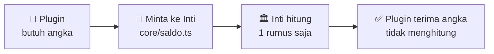
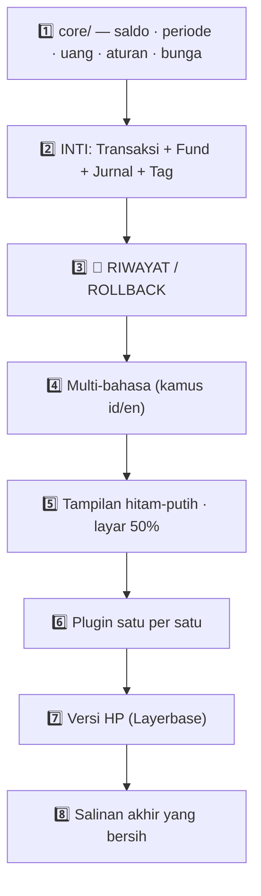
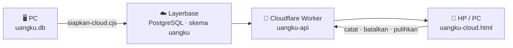

# 🧭 prompt.md — CETAK BIRU UangKu

> **Untuk siapa:** **AI mana pun** yang akan membangun/melanjutkan UangKu.
> **Tujuan:** hasilnya **sama persis** walau AI-nya berbeda.
> **Dibuat:** 25 September 2026 · **Status:** 📝 Cetak biru — kode belum ditulis
> **Wajib dibaca lebih dulu:** `agents.md` (aturan kerja) + `rencanakerja.md` (konsep & papan order)
>
> 🔴 **Kalau dokumen ini bertentangan dengan `agents.md`/`rencanakerja.md` → menang yang di sana, lalu laporkan.**

---

## 1. 🎯 TUJUAN

Bangun aplikasi keuangan pribadi bernama **UangKu** untuk Bapak (usia 60-an):

| Hal | Keterangan |
|---|---|
| **Bentuk** | Aplikasi web — dijalankan **PC** (Chrome, lebar layar **50%**) dan **HP** (Chrome) |
| **Dasar** | **Transaksi** — dipakai sehari-hari |
| **Asal** | Sistem lama `c:\data\keuangan` — **hanya konsep & metode** yang dibawa, **bukan kodenya** |
| **Data** | Database **dipakai yang lama** (datanya), cara kerjanya ditulis ulang |
| **Tampilan** | **BARU**, hitam-putih, dirancang untuk HP dan layar 50% |

### Kalimat Bapak yang menjadi dasar

> *"sistem keuangan ini dibangun ulang.. memasukan sistem keuangan lama berupa konsep atau metode saja..
> tapi untuk konsep UangKu ini adalah tampilan baru.. dan tentu ada konsep baru pula..
> itu tujuan UangKu di bangun bukan copy paste 100% dari keuangan.. **(karena tidak ada gunanya copy paste)**
> yg dimasukkan konsep."*

> *"Bangun ulang bukan berarti ganti struktur database. Pola data harus tetap sama, data tidak salah.
> Yang menjadi masalah kekacauan pada script. Jadi perbaikannya: **base adalah Transaksi**, yang lain plugin,
> **data tetap dipakai yang lama**."*

---

## 2. 🧱 PRINSIP WAJIB (tidak bisa ditawar)

| # | Prinsip | Artinya |
|---|---|---|
| **1** | **Transaksi = INTI** | Wajib jalan **tanpa** plugin apa pun. Rutin/Belanja/Wishlist/Investasi/Report/Pajak = **PLUGIN (opsional)** |
| **2** | **Satu logika = satu berkas** | Rumus saldo hanya di `core/saldo.ts`. Tanggal bulan hanya di `core/periode.ts`. Bunga/pajak hanya di `core/bunga.ts` |
| **3** | **Kode tetap ≠ nama** | Logika memakai kolom **`code`** — nama boleh diganti bahasa |
| **4** | 🔴 **Rollback** | Semua input · edit · hapus **harus bisa dikembalikan** + aksi berantai dibatalkan sekaligus. *"sangat penting dari seluruh arti sistem ini"* |
| **5** | **Dashboard = halaman PERTAMA** | Dari Dashboard baru masuk ke Transaksi |
| **6** | **Skema database TIDAK diubah** | Kolom tetap sama. Boleh **tambah** kolom `code` (+ tabel baru milik UangKu) — **tidak boleh** mengubah/menghapus yang ada |
| **7** | **Hitam-putih** | Warna **hanya** untuk peringatan penting |
| **8** | **Layar 50%** | Rancang ± 960 px. Info penting di atas |
| **9** | **Bahasa Indonesia bawaan** | Istilah **dan kalimat** bisa diganti English |
| **10** | **Backup + hapus script mati** | Setiap perbaikan wajib backup, dan script lama/salah **dihapus** — bukan dibiarkan |

---

## 3. 🗄️ STRUKTUR DATABASE (dari `schema.ts` — **tanpa diubah**)

> Skema di bawah **disalin apa adanya** dari `c:\data\keuangan`. UangKu **wajib kompatibel**.

```sql
-- ===== KOTAK UANG =====
CREATE TABLE source_funds (
  id INTEGER PRIMARY KEY AUTOINCREMENT,
  name TEXT NOT NULL,
  parent_id INTEGER,
  level INTEGER NOT NULL DEFAULT 1,
  is_blocked INTEGER NOT NULL DEFAULT 0,      -- 🔒 tidak muncul di dropdown Belanja
  sort_order INTEGER NOT NULL DEFAULT 0,      -- 🔢 nomor urut tampilan
  created_at TEXT NOT NULL DEFAULT (datetime('now','localtime')),
  deleted_at TEXT,
  minimum_saldo REAL DEFAULT NULL,            -- ⚠️ peringatan saldo di bawah batas
  is_titipan INTEGER NOT NULL DEFAULT 0       -- 👥 uang orang lain
);
-- 🆕 TAMBAHAN UangKu: code TEXT

-- ===== PINTU MASUK/KELUAR =====
CREATE TABLE journals (
  id INTEGER PRIMARY KEY AUTOINCREMENT,
  source_fund_id INTEGER NOT NULL REFERENCES source_funds(id),
  name TEXT NOT NULL,
  type TEXT NOT NULL,                         -- 'D' = Debit (masuk) · 'K' = Kredit (keluar)
  is_system INTEGER NOT NULL DEFAULT 0,
  sort_order INTEGER NOT NULL DEFAULT 0,
  created_at TEXT NOT NULL DEFAULT (datetime('now','localtime')),
  deleted_at TEXT
);

-- ===== PENENTU MAKNA =====
CREATE TABLE tags (
  id INTEGER PRIMARY KEY AUTOINCREMENT,
  name TEXT NOT NULL,
  icon TEXT,
  color TEXT,
  sort_order INTEGER NOT NULL DEFAULT 0,
  created_at TEXT NOT NULL DEFAULT (datetime('now','localtime')),
  deleted_at TEXT,
  journal_type TEXT,                          -- 'D' / 'K' / NULL (bebas)
  has_tax INTEGER NOT NULL DEFAULT 0,
  is_system INTEGER NOT NULL DEFAULT 0,       -- 🔧 dipakai perhitungan otomatis
  show_in_shopping INTEGER NOT NULL DEFAULT 0
);
-- 🆕 TAMBAHAN UangKu: code TEXT

-- ===== INTI =====
CREATE TABLE transactions (
  id INTEGER PRIMARY KEY AUTOINCREMENT,
  date TEXT NOT NULL,
  description TEXT NOT NULL,
  amount REAL NOT NULL,                       -- ⚠️ TOTAL harga — JANGAN dikali qty
  source_fund_id INTEGER NOT NULL REFERENCES source_funds(id),
  journal_id INTEGER NOT NULL REFERENCES journals(id),   -- ⚠️ arah D/K ada DI SINI
  transfer_pair_id INTEGER,                   -- 🔗 pasangan transfer
  sheet TEXT,
  notes TEXT,
  deleted_at TEXT,                            -- 🗑️ soft delete — bukan dibuang
  deleted_by TEXT,
  created_at TEXT NOT NULL DEFAULT (datetime('now','localtime')),
  created_by TEXT,
  updated_at TEXT,
  updated_by TEXT,
  qty INTEGER NOT NULL DEFAULT 1,
  tag TEXT,                                   -- 🏷️ makna transaksi
  has_tax INTEGER NOT NULL DEFAULT 0,
  is_historical INTEGER NOT NULL DEFAULT 0,   -- data lama (saldo awal)
  loan_id INTEGER,
  loan_lunas INTEGER NOT NULL DEFAULT 0,
  is_belanja INTEGER NOT NULL DEFAULT 0
);

-- ===== SALDO AWAL PER BULAN =====
CREATE TABLE monthly_snapshots (
  id INTEGER PRIMARY KEY AUTOINCREMENT,
  source_fund_id INTEGER NOT NULL REFERENCES source_funds(id),
  year INTEGER NOT NULL,
  month INTEGER NOT NULL,
  saldo_awal REAL NOT NULL DEFAULT 0,
  saldo_akhir REAL NOT NULL DEFAULT 0,
  is_locked INTEGER NOT NULL DEFAULT 0,
  locked_at TEXT,
  locked_by TEXT
);

-- ===== RUTIN (plugin) =====
CREATE TABLE recurring (
  id INTEGER PRIMARY KEY AUTOINCREMENT,
  name TEXT NOT NULL,
  amount REAL NOT NULL,
  source_fund_id INTEGER NOT NULL REFERENCES source_funds(id),
  journal_id INTEGER NOT NULL REFERENCES journals(id),
  frequency TEXT NOT NULL,
  interval INTEGER NOT NULL DEFAULT 1,        -- ⚠️ nama kolomnya `interval`
  target_day INTEGER,                         -- ⚠️ -1 = SENTINEL akhir bulan
  next_due_date TEXT NOT NULL,
  last_paid_date TEXT,
  is_active INTEGER NOT NULL DEFAULT 1,
  notes TEXT,
  deleted_at TEXT,
  created_at TEXT NOT NULL DEFAULT (datetime('now','localtime')),
  transfer_target_fund_id INTEGER,
  qty INTEGER NOT NULL DEFAULT 1,
  needs_tracking INTEGER NOT NULL DEFAULT 0,
  next_order_date TEXT,
  cycle_days INTEGER,
  remind_before_days INTEGER,
  prediction_mode TEXT NOT NULL DEFAULT 'fixed',
  wishlist_id INTEGER REFERENCES wishlist(id),
  tag TEXT,
  has_tax INTEGER NOT NULL DEFAULT 0,
  price_mode TEXT NOT NULL DEFAULT 'per_unit',
  transfer_target_tag TEXT,
  loan_id INTEGER,
  loan_lunas INTEGER NOT NULL DEFAULT 0,
  principal REAL,                             -- 💰 pokok (untuk bunga)
  rate REAL,                                  -- 💰 rate % p.a — WAJIB diisi
  monitor INTEGER NOT NULL DEFAULT 0
);

-- ===== PAJAK =====
CREATE TABLE tax_config (
  id INTEGER PRIMARY KEY AUTOINCREMENT,
  name TEXT NOT NULL,
  rate REAL NOT NULL,                         -- 20 = 20%
  effective_from TEXT NOT NULL,               -- '2025-01-01'
  created_at TEXT NOT NULL DEFAULT (datetime('now','localtime')),
  journal_names TEXT,                         -- 'Bunga' (tag yang dikenai)
  minimum_amount REAL NOT NULL DEFAULT 0      -- 🆕 batas: di bawah ini tidak dipotong
);

-- ===== BELANJA (plugin) =====
CREATE TABLE shopping_list (
  id INTEGER PRIMARY KEY AUTOINCREMENT,
  name TEXT NOT NULL, amount REAL NOT NULL DEFAULT 0,
  source_fund_id INTEGER NOT NULL REFERENCES source_funds(id),
  journal_id INTEGER NOT NULL REFERENCES journals(id),
  link TEXT, image_url TEXT,
  is_bought INTEGER NOT NULL DEFAULT 0, bought_at TEXT,
  bought_amount REAL, bought_qty INTEGER DEFAULT 1,
  transaction_id INTEGER REFERENCES transactions(id),
  month TEXT NOT NULL, qty INTEGER NOT NULL DEFAULT 1, notes TEXT,
  deleted_at TEXT,
  created_at TEXT NOT NULL DEFAULT (datetime('now','localtime')),
  is_favorite INTEGER NOT NULL DEFAULT 0, tag TEXT,
  stock_empty INTEGER NOT NULL DEFAULT 0
);

-- ===== WISHLIST (plugin) =====
CREATE TABLE wishlist (
  id INTEGER PRIMARY KEY AUTOINCREMENT,
  name TEXT NOT NULL, target_amount REAL NOT NULL,
  realized_amount REAL NOT NULL DEFAULT 0,
  priority TEXT NOT NULL DEFAULT 'medium',
  source_fund_id INTEGER, journal_id INTEGER,
  is_completed INTEGER NOT NULL DEFAULT 0, completed_at TEXT,
  notes TEXT, deleted_at TEXT,
  created_at TEXT NOT NULL DEFAULT (datetime('now','localtime')),
  tabungan_fund_id INTEGER, tag TEXT,
  goal_type TEXT NOT NULL DEFAULT 'belanja'
);

-- ===== INVESTASI (plugin) =====
CREATE TABLE investments (
  id INTEGER PRIMARY KEY AUTOINCREMENT,
  name TEXT NOT NULL, type TEXT NOT NULL, amount REAL NOT NULL DEFAULT 0,
  bank TEXT, invest_date TEXT, maturity_date TEXT,
  source_fund_id INTEGER, status TEXT NOT NULL DEFAULT 'active',
  notes TEXT, deleted_at TEXT,
  created_at TEXT NOT NULL DEFAULT (datetime('now','localtime')),
  recurring_id INTEGER
);

-- ===== PENDUKUNG =====
CREATE TABLE app_settings (id INTEGER PRIMARY KEY AUTOINCREMENT, key TEXT NOT NULL UNIQUE, value TEXT NOT NULL, description TEXT, updated_at TEXT NOT NULL DEFAULT (datetime('now','localtime')));
CREATE TABLE audit_log (id INTEGER PRIMARY KEY AUTOINCREMENT, user_id TEXT, username TEXT, action TEXT NOT NULL, table_name TEXT NOT NULL, record_id INTEGER, old_data TEXT, new_data TEXT, timestamp TEXT NOT NULL DEFAULT (datetime('now','localtime')));
CREATE TABLE users (id INTEGER PRIMARY KEY AUTOINCREMENT, username TEXT NOT NULL UNIQUE, password_hash TEXT NOT NULL, role TEXT NOT NULL DEFAULT 'viewer', is_active INTEGER NOT NULL DEFAULT 1, created_at TEXT NOT NULL DEFAULT (datetime('now','localtime')));
CREATE TABLE ai_knowledge (id INTEGER PRIMARY KEY AUTOINCREMENT, category TEXT NOT NULL, key TEXT NOT NULL, value TEXT NOT NULL, source TEXT, created_at TEXT NOT NULL DEFAULT (datetime('now','localtime')), updated_at TEXT NOT NULL DEFAULT (datetime('now','localtime')), UNIQUE(category, key));
CREATE TABLE ai_analyses (id INTEGER PRIMARY KEY AUTOINCREMENT, year INTEGER NOT NULL, month INTEGER NOT NULL, period TEXT NOT NULL, penerimaan_bulan_ini REAL NOT NULL DEFAULT 0, penerimaan_bulan_lalu REAL NOT NULL DEFAULT 0, penerimaan_perubahan_persen INTEGER NOT NULL DEFAULT 0, rutin_per_bulan REAL NOT NULL DEFAULT 0, transfer_per_bulan REAL NOT NULL DEFAULT 0, belanja_total REAL NOT NULL DEFAULT 0, saldo_total REAL NOT NULL DEFAULT 0, sisa_setelah_kewajiban REAL NOT NULL DEFAULT 0, gap_ke_target REAL NOT NULL DEFAULT 0, ai_response TEXT, penerimaan_detail TEXT, rutin_detail TEXT, belanja_detail TEXT, saldo_detail TEXT, is_stale INTEGER NOT NULL DEFAULT 0, saldo_when_created REAL NOT NULL DEFAULT 0, created_at TEXT NOT NULL DEFAULT (datetime('now','localtime')), UNIQUE(year, month));
```

### Tabel BARU milik UangKu (boleh ditambah — tidak mengubah yang lama)

| Tabel | Guna |
|---|---|
| `riwayat` | 🔴 catatan semua perubahan (sebelum & sesudah) — dasar rollback |
| `riwayat_grup` | 🔗 mengikat beberapa perubahan jadi **satu aksi berantai** (Rutin bayar, Transfer, dll) |

### 🔴 Yang DILARANG pada database

| ❌ Dilarang | Kenapa |
|---|---|
| `ALTER`/`DROP` kolom yang sudah ada | Data lama bisa rusak |
| Ganti nama 8 tag + 7 fund istimewa | Sampai kolom `code` dipakai penuh |
| `DELETE` keras pada transaksi | Melanggar rollback → pakai **tanda terhapus** (`deleted_at`) |
| Menyentuh `c:\data\keuangan\data\keuangan.db` | 🔴 **HANYA BACA** — produksi Bapak |

---

## 4. ⚙️ ATURAN INTI

### 4.1 Rumus saldo — **satu tempat** (`core/saldo.ts`)

$$\text{Saldo} = \text{Saldo Awal} + \text{Debit} - \text{Kredit}$$

```sql
-- ✅ SATU-SATUNYA rumus yang boleh ada di sistem
SELECT f.id, s.saldo_awal
     + COALESCE(SUM(CASE WHEN j.type='D' THEN t.amount ELSE 0 END),0)
     - COALESCE(SUM(CASE WHEN j.type='K' THEN t.amount ELSE 0 END),0) AS saldo
FROM source_funds f
LEFT JOIN monthly_snapshots s ON s.source_fund_id = f.id AND s.year = ? AND s.month = ?
LEFT JOIN transactions t ON t.source_fund_id = f.id
     AND t.deleted_at IS NULL AND COALESCE(t.is_historical,0) = 0
     AND t.date >= ? AND t.date <= ?          -- ⚠️ WAJIB awal DAN akhir bulan
LEFT JOIN journals j ON j.id = t.journal_id
WHERE f.deleted_at IS NULL
GROUP BY f.id;
```

### 4.2 Batas bulan — **satu tempat** (`core/periode.ts`)

| Aturan | Keterangan |
|---|---|
| **WAJIB awal DAN akhir** | `date >= '2026-09-01' AND date <= '2026-09-30'` |
| ❌ Dilarang | `date >= '2026-09-01'` tanpa batas akhir |
| Bulan terkunci | `is_locked = 1` → **read-only** |
| `target_day = -1` | 🔴 **SENTINEL** = akhir bulan — **jangan** diperlakukan angka biasa |
| Ubah frekuensi rutin | **WAJIB** hitung ulang `next_due_date` |

### 4.3 Bunga & pajak — **satu tempat** (`core/bunga.ts`)

$$\text{Bunga} = \text{Pokok} \times \frac{\text{Rate}}{100} \times \frac{\text{Jumlah hari}}{365} \qquad \text{Pajak} = \text{Bunga} \times \frac{\text{Rate pajak}}{100}$$

| Jenis simpanan | Rate | Catatan |
|---|---|---|
| 🏦 **Deposito** | **7,5% p.a** | berjangka |
| 🐷 **Tabungan biasa** | **5,0% p.a** | rate lebih rendah |
| 🧾 **Pajak** | **20%** | dipotong dari bunga |

| # | Aturan | Keterangan |
|---|---|---|
| 1 | **Hitung dalam SEN (integer)** | Jangan pakai pecahan mengambang |
| 2 | **Rate WAJIB diisi** | 🔴 **Dilarang** memakai angka cadangan diam-diam (ini bug 30 Agu: rate kosong → diam-diam 7,5% → tabungan 1,5× lebih besar) |
| 3 | **Simpan jejak hitungan** | pokok · rate · hari · hasil sistem · angka akhir · selisih · alasan koreksi |
| 4 | **Metode pembulatan bisa dipilih** per rutin | ① akhir (bawaan) · ② per hari · ③ basis 360 · ④ manual |
| **5** | **Batas minimum bunga** (`tax_config.minimum_amount`) | ⚪ **Tidak diaktifkan** — checkpoint sudah menangani bunga kecil |
| **6** | **Tanggal bayar default = JATUH TEMPO** | Bukan hari ini — kalau salah, jumlah hari meleset |
| **7** | **Hitung dari pembayaran terakhir → tanggal bayar** | Bukan tanggal mulai deposito |
| **8** | 🔴 **CHECKPOINT “Kena pajak [ ]”** | Saat input tag `BUNGA`, tanya **satu kotak**: dicentang = ada pajak · tidak = tanpa pajak |

#### 🔴 CHECKPOINT kena-pajak — **keputusan Bapak 25 Sep 2026**

> **Kalimat Bapak:** *"penggunaan 1 tag.. pada saat transaksi debit bunga bank Rp... dan ada pertanyaan
> apakah dikenakan pajak [ ] ada checkpoint berarti ada pajak dan sebaliknya"*
>
> *"masalah tidak kunjung selesai menggunakan 2 tag.. karena saya sudah dibuat pusing.. revisi terus
> masalah pajak.. jadi saya putuskan ditanyakan saja.. jalan pintas"*

| Hal | Aturan |
|---|---|
| **Tag** | **1 tag saja** — `Bunga` (`code` `BUNGA`). **Dilarang** menambah tag “bunga tidak kena pajak” |
| **Checkpoint** | Satu kotak **“Kena pajak”** di form input saat tag = `BUNGA`. **Bawaan: tidak dicentang** |
| **Dicentang** | Hitung pajak 20% → catat **2 transaksi** (Bunga masuk + Pajak keluar) + riwayat terikat |
| **Tidak dicentang** | Catat **1 transaksi** (Bunga masuk) — tanpa pajak |
| **Berlaku untuk** | **SEMUA** bunga — dari **rutin** maupun **manual** |
| **Simpan penanda** | `transactions.has_tax` = 1/0 — **WAJIB DIISI** |
| **Rutin** | Checkpoint **diingat** dari pembayaran sebelumnya |

**Kenapa checkpoint, bukan penanda di rutin:**

| Kejadian | Penanda di rutin | **Checkpoint** |
|---|---|---|
| Bunga dari rutin (150 tx) | ✅ jalan | ✅ jalan |
| **Bunga MANUAL (24 tx, Rp 6.359.819)** | ❌ **bocor** — tidak ada rutin | ✅ **tertangkap** |
| Bunga kecil Rp 24 | perlu batas minimum | ✅ cukup tidak dicentang |
| Menambah tag baru | tidak | tidak |
| Beban tiap input | nol | 1 kotak |

> 🔴 **Bukti yang membalik rekomendasi awal:** 24 transaksi bunga **diinput manual**
> (total **Rp 6.359.819**, terbesar Rp 509.589) — **tidak punya rutin**.
> Kalau penanda hanya di rutin, bunga sebesar itu **tidak akan dipajak** (pajak Rp 101.918 hilang).
>
> 🎯 **Kesimpulan:** semua bunga — rutin **dan** manual — melewati **satu pintu yang sama**:
> **form input transaksi**. Checkpoint di pintu itu **tidak bisa bocor**.

**Riwayat keputusan (jangan diulang):**

| Cara | Nasib |
|---|---|
| **2 tag** (`Bunga tidak kena pajak`) | ❌ dibuat 5 Jul 2026, dihapus 7 Jul 2026, **0 transaksi** — sudah gagal |
| **Penanda di rutin saja** | ❌ bocor lewat 24 input manual |
| **Batas minimum** | ⚪ tidak perlu — checkpoint menanganinya |
| **Checkpoint** | ✅ **dipilih Bapak** |

### 4.4 Transfer — 1 tindakan, 2 catatan

```
Bapak isi SEKALI: Superbank ➜ SeaBank Rp 500.000
   ↓  Inti menulis
Catatan 1: Superbank  KELUAR  (Kredit)
Catatan 2: SeaBank    MASUK   (Debit)
   ↓  diikat
transfer_pair_id
```

| Aturan | Keterangan |
|---|---|
| Fund tujuan ≠ fund sumber | Pelajaran bug 8 Agu |
| Tag = `TRANSFER` | **Tidak** masuk ringkasan pemasukan/pengeluaran |
| Batal | Kedua baris **kembali bersama** |

### 4.5 Validasi (`core/aturan.ts`)

| # | Validasi |
|---|---|
| 1 | Tidak boleh melampaui `minimum_saldo` tanpa peringatan |
| 2 | Tanggal tidak di luar siklus rutin (tolak kalau terlalu jauh) |
| 3 | Fund tujuan transfer ≠ fund sumber |
| 4 | Bulan terkunci → tidak bisa diubah |
| 5 | Tag sistem tidak boleh dihapus |
| 6 | Fund/tag yang masih dipakai transaksi tidak boleh dihapus |
| 7 | `amount` = TOTAL harga — jangan dikali `qty` |

---

## 5. 🔢 DAFTAR `CODE` (kode tetap — TIDAK ikut ganti bahasa)

### 5.1 15 tag + kode

| # | Nama sekarang | `code` | Ikon | `journal_type` | Kena pajak | Sistem | Belanja |
|---|---|---|---|---|---|---|---|
| 1 | Rumah | `RUMAH` | 🏠 | K | — | — | ✅ |
| 2 | Pribadi | `PRIBADI` | 👤 | K | — | — | ✅ |
| 3 | Pet | `PET` | 🐕 | K | — | — | ✅ |
| 4 | Mobil | `MOBIL` | 🚗 | K | — | — | ✅ |
| 5 | Bunga | `BUNGA` | 🌸 | **D** | ✅ | 🔧 | — |
| 6 | Pendapatan | `PENDAPATAN` | 💵 | **D** | — | 🔧 | — |
| 7 | Koreksi | `KOREKSI` | 🧹 | K | — | 🔧 | — |
| 8 | Pinjam | `PINJAM` | 💸 | bebas | — | 🔧 | — |
| 9 | Hutang | `HUTANG` | 💸 | K | — | 🔧 | — |
| 10 | Reimburse | `REIMBURSE` | 💵 | **D** | — | 🔧 | — |
| 11 | Transfer | `TRANSFER` | 🔄 | bebas | — | — | — |
| 12 | Pajak | `PAJAK` | 🧾 | K | ✅ | — | — |
| 13 | Bonus | `BONUS` | 🎁 | **D** | — | — | — |
| 14 | Hilang | `HILANG` | ✂️ | K | — | — | — |
| 15 | biaya | `BIAYA` | ✂️ | K | — | — | — |

> 🔧 = **tag sistem** — dipakai perhitungan otomatis, **TIDAK BOLEH DIHAPUS**.

### 5.2 🚫 5 tag yang DIKECUALIKAN dari ringkasan bulanan

```
TRANSFER · KOREKSI · PINJAM · HUTANG · REIMBURSE
```

> ⚠️ Dikecualikan **bukan** berarti tidak penting — justru **agar laporan tetap benar**.

#### ✅ Yang **TIDAK** dikecualikan (sering salah paham!)

| Tag | Ikut dihitung? | Sebagai |
|---|---|---|
| 🌸 **Bunga** | ✅ **IKUT** | **pemasukan** nyata (bunga bank memang uang masuk) |
| 🧾 **Pajak** | ✅ **IKUT** | **pengeluaran** nyata (pajak memang uang keluar) |
| 🎁 Bonus · ✂️ Hilang · ✂️ biaya | ✅ IKUT | pemasukan / pengeluaran nyata |

> 🔴 **Hanya 5 tag** yang dikecualikan. **Pajak dan Bunga TIDAK termasuk.**
> Sistem lama sudah memakai daftar yang sama (`server/routes/dashboard.ts:241`):
> `const excludeTags = ['Transfer','Koreksi','Pinjam','Hutang','Reimburse'];`
>
> **Angka September 2026 (bukti, jangan diubah):**
> masuk **14.191.861,37** · keluar **7.340.614,86** · selisih **6.851.246,51**
> (di dalam keluar itu sudah termasuk Pajak **331.232,86**; di dalam masuk termasuk Bunga **1.656.682,37**)
> ❌ Kalau Pajak dikecualikan → keluar jadi 7.009.382 → **SALAH**.

#### ⚠️ Transaksi TANPA tag — JANGAN hilang dari ringkasan

> **Bukti nyata:** Agustus 2026 ada **1 transaksi Rp 600.000 tanpa tag**.
> Kalau query hanya menulis `t.tag NOT IN (...)`, transaksi itu **hilang** →
> keluar Agustus jadi **8.120.294** padahal seharusnya **8.720.294,16**.
> Karena itu bentuk yang **BENAR** wajib:
>
> ```sql
> AND (t.tag IS NULL OR t.tag NOT IN ('Transfer','Koreksi','Pinjam','Hutang','Reimburse'))
> ```
>
> Ini persis jenis bug "script lama yang masih hidup" — satu salinan ketinggalan.
> **Satu logika = satu berkas** (`core/saldo.ts`).

### 5.3 18 fund + kode

| # | Nama | `code` | Tanda |
|---|---|---|---|
| 1 | Superbank | `SUPERBANK` | min. Rp 5.000.000 |
| 2 | SeaBank | `SEABANK` | min. Rp 50 |
| 3 | Celengan | `CELENGAN` | 🔒 diblokir |
| 4 | Dana Sopir | `DANA_SOPIR` | 🔒 diblokir · 👥 titipan |
| 5 | Dana swn | `DANA_SWN` | 👥 titipan |
| 6 | Tunai | `TUNAI` | — |
| 7 | Sopir pinjam uang | `SOPIR_PINJAM` | 🔒 diblokir |
| 8 | BCA tabungan | `BCA_TABUNGAN` | — |
| 9 | BCA Saham | `BCA_SAHAM` | — |
| 10 | Deposito | `DEPOSITO` | 🔒 diblokir |
| 11 | Tabungan A | `TABUNGAN_A` | slot wishlist |
| 12 | Tabungan B | `TABUNGAN_B` | slot wishlist |
| 13 | ShopeePay | `SHOPEEPAY` | — |
| 14 | OVO | `OVO` | — |
| 15 | GoPay | `GOPAY` | — |
| 16 | Tabungan C | `TABUNGAN_C` | slot wishlist |
| 17 | Tabungan D | `TABUNGAN_D` | slot wishlist |
| 18 | Tabungan E | `TABUNGAN_E` | slot wishlist |

> ⚠️ **Isi kolom `code` HANYA untuk 8 tag sistem + 7 fund istimewa lebih dulu.**
> Fund lain boleh menyusul — tapi kolomnya wajib ada sejak awal.

### 5.4 🔢 Cara mengatur urutan fund — **pakai ANGKA**

> **Permintaan Bapak (25 Sep 2026):**
> *"setelah menggunakan menaikkan dan menurunkan item memakan waktu.. jika beri nomor urut..
> sistem selalu menempatkan 1,2,3,4 user tinggal atur urutannya saja."*

#### 🎯 Untuk apa urutan ini?

> **Kalimat Bapak:** *"urutan source fund itu berguna pada saat menu pulldown source fund terurut..
> tujuannya adalah **diurut oleh user berdasarkan kebiasaan dia kerja atau yg sering dipakai dalam transaksi**"*

| Hal | Penjelasan |
|---|---|
| **Sasaran utama** | **Daftar pilihan (dropdown) fund** saat input transaksi |
| **Tujuan** | Fund yang **paling sering dipakai** ditaruh **di atas** → tidak perlu menggulir mencari tiap kali input |
| **Siapa yang mengatur** | **Bapak sendiri** — sesuai kebiasaan kerjanya |
| **Bukan** | Bukan urutan abjad, bukan urutan saldo, bukan urutan tanggal dibuat |
| **Berlaku juga untuk** | Daftar **tag** (agar konsisten) |

```
❌ CARA LAMA (melelahkan):
   [▲ naik] [▼ turun]  ← Bapak harus tekan berkali-kali untuk memindah 1 baris

✅ CARA BARU (angka):
   1  [Superbank    ]   ← Bapak cukup ubah angkanya
   2  [SeaBank      ]     sistem menyusun ulang sendiri
   3  [Celengan     ]     angka lebih kecil = tampil lebih dulu
```

| Aturan | Keterangan |
|---|---|
| Kolom `sort_order` = nomor urut | Bukan posisi sesaat |
| Ubah angka → sistem urut ulang | Tidak perlu tombol naik/turun |
| **Nomor selalu dirapikan 1, 2, 3, 4, …** | Setelah Bapak selesai mengubah angka, sistem **menomori ulang** supaya rapi & tidak ada nomor kembar |
| Angka sama boleh (saat mengetik) | Sistem urutkan pakai `id` sebagai penentu kedua, lalu dirapikan |
| Berlaku untuk fund **dan** tag | Supaya konsisten |
| **Urutan ikut ke dropdown** | Dropdown **wajib** membaca `sort_order` yang sama |

### 5.5 🏷️ `code` **TIDAK ditampilkan** berdampingan dengan nama

> **Pertanyaan Bapak:** *"mengapa source fund ada kata "echo" misal **Superbank [SUPERBANK]** ada
> pengulangan kata juga ada di tag.. mengapa tidak satu kata saja misal **Superbank**"*

| Hal | Aturan |
|---|---|
| **Masalahnya** | Nama + `code` tampil berdampingan → **tampak seperti pengulangan kata** |
| **Kenapa ada 2 kata** | **Nama** untuk Bapak (bisa diganti bahasa) · **`code`** untuk sistem (dipakai logika) |
| ✅ **Aturan tampilan** | Di **daftar**, tampilkan **HANYA NAMA**. `code` **disembunyikan** |
| ✅ **Di mana `code` masih terlihat** | ① formulir **Ubah** (supaya Bapak bisa memeriksa) · ② **tooltip** baris (arahkan kursor) · ③ halaman **Istilah** |
| ✅ **Tetap tersimpan** | `code` **selalu ada** di database — hanya **tidak dipamerkan** |

```
❌ SEBELUM:  Superbank [SUPERBANK]        ← tampak dobel
✅ SEKARANG: Superbank                    ← bersih
             (arahkan kursor → "kode: SUPERBANK")
```

> 🔑 **Kesimpulan:** `code` **bukan pengulangan** — dia **kunci logika** yang wajib ada.
> Yang salah cuma **cara menampilkannya**. Sekarang disembunyikan dari daftar.

---

## 6. 📖 DAFTAR ISTILAH (Indonesia ↔ English)

> **Bapak:** *"bahasa indonesia semua bisa diubah menjadi english.. di penggunaan istilah
> dan kalimat2nya."* — Jadi **istilah DAN kalimat** ikut berubah.

| Indonesia | English | Indonesia | English |
|---|---|---|---|
| **Debit** (masuk) | **Debit** (in) | **Kredit** (keluar) | **Credit** (out) |
| Transaksi | Transaction | Jurnal | Journal |
| Tanggal | Date | Keterangan | Description |
| Jumlah | Amount | Qty | Qty |
| Transfer | Transfer | Pasangan transfer | Transfer pair |
| Sumber Dana | Source Fund | Saldo | Balance |
| Saldo Awal | Opening Balance | Saldo Akhir | Closing Balance |
| Diblokir | Blocked | Titipan | Held |
| Saldo minimum | Minimum balance | Urutan | Sort order |
| Tag | Tag | Kode | Code |
| Tag sistem | System tag | Muncul di Belanja | Shown in Shopping |
| Dikecualikan | Excluded | Bunga | Interest |
| Pokok | Principal | Rate | Rate |
| Jumlah hari | Number of days | Pajak | Tax |
| Kena Pajak | Taxable | Neto | Net |
| Deposito | Time deposit | Tabungan | Savings |
| Batas minimum bunga | Minimum interest threshold | Selisih | Difference |
| Rutin | Recurring | Belanja | Shopping |
| Wishlist | Wishlist | Investasi | Investment |
| Laporan | Report | Pinjam | Borrow |
| Hutang | Debt | Reimburse | Reimburse |
| Proses Akhir Bulan | Month-End Close | Riwayat | History |
| Batalkan | Undo | Plugin | Plugin |
| Masuk | In | Keluar | Out |
| Tersedia | Available | Belum ada transaksi | No transactions yet |
| Perlu diproses | Needs processing | Jatuh tempo | Due |
| Bulan terkunci | Month locked | Saldo di bawah minimum | Balance below minimum |
| Tidak bisa dibatalkan | Cannot be undone | | |

### 🔴 Yang **TIDAK** diterjemahkan

| Hal | Contoh | Kenapa |
|---|---|---|
| **`code`** tag & fund | `TRANSFER` · `BUNGA` · `SUPERBANK` | Dipakai logika — kalau berubah, laporan rusak |
| Nama bank | Superbank · SeaBank · BCA | Nama diri |
| Angka & tanggal | 1.000.000 · 25 Sep 2026 | Format Indonesia tetap |
| Judul transaksi | "Galon Air" | Tulisan Bapak sendiri |

> 💡 **Nama tag & nama fund BOLEH diterjemahkan** (mis. `Rumah` → `Home`) — karena logika sudah pakai `code`.

---

## 7. 🧩 ATURAN PLUGIN

### ✅ Yang BOLEH

| Boleh | Contoh |
|---|---|
| Minta angka ke Inti | `saldoFund(fundId, tahun, bulan)` |
| Minta daftar transaksi terfilter | `daftarTransaksi({ fund, bulan })` |
| Membuat transaksi **lewat Inti** | `buatTransaksi(...)` — Inti yang menulis |
| Punya tabel sendiri | `shopping_list`, `wishlist`, `recurring` |
| Punya uji sendiri | `uji-rutin` = 1 perintah |

### ❌ Yang DILARANG (mutlak)

| Dilarang | Kenapa |
|---|---|
| Menghitung saldo sendiri | 42 salinan di sistem lama → akar semua bug saldo |
| Menulis `date >=` / `date <=` sendiri | Lupa batas akhir → selisih Rp 54.400 (24 Sep) |
| Menulis rumus bunga/pajak sendiri | 3 tempat berbeda → selisih sen berulang |
| Mencari tag lewat **nama** | Nama bisa berubah → **Report Bunga Rp 0** |
| Menyentuh tabel `transactions` langsung | Harus lewat Inti (agar riwayat & validasi jalan) |
| `DELETE` keras | Melanggar rollback — pakai **tanda terhapus** |

### Urutan yang benar



---

## 8. 📋 PERILAKU TIAP MODUL

### 🏛️ INTI

| Modul | Isi |
|---|---|
| **🏠 Dashboard** | Halaman **PERTAMA**. **Daftar sumber fund + saldo akhir** (semua fund, tanpa di-hide) · peringatan saldo minimum · total saldo (tersedia/diblokir/titipan) · ringkasan bulan · bunga & pajak · transaksi terbaru.<br/>⬅️ **Tidak ada tombol pintas** — pindah halaman lewat **tab bawah** (`Dashboard · Transaksi · Pengaturan`) |
| **🧾 Transaksi** | ★ **DASAR APLIKASI**. Chip fund · kartu saldo · daftar per tanggal · tombol **＋** · edit · hapus (soft) · riwayat |
| Fund | 18 kotak uang · urut **angka** · `code` · diblokir 🔒 · titipan 👥 · min. saldo |
| Jurnal | Debit (D) / Kredit (K) per fund — **arah** transaksi |
| Tag | 15 tag · penentu **makna** · `code` · tag sistem 🔧 |
| Kunci Bulan | Proses Akhir Bulan → pindah saldo · `is_locked` |
| Audit | Semua perubahan tercatat |
| Backup | Cadangan database |
| Pengaturan | Menu (sering dipakai · jarang dipakai · setting) |
| **Riwayat** | 🔴 **ROLLBACK** — lihat Bagian 9 |
| Login | Pengguna & peran |

### 🧩 PLUGIN (opsional — pemudah)

| Plugin | Perilaku |
|---|---|
| **🔁 Rutin** | Tagihan/penerimaan berulang. **Bayar** → buat transaksi + jadwal berikutnya (+ transfer pasangan + pajak). **Tag Hutang** = **pengingat saja** (tidak buat transaksi, jumlah 0, tanpa transfer). Tolak tanggal jauh melampaui siklus |
| **🛒 Belanja** | **Rencana**, bukan pengeluaran. Proses → jadi transaksi. ⚠️ `amount` = TOTAL harga (jangan × qty) |
| **⭐ Wishlist** | Menabung untuk keinginan · slot Tabungan A–E |
| **📈 Investasi** | Deposito · saham · emas |
| **📊 Report** | Analisa per tag & fund. 🔴 **Wajib pakai `code`**, bukan nama |
| **📱 HP / Sync** | Baca bulan berjalan dari HP (Layerbase) |

> 🔑 **Inti dari istilah "plugin":** Plugin itu **pemudah**, bukan penopang.
> Lepas **semua** plugin → UangKu **tetap bisa** mencatat semua transaksi. Hanya **lebih repot**.

---

## 9. 🔴 ROLLBACK / RIWAYAT — PALING PENTING

> **Bapak:** *"semua perhitungan dalam sistem akunting ini selalu ada input, edit dan delete..
> artinya semua kegiatan itu **harus bisa rollback** jika di hapus atau edit.. **nilai harus bisa
> dikembalikan sebelum di edit atau delete** — hal ini **sangat penting dari seluruh arti sistem ini**.."*

| Kejadian | Yang harus bisa dilakukan |
|---|---|
| Bapak **edit** | Kembalikan ke nilai **sebelum diedit** |
| Bapak **hapus** | Kembalikan transaksi yang dihapus |
| Sistem **auto-ubah** | Dibatalkan **seluruhnya** |
| Saldo berubah | Saldo **ikut kembali** otomatis |

### 🔗 Aksi berantai — harus kembali BERSAMA

| Aksi | Yang ikut berubah |
|---|---|
| Rutin **Bayar** | transaksi + jadwal berikutnya + **transfer pasangan** |
| Rutin **Bayar** tag Bunga | transaksi bunga + **transaksi pajak** + jadwal |
| Belanja **Proses** | beberapa transaksi + status belanja |
| **Transfer** | 2 transaksi (keluar + masuk) |
| **Koreksi tag** | bisa ratusan transaksi |

> 🔑 Tanpa ini, membatalkan 1 aksi bisa meninggalkan **transaksi pasangan menggantung** → saldo kacau.

### Aturan riwayat

| # | Aturan |
|---|---|
| 1 | Riwayat **tidak bisa dihapus** oleh siapa pun (termasuk AI) |
| 2 | Penghapusan = **tanda terhapus**, bukan dibuang |
| 3 | Setiap baris punya tombol **↩️ Batalkan** yang jelas |
| 4 | Konfirmasi **menyebutkan dampak**: "saldo SeaBank akan kembali dari 271.337 → 325.737" |
| 5 | Kalau pembatalan **tidak bisa** → jelaskan alasannya, jangan diam |

### Uji wajib (bukti, bukan janji)

```
1. Catat saldo 18 fund
2. Lakukan: input → edit → hapus → Rutin bayar
3. Batalkan SEMUA satu per satu
4. Bandingkan saldo 18 fund dengan langkah 1
   → HARUS IDENTIK 100%
```

---

## 10. 🚫 LARANGAN

| # | Larangan |
|---|---|
| 1 | ❌ Menulis rumus saldo/bulan/bunga **di luar `core/`** |
| 2 | ❌ Mencari tag/fund lewat **nama** (wajib pakai `code`) |
| 3 | ❌ `DELETE` keras pada transaksi (wajib soft delete) |
| 4 | ❌ Mengubah/menghapus kolom database yang sudah ada |
| 5 | ❌ Menyentuh `keuangan.db` selain **membaca** |
| 6 | ❌ Memakai angka cadangan diam-diam (mis. rate 7,5% kalau kosong) |
| 7 | ❌ Tag `TRANSFER` untuk uang penggantian → pakai `REIMBURSE` |
| 8 | ❌ Menghitung tag pengecualian di ringkasan bulanan |
| 9 | ❌ `target_day = -1` diperlakukan sebagai angka biasa |
| 10 | ❌ Mengubah tampilan yang sudah disetujui Bapak |
| 11 | ❌ Membiarkan script lama/salah tetap hidup setelah perbaikan |
| 12 | ❌ Warna-warni di UI (hanya untuk peringatan) |

---

## 11. 📖 PELAJARAN DARI BUG — jangan terulang

| # | Pelajaran | Kejadian nyata | Tanggal |
|---|---|---|---|
| 1 | Query saldo **wajib** batas **awal DAN akhir** bulan | Saldo SeaBank beda **Rp 54.400** | 24 Sep |
| 2 | Ubah frekuensi rutin → **hitung ulang** jadwal | "kopi kapal api" jadwalnya lompat ke **2027** | 24 Sep |
| 3 | Bayar rutin → **tolak tanggal** jauh melampaui siklus | Transaksi tercatat **8 Des** | 24 Sep |
| 4 | Kode **jangan** cari tag lewat **nama** | **Report Bunga Rp 0** padahal nyata Rp 6.466.857 | 24 Sep |
| 5 | `amount` = **TOTAL harga** — jangan dikali Qty | Item belanja berlipat | 25 Jun |
| 6 | GET form edit **wajib** pilih **semua** kolom | **Tag hilang** saat edit | 9 Jul, 6 Agu |
| 7 | Fund tujuan transfer **≠** fund sumber | Transfer ke diri sendiri | 8 Agu |
| 8 | `target_day = -1` = sentinel **akhir bulan** | Aplikasi macet | 30 Agu |
| 9 | Rutin bunga **wajib** ada `rate` + `pokok` | Diam-diam pakai 7,5% → tabungan **1,5× lebih besar** | 30 Agu |
| 10 | Tag **Transfer** untuk uang penggantian → uang **terlihat hilang** | RS Mandaya Rp 570.000 | 11 Agu |
| 11 | Belanja item pernah **ter-unbuy** → data hilang | Perlu rollback | 6 Agu |
| 12 | Nama tag diubah → **32 titik kode** harus ikut | Butuh kolom `code` | 24 Sep |
| 13 | Bunga **sama** tapi pajak **beda 1 sen** | tx #2894 vs #2981 | 24 Sep |

### Pola akar masalahnya (satu pola, tiga wujud)

| Wujud | Angka | Akibat |
|---|---|---|
| Rumus saldo ditulis berulang | **42 titik** | Dashboard lama salah |
| Nama tag dibaca di kode | **32 titik** | Report Bunga Rp 0 |
| Rumus pajak ditulis sendiri | **3 tempat** | Selisih sen berulang |

> 🎯 **Akarnya sama:** aturan ditulis **berulang**, lalu **satu salinan ketinggalan**.
> **Obatnya sama:** pusatkan aturan di `core/` — 1 berkas, 1 kebenaran.

---

## 12. 📐 RANCANGAN TAMPILAN

### 🖥️ Layar 50% (kebutuhan Bapak)

| Kondisi | Angka |
|---|---|
| Layar Bapak | Chrome dibuka **50%** |
| Lebar tersedia | ± **960 px** |
| Aplikasi lain berdampingan | ✅ Harus muat bersamaan |

| # | Cara |
|---|---|
| 1 | Rapatkan jarak (16px → 8px) |
| 2 | Tabel bisa digeser **di dalam kotaknya** |
| 3 | Info penting di **atas** |
| 4 | Bagian bisa **dilipat** |
| 5 | Font sedikit lebih kecil tapi terbaca |
| 6 | Hindari modal besar → panel samping / inline |
| 7 | Tinggi maksimum per bagian, sisanya scroll internal |

### ⬛⬜ Hitam-putih

| Elemen | Warna |
|---|---|
| Latar | Putih (terang) / Hitam pekat (gelap) |
| Teks utama | Hitam / Putih |
| Teks kedua | Abu-abu |
| Debit (masuk) | **Tebal** + tanda `+` |
| Kredit (keluar) | **Tebal** + tanda `−` |
| Tombol utama | Hitam (terang) / Putih (gelap) |
| Tombol kedua | Garis tepi (outline) |

### 🎨 Warna **HANYA** untuk 3 hal

| # | Kapan | Contoh |
|---|---|---|
| 1 | ⚠️ Peringatan penting | Kuning/Merah — "Saldo di bawah minimum!" |
| 2 | 🔻 Saldo di bawah minimum | Merah |
| 3 | 🔴 Peringatan bahaya | Merah — "Sisa setelah rutin negatif" |

### 📱 Tampilan HP (BEKU)

🔒 **Rancangan sudah disetujui Bapak 25 Sep 2026** → `design/ui-hp.html` = **BEKU**.
Boleh dipakai sebagai acuan — **jangan diubah/diganti** saat membangun aplikasi.

**13 layar:** Dashboard · Transaksi · Tambah · Detail & Riwayat · Pengaturan ·
Setting Dasar · Source Fund · Tags · Saldo Awal · Pajak · Bunga Bank · Bahasa · Istilah

> ⚠️ **Catatan 25 Sep 2026:** mockup sudah **tertinggal** dari revisi aplikasi pada
> **2 layar** (Dashboard & Transaksi). Yang **sudah berlaku di aplikasi** dan **belum**
> ada di mockup: ① daftar fund paling atas Dashboard · ② 4 tombol urut di Transaksi ·
> ③ tanpa tombol pintas (cukup tab bawah). **Ikuti aplikasi** (`uangku.html`) —
> mockup sedang menunggu keputusan Bapak untuk disamakan.

### 🔑 ATURAN TATA LETAK YANG SUDAH TERBUKTI (25 Sep 2026)

| # | Aturan | Angka/Bukti |
|---|---|---|
| **1** | ⬅️ **Pindah halaman = TAB BAWAH saja** — `Dashboard · Transaksi · Pengaturan`. Tombol pintas di dalam halaman **dihapus** supaya tidak dobel | Bapak: *"pakai menu paling bawah"* |
| **2** | 📊 **Dashboard = halaman pertama**, isinya berurutan: **① daftar Sumber fund + saldo akhir** (semua fund, **tanpa di-hide**) → ② peringatan saldo minimum → ③ kartu Total semua fund (Tersedia/Diblokir/Titipan) → ④ Ringkasan bulan → ⑤ Bunga & pajak → ⑥ Transaksi terbaru | urutan diminta Bapak 25 Sep |
| **3** | 🔢 **Kartu saldo fund = 4 KOLOM SEJAJAR**: `Saldo awal · Masuk · Keluar · Saldo akhir`. Bagian atas (saldo besar) **tidak dipakai** | Bapak: *"saldo akhir di kolom atas dihapus saja ganti ke bawah"* · 🔒 **DISETUJUI → BEKU** |
| **4** | 🏷️ **Layar Transaksi punya 4 CARA URUT**: **📅 Tanggal** (kelompok per hari) · **🏷️ Tag** (kelompok per tag + total masuk/keluar, besar di atas) · **＋ Masuk** / **− Keluar** (satu daftar lurus, **jumlah terbesar di atas**) | Bapak: *"di sort by tanggal.. dan bisa sort by tag atau sort by debit / kredit"* |
| **5** | 🔲 **Daftar fund & tag = KARTU GRID** (bukan baris panjang) — tujuan: **semua fund terlihat sekaligus** walau bertambah. Jumlah kolom: sasaran **78 px**/kartu, **batas paling sempit 96 px**, maks **5** kolom | 390 px → 3 kolom · 960 px → 5 kolom |
| **6** | 🔴 **ANGKA JANGAN DIPOTONG** — angka terpotong bisa salah baca (`22.057.864` terbaca `22.057`). Angka hanya boleh patah **di titik ribuan** (`<wbr>`). Nama fund **boleh** dipotong `…` (2 baris) — nama lengkap lewat tooltip/Detail/penyaring | Bapak: *"nama fund dipotong saja.. biar muat"* |
| **7** | 🔗 **Satu tampilan = satu fungsi, dipakai bersama.** Kartu fund di **Dashboard** & **Daftar Fund** **wajib** memakai pembuat yang **sama** | **Bug nyata 25 Sep:** Dashboard 3 kolom vs Daftar Fund 4 kolom padahal lebar layar sama |
| **8** | 🔴 **Jumlah kolom WAJIB SAMA** di Dashboard · Daftar Fund · chip Transaksi. Caranya: setiap halaman **mengirim wadahnya sendiri** ke `hitungKolom(pilih, wadah)` | Terbukti 390 px **3/3** · 560 px **5/5** · 960 px **5/5** |
| **9** | 🧾 **Chip source fund di Transaksi = grid HEMAT RUANG** — tertutup hanya **1 baris (32 px)**; klik → grid terbuka; pilih fund → **menutup lagi** | Hemat **263 px** vs grid selalu terbuka |
| **10** | ⚠️ **`-webkit-line-clamp` TIDAK bekerja di `<button>`** — jangan dipakai untuk memotong nama chip | Jebakan CSS nyata 25 Sep |

---

## 13. 🔄 SALINAN DATA (keuangan → UangKu)

```
   keuangan.db  ──────────────►  uangku.db
   (PRODUKSI)      HANYA BACA      (SALINAN)
                    satu arah
   ✅ Boleh: BACA dari keuangan
   ❌ DILARANG: TULIS / UBAH / HAPUS di keuangan
```

### 🗓️ Tiga tahap — jangan dicampur

| Tahap | Kapan | UangKu | Keuangan |
|---|---|---|---|
| **① Salinan kerja** | Selama pembangunan | Data **boleh kotor** — untuk menguji dengan angka nyata | Bapak **tetap update** di sini |
| **② Salinan akhir** | Setelah UangKu **benar & disetujui** | ⚠️ **Data coba-coba dihapus dulu** → isi 5 tabel kunci | 1× copy penuh |
| **③ Sesudahnya** | Selamanya | ✅ **Satu-satunya sumber** | ⏸️ Arsip |

### 📋 5 tabel kunci yang disalin

| # | Tabel | Isi |
|---|---|---|
| 1 | `source_funds` | 18 kotak uang (+ isi `code`) |
| 2 | `tags` | 15 tag (+ isi `code`) |
| 3 | `transactions` | 1.596 transaksi aktif (+ yang soft-delete + `is_historical`) |
| 4 | `monthly_snapshots` | Saldo awal per fund per bulan |
| 5 | `recurring` | 44 rutin |

### 🔴 Cara menyalin (wajib `.backup`, jangan copy file)

```
❌ SALAH:  Copy-Item keuangan.db → uangku.db
          → WAL 4 MB tidak ikut → data terbaru HILANG

✅ BENAR:  sqlite3 keuangan.db ".backup 'salinan-keuangan.db'"
          atau better-sqlite3: db.backup()
          → semua data di WAL ikut terbawa
```

### Urutan salinan akhir (7 langkah)

| # | Langkah |
|---|---|
| 1 | **BACKUP** `keuangan.db` |
| 2 | **Hentikan** sistem keuangan lama (port 5174 + 3003) |
| 3 | Salinan penuh lewat **`.backup`** |
| 4 | 🧹 **Hapus data coba-coba** di `uangku.db` |
| 5 | Baca 5 tabel kunci → tulis ke `uangku.db` (+ isi `code`) |
| 6 | **Buktikan identik** (`tools/salinan-cek.ts`) |
| 7 | Kalau ada **1 baris beda** → **berhenti**, periksa dulu |

---

## 14. 🧪 CARA UJI

### Uji bandingkan (bukti, bukan janji)

```
=== SIDIK JARI DATA ===
                    salinan-keuangan   uangku.db      status
Jumlah transaksi          1.596           1.596        ✅
Jumlah rutin                 44              44        ✅
Saldo Superbank       22.057.865      22.057.865        ✅
Saldo SeaBank            271.337         271.337        ✅
... (18 fund)
HASIL: IDENTIK 100%
```

### Uji rollback

```
1. Catat saldo 18 fund
2. input → edit → hapus → Rutin bayar
3. Batalkan SEMUA
4. Saldo harus IDENTIK 100% dengan langkah 1
```

### Uji saldo (18 fund, bukan 1)

| # | Uji |
|---|---|
| 1 | Saldo bulan lalu + Debit − Kredit = saldo bulan ini |
| 2 | Transfer tidak mengubah total kekayaan |
| 3 | 5 tag pengecualian tidak masuk ringkasan |
| 4 | Bunga & pajak cocok mutasi bank (setelah koreksi) |
| 5 | Bulan terkunci → benar-benar read-only |

### ⚡ Aturan uji (hemat waktu)

| Tindakan | Aturan |
|---|---|
| Menulis dokumen | ❌ **tidak perlu uji** |
| Uji otomatis | **hanya blok yang berhubungan** dengan revisi |
| Uji penuh | ❌ butuh **izin Bapak** dulu + sebut perkiraan waktu |
| Uji gagal > 2× | **HENTIKAN** — ganti cara, jangan ulangi cara yang sama |

### 🔍 WAJIB DEBUG DULU — dua jenis, jangan dicampur

> **Permintaan Bapak (25 Sep 2026):** *"setelah selesai revisi atau buat baru **harus km debugging
> terlebih dahulu sebelum saya tes**.. dan catatan apa yg harus di debugging **fokus pada yg di revisi
> atau sistem baru**.. jangan ke seluruhnya.. **debugging keseluruhan perlu tapi sesekali** jangan
> setiap kali revisi kecil saya harus tunggu lama.."*

| Jenis | Kapan | Cakupan | Waktu | Izin Bapak? |
|---|---|---|---|---|
| **① DEBUG FOKUS** | **SETIAP** revisi / fitur baru | **HANYA** yang direvisi + yang bersinggungan langsung | detik–1 menit | ❌ tidak perlu — **wajib** |
| **② DEBUG MENYELURUH** | **SESEKALI** (sebelum rilis / setelah perubahan besar) | seluruh sistem | bisa lama | ✅ **butuh izin** + sebut waktu |

**7 langkah debug fokus:**

| # | Langkah |
|---|---|
| 1 | Tulis **daftar fokus** (apa yang direvisi) |
| 2 | Tulis **yang bersinggungan langsung** (fungsi/berkas yang ikut terpanggil) |
| 3 | ❌ **JANGAN** sentuh bagian yang tidak berhubungan |
| 4 | Jalankan **pemeriksa galat** pada berkas yang diubah |
| 5 | Jalankan **uji nyata** pada blok itu saja |
| 6 | Periksa 4 hal paling mudah rusak: meluber · teks salah · angka salah · tombol mati |
| 7 | Lapor: **apa diuji · hasil · yang belum diuji** |

**Catatan wajib setelah debug:**

```
🔍 FOKUS DEBUG — <tanggal> — <apa yang direvisi>
   Fokus uji   : <blok yang diuji>
   Cara uji    : <perintah / aksi>
   Hasil       : ✅ lolos / ⚠️ ada masalah: ...
   Belum diuji : <bagian lain yang TIDAK diuji>
   Siap dites  : ya / belum (alasan)
```

### 🗣️ Jangan biarkan chat seperti freeze

> **Bapak:** *"setiap kali ada revisi atau buat sistem baru.. jangan biarkan layar chat seolah2 freeze ..
> saya perlu km tulis terus.. supaya saya tau masih hidup .. bisa jadi komputer saya error tapi karena
> freeze saya tidak tau"*

| # | Aturan |
|---|---|
| 1 | **Tulis kalimat pendek SEBELUM tiap langkah** (mis. *"Mencari sisa kata Indonesia…"*) |
| 2 | **Sebut kemajuan bertahap**: sudah berapa dari berapa |
| 3 | Kalau satu langkah **> 30 detik** → tulis dulu: *"Ini agak lama, saya sedang …"* |
| 4 | Temuan tak terduga / gagal → tulis **segera** |
| 5 | ❌ Jangan diam lama lalu melapor sekali di akhir |

> 🎯 **Alasan:** Bapak harus duduk menunggu. Kalau layar diam, dia tidak bisa membedakan
> **"AI masih bekerja"** dengan **"komputer saya error"**.

---

## 15. 🗺️ URUTAN PEMBANGUNAN (disarankan)



| # | Tahap | Kenapa urutannya begitu |
|---|---|---|
| 1 | `core/` | Semua bergantung ke sini — kalau aturan tersebar, bug kembali |
| 2 | **Transaksi** | **Inti** — wajib jalan tanpa plugin |
| 3 | 🔴 **Riwayat** | *"sangat penting dari seluruh arti sistem ini"* — jangan ditunda |
| 4 | Multi-bahasa | Dikerjakan **setelah** kolom `code` siap |
| 5 | Tampilan | Acuan **sudah ada** (`design/ui-hp.html`, BEKU) — tapi **2 layar sudah tertinggal** → **ikuti `uangku.html`** + aturan tata letak yang sudah terbukti (Bagian 12) |
| 6 | Plugin | Opsional — boleh berhenti kapan saja |
| 7 | HP | Setelah inti PC stabil |
| 8 | Salinan akhir | **Sekali saja**, setelah UangKu benar & disetujui |

### ✅ Sudah selesai (jangan diulang)

| # | Tahap | Bukti |
|---|---|---|
| **T1** | 🧱 **FONDASI** — `core/` 5 berkas (uang · periode · saldo · bunga · aturan) + `db/index.ts` + `uji/` 5 berkas + salinan kerja `data/uangku.db` | **99 uji LOLOS** (`npm run uji`) · `npm run cek` bersih · **18/18 saldo fund cocok** |
| **HP** | 📱 **`uangku.html`** — versi HP (Android), **mandiri**, **baca saja** | 58 pasangan transfer utuh · angka cocok persis · ID↔EN bersih |
| **☁️ CLOUD** | 🎉 **`uangku-cloud.html` + Worker + Layerbase** — **13 Okt 2026**. Seluruh kode tampilan `uangku.html` dipakai **apa adanya**; hanya **sumber data** & **tempat simpan** yang berganti. Ditambah **gerbang PIN**, **Riwayat**, **Catat multi-jurnal**, **Buka Bulan Baru** | **IDENTIK 100%** dengan `keuangan.db` (15 tabel, 18 fund) · bisa **dibaca & dicatat** dari PC/HP · 99 uji lolos · tampilan identik di 360–960 px |
| **⏳ Lanjut** | **T2 — Transaksi SEDERHANA di aplikasi PC lokal** (opsional — halaman cloud sudah bisa mencatat) | belum dimulai |

### ☁️ Cara kerja versi cloud (13 Okt 2026) — untuk AI berikutnya



| # | Aturan yang WAJIB dipatuhi |
|---|---|
| 1 | **JANGAN mengubah kode tampilan.** `uangku-cloud.html` disusun oleh `tools/bangun-cloud.cjs` dari `uangku.html` — ubah di sana, bukan di hasilnya |
| 2 | **Kunci Layerbase tidak pernah sampai ke browser** — browser hanya bicara ke Worker |
| 3 | **Tidak ada SQL dari luar** — Worker hanya menerima nama perintah + nilai |
| 4 | **Setiap tulis wajib masuk `audit_log`** (aturan C6 rollback) |
| 5 | **Nilai wajib di-escape** — Layerbase **tidak mendukung** `$1` parameter binding |
| 6 | **Angka dibulatkan 2 desimal** sebelum dikirim (SQLite & PostgreSQL menjumlah dengan urutan berbeda) |
| 7 | **Daftar bulan dari `monthly_snapshots`** — bukan dari tanggal transaksi (ada 2 tx bertanggal salah) |
| 8 | **Bulan baru harus dibuka dulu** (`bukaBulan`) sebelum bisa dicatat |
| 9 | **`bulat()` pakai `Math.trunc`** — PostgreSQL mengembalikan BIGINT sebagai teks |
| 10 | **Jangan taruh angka saldo / nama fund asli** di berkas yang masuk repo publik |

---

## 16. 📏 ANGKA ASLI (untuk membandingkan hasil)

> Dipakai untuk **membuktikan** UangKu benar.
>
> 🔴 **Diperbarui 13 Okt 2026.** Angka di bawah = **keadaan terbaru** dari `keuangan.db`.
> Angka September 2026 yang lama (25 Sep) **sudah tidak berlaku** — keuangan bertambah
> (September 234 → 307 transaksi), jadi angka pembanding ikut berubah.
> **Angka ini WAJIB disamakan lagi setiap kali keuangan berubah.**

| Hal | Angka (13 Okt 2026) |
|---|---|
| Jumlah fund aktif | **18** |
| Jumlah tag aktif | **15** |
| Transaksi | **1.889** (aktif 1.379 · terhapus lunak 87) |
| Rutin | **63** |
| Snapshot bulanan | **225** (13 bulan: Okt 2025 – Okt 2026) |
| Riwayat (audit_log) | **1.817** |
| **Total saldo (Okt 2026)** | **293.720.428,64** |
| Saldo awal Okt 2026 | 290.187.692,58 |
| Masuk September 2026 | 14.328.990,13 |
| Keluar September 2026 | 8.433.813,62 |
| Selisih September 2026 | +5.895.176,51 |
| Bunga September 2026 | 1.793.281,13 |
| Pajak September 2026 | 358.535,62 |

> ✅ **Cara membuktikan ulang:** `node tools\cek-sama-cloud.cjs` → harus **IDENTIK 100%**
> (15 tabel, 18 fund). Alat ini membandingkan **setiap baris & setiap kolom** antara
> `keuangan.db` ↔ `uangku.db` ↔ server.

> 🔴 **KOREKSI 25 Sep 2026 (jangan pakai angka lama).** Angka keluar **7.009.382** & selisih **+7.182.479** yang dulu tertulis di sini **SALAH** — angka itu menganggap **Pajak dikecualikan**.
> Kenyataan: **Pajak & Bunga TIDAK dikecualikan** — hanya **5 tag** (Transfer · Koreksi · Pinjam · Hutang · Reimburse), persis sistem lama `server/routes/dashboard.ts:241`.
> Jadi: keluar **7.340.614,86** (termasuk Pajak **331.232,86**) · masuk **14.191.861,37** (termasuk Bunga **1.656.682,37**) · selisih **+6.851.246,51**.
> Sudah dibuktikan uji T1 (`npm run uji`, 99 uji lolos) dan angka di `uangku.html` + `design/ui-hp.html` **sudah benar**.

### Saldo 18 fund (Oktober 2026 — keadaan 13 Okt 2026)

| Fund | Saldo awal | Saldo akhir |
|---|---|---|
| Superbank | 23.717.634,53 | 26.815.530,59 |
| SeaBank | 269.626 | 231.913 |
| Celengan | 3.170.087,19 | 3.820.087,19 |
| Dana Sopir | 2.378,61 | 2.378,61 |
| Dana swn | 610.894,16 | 610.894,16 |
| Tunai | 0 | 0 |
| Sopir pinjam uang | 325.000 | 325.000 |
| BCA tabungan | 108.027 | 30.165,40 |
| BCA Saham | 253.493 | 13.493,22 |
| Deposito | 260.000.000 | 260.000.000 |
| Tabungan A | 657.928,43 | 787.928,43 |
| Tabungan B | 16.510,37 | 16.510,37 |
| ShopeePay | 23.976 | 34.391 |
| OVO | 680 | 680 |
| GoPay | 24.827 | 24.827 |
| Tabungan C | 1.006.629,67 | 1.006.629,67 |
| Tabungan D | 0 | 0 |
| Tabungan E | 0 | 0 |
| **TOTAL** | **290.187.692,58** | **293.720.428,64** |

### 🔎 Temuan penting di `recurring` — bukti rate tabungan ≠ deposito

| Rutin | Rate | Pokok | Catatan |
|---|---|---|---|
| Bunga tabungan (Superbank) | **5** | 13.344.449 | ✅ benar |
| Bunga Bank (Dana Sopir) | **5** | 309.466 | ✅ benar |
| Bunga Bank (Celengan) | **5** | **0** | ⚠️ pokok kosong → bunga Rp 0 |
| Bunga Bank 5% p.a. (Dana swn) | **5** | 709.845 | ✅ benar |
| Bunga Tabungan A | **5** | 287.896 | ✅ benar |
| Bunga Tabungan B | **5** | 5.018.007 | ✅ benar |
| Bunga Tabungan C | **5** | 1.002.630 | ✅ benar |
| Bunga Deposito 10jt 17 | **7,5** | 10.000.000 | ✅ deposito |
| **6 rutin lain** | **KOSONG** | — | 🔴 **inilah bug** — diam-diam pakai 7,5% |

### `tax_config` — satu-satunya aturan pajak

```json
{ "id": 2, "name": "Pajak Bunga Bank", "rate": 20, "effective_from": "2025-01-01",
  "journal_names": "Bunga", "minimum_amount": 0 }
```

> ✅ Kolom `minimum_amount` **sudah ada** → fitur "bunga kecil tidak dipotong pajak"
> **tidak perlu ubah skema**.

---

## 17. 📚 URUTAN BACA DOKUMEN

| # | Dokumen | Isi |
|---|---|---|
| 1 | **`agents.md`** | Aturan kerja · larangan · pelajaran bug — **baca setiap sesi** |
| 2 | **`rencanakerja.md`** | Papan order + konsep lengkap (tag, bunga, tampilan) — **mana sudah, mana belum** |
| 3 | **`prompt.md`** (dokumen ini) | Cetak biru teknis — skema, `code`, aturan, uji |
| 4 | **`uangku.html`** | 📱 **Aplikasi versi HP yang SUDAH JADI** — sumber kebenaran **tampilan** paling baru (kalau berbeda dengan mockup, **ikuti berkas ini**). 🔴 **TIDAK boleh masuk repo publik** (memuat data asli) |
| 5 | **`uangku-cloud.html`** | 🎉 **Halaman yang DIPAKAI Bapak setiap hari** (13 Okt 2026) — https://suwandhih.github.io/uangku/uangku-cloud.html · PIN ada di `.env` di komputer. Disusun oleh `tools/bangun-cloud.cjs` dari `uangku.html` |
| 6 | **`cloudflare/worker.js`** | 🚪 Perantara aman ke Layerbase — satu-satunya jalan masuk data. Baca + tulis |
| 7 | `design/ui-hp.html` | Rancangan tampilan HP — 🔒 **BEKU** (2 layar sudah tertinggal, lihat Bagian 12) |

---

*Cetak biru ini dibuat 25 September 2026 dari: `agents.md` + `rencanakerja.md` + skema
`keuangan.db` (dibaca langsung, hanya baca) + arahan Bapak 24–25 Sep 2026.*
*Tidak ada data, kode, atau saldo yang diubah saat membuat dokumen ini.*

> 🔄 **Diperbarui 13 Okt 2026** (UangKu aktif dipakai): ① **Bagian 15** ditambah **tahap CLOUD
> SUDAH SELESAI** + 10 aturan wajib versi cloud · ② **Bagian 16** angka disamakan dengan
> keadaan terbaru (1.889 tx · total **293.720.428,64** · saldo 18 fund Okt 2026) ·
> ③ **Bagian 17** ditambah `uangku-cloud.html` + `cloudflare/worker.js`.
>
> 🔄 **Diperbarui 25 Sep 2026** (setelah aplikasi versi HP selesai): ① **angka Bagian 16 dikoreksi**
> (Pajak & Bunga **TIDAK** dikecualikan → keluar **7.340.614,86**, selisih **+6.851.246,51**;
> angka lama 7.009.382 / +7.182.479 **SALAH**) · ② **Bagian 12** ditambah **10 aturan tata letak
> yang sudah terbukti** (dashboard, 4 kolom saldo, 4 cara urut transaksi, kartu grid, aturan
> angka tidak dipotong) · ③ **Bagian 15** ditandai **T1 + versi HP SUDAH SELESAI**,
> berikutnya **T2**.
