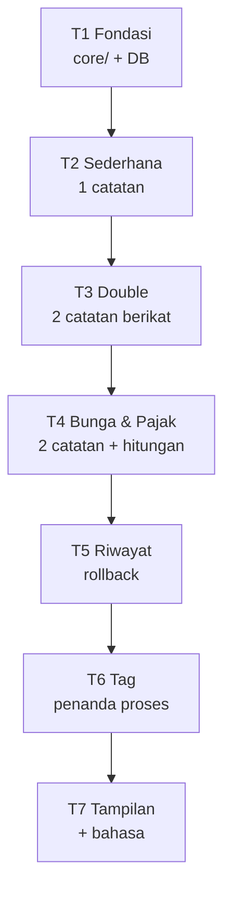
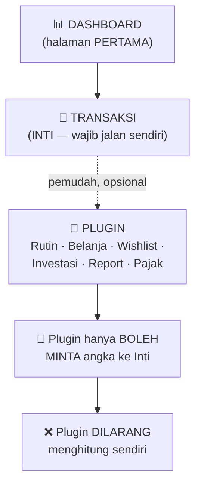
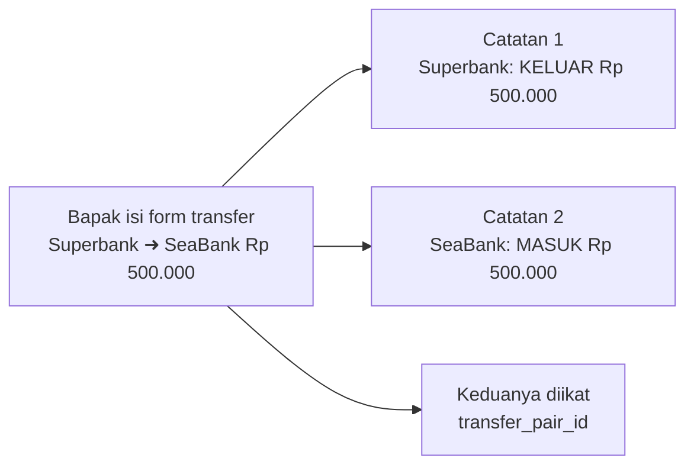
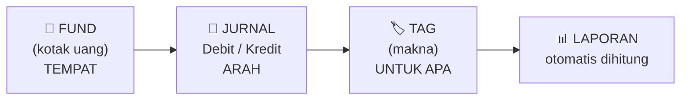
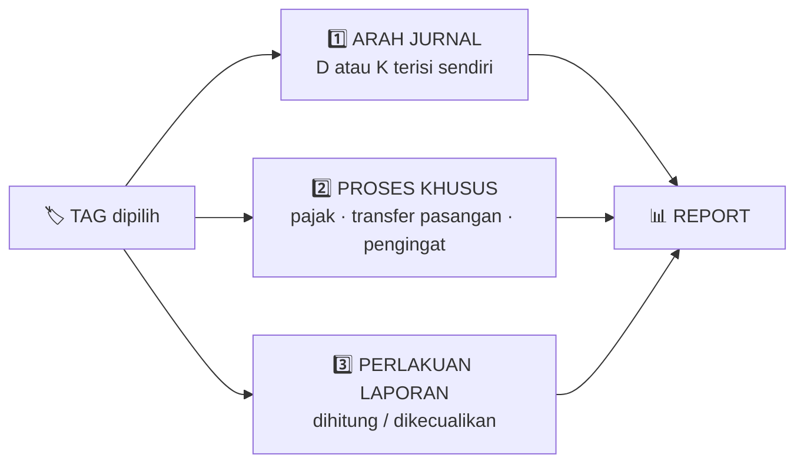
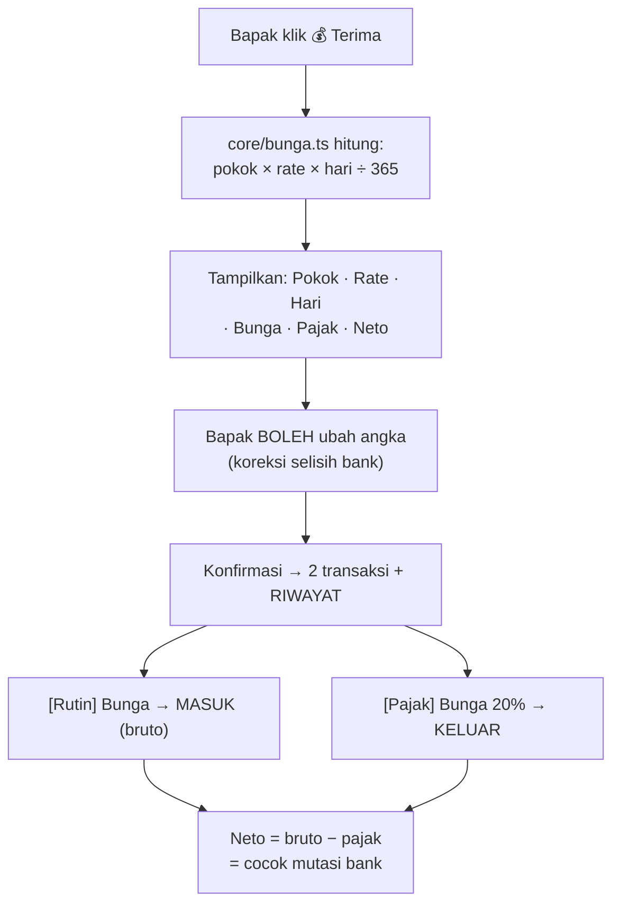
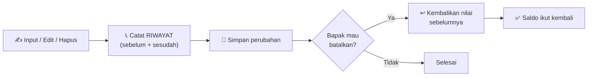
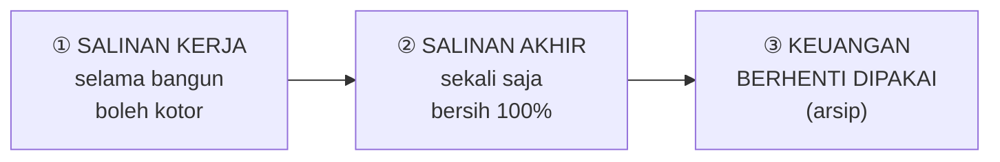
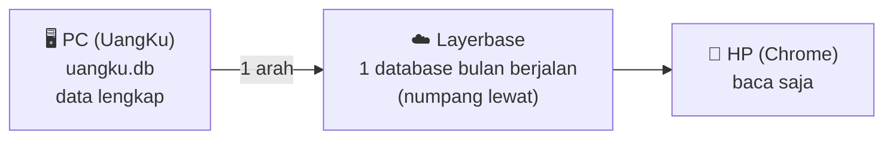
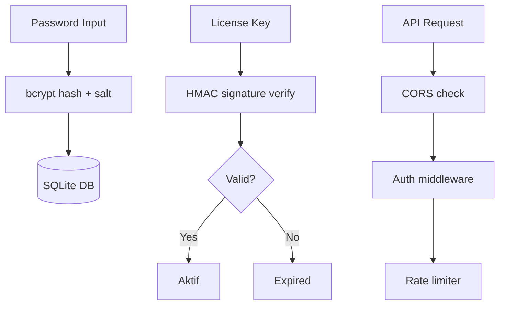

# 📋 RENCANA KERJA — Aplikasi **UangKu**

> **Status:** 🎉 **DIPERBARUI 13 Oktober 2026** — **UangKu SIAP DIPAKAI SETIAP HARI**.
> Bapak mencatat di **https://suwandhih.github.io/uangku/uangku-cloud.html** (PIN ada di berkas `PIN-UangKu.txt`) dari **PC maupun HP**.
> Data server **IDENTIK 100%** dengan `c:\data\keuangan` · 99 uji lolos · bisa **dibaca dan dicatat** dari HP.
> **Dokumen ini = peta induk.** Semua arahan & konsep Bapak ada di sini. Kalau lupa, baca ini.
> **Pasangannya:** `agents.md` (otak AI + aturan kerja) · **Cetak biru:** `prompt.md` ✅ sudah dibuat
> **Asal konsep:** sistem lama `c:\data\keuangan` — **konsep & metode saja**, bukan kodenya
> **Arsip:** Lampiran A/B/C di bawah · salinan asli semua dokumen lama tetap ada di `c:\data\keuangan`

---

## 0. ⚠️ ATURAN WAJIB — BACA SEBELUM APA PUN

> **Aturan lengkap ada di `agents.md` Bagian 0.** Ringkasannya:

| Kode | Aturan |
|---|---|
| **A1** | Sebut **perkiraan waktu** sebelum mulai · **A2** 🔍 **DEBUG FOKUS dulu sebelum Bapak menguji** (wajib, cepat, hanya blok terkait) — debug **menyeluruh** sesekali + minta izin |
| **A3** | 📢 **Jangan biarkan chat seperti freeze** — tulis kalimat pendek sebelum tiap langkah (lengkap: `agents.md` Bagian A3) · **A4** jangan ulangi cara yang gagal · tersangkut >2× → **HENTIKAN** |
| **A5–A6** | Uji **hanya bagian yang diubah** · menulis dokumen = **tanpa uji** |
| **B1** | **BACKUP DULU** sebelum menyentuh data |
| **B2** | 🔴 `keuangan.db` = **PRODUKSI, HANYA DIBACA** — dilarang tulis/ubah/hapus |
| **B3** | UangKu bekerja di **`uangku.db`** (salinan) |
| **B4–B5** | Jangan ganti nama tag/fund istimewa · **tag = penentu makna** |
| **B7** | Salinan wajib lewat **API backup SQLite** (bukan copy file mentah) |
| **C1–C4** | Transaksi = inti · saldo hanya di `core/saldo.ts` · tanggal hanya di `core/periode.ts` · logika pakai **`code`** |
| **C6** | 🔴 **Semua input·edit·hapus harus bisa DIKEMBALIKAN** |
| **C7** | Bunga & pajak: hitung **sen**, rumus hanya di `core/bunga.ts` |
| **C8** | 🎨 **Hitam-putih** · **C10** rancang untuk **layar 50%** · **C11** 📊 **Dashboard = halaman pertama** (+ daftar fund di paling atas) |
| **C12** | 🧹 Perbaikan = **backup + HAPUS script mati** · **C17** berkas lama yang digantikan **wajib dihapus** |
| **C13** | 🌐 **Bahasa Indonesia bawaan** — istilah **& kalimat** bisa diganti English |
| **C14** | 🔒 **Tampilan yang sudah disetujui Bapak = BEKU** — jangan diubah saat develop |
| **C18** | 📱 `uangku.html` = versi HP **baca saja**, angkanya **wajib sama** dengan `core/saldo.ts` |
| **C19** | 🔗 **Satu tampilan = satu fungsi, dipakai bersama** (dilarang dua versi → bug nyata: Dashboard 3 kolom vs Daftar Fund 4 kolom) |
| **C20** | ⬅️ **Pindah halaman = TAB BAWAH saja** (`Dashboard · Transaksi · Pengaturan`) — tombol pintas di dalam halaman dihapus |
| **D1–D4** | Perbarui papan order · lapor singkat · tandai ⚠️ · ide → tabel C |

**Kalau ragu → tanya Bapak dulu, jangan menebak.**

---

## 1. 🧭 PAPAN ORDER — Supaya Tidak Lupa

> **Kenapa ada ini:** Bapak perlu tahu sekilas — mana sudah, mana belum, mana ide, berikutnya apa.
> **Aturan:** selesai 1 butir → ✅ + tanggal · butir terakhir ✅ → kasusnya pindah ke D. SELESAI ·
> ide disetujui → pindah ke B (hapus dari C) · satu hal hanya boleh muncul di **satu** tabel.

**Tanda:** ✅ selesai · 🔨 sedang dikerjakan · ⬜ belum · ⚠️ masih bermasalah · ⏳ antre ·
🟡 perlu diperdalam · ⚪ belum diputuskan · ⏸️ ditahan · ❌ dibuang

### A. KASUS BELUM SELESAI

| Kode | Kasus | Butir | Tgl |
|---|---|---|---|
| **K33** | 🎉 **PINDAH KE SERVER + AKTIFKAN UANGKU** (perintah Bapak 13 Okt: *"tuntaskan semuanya.. saya mau hasil akhir dengan data sama seperti c:\data\keuangan"*) | ✅ **Data pindah** — 1.889 tx · 21 fund · 20 tag · 225 snapshot · 63 rutin · 1.817 riwayat<br/>✅ **IDENTIK 100%** dibuktikan `tools/cek-sama-cloud.cjs` (sidik jari SHA-256 seluruh baris+kolom, 15 tabel, 18 saldo fund)<br/>✅ **Halaman `uangku-cloud.html`** — seluruh kode tampilan `uangku.html` dipakai apa adanya; hanya sumber data & tempat simpan yang berganti<br/>✅ **Gerbang PIN** (salah/kosong → 401) · **Riwayat** · **Catat multi-jurnal** · **Batalkan** · **Pulihkan**<br/>✅ **Buka Bulan Baru** + pita pengingat di Dashboard (tanpa ini mulai 1 Nov tidak bisa mencatat)<br/>✅ **GitHub Pages** aktif · repo publik **tanpa data keuangan & tanpa kunci**<br/>✅ Tampilan **identik** dengan versi lama di 360/390/430/560/960 px<br/>✅ 99 uji lolos · `npm run cek` bersih<br/>⚠️ Belum ada pembatas percobaan PIN<br/>⬜ Bapak tes di HP Android sungguhan | 13 Okt |
| **K34** | 🧾 **Form Catat jadi SATU BARIS** (permintaan Bapak 13 Okt: *"tolong dibuat 1 baris .. memungkinkankah ?"*) | ✅ Susunan **fund · tag · D/K · harga · ✕** dalam **satu baris**<br/>✅ **Fund disingkat 3 huruf** (`SPB` `SEA` `CEL` …) — 18 fund punya singkatan; **nilai `<option>` tetap nama lengkap** supaya data & laporan tidak berubah<br/>✅ Tag tetap emoji+3 huruf · D/K tetap 1 huruf · **harga mengambil seluruh sisa lebar**<br/>✅ `aturLebarBaris()` menghitung lebar dari **lebar baris yang diukur** (bukan lebar jendela) · kelas `tl-sempit` merapatkan jarak & padding di layar ≤ 340 px<br/>✅ `formatJml()` memunculkan titik ribuan saat mengetik (`26504730` → `26.504.730`)<br/>✅ Diuji **256 / 288 / 312 / 344 / 448 / 768 px** (viewport nyata): **1 baris · angka utuh · tag utuh · 0 meluber**<br/>✅ Diuji juga di halaman **live** GitHub Pages — hasil sama<br/>✅ `uangku-cloud.html` dibangun ulang & dikirim (`bcb368e`) | 13 Okt |
| **K37** | 🔁 **RANCANGAN PLUGIN RUTIN** — order Bapak 13 Okt 2026 (4 butir). **STATUS: 📝 DICATAT, MENUNGGU ABA-GABA "proses"** (aturan B7) | Lihat **Bagian 18** di bawah untuk rincian lengkap + pertanyaan terbuka | 13 Okt |
| **K36** | 💰 **Angka selalu 2 desimal** (pertanyaan Bapak 13 Okt: *"apakah angka di sediakan desimal 2 digit minimal"* → **Ya**) | ✅ `rp2()` **selalu** menulis 2 desimal — `10.000` → `10.000,00` · `0` → `0,00`<br/>✅ Berlaku di **semua tempat**: kartu fund · total semua fund · ringkasan bulan · daftar transaksi · riwayat · bunga & pajak · saldo awal<br/>✅ Kotak angka melengkapi `,00` saat **selesai** mengetik (`change`), **bukan** saat mengetik — supaya tidak mengganggu<br/>✅ Uji: `30000` → `30.000,00` · `30000,5` → `30.000,50` · `0,05` → `0,05` · `100000000` → `100.000.000,00`<br/>🔴 **Bug nyata ditemukan & diperbaiki:** handler `resize` **tidak** memanggil `gbrDash()` → jumlah kolom kartu fund tetap memakai lebar layar **sebelumnya** → pernah jadi **5 kolom @ 50 px** sehingga angka saldo **patah 2 baris**<br/>✅ Diuji **256 / 288 / 312 / 344 / 448 / 768 px**: 1 baris · 0 terpotong · 0 meluber · **0 angka tanpa desimal**<br/>✅ Diuji juga di halaman **live** GitHub Pages — hasil sama<br/>✅ `uangku-cloud.html` dibangun ulang & dikirim (`d1d9dd9`) | 13 Okt |
| **K35** | 📐 **Lebar kolom baris jurnal diperbaiki** (usulan Bapak 13 Okt: *"ruang isi angka itu terlalu besar.. sumber sampai terlihat pulldown bisa terlihat dan tag juga dapat ruang yg cukup 3 digit terlihat.. minimal 100.000.000,00 bisa isi"*) | 🔴 **Masalah nyata:** kolom fund hanya 24 px → **panah pulldown terpotong**, Bapak tidak tahu kotak itu bisa dibuka<br/>✅ Lebar minimum baru: **fund 46 · tag 58 · D/K 38 · hapus 26 · harga 78 px** (cukup `100.000.000,00`)<br/>✅ `padding-right:14px` pada fund & tag → **panah ▾ tidak terpotong**<br/>✅ **7 langkah pengecilan bertahap** untuk layar sangat sempit (D/K → hapus → tag → fund)<br/>✅ Harga masih lega → **ruang dikembalikan ke fund & tag** (maks 8 px)<br/>✅ Diuji **256 / 288 / 312 / 344 / 448 / 768 px** dengan angka `100.000.000,00`: **1 baris · angka utuh · tag utuh · fund utuh · 0 meluber**<br/>✅ Diuji juga di halaman **live** GitHub Pages — hasil sama<br/>✅ `uangku-cloud.html` dibangun ulang & dikirim (`e715bb2`) | 13 Okt |
| **K27** | 🌐 **Penerapan konsep Peta Indonesia ke UangKu** — browser HP ↔ Cloudflare Worker (perantara, pegang kunci) ↔ Layerbase | 🔨 **Sedang dikerjakan** — keputusan Bapak 8 Okt: "Ya, terapkan dengan PIN"<br/>✅ Kunci per-database dibuat 8 Okt (ganti dengan Rotate), tersimpan di `.env` PC (bukan di HTML)<br/>✅ Uji query lewat API dari PC: OK (`SELECT 1` · 1.837 transaksi cadangan terbaca) · alamat: `sage.cloud.layerbase.dev` (sama dengan Peta Indonesia)<br/>⚠️ Kunci lama dari "Generate" tercabut otomatis setelah 24 jam (Rotate)<br/>✅ Worker **`uangku-api`** dipasang: https://uangku-api.suwandhih.workers.dev · **BACA SAJA** (fund, tag, snapshot, transaksi per bulan) · PIN wajib · kunci & PIN = secret Cloudflare<br/>✅ Uji 5/5: PIN salah 401 · PIN benar 200 · bulan tidak valid 400 · Okt 83 tx · CORS untuk file lokal<br/>⚠️ Belum ada pembatas percobaan PIN (perlu aturan rate-limit di Cloudflare)<br/>✅ Pengecualian aturan **C18** (tanpa server) — **disetujui Bapak 8 Okt**, dicatat<br/>⬜ HP membaca dari Worker (halaman baru, belum dibuat — perlu aba-aba Bapak)<br/>⬜ HP membaca dari Worker · Bapak tes di HP | 8 Okt |
| **K28** | 🏦 **Transaksi: fund awal = Superbank** (bukan semua fund) — rekomendasi Bapak | ✅ `FUND_AWAL = Superbank` dipakai saat buka layar, ganti bulan, dan geser bulan · Okt 44 baris · Sep 161 baris · tanpa galat · tanpa geser | 8 Okt |
| **K29** | 🧪 **Lab multi-jurnal masuk ke `uangku.html` — layar Catat (TES)** · simpan di browser (localStorage) · bisa dibatalkan · tampil di daftar Transaksi | ✅ Layar **Catat (TES)** jadi di `uangku.html` (tombol ＋ di Transaksi) · simpan di browser (`localStorage`) · tampil di Transaksi & saldo fund · bisa dibatalkan (↩️)<br/>✅ Uji: simpan 3 jurnal → Superbank +1.000.000 · Okt 83 → 86 tx · batalkan → kembali identik · tanpa galat · 360 px tanpa geser<br/>⚠️ Dashboard "Ringkasan bulan ini" belum ikut data tes (hanya fund & daftar)<br/>🔨 Penyimpanan resmi tetap di `uangku.db` lewat aplikasi PC (T2)<br/>⬜ Bapak tes · ⬜ Setelah tes: data tes DIHAPUS sebelum salinan akhir (aturan B8) | 8 Okt |
| **K30** | 🧮 **Konsep penghitungan Masuk (dipahami Bapak 8 Okt)** | ✅ Masuk (penerimaan) = baris **D bertag Pendapatan / Bonus**, dihitung **sekali** di fund penerima pertama<br/>✅ Transfer = pindahan antar fund (K asal + D tujuan), **tidak** dihitung<br/>✅ Jumlah semua baris D **BUKAN** masuk — penyebab salah 20jt<br/>✅ Dua debit dari fund berbeda tidak otomatis dijumlah — lihat tag & pasangannya<br/>⬜ Peringatan (bukan blokir): penerimaan yang sama jumlah dengan K Transfer pada tanggal sama → periksa tag
| **K31** | 🧪 **Tes data Oktober 2026 — besok** | ⏳ Antre (Bapak lanjut besok)<br/>⬜ Bandingkan angka HP vs keuangan (Okt 83 tx · saldo fund) — sidik jari<br/>⬜ Catat tes transaksi Oktober di layar Catat (TES) — **hanya tes**, bukan catatan resmi<br/>⚠️ Yang belum siap untuk data sungguhan: lihat K32 | 8 Okt |
| **K32** | ⚠️ **Syarat sebelum data sungguhan masuk UangKu** (status akhir 8 Okt) | ⬜ Input resmi ke `uangku.db` lewat aplikasi PC (T2) — layar Catat saat ini hanya di browser<br/>⬜ Rollback resmi (C6, T5) — saat ini hanya ↩️ untuk data tes<br/>⬜ Peringatan penerimaan vs K Transfer (K30) — besok, ±20 menit<br/>⬜ Ringkasan Dashboard belum ikut data tes · daftar Transaksi hitung "Masuk" termasuk Transfer (perlu disamakan dengan K30)<br/>⬜ Tag bermasalah di data: 6 Koreksi bertanda D · tag Tabungan (36 tx) tidak ada di tabel tag · 1 transaksi tanpa tag (K21)<br/>⬜ Hutang & Reimburse: tabel tag di database perlu disesuaikan (K21)<br/>⬜ Bunga & pajak semi-otomatis (K22) belum dibangun<br/>🔴 Keuangan (`c:\data\keuangan`) tetap sumber utama sampai UangKu siap (aturan B9) | 8 Okt |
| **K26** | ☁️ **Jembatan Layerbase — numpang lewat** (PC → Layerbase → HP; HP → Layerbase → PC) | ✅ **Dicek dokumentasi** 8 Okt: query HTTP `POST /v1/databases/:id/query` · kunci per-database (terbatas 1 database) · Free: 2 database, 5 GB, tidur saat idle<br/>⚠️ Batas **10.240 karakter per query** → data dikirim per potongan SQL, bukan berkas utuh<br/>🔴 **Uji CORS (8 Okt):** query **SQLite** `/v1/databases/:id/query` → browser HP **DIBLOKIR** (hanya `localhost` yang diizinkan; `file://`, `null`, domain lain tidak). Sisi **PC** (bukan browser) tetap bisa. · **Neon SQL** `api.cloud.layerbase.dev/sql` → `Access-Control-Allow-Origin: *` ✅, tetapi **hanya untuk PostgreSQL**. ✅ **Keputusan Bapak: PostgreSQL di Layerbase, HP baca langsung** (driver Neon) · PC tetap sumber utama<br/>✅ **8 Okt:** database **`uangku`** (PostgreSQL 18, gratis, Running) dibuat di akun Bapak · 3 peran dibuat (`uangku_pc`, `uangku_baca`, `uangku_kirim`) · ⚠️ **peran TIDAK bisa login** (pooler menolak pengguna buatan SQL, diuji dengan kata sandi sederhana juga gagal) · owner `postgres` bisa login · database `peta-indonesia` milik proyek Peta Dunia **tidak disentuh**. Lihat ⬜ di bawah.<br/>✅ **Keputusan Bapak (8 Okt):** PC saja memakai owner untuk **cadangan** — `tools\cadangan-layerbase.cjs` · skema `cadangan_202610081330` · 15 tabel, jumlah baris & total (transaksi, saldo awal) **cocok** · HP tetap berkas manual<br/>⏸️ Ditahan (8 Okt, Bapak belum mau): tanya support Layerbase cara membuat pengguna database agar HP bisa baca langsung. Arsitektur "program di PC/HP, data di Layerbase" bergantung pada ini. Opsi GitHub Pages ditolak sementara (kode publik, melanggar C18) · buat 2 peran: `uangku_baca` (SELECT saja) & `uangku_kirim` (INSERT ke kotak masuk saja) · string koneksi ditempel di `c:\data\UangKu\.env` (jangan di chat, jangan di HTML)<br/>⬜ Uji CORS & koneksi · ⬜ Dorong data bulan berjalan dari PC · ⬜ HP baca dari Layerbase<br/>⏳ **Arah HP → PC** lewat **kotak masuk** (tabel terpisah, PC yang menulis tabel utama — tidak ada tabrakan data). Keputusan Bapak diperlukan (I-10 sebelumnya ditahan) | 8 Okt |
| **K19** | 🆕 **Order 8 Okt — daftar transaksi & data** | ✅ Layar **Rincian dihapus** → daftar transaksi jadi **tabel HP** (Tgl · Keterangan · Tipe · Jumlah; Fund & Tag di baris kedua) · Dashboard memakai tabel yang sama (C19)<br/>✅ HP tampil **4 bulan** (Jul · Agu · Sep · Okt)<br/>✅ **Salin ulang** keuangan → uangku: Okt **83** tx · Sep **307** tx · Jul/Agu tetap · cocok baris per baris (hash sama)<br/>✅ Cadangan semua perubahan di `data\backups\` | 8 Okt |
| **K20** | 🆕 **Lab multi-jurnal + tag** (`lab-uang2.html` — berkas terpisah) | ✅ Satu transaksi = **1–6 jurnal** (sesuai catatan bank)<br/>✅ **Tag per jurnal** · tag tetap **mengunci** arah D/K · tag dua arah dipilih manual<br/>✅ **Singkatan tag** (RMH, PRB, TRF, PDP, …)<br/>✅ Ringkasan sederhana: Total masuk · Total keluar · saldo per fund · Selisih D − K<br/>⬜ Masukkan ke layar **Transaksi** (setelah T2) | 8 Okt |
| **K21** | 🏷️ **Aturan tag & arah** | ✅ **Keputusan Bapak:** Hutang & Reimburse = **dua arah, manual** (ikut `agents.md`)<br/>✅ **Keputusan Bapak:** penerimaan laporan = **Pendapatan + Bonus**<br/>⬜ Sesuaikan tabel tag di database (Hutang = K, Reimburse = D sekarang)<br/>⚠️ 6 transaksi **Koreksi** bertanda D (tag dikunci K)<br/>⚠️ Tag **Tabungan** dipakai 36 transaksi (K) tapi **tidak ada** di tabel tag<br/>⚠️ 1 transaksi **tanpa tag** | 8 Okt |
| **K22** | 🧮 **Bunga & pajak — SEMI-OTOMATIS** (menggantikan keputusan CHECKPOINT B-16) | ✅ **Keputusan Bapak:** rate tabungan **5%** · deposito **7,5%** p.a — rate **wajib diisi**, tanpa nilai cadangan diam-diam<br/>✅ **Keputusan Bapak:** bunga (D, tag Bunga) → sistem **mengusulkan pajak 20%** (K, tag Pajak) · berlaku tabungan & deposito<br/>✅ **Keputusan Bapak:** Bapak **memeriksa & boleh mengubah** angka (selisih pembulatan bank), lalu **konfirmasi** → 1 aksi, tercatat di riwayat, bisa dibatalkan<br/>⬜ Terapkan di `core/bunga.ts` + layar Transaksi (**T4** + **T5**) | 8 Okt |
| **K23** | 🔌 **Plugin Reimburse** — aplikasi khusus **bayar hutang** | ✅ **Keputusan Bapak:** dikerjakan **setelah** Transaksi (T2–T7) selesai<br/>⏳ Antre — belum mulai | 8 Okt |
| **K24** | 🛒 **Plugin Belanja** — aplikasi khusus **belanja** | ✅ **Keputusan Bapak:** dikerjakan **setelah** Transaksi (T2–T7) selesai<br/>⏳ Antre — belum mulai | 8 Okt |
| **K25** | 📜 **Aturan main Peta Dunia disalin ke `agents.md` UangKu** | ✅ Bagian umum disalin (4 aturan utama · A–E · G · H). Bagian F & I (khusus peta) tidak disalin<br/>✅ **Aturan baru:** order dicatat dulu di `rencanakerja.md`, baru dikerjakan satu per satu; yang sudah dikerjakan diberi ✅ | 8 Okt |
| **K1** | **Aplikasi baru "UangKu"** — bangun ulang kode (data tetap) | ✅ **Rapikan dokumen** → dokumen induk (`agents.md` + `rencanakerja.md`; **kemudian jadi 3** setelah `prompt.md` selesai), sisanya dihapus<br/>✅ **Tulis `agents.md` UangKu**<br/>✅ **Tulis `rencanakerja.md`** (papan order + semua konsep)<br/>✅ **Pindahkan dokumentasi lama** (konsep tag/bunga/tampilan/panduan) → ke dokumen induk<br/>✅ **Tulis `prompt.md`** (cetak biru — 17 bagian) 25 Sep<br/>✅ **T1 Fondasi selesai** — `core/` 5 berkas + `db/index.ts` + **salinan kerja `uangku.db`** + 99 uji **LOLOS** 25 Sep<br/>✅ **`uangku.html` versi HP selesai** — termasuk **5× revisi tampilan** (lihat K6/K15) 25 Sep<br/>✅ **`CHANGELOG.md` + `panduan.md` dibuat** — sesuai standar dokumentasi 25 Sep<br/>⬜ Buat folder & struktur plugin ⏳<br/>⬜ **T2 — Transaksi Sederhana** ⏳ | 25 Sep |
| **K2** | **Kode lama: fondasi rapuh** — rumus tersebar 42 titik | ✅ **Pusatkan rumus saldo** → `core/saldo.ts` (satu berkas) 25 Sep<br/>✅ **Pusatkan aturan tanggal** → `core/periode.ts` 25 Sep<br/>✅ **Pusatkan aturan pajak & bunga** → `core/bunga.ts` (hitung **sen**) 25 Sep<br/>✅ **Pusatkan pembulatan & format Rupiah** → `core/uang.ts` 25 Sep<br/>✅ **Pusatkan validasi** → `core/aturan.ts` 25 Sep<br/>✅ **Uji otomatis 1 perintah** → `npm run uji` · **99 uji, 0 gagal** 25 Sep<br/>✅ **HAPUS 2 skrip mati** (`baca-keuangan.cjs` · `hitung-saldo.cjs`) + hasilnya — duplikat `salinan-kerja.cjs` (aturan C12/C17) 25 Sep<br/>⬜ Ubah sistem lama memakai core ini ⏳ (UangKu yang baru) | 25 Sep |
| **K3** | **Report rusak** — tag memakai nama lama | ⚠️ Bunga Rp 0 padahal nyata Rp 6.466.857<br/>⬜ Perbaiki `ARENA_ORDER` di `reports.ts` (Nami→Pet, Bunga Bank→Bunga)<br/>⬜ Periksa 4 report lain | 24 Sep |
| **K4** | **Tag aman diganti nama** — perlu kolom `code` | ⬜ Tambah kolom `code` di `tags` + isi 15 tag<br/>⬜ Tambah `code` di `source_funds` + isi 18 fund<br/>⬜ Ubah 32 titik logika → pakai `code` | 24 Sep |
| **K5** | **Multi-bahasa istilah keuangan** (mulai dari Transaksi) | ⬜ Kamus id/en + pemilih bahasa<br/>⬜ Terapkan di halaman Transaksi<br/>⬜ Lanjut halaman lain (bertahap) | 24 Sep |
| **K6** | **Versi HP** (browser Chrome) | ✅ **Cara jalan: buka dari HP (Chrome)** — HP **hanya bulan berjalan**<br/>✅ **Jembatan: Layerbase** — ditentukan Bapak 25 Sep (lihat Bagian 14)<br/>✅ **`uangku.html` SELESAI 25 Sep** — berkas mandiri, **3 bulan terakhir** (Sep/Agu/Jul 2026), tanpa server & internet. Uji: 12 langkah klik **OK** · 58 pasangan transfer terbaca utuh · 18 fund · 15 tag · bahasa ID↔EN · tema terang/gelap<br/>✅ **Revisi 25 Sep (5×)**: tombol Transaksi dobel dihapus → **semua tombol pintas di Dashboard dihapus** (cukup tab bawah) · kartu saldo fund **4 kolom** (Saldo awal·Masuk·Keluar·Saldo akhir) · Transaksi **4 cara urut** (Tanggal·Tag·Masuk·Keluar) · **daftar fund paling atas Dashboard**<br/>✅ **8 Okt:** halaman *Rincian* dihapus → daftar transaksi jadi **tabel** (Tgl · Keterangan · Tipe · Jumlah; Fund & Tag di baris kedua) — dipakai juga di Dashboard · cadangan `data\backups\` · lihat `CHANGELOG.md`<br/>⬜ Bapak tes di HP Android (kirim berkas → buka Chrome)<br/>⬜ Buat database Layerbase (**libSQL** atau **SQLite**) di daun gratis ⏳<br/>⬜ Endpoint PC → Layerbase (unggah bulan berjalan) ⏳<br/>⬜ Halaman HP langsung dari Layerbase ⏳ | 25 Sep |
| **K7** | **FexMax & Token PLN** — interval melebihi batas validasi | ⚠️ Harian 28 & 21 melebihi batas 6 → tidak bisa diedit | 24 Sep |
| **K8** | **Sistem salinan** keuangan → UangKu | ✅ **Sistem sinkronisasi terus-menerus DIBATALKAN** — cukup **1× salinan akhir**<br/>✅ **Tahap salinan kerja** (selama bangun, data boleh kotor)<br/>⬜ **Salinan akhir**: hentikan keuangan → `.backup` → hapus data coba-coba → isi 5 tabel kunci<br/>⬜ Alat pembukti salinan (`salinan-cek`) — sidik jari 18 fund<br/>🔴 `keuangan.db` HANYA DIBACA | 25 Sep |
| **K9** | 🔴 **ROLLBACK / RIWAYAT — aman untuk semua input·edit·hapus** | ⚠️ **"hal ini sangat penting dari seluruh arti sistem ini"**<br/>⬜ Riwayat semua perubahan (sebelum & sesudah)<br/>⬜ Tombol **↩️ Batalkan** pada setiap baris (transaksi, rutin, belanja, wishlist, investasi)<br/>⬜ Pemulihan berantai — termasuk yang dibuat sistem (Rutin bayar, transfer pasangan)<br/>⬜ Riwayat tidak bisa dihapus oleh siapa pun<br/>⬜ Uji khusus: hapus → pulihkan → nilai identik | 24 Sep |
| **K10** | 📄 **Tombol [Doc] di halaman Transaksi** | ⬜ Tampilkan `rencanakerja.md` · `changelog` · `prompt.md` langsung di aplikasi | 24 Sep |
| **K11** | 🐞 **Selisih 1 sen bunga vs pajak** (bukti nyata 24 Sep) | ⚠️ Bunga sama 636.986,30 tapi pajak beda 1 sen<br/>⚠️ 89 transaksi punya desimal (55 bunga + 34 pajak)<br/>⚠️ 6 dari 14 rutin bunga rate/pokok kosong<br/>✅ **Solusi dirancang**: rate tabungan vs deposito dipisah (Bagian 13.9)<br/>✅ **Penanda kena-pajak DIPUTUSKAN: CHECKPOINT** (Bagian 9.14) — 1 tag + kotak “Kena pajak [ ]”<br/>🔴 **Akar masalah ditemukan**: `transactions.has_tax` **tidak diisi** (Sep 2026: 6 tx dipajak tapi `has_tax` semua 0) | 25 Sep |
| **K12** | 🆕 **Konsep baru UangKu** (belum ada di sistem lama) | ⬜ Tentukan daftar konsep baru mana yang masuk tahap awal<br/>⬜ Konsep: lihat Bagian 3 (12 konsep baru) | 25 Sep |
| **K13** | 🆕 **Setting dasar UangKu** | ⬜ Daftar fund (18) + kolom `code`<br/>⬜ Daftar tag (15) + kolom `code`<br/>⬜ Saldo awal per fund per bulan | 25 Sep |
| **K14** | 🆕 **Jembatan Layerbase (PC ↔ Android)** | ✅ **Akun sudah dibuat** Bapak (login GitHub/Google) — 0/2 database<br/>✅ **Cara kerja dipahami & dicatat** (Bagian 14.10–14.13)<br/>⬜ Buat database (**libSQL** atau **SQLite**) di daun gratis<br/>⬜ Simpan `LAYERBASE_API_URL` + API key di `.env`<br/>⬜ Buat tabel + unggah data bulan berjalan<br/>⬜ Buat halaman pembaca untuk HP<br/>⬜ Bapak test dari HP | 25 Sep |
| **K15** | 🆕 **Rancangan tampilan (UI)** | ✅ **Mockup HP jadi**: `design/ui-hp.html`<br/>✅ **Koreksi 1**: **Dashboard = halaman pertama**<br/>✅ **Koreksi 2**: menu → **Pengaturan**, dipisah **sering/jarang** dipakai<br/>✅ **Koreksi 3**: Transaksi **bisa balik ke Dashboard**<br/>✅ **Koreksi 4**: bingkai HP dihilangkan (**mode tanpa bingkai**, penuh layar)<br/>✅ **Koreksi 5**: bar alat peraga **disembunyikan** (tombol 🔧)<br/>✅ 🔒 **DISETUJUI Bapak 25 Sep** → **BEKU** (aturan C14)<br/>✅ **Dashboard diisi data asli** — total 288.175.713 · masuk 14.191.861,37 · keluar **7.340.614,86** · selisih 6.851.246,51<br/>✅ **Tombol ‹ kembali diperbaiki** (Setting Dasar → Pengaturan)<br/>✅ **Tombol dobel + tombol "Lihat semua transaksi" dihapus** (25 Sep) — navigasi cukup **tab bawah**<br/>⚠️ **2 layar mockup TERTINGGAL** dari aplikasi: **Dashboard** (belum ada daftar fund paling atas) & **Transaksi** (masih `Semua/Masuk/Keluar`, belum 4 cara urut). Aplikasi `uangku.html` = **sumber kebenaran tampilan**<br/>⬜ Samakan mockup dengan aplikasi (**menunggu keputusan Bapak** — mockup BEKU)<br/>⬜ Terapkan jadi tampilan PC (layar 50% ±960px)<br/>⬜ Terapkan ke halaman plugin (Rutin, Belanja, Wishlist, Investasi, Report) | 25 Sep |
| **K16** | 🆕 **Setting Dasar** — fund · tag · saldo awal | ✅ **Mockup 3 layar jadi** (Source Fund · Tags · Saldo Awal)<br/>✅ **Source Fund diisi 18 fund ASLI** + saldo asli September 2026 (Superbank 22.057.865 · Deposito 260.000.000 · SeaBank 271.337 · dll)<br/>✅ **Saldo Awal diisi snapshot ASLI** — total 280.941.750<br/>✅ **Tombol ＋ Tambah fund BERFUNGSI** (nama · kode · ikon · urut · saldo awal)<br/>✅ **Urutan pakai ANGKA** (`sort_order`) — ubah angka → sistem urut ulang sendiri<br/>✅ **Tujuan urutan dijelaskan** — agar **dropdown fund** terurut sesuai kebiasaan Bapak<br/>✅ **Kode duplikat disembunyikan** — `Superbank [SUPERBANK]` → cukup `Superbank` (kode di tooltip)<br/>✅ **25 Sep: Daftar Fund & Tag jadi KARTU GRID** — **semua fund terlihat sekaligus**; **3 kolom di HP**, 4–5 di layar lebar; **nama boleh dipotong `…`** (keputusan Bapak) tapi **angka SELALU utuh** + lencana 🔒👥 tidak ikut terpotong<br/>✅ **25 Sep: chip source fund di TRANSAKSI juga jadi GRID** — jumlah kolom **ikut pengaturan Daftar Fund** (bukti 8/8 uji sama)<br/>⬜ Terapkan jadi sistem sungguhan<br/>⬜ Kolom `code` di fund & tag | 25 Sep |
| **K17** | 🆕 **Setting Pajak & Bunga Bank** | ✅ **Mockup jadi** (Pajak · Bunga Bank)<br/>✅ **Tabungan 5% p.a** vs **Deposito 7,5% p.a** dipisah<br/>✅ **Pajak 20%** · contoh hitungan **debet bunga + pajak**<br/>✅ **Pajak diisi data ASLI**: `tax_config` id 2 — “Pajak Bunga Bank”, rate **20**, sejak **2025-01-01**, tag **Bunga**<br/>✅ **Temuan nyata**: 7 rutin tabungan rate **5**, 1 deposito rate **7,5**, **6 rutin rate KOSONG** (bug 30 Agu)<br/>✅ **KEPUTUSAN Bapak**: pakai **CHECKPOINT “Kena pajak [ ]”** (Bagian 9.14) — **bukan** 2 tag, **bukan** batas minimum<br/>⬜ Terapkan jadi sistem (`core/bunga.ts`) + checkpoint di form input | 25 Sep |
| **K18** | 🆕 **Multi-bahasa menyeluruh** (ID ↔ EN) | ✅ **Mockup layar Bahasa jadi**<br/>✅ **Debit & Kredit ditambahkan** ke daftar contoh istilah<br/>✅ **Tombol 🌐 ID → EN BENAR-BENAR BERFUNGSI** — judul halaman, navigasi bawah, ringkasan Dashboard, tombol ganti bahasa<br/>✅ Istilah **dan kalimat** ikut berubah (contoh kalimat ditambah)<br/>✅ Ada tombol uji **“🌐 Ganti ke English”** di layar Bahasa<br/>⬜ Terapkan menyeluruh (kamus id/en) — **setelah** kolom `code` siap<br/>⬜ Perluas ke seluruh halaman (sekarang: judul + navigasi + ringkasan) | 25 Sep |

### B. ANTREAN KERJA — sudah disetujui, belum mulai

> **Urutan dari atas = dikerjakan dulu**

| # | Pekerjaan | Alasan didahulukan | Perkiraan |
|---|---|---|---|
| **B-1** | Tulis **`prompt.md`** — cetak biru "UangKu" ✅ **SELESAI 25 Sep** | Dibutuhkan sebelum bangun apa pun | ✅ selesai |
| **B-2** | Buat folder `data/` + **salinan kerja** keuangan → uangku ✅ **SELESAI 25 Sep** — `data/uangku.db` 752 KB · 1.679 tx · 21 fund · 20 tag · 207 snapshot · 63 rutin | Titik mulai pengerjaan | ✅ selesai |
| **B-2b** | 🔴 **Salinan AKHIR yang bersih** (setelah UangKu benar) | **Menggantikan** sistem sinkronisasi berkala yang dibatalkan | 1 sesi |
| **B-3** | Bangun **inti**: Transaksi + fund + jurnal + tag — **dipecah jadi T1–T7** (lihat bawah) | Fondasi semua modul | 7 sesi |
| **T1** | 🧱 **TAHAP 1 — FONDASI** ✅ **SELESAI 25 Sep 2026** (99 uji lolos) | `core/saldo.ts` · `core/periode.ts` · `core/uang.ts` · `core/bunga.ts` · `core/aturan.ts` · skema + **salinan kerja** DB | Kalau rumus salah, semua tahap di atasnya salah | ✅ selesai |
| **T2** | ✍️ **TAHAP 2 — TRANSAKSI SEDERHANA**: 1 catatan · 1 fund · 1 arah (D/K) · tag · jumlah | Fondasi input — dipakai tiap hari | 1 sesi |
| **T3** | 🔄 **TAHAP 3 — TRANSAKSI DOUBLE**: 1 input → 2 catatan berikat `transfer_pair_id` | Transfer = 2× T2 | 1 sesi |
| **T4** | 🌸 **TAHAP 4 — BUNGA + PAJAK**: checkpoint “Kena pajak [ ]” + hitung bunga & pajak 20% + jejak | Cegah koreksi sen berulang | 1–2 sesi |
| **T5** | 🔴 **TAHAP 5 — RIWAYAT / ROLLBACK**: ↩️ Batalkan + aksi berantai dibatalkan sekaligus | *"sangat penting dari seluruh arti sistem ini"* | 1–2 sesi |
| **T6** | 🏷️ **TAHAP 6 — TAG = PENANDA PROSES**: arah otomatis dari tag · 4 tag dua arah · 5 dikecualikan | Inti konsep transaksi | 1 sesi |
| **T7** | 🖥️ **TAHAP 7 — TAMPILAN + BAHASA**: vertikal (layar 50% + HP) · kamus ID↔EN · Dashboard | Mockup sudah BEKU — tinggal menempel | 2 sesi |
| **B-4** | **Multi-bahasa** di Transaksi | Diminta Bapak — dikerjakan bersama inti | 1–2 sesi |
| **B-5** | **Plugin** satu per satu (Rutin, Belanja, Wishlist, Investasi, Report) | Bertahap, bisa berhenti kapan saja | 1–2 sesi/modul |
| **B-6** | **Versi HP (Chrome)** + jembatan **Layerbase** | Setelah inti PC stabil | 3–4 sesi |
| **B-7** | 🔴 **ROLLBACK / RIWAYAT** — harus ada dari awal inti | **"sangat penting dari seluruh arti sistem ini"** — jangan ditunda | 2 sesi |
| **B-8** | 🎨 **Tampilan hitam-putih** (bukan warna warni) | Supaya nyaman di layar 50% | 1–2 sesi |
| **B-9** | 📐 **Menyesuaikan layar 50%** (2 aplikasi berdampingan) | Kebutuhan kerja Bapak sehari-hari | 1 sesi |
| **B-10** | 💰 **Bunga & pajak v2** — 1 tempat, hitung sen, jejak koreksi | Cegah masalah berulang (Bagian 10) | 2 sesi |
| **B-11** | 📄 **Tombol [Doc]** — lihat dokumen dari dalam aplikasi | Bapak minta | 1 sesi |
| **B-12** | ⚙️ **Setting dasar**: daftar fund · tag · saldo awal | Fondasi sebelum modul lain | 1 sesi |
| **B-13** | 🆕 🧾 **Setting pajak & bunga** — tabungan 5% vs deposito 7,5% · pajak 20% · batas pajak | Cegah masalah berulang (Bagian 10) | 2 sesi |
| **B-14** | 🆕 🌐 **Multi-bahasa menyeluruh** (istilah **+ kalimat**) | Bapak minta | 2 sesi |
| **B-15** | 🆕 🏷️ **Terapkan “tag = penanda proses”** — arah jurnal otomatis dari tag, kecuali 4 tag dua arah | **Inti konsep transaksi** (Bagian 9.15) | 1–2 sesi |
| **B-16** | 🔁 **DIREVISI 8 Okt → semi-otomatis (K22).** Dulu: ✅ CHECKPOINT (Bagian 9.14). 1 tag `Bunga` + kotak “Kena pajak [ ]” saat input · berlaku rutin **dan** manual · batas minimum **tidak perlu** | Cegah koreksi sen berulang | 1 sesi |
| **B-17** | 🔁 **DIREVISI 8 Okt → TABEL HP (K19).** Dulu: ✅ VERTIKAL (Bagian 2 blok ke-7). Alasan Bapak: horisontal **tidak efektif kalau ada penambahan kolom** di layar terbatas. Horisontal tetap ada di mockup sebagai bahan banding | Menentukan kepadatan data & enak-dibaca | 1 sesi |

### C. IDE — belum diputuskan

| Kode | Ide | Status |
|---|---|---|
| **I-01** | 🎯 Widget Target Deposito 300jt di Dashboard | 🟡 perlu diperdalam (dari 30 Agu) |
| **I-02** | Tag → "resep jurnal berantai" (1 tag = beberapa jurnal sekaligus) | ⏸️ ditahan (konsep 31 Juli) |
| **I-03** | Sistem hutang-piutang terpisah dari tag | ⏸️ ditahan — *"nanti saja bila sangat mengganggu"* |
| **I-04** | Arsip data lama (transaksi > 6 bulan dipindah) | ⏸️ ditahan — DB cuma 0,72 MB, 10 tahun pun aman |
| **I-05** | Widget "Uang Menurut Bank vs Catatan" (rekonsiliasi) | 🟡 perlu diperdalam |
| **I-06** | Laporan Bulanan otomatis (PDF/Excel) | ⚪ belum diputuskan |
| **I-07** | Aplikasi Android read-only (file HTML statis) | ❌ **dibuang** — Bapak batalkan 30 Agu: *"ternyata tidak mudah... effort tidak sebanding"*. **Digantikan K6 (versi HP via Chrome)** |
| **I-08** | Arsip/cleanup script mati & backup lama | 🟡 tertunda — menunggu konfirmasi (26 Juli) |
| **I-09** | 🆕 Simpan **riwayat percakapan AI** ke database (seperti `conversation-log.json` sistem lama) | ⚪ belum diputuskan |
| **I-10** | 🆕 Sinkronisasi **dua arah** PC ↔ HP (input dari HP) | ⏸️ ditahan — *"sinkronisasi 2 database rawan bentrok/hilang"* (30 Agu). Tunggu versi 1 arah stabil |

### D. SELESAI — arsip

| Pekerjaan | Selesai |
|---|---|
| 🎉 **UANGKU AKTIF — data pindah ke server, bisa dipakai dari PC & HP** (perintah Bapak 13 Okt: *"tuntaskan semuanya.. saya mau hasil akhir dengan data sama seperti c:\data\keuangan"*).<br/>**① Data pindah & dibuktikan:** 1.889 tx · 21 fund · 20 tag · 225 snapshot · 63 rutin · 1.817 riwayat → server Layerbase (PostgreSQL, skema `uangku`). Dibuktikan **IDENTIK 100%** oleh alat baru `tools/cek-sama-cloud.cjs` — membandingkan **setiap baris & setiap kolom** 15 tabel antara `keuangan.db` ↔ `uangku.db` ↔ server, plus 18 saldo fund. Total Okt 2026 **Rp 293.720.428,64** sama di ketiganya.<br/>**② Halaman `uangku-cloud.html`:** seluruh kode tampilan `uangku.html` dipakai **apa adanya** (aturan Bapak: *"jangan km ubah apapun"*); yang berganti hanya **sumber data** & **tempat simpan**. Ditambah **gerbang PIN**, layar **Riwayat**, dan **Catat multi-jurnal**.<br/>**③ Bisa MENCATAT dari HP** (sebelumnya hanya melihat): ＋ di Transaksi → simpan ke server · **Batalkan** per transaksi · **Pulihkan** dari Riwayat. Uji nyata: catat → naik · batalkan → kembali · pulihkan → naik lagi.<br/>**④ Buka Bulan Baru** — 🔴 **masalah nyata ditemukan:** `monthly_snapshots` berhenti di Okt 2026, jadi mulai **1 Nov Bapak tidak bisa mencatat sama sekali**. Dibuat menu **Pengaturan → 📅 Bulan Baru** + **pita pengingat di Dashboard**. Diuji: November dibuat dari Oktober → **18/18 fund cocok** · Oktober terkunci.<br/>**⑤ GitHub Pages** aktif di https://suwandhih.github.io/uangku/ · repo publik **tanpa data keuangan & tanpa kunci** (diperiksa).<br/>**⑥ Tampilan identik** dengan versi lama di 360/390/430/560/960 px (jumlah kolom, lebar kartu, angka).<br/>**⑦ 99 uji lolos · `npm run cek` bersih.**<br/>**Bug ditambal:** angka uji September basi (keuangan bertambah 234→307 tx) · tombol Buka Bulan Baru dipasang sebelum ada · layar Tentang masih bilang "tidak butuh server" · `wrangler.jsonc` sampah · `bulat()` menolak angka desimal (PostgreSQL mengembalikan BIGINT sebagai teks).<br/>⚠️ Belum ada pembatas percobaan PIN · ⬜ Bapak tes di HP Android sungguhan | 13 Okt 2026 |
| ✅ **Semua dokumen diperbarui (25 Sep, malam)** — `agents.md` (Bagian 2 posisi pekerjaan, struktur folder nyata, angka grid terbaru, aturan **C19/C20**) · `prompt.md` (**Bagian 12 ditambah 10 aturan tata letak terbukti** · Bagian 15 tandai T1+HP selesai · Bagian 17 sumber kebenaran tampilan) · `rencanakerja.md` (kepala status, ringkasan aturan, K6/K15, penutup)<br/>🆕 **2 dokumen BARU dibuat**: **`CHANGELOG.md`** (catatan perubahan untuk Bapak) + **`panduan.md`** (panduan pemakaian versi HP, bahasa awam + diagram) — sesuai standar dokumentasi Bapak (otak + changelog + panduan)<br/>🔴 **Angka salah dikoreksi** di `prompt.md`: keluar ~~7.009.382~~ → **7.340.614,86** · selisih ~~+7.182.479~~ → **+6.851.246,51** | 25 Sep 2026 |
| ✅ **Dashboard: SUMBER FUND + SALDO AKHIR di posisi PALING ATAS** (permintaan Bapak 25 Sep: *"dashboard mau ditambahkan di posisi paling atas sumber fund dengan saldo akhir superbank Rp..... < saldo akhir ditampilkan"*). Keputusan Bapak: **semua 18 fund tanpa di-hide** · **daftar fund paling atas** · kartu Total di bawahnya.<br/>Urutan Dashboard: **① Sumber fund · saldo akhir (18 kartu)** → ② peringatan saldo minimum → ③ kartu Total semua fund + Tersedia/Diblokir/Titipan → ④ Ringkasan → ⑤ Bunga & pajak → ⑥ Transaksi terbaru.<br/>🔴 **Bug nyata ditambal:** Dashboard **3 kolom** vs Daftar Fund **4 kolom** padahal lebar grid sama — sebab `hitungKolom()` punya fallback rapuh `#subIsi .grid4` yang terpakai diam-diam saat Dashboard menggambar → **fallback itu dibuang**. Sekarang 390 px → **3/3** · 560 → **5/5** · 960 → **5/5**.<br/>🔴 **Regresi ditambal:** kartu terlalu sempit → angka `22.057.864,95` turun baris & "Superbank" terpotong jadi `Superba/nk` → **`LEBAR_AMAN` 72 → 96 px**. Sesudah itu **nama & angka tidak ada yang terpotong**.<br/>**Bukti uji:** 18/18 kartu · **angka 0 beda** dari hitungan langsung `DATA.fund` · Superbank **22.057.864,95** tampil persis · meluber **0** · `undefined` tidak ada · Daftar Fund tetap jalan. Fungsi baru `kartuFund()` + `kisiFund()` dipakai **bersama** Daftar Fund & Dashboard (aturan C2/C12) | 25 Sep 2026 |
| ✅ **Tombol Dashboard DISEDERHANAKAN — cukup tab bawah** (permintaan Bapak 25 Sep: *"di dashboard masih ada menu Lihat semua transaksi, dihapus saja.. pakai menu paling bawah dashboard \| Transaksi \| Pengaturan"*). Tombol **"Lihat semua transaksi"** dihapus dari `uangku.html` + `design/ui-hp.html` (+ entri kamus matinya, aturan C17). **Navigasi ke Transaksi kini HANYA lewat tab bawah** — Dashboard · Transaksi · **Pengaturan**.<br/>**Bukti uji:** tombol `.goto` di Dashboard **0** (tidak ada sisa kotak kosong) · baris Transaksi terbaru tetap 4 · tab bawah berpindah benar (`pgTx` → `pgSet` → `pgDash`, tab aktif ikut) · meluber **0** · galat kode **0** di 2 berkas · mockup: `.goto` di Dashboard **0**, tab bawah tetap jalan | 25 Sep 2026 |
| ✅ **Kartu saldo fund → 4 KOLOM SEJAJAR** (permintaan Bapak 25 Sep: *"ada saldo awal \| masuk \| keluar \| saldo akhir .. saldo akhir di kolom atas di hapus saja ganti ke bawah seperti gambar diatas"*). Bagian atas (saldo akhir besar 25px + tulisan bulan) **dihapus**; sekarang hanya **4 kolom sejajar**: `Saldo awal · Masuk · Keluar · Saldo akhir`. Kelas baru `.grid.k4` supaya kartu **Dashboard tetap 3 kolom** (Tersedia/Diblokir/Titipan) **tidak ikut berubah**.<br/>Label kolom kini boleh **turun 2 baris** → "Saldo akhir" **tidak lagi terpotong "Saldo akh…"** di kolom 70 px (320 px).<br/>**Bukti uji (Superbank):** `16,31 jt \| +16,56 jt \| −10,82 jt \| 22,06 jt` · **sejajar** (atas semua 193 · kiri 13/101/189/277) · tidak terpotong di 320/360/390 px · meluber **0** · Dashboard utuh.<br/>🔒 **DISETUJUI BAPAK** (*"UI sudah benar masing2 dalam kolom saldo awal \| debit \| kredit \| saldo akhir"*) → **BEKU (C14)** | 25 Sep 2026 |
| ✅ **Layar TRANSAKSI → 4 CARA URUT** (permintaan Bapak 25 Sep: *"pilih sumber fund > superbank > tampil seluruh transaksi superbank saja.. baik debit atau kredit.. di sort by tanggal.. dan bisa sort by tag atau sort by debit / kredit"*).<br/>Baris lama `Semua / Masuk / Keluar` (`#segArah`) **DIHAPUS** (aturan C17) → diganti **4 tombol**: **📅 Tanggal** (seperti dulu, kelompok per hari) · **🏷️ Tag** (kelompok per tag, besar di atas, tiap kelompok ada total masuk/keluar) · **＋ Masuk** / **− Keluar** (satu daftar lurus, **jumlah terbesar di atas**, tanggal tetap tertera).<br/>**Bukti uji:** Tanggal **234** · Tag **234** · Masuk **118** + Keluar **116** = **234** (cocok dengan hitungan langsung dari data) · id unik 234 = total data · **Superbank 126 tx, 0 baris fund lain** = data **126** · tag Bunga **30 tx, +1.656.682,37** = data · meluber **0** di 320/360/390/960 px · 4 tombol **tidak terpotong** · ID↔EN bersih · ganti bulan (Agu 323 tx) jalan.<br/>🔴 **Bug nyata ditemukan & ditambal:** mode Tag semula menampilkan **240 baris padahal total 234** — pasangan **Bunga + Pajak** (tag berbeda) tergambar **dua kali**. Obat: pasangan hanya disatukan kalau **kedua anggotanya ada di kelompok itu** | 25 Sep 2026 |
| ✅ **Tombol Transaksi DOBEL di Dashboard dihapus** (permintaan Bapak: *"dari dashboard ada tombol transaksi dan dibawah ada lagi tombol transaksi.. sebaiknya yg di atas dihapus saja"*). Tinggal **1 tombol**: "Lihat semua transaksi". Dihapus di **2 berkas**: `uangku.html` + `design/ui-hp.html` (+ entri kamus matinya, aturan C17) | 25 Sep 2026 |
| ✅ **Chip source fund di TRANSAKSI jadi GRID + HEMAT RUANG** (revisi Bapak 25 Sep 2 tahap). Tahap 1: deretan geser → grid, jumlah kolom sama dengan Pengaturan (8/8 uji sama). Tahap 2 (*"ruang kerja perlu seefektif mungkin"*): grid selalu terbuka (±295 px) → **tertutup 1 baris saja (32 px)** = hemat 263 px. Alur: klik "Semua Fund" → grid terbuka → pilih Superbank → grid menutup, barisnya berganti "🏦 Superbank 22,06 jt ▾".<br/>**Bukti uji 6 lebar (360–960 px):** tertutup **32 px** · terbuka 279 px (3 kolom) s/d 208 px (5 kolom) · meluber **0** · angka saldo **tidak terpotong** · **0 galat JS**. Jebakan CSS ditemukan: `-webkit-line-clamp` **tidak bekerja di `<button>`** + pembungkusan kata jelek → chip memakai pemotongan `…` 1 baris (keputusan Bapak: *"masih kebaca.. ok"*).<br/>Berkas: `uangku.html` (`.chips` `.kepala` `.chipgrid` + `chipsTerbuka`) | 25 Sep 2026 |
| ✅ **Daftar Fund & Tag jadi KARTU GRID** (permintaan Bapak 25 Sep). Dulu baris panjang ke bawah → sekarang **kartu kecil dalam grid**, **semua fund terlihat sekaligus** walau bertambah banyak.<br/>**Keputusan Bapak (2 tahap):** *"tidak harus 4 kolom .. 3 kolom kah?"* → **3 kolom untuk HP**; lalu *"coba nama fund dipotong saja.. biar muat.. sepertinya tidak terlalu sulit mengenali nama walau terpotong"* → ✅ **nama BOLEH dipotong dengan `…`** (2 baris).<br/>🔴 **Tapi angka TETAP UTUH** — angka terpotong bisa salah baca (mis. `22.057.864` terbaca `22.057`). Angka hanya patah **di titik ribuan**. Nama lengkap tetap bisa dibaca lewat **tooltip (tekan lama)**, halaman **Detail**, dan **penyaring di Transaksi**.<br/>**Bukti ukur (320–1280 px):** angka **utuh 100%** · lencana 🔒👥 **terlihat 5/5** · **tidak meluber** · nama dipotong hanya 0–2 dari 18. Di **layar 50% Bapak (960 px)** → 5 kolom @144 px, **nama tidak ada yang dipotong**.<br/>Total saldo dipindah **ke atas** grid (aturan C10) | 25 Sep 2026 |
| ✅ **`uangku.html` — VERSI HP (Android) SELESAI.** Berkas **mandiri** (tanpa server, tanpa internet). Isi: **3 bulan** (Sep/Agu/Jul 2026) · 18 fund · 15 tag · 234/323/345 transaksi. Layar: Dashboard · Transaksi (cari + saring + chip fund) · Detail · Pengaturan · Fund · Tag · Pajak & Bunga · Bahasa · Istilah · Tentang. Alat pengisi data: `tools/siapkan-data.cjs`.<br/>**Bukti uji:** 12 langkah klik **OK** · **58 pasangan transfer** terbaca utuh (0 menggantung) · saldo/ringkasan **cocok persis** dengan bukti T1 · bahasa ID↔EN **bersih** · tema terang/gelap jalan · tidak ada elemen meluber.<br/>**3 bug ditemukan & diperbaiki saat uji:** ① tab bawah tidak bisa ditekan (`100dvh` tak dikenali → ditambah fallback `100vh`) ② pasangan transfer tidak menyatu (`transfer_pair_id` **menunjuk id pasangan**, bukan nomor grup) ③ nama fund terpotong di layar sempit (flex-wrap).<br/>**Temuan aturan baru:** transaksi **tanpa tag** wajib ikut ringkasan (`t.tag IS NULL OR ...`) — bukti Agustus Rp 600.000. | 25 Sep 2026 |
| ✅ **T1 — FONDASI SELESAI** (99 uji **LOLOS, 0 gagal**). `core/uang.ts` · `core/periode.ts` · `core/saldo.ts` · `core/bunga.ts` · `core/aturan.ts` · `db/index.ts` · `uji/alat.ts` + **5 berkas uji** · `tools/salinan-kerja.cjs` · `tsconfig.json` · `package.json` (`npm run uji` · `npm run cek`).<br/>**Bukti:** 18/18 saldo fund **cocok** dengan keuangan · total **288.175.713** · awal **280.941.750** · bunga nyata 636.986,30 → pajak 127.397,26 (persis) · rate 5% vs 7,5% dipisah · rate kosong **DITOLAK**.<br/>**Temuan penting:** Pajak & Bunga **TIDAK dikecualikan** dari ringkasan (hanya 5 tag: Transfer·Koreksi·Pinjam·Hutang·Reimburse) — cocok dengan sistem lama `dashboard.ts:241`.<br/>**Bukti bug batas bulan:** lupa batas akhir → Agu **10 fund salah (Rp 7,2jt)**, Jul **12 fund (Rp 16,6jt)**, Jun **14 fund (Rp 21,1jt)** | 25 Sep 2026 |
| ✅ **KEPUTUSAN pajak bunga: CHECKPOINT** — 1 tag `Bunga` + kotak “Kena pajak [ ]” saat input. 2 tag **dibuang**, batas minimum **tidak perlu**. Temuan kunci: **24 bunga MANUAL (Rp 6.359.819) tidak punya rutin** → penanda di rutin bocor | 25 Sep 2026 |
| ✅ **Aturan A2 (WAJIB DEBUG DULU)** — dua jenis debug: **FOKUS** (setiap revisi, wajib, cepat) vs **MENYELURUH** (sesekali, butuh izin). 7 langkah + catatan debug wajib | 25 Sep 2026 |
| ✅ **Aturan A3 (JANGAN BIARKAN CHAT FREEZE)** — tulis kalimat pendek sebelum tiap langkah, sebut kemajuan bertahap | 25 Sep 2026 |
| ✅ **Tujuan urutan fund dijelaskan** — untuk mengurutkan **daftar pilihan (dropdown)** sesuai kebiasaan kerja Bapak | 25 Sep 2026 |
| ✅ **Kode duplikat disembunyikan** — `Superbank [SUPERBANK]` → cukup `Superbank` (kode pindah ke tooltip + formulir ubah) | 25 Sep 2026 |
| ✅ **Debug bahasa English** — ditemukan 1 bug nyata: entri kamus `pajak` tidak pernah masuk → sudah ditambal. Sisa 2 (nama kolom DB & nama berkas) memang harus tetap | 25 Sep 2026 |
| ✅ **`prompt.md` — CETAK BIRU UangKu** selesai (17 bagian: tujuan · prinsip · skema database · aturan inti · 15 tag + 18 fund + `code` · istilah ID↔EN · aturan plugin · perilaku modul · rollback · larangan · 13 pelajaran bug · tampilan · salinan · cara uji · urutan pembangunan · angka asli) | 25 Sep 2026 |
| ✅ **TRIK TAG DIPELAJARI & DIBUKTIKAN** — tag = **penanda proses** (bukan sekadar label); Rumah·Pribadi·Pet·Mobil **terbukti selalu Kredit** dari 1.596 transaksi; 4 tag **dua arah** (Transfer·Pinjam·Hutang·Reimburse) | 25 Sep 2026 |
| ✅ **Istilah halaman dipisah jadi layar sendiri** (bukan “Contoh istilah”) + **59 istilah keuangan** dalam 6 kelompok | 25 Sep 2026 |
| ✅ **Bahasa ID↔EN benar-benar berfungsi** di seluruh tulisan & kalimat | 25 Sep 2026 |
| ✅ **Source Fund: tombol ＋ Tambah fund BERFUNGSI** (nama · kode · ikon · urut · saldo awal) | 25 Sep 2026 |
| ✅ **Urutan fund pakai ANGKA** (`sort_order`) — bukan naik/turun; ubah angka → sistem urut ulang sendiri | 25 Sep 2026 |
| **Dashboard + Setting diisi DATA ASLI** dari `keuangan.db` (baca saja) — 18 fund, 15 tag, saldo awal, pajak 20%, tabungan 5% vs deposito 7,5% | 25 Sep 2026 |
| **Multi-bahasa benar-benar berfungsi** — tombol 🌐 ID → EN mengganti judul, navigasi, ringkasan Dashboard + **Debit/Kredit ditambahkan** | 25 Sep 2026 |
| **Tombol ‹ Setting Dasar** diperbaiki (dulu tidak kembali) | 25 Sep 2026 |
| **Rancangan tampilan HP** — mockup `design/ui-hp.html` (4 layar: Transaksi · Tambah · Detail & Riwayat · Lainnya) | 25 Sep 2026 |
| **Rapikan dokumen UangKu** → dokumen induk `agents.md` + `rencanakerja.md` (25 Sep pagi; lalu ditambah `prompt.md`, dan malam `CHANGELOG.md` + `panduan.md`), 11 dokumen lain dipindah isinya lalu dihapus | 25 Sep 2026 |
| Bug saldo Dashboard (filter tanggal tanpa batas akhir) — 11 titik diperbaiki, 18/18 fund cocok | 24 Sep 2026 |
| Bug rutin "kopi kapal api" jadwal 2027 + transaksi 8 Des | 24 Sep 2026 |
| Pencegahan: validasi tanggal bayar + hitung ulang jadwal | 24 Sep 2026 |
| Dokumen `konsepbaru.md` (kondisi sistem, bahasa awam) | 24 Sep 2026 |
| Dokumen `konsepTag.md` (cara kerja tag — acuan wajib) | 24 Sep 2026 |
| Bug FexMax salah frekuensi (monthly + 28) | 30 Agu 2026 |
| Hapus 45 script mati + samakan pajak ke tax_config | 30 Agu 2026 |
| Validasi interval rutin 3 lapis | 30 Agu 2026 |
| Fix data bunga tabungan (rate 5% + pokok) | 30 Agu 2026 |
| Fitur Monitor rutin + card di Dashboard | 28 Agu 2026 |
| Fitur Investasi (deposito/saham/emas) + laporan bunga bulanan | 17 Agu 2026 |

**Perintah singkat:** `kerjakan B-3` · `tunda K7` · `buang I-06` · `selesai K3` · `papan` (minta ringkasan)

**Aturan perawatan papan:**

1. Selesai satu **butir** → ✅ + tanggal
2. Butir **terakhir** ✅ → kasusnya **pindah** ke D. SELESAI
3. Ide **disetujui** → pindah ke **B**, hapus dari C (jangan dobel)
4. **Dibatalkan** → pindah ke ❌ dibuang + alasan
5. Satu hal hanya boleh muncul di **satu** tabel
6. Papan ini **wajib dirawat** di setiap sesi kerja

---

## 2. 📌 Arahan Bapak (kronologis)

### 🆕 25 September 2026 (blok ke-8) — BANGUN TRANSAKSI BERTAHAP

> *"ok.. kurang lebih seperti saya tetap pilih vertikal .. karena horisontal dengan ukuran layar
> terbatas **tidak efektif jika ada penambahan**
> apakah siap untuk bangun transaksi ?
> ini menurut saya.. **transaksi dibangun tahap demi tahap**.. tapi secara teknis km sudah mengerti
> gambar besar transaksi .. tahap demi tahap berguna untuk **debugging dan tes dari saya**..
> jika transaksi sederhana sudah benar lanjut dengan transaksi yg double.. jika sudah benar
> tes bunga pajak jika sudah benar ... lanjut satu - satu supaya sudah dibangun besar..
> ada masalah perbaikan sangat sensitif untuk lainnya.. bagaimana menurut km"*

| # | Arahan | Pemahaman |
|---|---|---|
| **1** | ✅ **Baris = VERTIKAL** | Horisontal tidak efektif kalau ada penambahan kolom |
| **2** | ✅ **Bangun transaksi TAHAP DEMI TAHAP** | Bukan sekali jadi — dibagi 7 tahap |
| **3** | Tujuan bertahap | ① **debugging lebih fokus** ② **Bapak bisa tes tiap tahap** |
| **4** | Urutan Bapak | sederhana → **double** → bunga & pajak → … **satu-satu** |
| **5** | Alasan | Kalau dibangun besar dulu, **perbaikan jadi sensitif** merusak bagian lain |

> 🎯 **Saya SETUJU SEPENUHNYA.** Ini persis prinsip `core/` di `agents.md`:
> **1 logika = 1 berkas** → kalau salah, perbaikannya **lokal**, tidak merembet.
> Bertahap = setiap tahap **diuji & dikunci** sebelum lanjut → **tidak ada bug lama tertinggal**.

---

### 📐 RANCANGAN TAHAPAN BANGUN TRANSAKSI (7 tahap)

> **Cara kerja tiap tahap:** bangun → **DEBUG FOKUS** → Bapak tes → kalau ✅ baru lanjut.
> Kalau ❌ → perbaiki **di tahap itu saja** (tidak merusak tahap sebelumnya).

| Tahap | Nama | Isi | Yang diuji Bapak | Perkiraan |
|---|---|---|---|---|
| **T1** | 🧱 **Fondasi** ✅ **SELESAI 25 Sep** | `core/saldo.ts` · `core/periode.ts` · `core/uang.ts` · `core/bunga.ts` · `core/aturan.ts` · skema + salinan kerja DB | ✅ **99 uji LOLOS, 0 gagal** — 18/18 saldo fund **cocok 100%** dengan keuangan<br/>total **288.175.713** · awal **280.941.750** · masuk 14.191.861,37 · keluar 7.340.614,86 | ✅ selesai |
| **T2** | ✍️ **Transaksi SEDERHANA** | 1 catatan · 1 fund · 1 arah (D **atau** K) · tag · keterangan · jumlah | Input · edit · hapus · saldo fund berubah benar | 1 sesi |
| **T3** | 🔄 **Transaksi DOUBLE** | 1 input → **2 catatan** berikat `transfer_pair_id` (Kredit fund A + Debit fund B, atau sebaliknya) | Transfer: total kekayaan **tidak berubah** · 2 baris **kembali bersama** saat dibatalkan | 1 sesi |
| **T4** | 🌸 **BUNGA + PAJAK** | Checkpoint “Kena pajak [ ]” · hitung bunga (pokok×rate×hari÷365) · pajak 20% · **2 catatan terikat** · jejak hitungan | Angka bunga & pajak **cocok mutasi bank** · centang/tidak centang benar | 1–2 sesi |
| **T5** | 🔴 **RIWAYAT / ROLLBACK** | Catat sebelum & sesudah · tombol ↩️ Batalkan · **aksi berantai dibatalkan sekaligus** | input → edit → hapus → batalkan semua → **saldo kembali identik** | 1–2 sesi |
| **T6** | 🏷️ **TAG = PENANDA PROSES** | Arah jurnal otomatis dari tag · **4 tag dua arah** dikecualikan · 5 tag dikecualikan dari ringkasan | Rumah/Pribadi/Pet/Mobil → otomatis **Kredit** · Transfer tidak masuk ringkasan | 1 sesi |
| **T7** | 🖥️ **TAMPILAN + BAHASA** | Tampilan vertikal (layar 50% + HP) · kamus ID↔EN · Dashboard | Tampilan sesuai mockup yang **sudah BEKU** · ganti bahasa jalan | 2 sesi |

#### Kenapa urutannya begitu (bukan sembarang urutan)



| # | Kenapa urutan ini |
|---|---|
| **1** | **T1 dulu** — kalau rumus saldo salah, semua tahap di atasnya salah |
| **2** | **T2 sebelum T3** — transfer itu **2× T2**; kalau 1 catatan belum benar, 2 catatan pasti salah |
| **3** | **T3 sebelum T4** — bunga+pajak **juga** 2 catatan berikat (sama seperti transfer) → pakai mesin yang sama |
| **4** | **T4 sebelum T5** — rollback diuji dengan kasus tersulit: **bunga+pajak** (2 catatan + hitungan) |
| **5** | **T5 sebelum T6** — tag mengubah arah otomatis; kalau rollback belum ada, **tidak bisa kembali** kalau salah |
| **6** | **T6 sebelum T7** — tampilan menampilkan hasil; logika dulu, tampilan kemudian |
| **7** | **T7 terakhir** — mockup sudah **BEKU**, jadi tinggal menempel |

#### 🔑 Manfaat bertahap (persis seperti yang Bapak maksud)

| # | Manfaat |
|---|---|
| **1** | **Debug fokus jadi kecil** — tiap tahap hanya ±1 blok, ≤1 menit (aturan A2) |
| **2** | **Bapak bisa tes tiap tahap** — tahu pasti bagian mana yang benar |
| **3** | **Perbaikan tidak sensitif** — salah di T4 tidak merusak T2/T3 yang sudah ✅ |
| **4** | **Bug tidak menumpuk** — setiap tahap **dikunci** sebelum lanjut |
| **5** | **Bisa berhenti kapan saja** — kalau Bapak perlu istirahat, sistem tetap dalam keadaan **benar** |

> 📌 **Status:** ✅ **disetujui Bapak 25 Sep 2026.** Mulai dari **T1**.

---

### 🆕 25 September 2026 (blok ke-7) — Bentuk baris transaksi (vertikal vs horisontal)

> *"kasus jurnal normal kredit dengan fund ... Rp. .... jurnal 2x sumber fund kredit Rp. .......
> sumber fund debit Rp. ....... atau sebakiknya*
> *design transaksi apakah dibuat vertikal seperti design keuangan atau dibuat horisontal ..
> per transaksi per baris"*

#### 📋 Yang Bapak jelaskan — bentuk jurnal

| Bentuk | Contoh |
|---|---|
| **1 catatan** (normal) | `Superbank` **Kredit** Rp 18.000 |
| **2 catatan** (berpasangan) | `Superbank` **Kredit** Rp 500.000  ·  `SeaBank` **Debit** Rp 500.000 |
| **…atau sebaliknya** | `Superbank` **Debit** Rp …  ·  `SeaBank` **Kredit** Rp … |

> ✅ Ini **sudah dipahami & sudah ada di rancangan** — tiap pasangan ditampilkan dalam
> **satu kartu berlabel “1 tindakan → 2 catatan”** supaya jelas itu satu tindakan, bukan dua.
> Selalu **Kredit dulu** (sumber dana keluar), lalu **Debit** (dana masuk) — atau sebaliknya.

#### ⚖️ Pertanyaan Bapak: baris transaksi VERTIKAL atau HORISONTAL?

| | ① **VERTIKAL** (rancangan sekarang) | ② **HORISONTAL** (seperti keuangan lama) |
|---|---|---|
| **Bentuk** | ikon · nama+keterangan · jumlah | tanggal · ikon · nama+keterangan · jumlah |
| **Keterangan** | **di bawah** nama | di bawah nama (2 baris kecil) |
| **Tinggi baris** | **55–70 px** | **43–45 px** |
| **Baris terlihat 1 layar HP** | ± 9 baris | ± **14 baris** |
| **Kelebihan** | enak dibaca · sekali lihat jelas | **lebih banyak data terlihat** · sejajar rapi |
| **Kekurangan** | lebih sedikit baris | tulisan lebih kecil |
| **Asal** | rancangan UangKu (HP) | `Transactions.tsx` lama — tabel 6–7 kolom |

> ✅ **KEPUTUSAN BAPAK 25 Sep 2026: ① VERTIKAL**
>
> **Alasan Bapak:** *"saya tetap pilih vertikal .. karena horisontal dengan ukuran layar terbatas
> **tidak efektif jika ada penambahan**"*
>
> 🔑 **Alasan ini tepat secara teknis:** di horisontal, kolom berbagi lebar tetap → kalau nanti ada
> **tambahan kolom** (mis. catatan, no. referensi, status), tiap kolom **makin sempit** → tulisan
> terpotong. Vertikal **tumbuh ke bawah**, bukan menyempit → aman untuk penambahan.
>
> | | ① VERTIKAL ✅ | ② HORISONTAL ❌ |
> |---|---|---|
> | Kalau tambah kolom/field | ✅ tumbuh ke bawah, aman | ❌ kolom menyempit, terpotong |
> | Tulisan | lebih besar | lebih kecil |
> | Baris per layar | ± 9 | ± 14 |
>
> 📌 **Horisontal tetap disimpan di mockup** sebagai bahan banding (tombol ①/②),
> **tapi yang dipakai di sistem = VERTIKAL.**

---

### 🆕 25 September 2026 (blok ke-6) — Urutan fund · kode duplikat · debug · chat hidup

> *"1. urutan source fund itu berguna pada saat menu pulldown source fund terurut.. tujuannya adalah
> diurut oleh user berdasarkan kebiasaan dia kerja atau yg sering dipakai dalam transaksi..
> 2. mengapa source fund ada kata "echo" misal Superbank [SUPERBANK] ada pengulangan kata juga ada di tag..
> mengapa tidak satu kata saja misal Superbank
> 3. dalam bahasa english masih ada kata "pajak" > mesti km telusuri lagi atau debuging
> 4. ini atauran yg penting ditambahkan .. setelah selesai revisi atau buat baru harus km debugging
> terlebih dahulu sebelum saya tes.. dan catatn apa yg harus di debugging fokus pada yg di revisi atau
> sistem baru .. jangan ke seluruhan .. debugging keseluruhan perlu tapi sesekali jangan setiap kali
> revisi kecil saya harus tunggu lama karena km debuging keseluruhan sistem.. tunggu kelamaan..
> bagaimana km mengkalimatkan ini dalam aturan .. karena debugging seluruh penting tapi tidak selalu
> dijalankan untuk setiap revisi2..
> 5. setiap kali ada revisi atau buat sistem baru.. jangan biarkan layar chat seolah2 freeze ..
> saya perlu km tulis terus.. supaya saya tau masih hidup bisa jadi komputer saya error tapi karena
> freeze saya tidak tau.."*

| # | Arahan Bapak | Pemahaman | Status |
|---|---|---|---|
| **1** | **Urutan fund** berguna untuk **daftar pilihan (dropdown)** — diurut sesuai **kebiasaan kerja** / yang **sering dipakai** | Urutan ≠ hiasan tampilan, tapi **mempercepat input** | ✅ dijelaskan di layar Source Fund |
| **1b** | 🔢 **Sistem selalu menomori 1, 2, 3, 4** — Bapak tinggal atur | Nomor **dirapikan ulang otomatis** setelah diubah (tidak ada nomor kembar) | ✅ diuji: ubah 18 → 1, nomor jadi 1–18 rapi |
| **2** | Kenapa ada **pengulangan kata**? `Superbank [SUPERBANK]` — juga di tag | **Nama** = untuk Bapak · **`code`** = untuk sistem. Tidak perlu tampil berdampingan | ✅ **kode disembunyikan** dari daftar (pindah ke tooltip + formulir ubah) |
| **3** | Bahasa English masih ada kata **"pajak"** → telusuri/debug | Bug nyata di kamus | ✅ **ditemukan & ditambal** (entri `pajak` tidak pernah masuk) |
| **4** | 🔴 **WAJIB DEBUG DULU** sebelum Bapak tes — **FOKUS** pada yang direvisi, **MENYELURUH sesekali** | Dua jenis debug yang berbeda | ✅ **aturan A2** ditulis di `agents.md` |
| **5** | 🔴 **Jangan biarkan chat seperti freeze** — tulis terus supaya Bapak tahu masih hidup | Tulisan pendek = tanda sistem hidup | ✅ **aturan A3** ditulis di `agents.md` |

---

### 🆕 25 September 2026 — Tampilan DISETUJUI + Setting Dasar + Aturan Bersih
> *"1. ini tampilan yg saya mau .. jadi **tidak rusak/diubah/diganti** pada saat develop aplikasi..
> 2. Saya mau minta di buat **setting dasar** .. source fund, tags, saldo awal.. , **setting pajak** (pelajari),
> **bunga bank tabungan dengan deposito berbeda** tabungan biasa 5% p.a sedangn deposito 7.5% p.a .. pajak 20%
> sistem harus bisa menghitung berapa debet dari bunga tabungan atau deposito Rp.... dan dikenaka pajak Rp.....
> .. ada juga bank tidak kenakan pajak karena tabungan terlalu sedikit dan bunga di peroleh harian jadi
> tidak ada pajak.. (bisa dipelajari) ini mulai dari setting
> 3. bahasa indonesia semua bisa diubah menjadi english.. di penggunaan istilah dan kalimat2nya
> 4. ini penting masukkan dalam aturan.. jika ada perbaikan tentu **harus backup** terutama sistem ..
> jadi perbaikan **bukan membiarkan script yg salah masih ada didalam harus dihapus** .. supaya tidak
> menjadi masalah pada saat banyak revisi sana sini.. malah script yg seharusnya mati jadi hidup tanpa
> diharapkan.. mengakibatkan perhitungan kacau dan sebagainya"*

| # | Arahan Bapak | Pemahaman | Status |
|---|---|---|---|
| **1** | 🔒 **Tampilan HP DISETUJUI** — jangan rusak/diubah/diganti | Rancangan **beku** (aturan **C14**) | ✅ dicatat + **BEKU** |
| **2a** | **Setting dasar**: Source Fund · Tags · Saldo Awal | 3 setting fondasi | ✅ **mockup jadi** |
| **2b** | **Setting pajak** — pelajari | Aturan pajak + kolomnya | ✅ **mockup jadi** |
| **2c** | **Tabungan 5% p.a** vs **Deposito 7,5% p.a** — **berbeda** | Dua rate terpisah | ✅ **mockup jadi** |
| **2d** | **Pajak 20%** | Rate pajak bawaan | ✅ **mockup jadi** |
| **2e** | Sistem **menghitung debet bunga Rp…** dan **pajak Rp…** | Tampilkan hitungan lengkap | ✅ **mockup jadi** (3 contoh) |
| **2f** | 🆕 **Ada bank tidak potong pajak** karena bunga terlalu sedikit / bunga harian kecil | Batas minimum pajak | ✅ **mockup jadi** |
| **3** | **Bahasa Indonesia → English** — istilah **dan kalimat** | Multi-bahasa menyeluruh | ✅ **mockup jadi** (layar Bahasa) |
| **4** | 🔴 **Perbaikan = backup + HAPUS script salah** | Script mati **jangan** dibiarkan hidup | ✅ **aturan C12** |

### 🆕 25 September 2026 — Koreksi tampilan (menu & Pengaturan)
> *"1. daftar menu ini sementara dimasukkan dalam setting / pengaturan... supaya tampilannya lebih rapih
> 2. menu tsb jarang atau sering di gunakan
> 3. menu transaksi sudah ada di dashboard .. hanya perlu dari transkasi ke dashboard"*

| # | Koreksi Bapak | Pemahaman | Status |
|---|---|---|---|
| 1 | **Daftar menu dimasukkan ke Pengaturan** | Supaya tampilan **lebih rapi** | ✅ **dikerjakan** |
| 2 | **Pisahkan menu sering vs jarang dipakai** | Yang sering di atas | ✅ **dikerjakan** |
| 3 | **Transaksi sudah ada di Dashboard** | Cukup tambahkan tombol **balik ke Dashboard** dari Transaksi | ✅ **dikerjakan** |

**Hasil perubahan mockup:**

| Sebelum | Sesudah |
|---|---|
| Navigasi bawah: Dashboard · Transaksi · **☰ Lainnya** | Dashboard · Transaksi · **⚙️ Pengaturan** |
| Halaman "Lainnya" = daftar menu campur | Halaman **Pengaturan** = **📊 Sering dipakai** → **🗂️ Jarang dipakai** → **⚙️ Pengaturan** → **🧩 Plugin yang dilepas** |
| Tombol "Lainnya" tidak jelas isinya | Nama jelas: **Pengaturan** |
| Transaksi tidak punya jalan balik | Tombol **‹** + tab **📊 Dashboard** di navigasi bawah |
| Bar alat peraga selalu terlihat | **Disembunyikan** — muncul lewat tombol **🔧** (kecil, sudut kanan bawah) |

**Kelompok menu:**

| Kelompok | Isi |
|---|---|
| **📊 Sering dipakai** | Rutin · Belanja · Report |
| **🗂️ Jarang dipakai** | Wishlist · Investasi |
| **⚙️ Pengaturan** | Setting dasar · Bahasa · Proses Akhir Bulan · Riwayat & Batalkan · Dokumen [Doc] · Ambil Data Terbaru · Backup |
| **🧩 Plugin yang dilepas** | Tombol “Pasang plugin” — penjelas: plugin **opsional** |

### 🆕 25 September 2026 — KOREKSI PENTING (Dashboard & plugin)

> *"transaksi di buat dasar itu benar .. tapi **tampilan pertama adalah dashboard**.. kemudian kedalam transaksi ..
> sisa adalah plugin < mengapa di sebut plugin karena **tanpa plugin transaksi bisa tetap input semua transaksi**..
> hanya repot.. apalagi juga transaksi tsb sudah bersifat rutin yg akan diinput setiap hari sama terus..
> maka adanya plugin itu **mempermudah saja**.. jadi yg harus di selesaikan **transaksi**.. ini harus dipahami..
> jadi **plugin rutin boleh di masukkan boleh tidak**.. jika ditempelkan pekerjaan rutin menjadi lebih mudah..
> dan yg lain seperti itu.. depan adalah dashboard dan masuk ke transaksi ..
> bisa design UI dulu untuk dashboard dan transaksi"*

| # | Koreksi Bapak | Pemahaman | Status |
|---|---|---|---|
| 1 | **Dashboard = tampilan PERTAMA** | Yang dilihat saat aplikasi dibuka | ✅ dicatat (Bagian 4.1) |
| 2 | **Dari Dashboard → masuk ke Transaksi** | Dashboard jadi pintu masuk | ✅ dicatat |
| 3 | **Transaksi = INTI** (benar, tidak berubah) | Wajib bisa berdiri sendiri | ✅ dicatat |
| 4 | **Plugin = OPSIONAL** (boleh dipasang, boleh tidak) | Bukan syarat agar transaksi jalan | ✅ **istilah diperjelas** |
| 5 | **Tanpa plugin → transaksi tetap bisa diinput semua** | Hanya **lebih repot** | ✅ dicatat |
| 6 | **Plugin = pemudah kerja** (contoh: rutin yang sama tiap hari) | Tambahan kemudahan | ✅ dicatat |
| 7 | 🎯 **Yang wajib diselesaikan = TRANSAKSI** | Prioritas pengerjaan | ✅ dicatat |
| 8 | **Design UI dulu untuk Dashboard + Transaksi** | 2 halaman itu dulu | ✅ **dikerjakan** |

### 🆕 25 September 2026 — Cara membangun UangKu (lanjutan)

> *"1. PC dengan versi chrome HP (android) harus sync seperti saya sudah utarakan sebelumnya
> 2. cara menggunakan jembatan / server untuk numpang lewat — ini sudah disiapkan dari awal
> 3. jika saya update data di keuangan .. **yg saya sampai sebelumnya dibatalkan** .. hanya sistem sudah
> terbangun baru menggunakan seluruh data keuangan .. selama sistem ini dibangun **saya tetap update di
> keuangan**.. setelah selesai sistem uangku dibangun dan sudah benar.. **saya tidak menggunakan sistem
> keuangan**.. seluruh history data di keuangan harus dicopy ke uangku (tentu **uangku data coba2 harus
> dihapus terlebih dahulu**)
> 4. pelajari https://cloud.layerbase.com/cloud/create — tujuannya sebagai **jembatan PC dan android**"*

| # | Arahan 25 Sep (lanjutan) | Pemahaman | Status |
|---|---|---|---|
| 8 | **PC ↔ HP harus sync** | Versi HP (Chrome) + jembatan cloud — **tetap tujuan** | ✅ dicatat (Bagian 14) |
| 9 | **Cara jembatan "numpang lewat" sudah disiapkan dari awal** | Konsep jembatan sudah disetujui sejak awal — sekarang **dipastikan**: Layerbase | ✅ dicatat |
| 10 | 🔴 **Sistem "selalu sync" DIBATALKAN** | UangKu **tidak** mengejar data keuangan terus-menerus | ✅ **aturan lama direvisi** |
| 11 | **Keuangan tetap diupdate selama pembangunan** | Keuangan = **sumber data sebenarnya** selama UangKu dibangun | ✅ dicatat (Bagian 12) |
| 12 | **Setelah UangKu benar → keuangan BERHENTI dipakai** | Keuangan jadi **arsip**; UangKu = satu-satunya sumber | ✅ dicatat |
| 13 | 🔴 **Seluruh history keuangan dicopy ke UangKu** (1× salinan akhir) | Semua data Okt 2025 → sekarang | ✅ dicatat |
| 14 | 🧹 **Data coba-coba di UangKu DIHAPUS DULU** | Supaya history masuk **bersih & identik 100%** | ✅ dicatat |
| 15 | 🆕 **Jembatan = Layerbase** (`cloud.layerbase.com`) | Bukan SQLate/Turso — **Layerbase** | ✅ **dipelajari** (Bagian 14) |

### 🆕 25 September 2026 — Cara membangun UangKu

> *"sistem keuangan ini dibangun ulang.. memasukan sistem keuangan lama berupa **konsep atau metode saja**..
> tapi untuk konsep UangKu ini adalah **tampilan baru**.. dan tentu ada **konsep baru** pula..
> itu tujuan UangKu di bangun **bukan copy paste 100%** dari keuangan.. **(karena tidak ada gunanya copy paste)**
> yg dimasukkan **konsep**."*

> *"dokumen yg sudah ada di uangku saat ini saya copy paste.. karena saya tidak tau mana yg dipakai..
> jadi **perbaiki dokumen agents dan rencanakerja**.. **semua konsep dicatat di ke dua file ini**..
> yg lain **dihapus**.. pindahkan jika ada catatan ada di file .md lain.. saya mau di mulai dengan 2 file ini."*

| # | Arahan 25 Sep | Pemahaman | Status |
|---|---|---|---|
| 1 | Bawa **konsep/metode** dari sistem lama | Rumus, aturan, perilaku modul — bukan kodenya | ✅ dicatat |
| 2 | UangKu = **tampilan baru** | Layout, warna, susunan info dirancang ulang | ✅ dicatat |
| 3 | Ada **konsep baru** | Lihat Bagian 3 (11 konsep baru) | ✅ dicatat |
| 4 | **Bukan copy paste 100%** | Tidak ada gunanya menyalin kode lama | ✅ dicatat |
| 5 | **Semua konsep di 2 file** ini | `agents.md` + `rencanakerja.md` | ✅ **dikerjakan** |
| 6 | **File lain dihapus** | Isinya dipindah dulu, baru dihapus | ✅ **dikerjakan** |
| 7 | **Mulai dari 2 file ini** | Tidak ada kode sebelum dokumen beres | ✅ **dikerjakan** |

### 24 September 2026 — 24 arahan

| # | Arahan Bapak | Pemahaman |
|---|---|---|
| 1 | Bangun aplikasi baru bernama **"UangKu"** di `C:\data\UangKu` | Nama & lokasi baru |
| 2 | **Data & struktur database TIDAK berubah** | Tabel, kolom, isi — sama persis |
| 3 | Masalahnya **kekacauan pada script**, bukan data | Yang dirapikan = kode |
| 4 | **Transaksi = dasar aplikasi (inti)** | Semua bergantung ke sini |
| 5 | **Report = plugin**, sama seperti Rutin, Belanja, Wishlist, Investasi | Derajat sama |
| 6 | Istilah keuangan di **Transaksi bisa diganti bahasa** (Indonesia ↔ Inggris) | Fitur baru |
| 7 | **Tag sangat penting** — penentu makna, tidak boleh salah tafsir | Bagian 9 |
| 8 | **Versi HP** dapat dijalankan di Chrome | Fitur baru |
| 9 | **Data PC sync ke HP** — numpang lewat server gratis | Fitur baru |
| 10 | **HP hanya data bulan berjalan**; PC semua bulan lengkap | Perbedaan disengaja |
| 11 | Buat **`agents.md`** & **`prompt.md`** (cetak biru untuk AI mana pun) | 2 dokumen wajib |
| 12 | **Dicatat dulu, dikerjakan besok** | ✅ |
| 13 | 🆕 **Copy database keuangan → UangKu** | UangKu punya data yang sama |
| 14 | 🆕 **Selalu copy data baru** — keuangan & UangKu **selalu sync** | ❌ **DIBATALKAN 25 Sep** — diganti **1× salinan akhir** |
| 15 | 🔴 🆕 **JANGAN menyentuh data keuangan** (hapus/edit) | **Aturan mutlak** |
| 16 | 🆕 **Setiap tahap kerja WAJIB sebut perkiraan waktu** | Aturan A1–A4 |
| 17 | 🆕 **`rencanakerja.md`**: tandai mana sudah & belum; ide baru dicatat | Papan order |
| 18 | 🆕 **Semua aturan dicatat** agar AI lain tidak salah paham | Bagian 0 + `agents.md` |
| 19 | 🔴 🆕 **Semua input·edit·hapus harus bisa DIKEMBALIKAN** | **Bagian 11** |
| 20 | 🆕 **Dokumen tampil di tombol [Doc] halaman Transaksi** | Bagian 13 |
| 21 | 🆕 **Layar Bapak 50%** (Chrome, 2 aplikasi berdampingan) | Bagian 13 |
| 22 | 🆕 **UI hitam-putih** — warna hanya untuk tanda penting | Bagian 13 |
| 23 | 🆕 **Setting keuangan**: daftar fund · tag · saldo awal | Bagian 13 |
| 24 | 🆕 **Bunga & pajak dipelajari & dicatat** — jangan terulang | **Bagian 10** |

> ### 🎯 Kalimat kunci Bapak (24 Sep)
> *"Bangun ulang **bukan** berarti ganti struktur database. Pola data harus tetap sama, data tidak salah.
> Yang menjadi masalah kekacauan pada script. Jadi perbaikannya: **base adalah Transaksi**, yang lain plugin,
> **data tetap dipakai yang lama**."*

---

## 3. 🎯 Tujuan UangKu — dan Apa BUKAN

### ✅ YANG DIBAWA (konsep & metode)

| Kategori | Isi |
|---|---|
| **Skema database** | Tabel & kolom — **sama** (agar data bisa masuk) |
| **Isi data** | 1.597 transaksi + saldo (via salinan) |
| **Metode** | Rumus saldo · aturan bulan · cara kerja tag · pajak · bunga · rutin · transfer |
| **Aturan bisnis** | 5 tag dikecualikan · tag Hutang = pengingat · aturan emas belanja |
| **Tampilan** | **Susunan informasi** yang Bapak butuhkan (bukan layoutnya) |
| **Bug & pelajaran** | Daftar 15 bug + penyebabnya (Bagian 7) |

### ❌ YANG **TIDAK** DIBAWA

| Hal | Alasan |
|---|---|
| Kode `.ts` / `.tsx` sistem lama | *"tidak ada gunanya copy paste"* |
| Layout, warna-warni, font, modal besar | Tampilan baru |
| Rumus yang ditulis berulang (42 titik) | Itu akar bugnya |
| Nama tag lama ("Nami", "Bunga Bank", "Dana Sopir") | Sudah tidak ada / sudah berganti |
| Submenu ⭐ Favorit Belanja | Sudah dihapus |
| Kolom baru yang tidak perlu | Data tidak boleh berubah |

### 🆕 12 KONSEP BARU UangKu

| # | Konsep baru | Kenapa |
|---|---|---|
| 1 | **Inti + Plugin** dengan batas tegas · **plugin = opsional** | Rumus tersebar 42 titik = sumber semua bug · plugin pemudah, bukan penopang |
| 2 | **Kolom `code`** pada tag & fund | Nama boleh diganti bahasa tanpa merusak laporan |
| 3 | **Multi-bahasa istilah keuangan** | Bapak minta (Indonesia ↔ Inggris, dst) |
| 4 | 🔴 **Rollback / Riwayat menyeluruh** | *"sangat penting dari seluruh arti sistem ini"* |
| 5 | **Aksi berantai bisa dibatalkan sekaligus** | Rutin bayar = transaksi + pajak + jadwal + transfer pasangan |
| 6 | **Jejak perhitungan bunga** (hitungan sistem vs angka bank) | Selisih sen jadi jelas |
| 7 | **Metode pembulatan bisa dipilih** per rutin | Meniru cara bank masing-masing |
| 8 | **Salinan akhir 1× + pembukti sidik jari** | Angka UangKu terbukti sama dengan keuangan |
| 9 | **Tampilan hitam-putih + layar 50%** | Kebutuhan kerja harian Bapak |
| 10 | **Tombol [Doc]** — dokumen dibaca dari dalam aplikasi | Tidak perlu buka file `.md` |
| 11 | **Versi HP (Chrome) + jembatan Layerbase** | Cek uang saat di luar rumah |
| 12 | **Jembatan cloud "numpang lewat"** (bukan tempat data utama) | Server gratis hanya perantara PC ↔ HP |

### 6 prinsip dasar (tidak bisa ditawar)



| Prinsip | Arti |
|---|---|
| **1. Data tetap** | Database, tabel, kolom, isi — **nol perubahan** |
| **2. Satu sumber kebenaran** | Rumus saldo hanya di **`core/saldo.ts`** |
| **3. Satu sumber tanggal** | Aturan bulan hanya di **`core/periode.ts`** |
| **4. Plugin meminta, bukan menghitung** | Plugin tidak menyentuh tabel transaksi langsung |
| **5. Kode tetap ≠ nama** | Logika pakai `code`, bukan nama yang bisa diterjemahkan |
| **6. Setiap plugin punya uji sendiri** | 1 perintah = tahu masih benar |

---

## 4. 🏗️ Inti + Plugin

### 📋 Pembagian — INTI · TAMPILAN AWAL · PLUGIN

| Bagian | Modul | Boleh diubah? |
|---|---|---|
| 🏛️ **INTI** | **Transaksi** (dasar — **wajib jalan sendiri**), Fund, Jurnal, Tag, Kunci Bulan, Audit, Backup, Pengaturan, Login, **Riwayat** | Hati-hati — semua bergantung ke sini |
| 📊 **TAMPILAN AWAL** | **Dashboard** — halaman **pertama**: daftar sumber fund + saldo akhir, total, ringkasan | Bebas — hanya membaca angka dari Inti |
| 🧩 **PLUGIN (opsional)** | **Report**, Rutin, Belanja, Wishlist, Investasi, Hutang, Pajak, HP/Sync | **Bebas** — boleh dipasang, boleh tidak |

### 🔑 Kenapa disebut "plugin" — ini yang wajib dipahami

> **Kalimat Bapak:** *"mengapa di sebut plugin karena **tanpa plugin transaksi bisa tetap input semua transaksi**..
> hanya repot.. maka adanya plugin itu **mempermudah saja**."*

| | Tanpa plugin | Dengan plugin |
|---|---|---|
| **Input transaksi** | ✅ **Tetap bisa** — semua bisa dicatat | ✅ Bisa |
| **Rasanya** | 😓 **Repot** — harus ketik ulang tiap kali | 😊 **Mudah** |
| **Contoh: beli galon tiap 3 hari** | Ketik "Galon Air Rp 18.000" **tiap kali** | Isi **sekali** → sistem ingatkan → **klik Bayar** |
| **Wajib dipasang?** | — | ❌ **Tidak wajib** |

**Aturan penting:**

| # | Aturan |
|---|---|
| **1** | Plugin = **tambahan kemudahan**, **bukan** syarat agar transaksi jalan |
| **2** | Lepas **semua** plugin → UangKu **tetap bisa** mencatat semua transaksi |
| **3** | 🎯 Karena itu **yang wajib diselesaikan lebih dulu = TRANSAKSI** |
| **4** | Plugin dipasang **satu per satu**, boleh berhenti kapan saja |

### Kenapa Transaksi jadi inti

| Alasan | Penjelasan |
|---|---|
| Semua modul **bermuara** ke transaksi | Rutin bayar → transaksi · Belanja proses → transaksi · Wishlist → transaksi |
| Semua laporan **membaca** transaksi | Report, Dashboard, Investasi — tabel yang sama |
| Semua saldo **berasal** dari transaksi | Saldo Awal + Debit − Kredit |

### Core (5 berkas — satu-satunya tempat aturan)

| Berkas | Isi | Dilarang di tempat lain |
|---|---|---|
| `core/saldo.ts` | Rumus saldo | ❌ `SUM(CASE WHEN type='D' ...)` di plugin |
| `core/periode.ts` | Aturan tanggal & bulan | ❌ `date >= '2026-09-01'` di plugin |
| `core/bunga.ts` | Bunga, pajak, pembulatan (sen) | ❌ Rumus bunga/pajak di plugin |
| `core/uang.ts` | Pembulatan, format Rp | ❌ `Math.round` liar di plugin |
| `core/aturan.ts` | Validasi (min saldo, tanggal, transfer diri) | ❌ Validasi ganda tak konsisten |

### 📋 6 aturan emas (dilarang dilanggar)

| # | Aturan | Kalau dilanggar |
|---|---|---|
| **1** | Database **tidak berubah** | Dilarang total |
| **2** | Saldo **hanya** di `core/saldo.ts` | Plugin dilarang menulis SUM(D)−SUM(K) |
| **3** | Tanggal bulan **hanya** di `core/periode.ts` | Plugin dilarang menulis `date >=` |
| **4** | Plugin **hanya meminta** ke Inti | Dilarang menyentuh tabel transaksi langsung |
| **5** | Logika pakai **`code`**, bukan nama | Dilarang `tag === "Transfer"` |
| **6** | Setiap plugin **punya uji sendiri** | Wajib |

### 📁 Struktur folder yang dituju

```
C:\data\UangKu\
  ├── agents.md            ← otak + aturan kerja
  ├── rencanakerja.md      ← papan order + konsep (file ini)
  ├── prompt.md            ← cetak biru (untuk AI mana pun)   ✅ selesai
  ├── CHANGELOG.md         ← catatan perubahan (untuk Bapak)  ✅ selesai
  ├── panduan.md           ← panduan pemakaian versi HP       ✅ selesai
  ├── uangku.html          ← 📱 versi HP (Android) — MANDIRI, baca saja ✅
  ├── package.json · tsconfig.json
  │
  ├── data/
  │   └── uangku.db        ← 📋 SALINAN KERJA — aplikasi bekerja di sini
  │   (keuangan.db tetap di c:\data\keuangan\data\ — 🔴 HANYA DIBACA)
  │
  ├── design/
  │   └── ui-hp.html       ← 🔒 mockup tampilan HP (BEKU)
  │
  ├── server/
  │   ├── db/     index.ts
  │   ├── core/   uang.ts · periode.ts · saldo.ts · bunga.ts · aturan.ts  ✅ T1
  │   └── uji/    alat.ts + 5 berkas uji (99 uji lolos)                  ✅ T1
  │
  ├── tools/
  │   ├── salinan-kerja.cjs    ← keuangan → uangku.db (BACA SAJA)
  │   ├── siapkan-data.cjs     ← uangku.db → suntik ke uangku.html
  │   └── periksa-ringkasan.ts ← pembanding angka
  │
  ⬜ BELUM ADA (rencana): server/routes/ · server/plugins/ · src/ (halaman PC)
```

### 🧩 Cara plugin meminta angka (inti perbaikan)

```
❌ CARA LAMA (42 salinan — sumber bug):
   Plugin menulis sendiri:
   SELECT SUM(CASE WHEN type='D' THEN amount ELSE -amount END)
   FROM transactions WHERE date >= '2026-09-01'     ← lupa batas akhir → SALAH

✅ CARA BARU (1 sumber kebenaran):
   Plugin berkata: "Inti, tolong saldo SeaBank bulan September"
   Inti menjawab: 271.337
```

> 🎯 Kalau aturan berubah → perbaiki **1 berkas** → **semua** halaman otomatis benar.

---

## 5. 📚 Konsep Dasar

### 5.1 🧺 Fund (Kotak Uang) = "dompet"

Setiap tempat uang adalah satu kotak. **Semua kotak sama derajatnya** — tidak ada induk & anak.

| Tanda | Arti | Contoh |
|---|---|---|
| 🔒 **Diblokir** | Uangnya tidak boleh dipakai belanja | Celengan, Dana Sopir, Sopir pinjam uang, Deposito |
| 👥 **Titipan** | **Uang orang lain** yang numpang lewat | Dana Sopir, Dana swn |
| 🛡️ **Minimum saldo** | Saldo tidak boleh turun di bawah angka ini | Superbank min. Rp 5.000.000 · SeaBank min. Rp 50 |

> 💡 **Kenapa titipan penting?** Bunga bank di kotak titipan **bukan penghasilan Bapak**.
> Baru dihitung penghasilan **saat uang itu dipindah** ke kotak milik Bapak (misal Superbank).

### 5.2 🚪 Jurnal = "pintu masuk dan keluar"

| Pintu | Arti | Efek saldo |
|---|---|---|
| **Debit (D)** | Uang **MASUK** | saldo **naik** ➕ |
| **Kredit (K)** | Uang **keluar** | saldo **turun** ➖ |

> Setiap fund punya **2 jurnal saja** (D & K). Kategorisasi **bukan** di jurnal, tapi di **tag**.

### 5.3 🏷️ Tag = "penentu makna"

Tag menentukan **5 hal sekaligus**:

| Yang ditentukan tag | Contoh |
|---|---|
| Masuk atau keluar | Tag "Bunga" → otomatis pintu Debit |
| Dihitung sebagai penghasilan? | "Pendapatan" ✅ · "Transfer" ❌ |
| Kena pajak? | "Bunga" → pajak 20% dipotong otomatis |
| Muncul di halaman Belanja? | Rumah/Pribadi/Pet/Mobil ✅ |
| Cara sistem memperlakukan | "Hutang" di Rutin → pengingat saja, tidak buat transaksi |

> 📌 **Detail lengkap: Bagian 9.**

### 5.4 🧮 Rumus Saldo — satu rumus untuk semua

$$\text{Saldo Akhir} = \text{Saldo Awal} + \text{Total Debit} - \text{Total Kredit}$$

| Bagian | Dari mana |
|---|---|
| **Saldo Awal** | Catatan saldo dari "Proses Akhir Bulan" (atau diisi manual) |
| **Total Debit** | Semua transaksi masuk bulan itu |
| **Total Kredit** | Semua transaksi keluar bulan itu |

> 💡 **Hubungan dengan Proses Akhir Bulan:** saat proses, **Saldo Akhir** bulan ini jadi **Saldo Awal**
> bulan depan. Catatan bulan lalu tidak perlu dihitung ulang — sudah jadi satu angka ringkasan.
> Itu sebabnya aplikasi tetap ringan walau data bertahun-tahun.

**Konsekuensi penting:** laporan, saldo, grafik **tidak disimpan** — dihitung ulang setiap halaman dibuka.
Jadi **1 transaksi salah → semua angka yang memakainya ikut salah**. Sebaliknya, transaksi benar → semua benar.

---

## 6. 🔄 Enam Alur Uang & Perilaku Modul

### 6.1 ✍️ Transaksi Biasa (paling sering)

```
Bapak catat: "beli galon Rp 18.000 dari Superbank"
  ↓
Sistem simpan 1 transaksi: Superbank → pintu Kredit → tag Rumah
  ↓
Saldo Superbank berkurang Rp 18.000
```

### 6.2 🔄 Transfer (uang pindah kotak)

Ini **1 tindakan Bapak, tapi jadi 2 catatan**:



> **Total uang tidak berubah** — hanya pindah tempat. Karena itu **tidak dihitung** di ringkasan bulanan.
> Bapak bisa memberi **🏷️ Tag Tujuan** — saat uang tiba di kotak tujuan sudah langsung berlabel.
> ⚠️ Aturan: **fund tujuan ≠ fund sumber**.

### 6.3 🔁 Rutin (tagihan/penerimaan berulang)

```
Isi sekali: nama, kotak, tag, jumlah, tanggal mulai, seberapa sering
  ↓
Aplikasi mengingatkan terus-menerus
  ↓
Klik ✅ Bayar/Terima → transaksi dibuat → jadwal otomatis maju ke periode berikutnya
```

**2 metode penentuan jadwal:**

| Metode | Cara kerja | Cocok untuk |
|---|---|---|
| **Fixed (tetap)** | Bapak tentukan: harian / mingguan / bulanan / tahunan | Tagihan pasti: token, gaji, deposito |
| **Auto (belajar sendiri)** | Belajar dari **5 kali pembelian terakhir** lalu memperkirakan | Barang habis pakai: galon, obat, makanan hewan |

**⚠️ Batas validasi interval (pelajaran kasus "FexMax"):**

| Frekuensi | Batas |
|---|---|
| Harian | maksimal tiap **6 hari** |
| Mingguan | maksimal tiap **52 minggu** |
| Bulanan | maksimal tiap **6 bulan** |
| Tahunan | maksimal tiap **5 tahun** |

> ⚠️ Untuk paket data tiap **28 hari** → pilih **Harian** dengan isi 28, **bukan** Bulanan.
> ⚠️ Tanggal "akhir bulan" otomatis (28/29/30/31) — dulu sempat bikin aplikasi macet.

**Perilaku penting Rutin:**

| Perilaku | Keterangan |
|---|---|
| **Anti double-bayar** | Kalau transaksi tanggal itu sudah ada → klik 💰 lagi tidak bikin duplikat |
| **Tombol ⏭ Lewati** | Maju ke tanggal berikutnya **tanpa** buat transaksi |
| **⏰ Pengingat** | H-1 (default) / H-2 / H-3 — bisa dimatikan (isi 0) |
| **🛡️ Proteksi minimum saldo** | Saldo setelah transaksi tidak boleh di bawah minimum → ditolak |
| **Tag Hutang** | **Pengingat saja** — tidak buat transaksi, jumlah 0, tanpa transfer. Pakai ✅ Selesai |
| **Edit Rutin** | **Tidak mengubah jadwal** — `next_due_date` tetap |
| **Export .ics** | Semua item rutin bisa jadi kalender (Google/Apple Calendar) |
| **🔗 Link ke Wishlist** | Rutin transfer ke slot Tabungan → progress wishlist naik otomatis |

### 6.4 🛒 Belanja (rencana, bukan pengeluaran)

Ini **daftar keinginan belanja** — belum keluar uang sampai ditekan ✅ Beli.

```
📋 Rencana          → daftar semua yang mau dibeli (tidak pernah hilang)
    ↓ ✅ Beli
🛒 Keranjang        → item masuk cart, BELUM jadi transaksi
    ↓ ✅ Proses
✅ Transaksi        → semua isi keranjang jadi transaksi sekaligus
🚩 Prioritas        → yang harus segera dibeli
```

**Rumus budget belanja:**

$$\text{Max Belanja} = \text{Saldo} - \text{Rutin bulan ini} - \text{Target tabungan} - \text{Minimum saldo}$$

Kalau budget kurang → aplikasi menawarkan **💰 Top Up** (pindah uang dari kotak lain dulu).

> ⚠️ **ATURAN EMAS:** kolom **Jumlah** di belanja = **harga total** (sudah termasuk jumlah barang,
> ongkir, diskon). Sistem **tidak pernah** mengalikan dengan Qty. Qty cuma catatan "isi berapa pcs".
>
> ⚠️ Item yang sudah dibeli **tidak bisa dihapus** — batalkan dulu dengan ↩️ Batal.
> ⚠️ Fund 🔒 diblokir (Deposito, Celengan) **tidak muncul** di dropdown Belanja.

### 6.5 ⭐ Wishlist (menabung untuk keinginan)

```
Bapak tentukan: "mau TV Box Rp 899.000"
  ↓
Aplikasi siapkan slot tabungan (Tabungan A–E)
  ↓
Uang menabung diarahkan ke slot itu (bisa otomatis lewat Rutin)
  ↓
Target tercapai → tombol berubah jadi 🛒 Beli
```

**2 jenis tujuan wishlist:**

| Tujuan | Saat target tercapai |
|---|---|
| 🛒 **Belanja** | Muncul tombol "🛒 Beli" |
| 🏦 **Deposito** | Muncul tombol "🏦 Deposito" |

**Aturan penting penempatan deposito** (dari pengalaman nyata):

```
① Tabungan (slot) → KELUAR → Superbank MASUK
② Superbank KELUAR → Deposito MASUK   ← baru ini bisa jadi deposito
```

> ⚠️ Bank hanya menerima setoran deposito dari **rekening tabungan utama (Superbank)** — tidak bisa
> langsung dari slot. **Angka desimal (sen) sisa bunga bank tetap ditinggal di slot** — yang dipindah hanya angka bulatnya.

**Perilaku penting:**

| Perilaku | Keterangan |
|---|---|
| **Progress = saldo slot Tabungan** | Dibaca **real-time** dari saldo sebenarnya, bukan kolom manual |
| **Wishlist bisa diedit kapan saja** | Termasuk ubah target di tengah tabungan |
| **Hapus wishlist yang ada dananya** | Dana otomatis dikembalikan ke fund asal sebagai **refund** |
| **Wishlist 0% tidak muncul di Dashboard** | Hanya yang sudah ada tabungannya |
| **Setup fund & jurnal wajib** | Kalau kosong → muncul "Setup fund & jurnal dulu" |

### 6.6 💸 Pinjam, Hutang & Reimburse (uang keluar lalu kembali)

Kasus seperti **"bayar obat RS Rp 570.000, nanti diganti"**:

| Langkah | Tag | Muncul di laporan |
|---|---|---|
| Uang keluar (bayar obat) | 💸 **Hutang** | ✅ dihitung sebagai pengeluaran |
| Uang kembali (diganti) | 💵 **Reimburse** | ✅ dihitung sebagai penerimaan |
| Ditandai selesai | otomatis "🟢 Lunas" | — |

> ⚠️ **JANGAN pakai tag "Transfer"** untuk uang penggantian. Transfer = "uang numpang lewat"
> dan **sengaja tidak dihitung** → akibatnya dulu uang terlihat hilang (kasus RS Mandaya).

### 6.7 📊 Perilaku halaman (konsep dari sistem lama — tampilan akan dibuat baru)

| Halaman | Untuk apa | Isi penting |
|---|---|---|
| **📊 Dashboard** | Keadaan uang hari ini | Saldo per fund · Ringkasan bulan · Tagihan & Penerimaan 30 hari · Transaksi terbaru · Daftar belanja · Proyeksi saldo vs rutin |
| **🧾 Transaksi** | Buku besar — catat & koreksi | Filter fund/bulan/tag · tombol R (jadikan rutin) · badge 🛒 (belanja) · badge 📖 (catatan lama) · **terkunci otomatis** kalau bulan diproses |
| **🔁 Rutin** | Tagihan berulang | 3 bagian: 🔴 Perlu Diproses · ⏰ Pengingat (H-1/H-2/H-3) · 🟢 Akan Datang |
| **⭐ Wishlist** | Menabung untuk keinginan | Progress dari **saldo slot tabungan sebenarnya** |
| **📈 Investasi** | Deposito, saham, emas | Deposito + tabel gabungan bunga per bulan |
| **🛒 Belanja** | Daftar & prioritas belanja | Rencana · Sudah Dibeli · Prioritas · Keranjang |
| **📈 Report** | Analisa | Breakdown per Fund · Perbandingan Bulanan · Pengeluaran per Arena · Analisa Deskripsi · Cross-Check Bank (CSV) |
| **⚙️ Settings** | Pengaturan | Fund · Jurnal · Tag · Proses Akhir Bulan · Pajak · Backup · Min. Saldo · Umum |
| **📜 Audit** | Siapa mengubah apa | Semua perubahan tercatat otomatis, melekat "Auto" kalau dibuat sistem |
| **📝 Catatan** | Riwayat pengembangan | Changelog + log percakapan |

**Hal penting yang harus dipertahankan (konsep, bukan tampilan):**

| # | Hal |
|---|---|
| 1 | Halaman Transaksi **default ke fund utama**, bukan "Semua Fund" — mencegah salah lihat saldo gabungan |
| 2 | Popup/form **hanya bisa ditutup dengan tombol** (Tutup/Batal/Simpan) — supaya tidak kehilangan isian |
| 3 | Klik **Debit/Kredit** untuk filter cepat — nilai stat tetap total bulan penuh |
| 4 | Klik kotak **Saldo Awal** → rincian per fund |
| 5 | Hapus = **soft delete** — bisa dipulihkan |
| 6 | **Proses Akhir Bulan** = backup dulu → hitung saldo akhir → kunci bulan → saldo akhir jadi saldo awal bulan depan |
| 7 | Bisa **↩️ Batalkan Proses** dari file backup (kembali seperti sebelum proses) |
| 8 | Audit log **read-only** — "CCTV keuangan" |

---

## 7. 📖 Pelajaran dari Bug — Jangan Terulang

> Setiap baris adalah **bug nyata** dari sistem lama. Aturan yang lahir darinya **wajib** dipatuhi.

| # | Pelajaran | Kejadian nyata | Tanggal |
|---|---|---|---|
| 1 | Query saldo bulanan **wajib** ada batas **awal DAN akhir** bulan | Saldo SeaBank beda **Rp 54.400** | 24 Sep |
| 2 | Ubah frekuensi rutin → **hitung ulang jadwal** berikutnya | "kopi kapal api" jadwalnya lompat ke **2027** | 24 Sep |
| 3 | Bayar rutin → **tolak tanggal** jauh melampaui siklus | Transaksi tercatat **8 Des** | 24 Sep |
| 4 | Kode **jangan** mencari tag lewat **nama** | **Report Bunga Rp 0** padahal nyata Rp 6.466.857 | 24 Sep |
| 5 | `amount` = **TOTAL harga** — jangan dikali Qty | Item belanja jadi berlipat | 25 Jun |
| 6 | GET untuk form edit **wajib** pilih **semua** kolom | **Tag hilang** saat edit | 9 Jul, 6 Agu |
| 7 | Fund tujuan transfer **≠** fund sumber | Transfer ke diri sendiri | 8 Agu |
| 8 | `target_day = -1` = sentinel **akhir bulan** — jangan diperlakukan angka biasa | Aplikasi macet | 30 Agu |
| 9 | Rutin bunga **wajib** ada `rate` + `pokok` | Sistem diam-diam pakai 7,5% → bunga tabungan **1,5× lebih besar** | 30 Agu |
| 10 | Tag **Transfer** untuk uang penggantian → uang **terlihat hilang** | RS Mandaya Rp 570.000 | 11 Agu |
| 11 | Belanja item pernah **ter-unbuy** → data hilang | Perlu rollback | 6 Agu |
| 12 | Data tag pernah **hilang** | Perlu rollback | 2026 |
| 13 | Nama tag diubah → **32 titik kode** harus ikut | Butuh kolom `code` | 24 Sep |
| 14 | Rutin jadwal 2027 → validasi interval **3 lapis** | FexMax salah frekuensi | 30 Agu |
| 15 | Bunga **sama** tapi pajak **beda 1 sen** | tx #2894 vs #2981 | 24 Sep |

### 🎯 Pola akar masalahnya (satu pola, tiga wujud)

| Wujud | Angka | Akibat |
|---|---|---|
| Rumus saldo ditulis berulang | **42 titik** | Dashboard lama salah |
| Nama tag dibaca di kode | **32 titik** | Report Bunga Rp 0 |
| Rumus pajak ditulis sendiri | **3 tempat** | Selisih sen berulang |

> **Akarnya sama:** aturan ditulis **berulang**, lalu **satu salinan ketinggalan**.
> **Obatnya sama:** pusatkan aturan di `core/` — 1 berkas, 1 kebenaran.

### ⚠️ Status Report sekarang (belum diperbaiki) — K3

`reports.ts` masih memakai **nama tag LAMA**:

| Di kode (`ARENA_ORDER`) | Di database sekarang | Akibat |
|---|---|---|
| "Nami" | **Pet** (28 transaksi, Rp 2.367.098) | Arena Nami **selalu kosong** |
| "Dana Sopir" | *(nama lama)* | Arena **selalu kosong** |
| **"Bunga Bank"** | **Bunga** (153 transaksi, Rp 6.466.857) | 🔴 **Report Bunga selalu Rp 0** |

```
Kode reports.ts mencari tag : "Bunga Bank"
  Tag "Bunga Bank" di database : 0 transaksi       ← ini yang dibaca → Rp 0
  Tag "Bunga"      di database : 153 transaksi, Rp 6.466.857   ← ini yang NYATA

Dashboard (benar, pakai GROUP BY) : Bunga Rp 6.466.857  ✅
Report Bunga (salah, nama tetap)  : Rp 0                ❌
```

**Report lain yang masih perlu diperiksa:** Pengeluaran per Arena · Breakdown per Fund ·
Perbandingan Bulanan · Analisa Deskripsi.

---

## 8. 🌐 Multi-Bahasa (Istilah Keuangan)

### Konsep

```
src/core/istilah/
   kamus-id.ts   ← istilah Indonesia
   kamus-en.ts   ← istilah Inggris
   index.ts      ← pemilih bahasa
```

**Pengaturan:** `Settings → ⚙️ Umum → 🌐 Bahasa` (`app_settings.bahasa` = `id` / `en`)

### Contoh istilah yang diterjemahkan

| Indonesia | Inggris | Indonesia | Inggris |
|---|---|---|---|
| Saldo Awal | Opening Balance | Rutin | Recurring |
| Saldo Akhir | Closing Balance | Belanja | Shopping |
| Debit / Kredit | Debit / Credit | Tagihan | Bills |
| Sumber Dana | Source Fund | Penerimaan | Income |
| Keterangan | Description | Pengeluaran | Expenses |
| Jurnal | Journal | Kena Pajak | Taxable |
| Jumlah | Amount | Transfer | Transfer |
| Tanggal | Date | | |

### Cakupan di halaman Transaksi

| Bagian | Contoh |
|---|---|
| Judul kolom tabel | Tanggal · Keterangan · Fund · Tag · Tipe · Jumlah · Aksi |
| Label formulir | Tanggal · Keterangan · Source Fund · Tag · Jurnal · Jumlah · Qty |
| Tombol | + Tambah · Simpan · Batal · Kunci Bulan · Jadikan Rutin |
| Pesan | "Belum ada transaksi" · "Semua saldo awal kosong" |
| Judul modal | ✏️ Edit Transaksi · 📝 Tambah Transaksi · 💰 Rincian Saldo Awal · 🔁 Jadikan Rutin |

### ⚠️ Yang **TIDAK** diterjemahkan (karena dipakai logika)

| Kategori | Daftar |
|---|---|
| **Nama tag istimewa** (8) | Transfer · Koreksi · Pinjam · Hutang · Reimburse · Bunga · Pajak · Pendapatan |
| **Nama fund istimewa** (7) | Deposito · Superbank · Tabungan A · B · C · D · E |
| **Nilai di kode** | `"Hutang"` (mode pengingat) · `'D'` / `'K'` |

> 🔴 **Urutan wajib:** kolom **`code` dulu** (Bagian 9) → **baru** multi-bahasa.
> Kalau dibalik, sistem **pasti rusak**.

---

## 9. 🏷️ TAG & FUND → Kolom `code`

> **Kalimat kunci:** **Jurnal hanya bilang "masuk/keluar". TAG yang bilang artinya.**
> Detail lengkap cara kerja tag ada di **`agents.md` Bagian 9** — bagian ini yang untuk Bapak.

### 9.1 Kenapa tag disebut "paling penting"

Sistem berdiri di atas **3 benda**:



| Benda | Menjawab pertanyaan | Kalau salah |
|---|---|---|
| **Fund** | Uang ini ada di mana? | Saldo 1 kotak salah |
| **Jurnal** | Uang masuk atau keluar? | Arah salah |
| **🏷️ TAG** | **Uang ini untuk apa?** | 🔴 **SELURUH laporan salah** |

**Contoh yang membuat jelas:**

Dua transaksi sama-sama **Debit Rp 500.000** di **Superbank**:
- Tag = **Pendapatan** → ini **penghasilan** ✅
- Tag = **Transfer** → ini **bukan penghasilan**, cuma uang pindah tempat ❌

> **Angkanya sama, tapi artinya beda jauh.** Hanya **tag** yang membedakan.

### 9.2 15 tag sekarang + kodenya

| # | Tag | `code` | Pintu | Kena pajak | Sistem? | Di Belanja? | Makna |
|---|---|---|---|---|---|---|---|
| 1 | 🏠 Rumah | `RUMAH` | Keluar | — | — | ✅ | Pengeluaran rumah tangga |
| 2 | 👤 Pribadi | `PRIBADI` | Keluar | — | — | ✅ | Pengeluaran pribadi |
| 3 | 🐕 Pet | `PET` | Keluar | — | — | ✅ | Pengeluaran hewan (dulu "Nami") |
| 4 | 🚗 Mobil | `MOBIL` | Keluar | — | — | ✅ | Pengeluaran mobil |
| 5 | 🌸 Bunga | `BUNGA` | **Masuk** | ✅ | 🔧 | — | Pendapatan bunga — pajak otomatis |
| 6 | 💵 Pendapatan | `PENDAPATAN` | **Masuk** | — | 🔧 | — | Penghasilan riil |
| 7 | 🧹 Koreksi | `KOREKSI` | Keluar | — | 🔧 | — | Koreksi saldo — tidak dihitung |
| 8 | 💸 Pinjam | `PINJAM` | bebas | — | 🔧 | — | Uang dipinjamkan / dipinjam |
| 9 | 💸 Hutang | `HUTANG` | Keluar | — | 🔧 | — | Akan diganti — di Rutin = pengingat |
| 10 | 💵 Reimburse | `REIMBURSE` | **Masuk** | — | 🔧 | — | Uang penggantian (pasangan Hutang) |
| 11 | 🔄 Transfer | `TRANSFER` | bebas | — | — | — | Uang pindah tempat — **tidak dihitung** |
| 12 | 🧾 Pajak | `PAJAK` | Keluar | ✅ | — | — | Pajak dipotong otomatis |
| 13 | 🎁 Bonus | `BONUS` | **Masuk** | — | — | — | Penerimaan bonus |
| 14 | ✂️ Hilang | `HILANG` | Keluar | — | — | — | Uang hilang |
| 15 | ✂️ biaya | `BIAYA` | Keluar | — | — | — | Biaya-biaya |

> 🔧 = **tag sistem** — dipakai perhitungan otomatis, **tidak boleh dihapus**.

### 9.3 🚫 5 tag yang DIKECUALIKAN dari ringkasan bulanan

```
Transfer · Koreksi · Pinjam · Hutang · Reimburse
```

| Tag | Kenapa dikecualikan |
|---|---|
| Transfer | Uang pindah tempat — total kekayaan tidak berubah |
| Koreksi | Perbaikan catatan — bukan transaksi nyata |
| Pinjam | Uang yang akan kembali |
| Hutang | Uang keluar yang akan diganti |
| Reimburse | Uang kembali dari Hutang — sudah dihitung saat keluar |

> ⚠️ **Dikecualikan bukan berarti tidak penting** — justru **agar laporan tetap benar**.
> Kalau uang pindah-pindah ikut dihitung, pemasukan akan tampak jauh lebih besar dari kenyataan.

### 9.4 🔴 BAHAYA kalau nama tag diganti (tanpa kolom `code`)

| Tag | Kalau namanya diganti → apa yang rusak |
|---|---|
| 🔄 **Transfer** | Uang pindah-pindah **ikut dihitung sebagai pemasukan** → ringkasan salah besar |
| 🧹 **Koreksi** | Koreksi saldo ikut dihitung sebagai pengeluaran |
| 💸 **Pinjam** | Uang pinjaman ikut dihitung sebagai pemasukan |
| 💸 **Hutang** | (1) Ikut dihitung di ringkasan, (2) Rutin tidak lagi "pengingat saja" |
| 💵 **Reimburse** | Penggantian uang ikut dihitung → uang tampak berlebih |
| 🌸 **Bunga** | 🔴 **Pajak TIDAK dipotong lagi** — mutasi bank tidak cocok |
| 🧾 **Pajak** | Transaksi pajak ikut dihitung sebagai pengeluaran biasa (dobel) |
| 💵 **Pendapatan** | Penerimaan riil tidak dikenali |

### 9.5 Solusi: 1 kolom `code` — kode tetap yang tidak ikut diterjemahkan

| Tabel | `name` (bebas diganti) | `code` (TETAP) |
|---|---|---|
| tags | `Transfer` → `Transferencia` | `TRANSFER` |
| tags | `Bunga` → `Interest` | `BUNGA` |
| funds | `Deposito` → `Deposit` | `DEPOSITO` |
| funds | `Superbank` → `Bank Utama` | `SUPERBANK` |

**Manfaat:**
- Kode mencari **`code`**, bukan `name` → nama bebas diganti bahasa apa pun
- Bug "rename tag mengacaukan laporan" **hilang permanen**
- Multi-bahasa jadi **mungkin** (tanpa ini, tidak mungkin)

> ✅ **Tidak merusak data lama** — kolom baru diisi dari nama lama.

### 9.6 🔴 7 aturan wajib tag

| # | Aturan |
|---|---|
| 1 | Logika **wajib** pakai `code`, **bukan** nama |
| 2 | Nama tag istimewa (8 tag sistem) **dilindungi** |
| 3 | Tag **Transfer** **dilarang** dipakai untuk uang penggantian → pakai **Reimburse** |
| 4 | Tag **Bunga** **wajib** punya pasangan pajak bila kena pajak |
| 5 | 5 tag pengecualian **tidak boleh** ikut dihitung di ringkasan |
| 6 | Tag **Hutang** di Rutin = **pengingat saja** |
| 7 | Hapus tag **dicegah** kalau masih dipakai transaksi |

### 9.7 🔧 Perilaku khusus tag

| Tag | Perlakuan khusus |
|---|---|
| **Hutang** di Rutin | **Pengingat saja** — tidak buat transaksi, jumlah 0, tanpa transfer. Pakai ✅ Selesai, bukan 💰 Bayar |
| **Bunga** | Kena pajak otomatis (jika checkbox "🧾 Kena Pajak" dicentang) |
| **Transfer** | Tidak dihitung di ringkasan; pencariannya lewat `is_system`, bukan nama |
| **Pajak** | Pasangan otomatis dari Bunga — tidak dihitung dobel |

### 9.8 📖 Kasus nyata: tag salah = uang terlihat hilang

> **RS Mandaya, 11 Agustus 2026.** Pengembalian uang Rp 570.000 diberi tag **Transfer**.
> Karena "Transfer" **sengaja dikecualikan**, uang itu tidak muncul di laporan
> → **terlihat seperti uang hilang**.
>
> **Perbaikannya bukan mengubah kode, tapi mengganti tag** ke **Reimburse**.
> Inilah bukti: **tag = makna**, dan salah tag = laporan salah.

Contoh nyata lain yang sudah tercatat & benar: RS Mandaya (30 Juli, Rp 570.000) ✅
dan pasang AC kamar Jo (10 Sep, Rp 1.000.000) ✅ — keduanya sudah tertandai lunas.

### 9.9 Panduan pengisian tag — supaya konsisten

> **Prinsip dasar: Tag = APA yang terjadi, bukan KENAPA atau KE MANA uangnya.**

| Skenario | Tag | Pintu | Penjelasan |
|---|---|---|---|
| Beli beras di warung | **Rumah** | K | Pengeluaran rumah tangga |
| Makan siang | **Pribadi** | K | Pengeluaran pribadi |
| Bayar Token PLN | **Rumah** | K | Listrik = kebutuhan rumah |
| Beli Royal Canin | **Pet** | K | Kebutuhan hewan |
| Bayar sopir | **Sopir** | K | Kategori spesifik |
| Transfer Superbank → SeaBank | **Transfer** | K | Pindah uang antar fund |
| (sisi penerima) | **Transfer** | D | Terima pindahan |
| Gaji masuk ke Superbank | **Pendapatan** | D | Pendapatan utama |
| Gaji masuk ke SeaBank (numpang) | **Pendapatan** | D | Meski numpang, tetap pendapatan |
| Bunga Deposito | **Bunga** | D | Bunga bank (auto-pajak) |
| Pajak bunga (otomatis) | **Pajak** | K | Auto-potong sistem |
| Setor ke Celengan | **Transfer** | K | Pindah ke celengan |
| Uang hilang Rp 50.000 | **Hilang** | K | Uang fisik hilang |
| Koreksi selisih saldo | **Koreksi** | K | Samakan dengan mutasi bank |

**⚠️ Tag yang sering salah:**

| Salah ❌ | Benar ✅ | Kenapa |
|---|---|---|
| Token PLN → `Belanja` | → `Rumah` | Listrik = kebutuhan rumah, bukan belanja |
| Transfer antar fund → `Pendapatan` | → `Transfer` | Bukan pemasukan baru, cuma pindah |
| Pendapatan numpang di SeaBank → `Transfer` | → `Pendapatan` | Asal uang = pendapatan |
| Bayar sopir → `Pribadi` | → `Sopir` | Kategori spesifik |
| Bunga tabungan → `Pendapatan` | → `Bunga` | Bunga punya tag sendiri (auto-pajak) |
| Uang penggantian → `Transfer` | → `Reimburse` | Transfer tidak dihitung → uang terlihat hilang |

**Kapan pakai `Transfer` vs tag lain:**

```
Uang MASUK dari luar (gaji, project)    → Pendapatan
Uang MASUK dari bunga bank              → Bunga
Uang MASUK dari fund lain (pindahan)    → Transfer
Uang KELUAR untuk belanja/kebutuhan     → Rumah / Pribadi / Pet / dll
Uang KELUAR ke fund lain (pindahan)     → Transfer
Uang KELUAR untuk gaji/sopir            → Sopir
```

### 9.10 18 fund + kodenya

| Fund istimewa | `code` | Tanda |
|---|---|---|
| Deposito | `DEPOSITO` | 🔒 diblokir |
| Superbank | `SUPERBANK` | min. Rp 5.000.000 |
| Tabungan A–E | `TABUNGAN_A` … `TABUNGAN_E` | slot wishlist |
| Dana Sopir | — | 🔒 diblokir · 👥 titipan |
| Dana swn | — | 👥 titipan |
| Celengan | — | 🔒 diblokir |
| Sopir pinjam uang | — | 🔒 diblokir |
| *(fund lain)* | bebas | — |

### 9.11 Temuan: 32 titik kode membaca nilai tag

| Kelompok | Titik | Yang dilakukan |
|---|---|---|
| Pengecualian dari ringkasan | 15 | Sembunyikan Transfer/Koreksi/Pinjam/Hutang/Reimburse |
| Pajak & bunga | 3 | Cocokkan tag dengan kata kunci pajak · blokir tombol Bayar untuk Hutang |
| Mode "pengingat saja" | 4 | `tag === "Hutang"` → tidak butuh jurnal, jumlah 0 |
| Pengelompokan laporan | 10 | ARENA_ORDER · TAG_ICONS · `isTransferPair()` |
| **Total** | **32** | → semua harus pakai `code` |

### 9.12 Daftar kode tetap yang perlu dibuat

| Tag | Code | Tag | Code |
|---|---|---|---|
| Transfer | `TRANSFER` | Bunga | `BUNGA` |
| Koreksi | `KOREKSI` | Pajak | `PAJAK` |
| Pinjam | `PINJAM` | Pendapatan | `PENDAPATAN` |
| Hutang | `HUTANG` | Rumah | `RUMAH` |
| Reimburse | `REIMBURSE` | Pribadi | `PRIBADI` |
| Pet | `PET` | Mobil | `MOBIL` |
| Bonus | `BONUS` | Hilang | `HILANG` |
| biaya | `BIAYA` | | |

| Fund | Code | Fund | Code |
|---|---|---|---|
| Deposito | `DEPOSITO` | Superbank | `SUPERBANK` |
| Tabungan A–E | `TABUNGAN_A`…`E` | *(fund lain bebas)* | — |

### 9.14 💰 BUNGA KENA PAJAK vs TIDAK KENA PAJAK — temuan & pilihan desain (25 Sep 2026)

> **Pertanyaan Bapak:** *"bunga bank dengan tag: bunga ... di hitung .... dan pajak 20% Rp. ....
> tapi ada juga pendapatan bunga bank tidak kena pajak.. apakah lebih mudah dilakukan
> **menggunakan 2 tag**.. jadi sistem mengerti bunga dan pajak — jika tag: bunga saja artinya bunga
> tidak kena pajak.. bagaimana menurut km"*

#### 🔴 TEMUAN PENTING — penanda kena-pajak **SUDAH ADA**, tapi di tempat yang salah

| Hal | Bukti dari data |
|---|---|
| Tag `Bunga` **sudah punya** kolom `has_tax` | `tags` id 6 `Bunga` → `has_tax = 1` |
| Tapi **transaksi** juga punya kolom `has_tax` sendiri | `transactions.has_tax` |
| **Tag `Bunga tidak kena pajak` pernah dibuat** | tags id 21, dibuat **5 Jul 2026** |
| … lalu **dihapus 2 hari kemudian** | `deleted_at = 2026-07-07` |
| … dan **TIDAK PERNAH DIPAKAI** | **0 transaksi** memakai tag itu |

> 💡 **Artinya:** Bapak **sudah pernah mencoba cara 2 tag** (Juli 2026) — dan **membuangnya**.
> Setelah itu Bapak kembali memakai **1 tag `Bunga`** + penanda kena-pajak **per rutin**.

#### 🔴 BUKTI BAHWA `transactions.has_tax` TIDAK DIPAKAI KONSISTEN

| Bulan | Bunga | Pajak | Rasio | Kesimpulan |
|---|---|---|---|---|
| Sep 2026 | 1.656.682 | 331.233 | **20,0%** | ✅ benar |
| Agu 2026 | 1.718.069 | 343.475 | **20,0%** | ✅ benar |
| Jul 2026 | 1.607.600 | 321.156 | **20,0%** | ✅ benar |
| Jun 2026 | 1.484.505 | 153.972 | **10,4%** | 🔴 **separuh tidak dipajak** |
| Mei 2026 | 1.215.825 | **0** | **0%** | 🔴 **tidak dipajak sama sekali** |
| Apr 2026 | 1.232.350 | **0** | **0%** | 🔴 |
| Mar 2026 | 954.677 | **0** | **0%** | 🔴 |
| Feb 2026 | 1.180.887 | **0** | **0%** | 🔴 |
| Jan 2026 | 1.202.029 | **0** | **0%** | 🔴 |
| Des 2025 | 570.902 | **0** | **0%** | 🔴 |

**Di September 2026 (bulan berjalan):**

| Hal | Angka |
|---|---|
| Transaksi `Bunga` **yang seharusnya** dipajak (pokok ≥ Rp 63.000) | **6 transaksi** |
| Transaksi `Pajak` yang benar-benar ada | **6 transaksi** ✅ |
| Semua `has_tax` di transaksi Bunga | **0** ❌ (padahal ada 6 yang dipajak) |
| Bunga kecil harian (Rp 1–127, 24 transaksi) | tidak dipajak ✅ (memang benar) |

> 🔴 **KESIMPULAN:** `transactions.has_tax` **tidak diisi** — pajaknya nyata ada (rasio tepat 20%)
> tapi penandanya kosong. **Tidak ada tempat yang bisa dipercaya untuk “mana yang kena pajak”.**
> Inilah sebabnya koreksi selisih sen **selalu berulang sejak sistem dibuat**.

#### 🔴 JUGA: tag `Bunga` **tidak bisa** menyimpan penanda itu

| Tag `Bunga` | Nilai |
|---|---|
| `has_tax` | **1** (berlaku untuk SEMUA) |

> Padahal nyatanya **tidak semua** bunga dipajak:
> • Deposito Rp 636.986 → **dipajak** · • Tabungan Rp 24 → **tidak dipajak**
>
> 🔴 Kalau `has_tax` di tag diikuti → **bunga kecil ikut dipajak** (salah).
> 🔴 Kalau diabaikan → **penandanya tidak berguna**.
> **Ini bukti: tag BUKAN tempat yang tepat untuk penanda kena-pajak.**

#### 📊 Cakupan angka (dari 1.596 transaksi)

| Golongan bunga | Jumlah tx | Total Rp |
|---|---|---|
| Besar (≥ Rp 100rb) | 28 | 11.716.246 |
| Sedang (Rp 1rb–100rb) | 29 | 1.102.816 |
| **Kecil (< Rp 1.000)** | **117** | **4.465** |

> 💡 **117 transaksi** bunganya cuma **Rp 4.465 total** (rata-rata Rp 38). Kalau dipajak,
> total pajaknya **Rp 893** — tapi **menambah 117 baris** + 117 koreksi. **Tidak sebanding.**

#### ⚖️ 4 pilihan desain — mana yang lebih aman

| # | Cara | Cara kerja | Nilai |
|---|---|---|---|
| **A** | **2 TAG** | `Bunga` = tidak kena pajak · `Bunga kena pajak` = kena | ⚠️ **Bapak pernah coba Juli 2026, lalu dibuang** (0 transaksi). Menambah 1 tag sistem + aturan tag baru |
| **B** | **1 TAG + penanda per RUTIN** | Rutin yang dipajak ditandai “Kena pajak” | ⚠️ **TIDAK CUKUP** — lihat bukti di bawah: **24 bunga manual** (Rp 6.359.819) **tidak punya rutin** |
| **C** | **Batas minimum** | Bunga < Rp ... tidak dipajak | ⚪ **tidak perlu** — checkpoint sudah menangani bunga kecil |
| **D** | **CHECKPOINT di transaksi** ⭐ | Saat input bunga → **“Kena pajak? [ ]”** | ✅✅ **DIPILIH BAPAK** — berlaku untuk **semua** bunga (rutin & manual) |

#### 🔴 BUKTI BARU — kenapa penanda di RUTIN saja TIDAK cukup

> Ditemukan 25 Sep 2026 saat memeriksa ulang. **Ini yang membalik rekomendasi awal saya.**

| Asal bunga | Jumlah tx | Total Rp | Punya rutin? |
|---|---|---|---|
| **Dari rutin** | 150 | 6.463.707 | ✅ ya |
| **MANUAL** | **24** | **6.359.819** | ❌ **tidak ada rutin-nya** |

Bunga manual itu **nilainya BESAR** — 20 dari 24 transaksi **≥ Rp 10.000**:

| Tanggal | Keterangan | Jumlah |
|---|---|---|
| 2026-01-23 | deposito | **509.589** |
| 2026-02-23 | Deposito | **509.589** |
| 2026-04-14 | Deposito | **509.589** |
| 2026-04-23 | Deposito | **509.589** |
| 2026-01-14 | deposito | **509.569** |
| 2026-02-14 | bunga deposito | **509.569** |
| 2025-12-23 | deposito | **493.151** |
| 2026-05-14 | Deposito | **493.151** |
| 2026-05-23 | Deposito | **493.151** |
| 2026-03-14 | Deposito | **460.274** |
| 2026-03-23 | Deposito | **460.274** |
| 2026-04-15 | Deposito | **152.877** |
| 2026-05-15 | Deposito | **147.945** |
| 2026-01-15 | deposito | **101.918** |
| 2026-02-15 | Deposito | **101.918** |
| 2026-05-28 | bunga tabungan | **81.578** |
| 2026-01-28 | bunga bank | **80.953** |
| 2025-12-28 | Bunga bank | **77.751** |
| 2026-04-28 | Deposito | **60.295** |
| 2026-02-28 | Bunga Bank | **59.812** |

> 🔴 **Masalahnya:** bunga manual **tidak punya rutin** → **tidak ada tempat** menaruh penanda
> “kena pajak”. Kalau penanda hanya di rutin, **bunga manual Rp 509.589 tidak akan dipajak** —
> dan itu berarti **pajak Rp 101.918 hilang per transaksi**.
>
> 💡 **Inilah sebabnya masalah pajak tidak kunjung selesai** — penanda di rutin **selalu bocor**
> lewat input manual. Bapak **benar**.

#### ✅ KEPUTUSAN BAPAK (25 Sep 2026): **CHECKPOINT** — 1 tag + pertanyaan

> **Kalimat Bapak:**
>> *"1. penggunaan 1 tag.. pada saat transaksi debit bunga bank Rp... dan ada pertanyaan apakah dikenakan
>> pajak [ ] ada checkpoint berarti ada pajak dan sebaliknya*
>> *2. yg lalu tidak ada konsep batas minimum kena pajak.. jawabannya no.1*
>> *3. masalah tidak kunjung selesai menggunakan 2 tag.. karena saya sudah dibuat pusing.. revisi terus
>> masalah pajak.. jadi saya putuskan ditanyakan saja.. jalan pintas.."*

| # | Keputusan |
|---|---|
| **1** | **Pakai 1 tag** — `Bunga` (tetap punya `code` `BUNGA`) |
| **2** | **TIDAK pakai 2 tag** — *"saya sudah dibuat pusing.. revisi terus masalah pajak"* |
| **3** | **Checkpoint** saat input: `Apakah dikenakan pajak? [ ]` — **dicentang** = ada pajak · **tidak** = tanpa pajak |
| **4** | **Batas minimum: TIDAK perlu** — checkpoint sudah menjawab kasus bunga kecil (tidak dicentang) |
| **5** | Alasan: **jalan pintas** yang bisa dipertanggungjawabkan — Bapak **tahu sendiri** mana yang dipajak |

#### 🎯 CARA KERJA CHECKPOINT

```
Bapak input transaksi bunga:
   Tag      : 🌸 Bunga
   Debit    : Rp 636.986,30        ← bunga bank masuk
   ─────────────────────────────────────────────
   Apakah dikenakan pajak?  [ ✓ ]   ← CHECKPOINT (satu kotak)
   ─────────────────────────────────────────────
   ↓ kalau DICENTANG
   Sistem menampilkan: Bunga      Rp  636.986,30
                       Pajak 20%  Rp  127.397,26
                       Neto       Rp  509.589,04   ← cocok mutasi bank
   Sistem mencatat   : 2 transaksi (Bunga masuk + Pajak keluar) + RIWAYAT terikat
   ↓ kalau TIDAK dicentang
   Sistem mencatat   : 1 transaksi (Bunga masuk) — tanpa pajak
```

| Hal | Aturan |
|---|---|
| **1 tag saja** | `Bunga` — tidak ada tag tambahan |
| **Checkpoint** | Satu kotak: **“Kena pajak”** — bawaan **tidak dicentang** |
| **Berlaku untuk** | **SEMUA** bunga — dari **rutin** maupun **manual** |
| **Bunga kecil** | Bapak **tidak** centang → tanpa pajak. **Tidak perlu batas minimum** |
| **Rutin** | Checkpoint **diingat** dari pembayaran sebelumnya → tidak perlu dicentang tiap kali |
| **Pajak** | Selalu **terikat** ke transaksi bunga pasangannya → bisa **dibatalkan bersama** |
| **Simpan penanda** | `transactions.has_tax` = 1/0 — **WAJIB DIISI** (sekarang kosong = sumber masalah) |

#### 🆚 Bandingkan: RUTIN vs CHECKPOINT

| Kejadian | Penanda di **rutin** | **Checkpoint** |
|---|---|---|
| Bunga dari rutin | ✅ jalan | ✅ jalan |
| **Bunga MANUAL** (24 tx, Rp 6.359.819) | ❌ **bocor** — tidak ada rutin | ✅ **tertangkap** |
| Bunga kecil Rp 24 | perlu batas minimum | ✅ cukup tidak dicentang |
| Bapak ganti bahasa tag | ✅ aman | ✅ aman |
| Menambah tag baru | tidak | tidak |
| Beban tiap input | **nol** | **1 kotak** |

> 🎯 **Kesimpulan:** Checkpoint **menutup lubang** yang tidak bisa ditutup cara lain —
> karena **semua** bunga (rutin & manual) melewati satu pintu yang sama: **form input transaksi**.

#### 🔴 Yang WAJIB diperbaiki di UangKu

| # | Perbaikan |
|---|---|
| 1 | **Checkpoint “Kena pajak [ ]”** di form input saat tag = `BUNGA` |
| 2 | `transactions.has_tax` **WAJIB DIISI** — sekarang kosong = sumber masalah |
| 3 | Transaksi `Pajak` **selalu terikat** ke transaksi `Bunga` pasangannya (bisa dibatalkan bersama) |
| 4 | Jejak hitungan disimpan: pokok · rate · hari · bunga · pajak · angka bank · selisih |
| 5 | `tax_config.rate` (20%) tetap satu tempat — di `core/bunga.ts` |
| 6 | `minimum_amount` **tidak diaktifkan** — checkpoint sudah menanganinya |

> 📌 **Status:** ✅ **DIPUTUSKAN BAPAK 25 Sep 2026** — checkpoint. Siap dikerjakan (antrean **B-16**).

#### 🎯 REKOMENDASI AWAL SAYA (arsip — sudah dibatalkan)

> ⚠️ **Ini rekomendasi saya sebelumnya** (B+C: penanda di rutin + batas minimum).
> **Dibatalkan** karena bukti bunga manual di atas. **Disimpan supaya jejaknya tidak hilang.**

```
Tag  : Bunga            ← tetap SATU tag, tetap punya code BUNGA
              ↓
Rutin: Bunga Deposito 1 100jt   [✓ Kena pajak]  →  hitung bunga + potong 20% + catat 2 transaksi
       Bunga Bank (Celengan)    [  tidak ]      →  hitung bunga saja, tanpa pajak
              ↓
Batas: Bunga < Rp 1.000 → tidak dipotong   ← kolom minimum_amount
              ↓
Simpan: transactions.has_tax = 1/0  ← WAJIB DIISI (sekarang kosong = sumber masalah)
```

**Alasan B lebih aman daripada A:**

| # | Alasan |
|---|---|
| **1** | **Sudah terbukti jalan** — Jul–Sep 2026 rasio pajak tepat **20,0%**. Cara ini **tidak perlu diuji ulang dari nol** |
| **2** | **Bapak sendiri sudah mencoba 2 tag** (Jul 2026) lalu **membuangnya** — jangan ulangi cara yang sudah gagal |
| **3** | Penanda **menempel pada sumber uangnya** (rutin per bank), bukan pada label |
| **4** | **Tag tetap 15** — tidak menambah tag sistem baru & tidak ada aturan tag baru |
| **5** | Kalau Bapak ganti bahasa tag `Bunga` → `Interest`, **penanda pajak tetap utuh** (tidak ikut berubah) |
| **6** | Bunga kecil (117 tx) otomatis **tidak dipajak** lewat batas minimum — tanpa perlu tag ketiga |

> 🔴 **Kenapa dibatalkan:** semua alasan di atas **benar** — tapi **lupa satu hal**:
> **bunga manual tidak punya rutin**. 24 transaksi (Rp 6.359.819) akan **bocor**.
> Pelajaran: *rekomendasi yang hanya melihat "cara lama jalan" bisa salah kalau tidak
> memeriksa **seluruh pintu masuk data**.*

> 📌 **Status:** ❌ **dibatalkan** — digantikan **checkpoint**.

---

### 9.15 🎯 TAG = PENANDA PROSES (dipelajari 25 Sep 2026)
> **Kalimat Bapak:** *"tag itu banyak trik .. harus pelajari.. semua rumah, Pribadi, Hewan, Mobil
> itu posisi selalu Kredit .. jadi tag itu tanda pada sistem untuk melakukan proses yg berbeda..
> silahkan dipelajari.. **ini inti dari konsep transaksi berkerja**.. tag ini berguna sampai reporting"*

#### Bukti dari data asli (1.596 transaksi) — tag menentukan D/K

| Tag | Arah | Jumlah tx | Total Rp | Catatan |
|---|---|---|---|---|
| **Rumah** | **K** | 77 | 12.410.683 | **selalu Kredit** ✅ sesuai ucapan Bapak |
| **Pribadi** | **K** | 125 | 18.498.510 | **selalu Kredit** ✅ |
| **Pet** | **K** | 28 | 2.367.098 | **selalu Kredit** ✅ |
| **Mobil** | **K** | 1 | 40.000 | **selalu Kredit** ✅ |
| Bunga | D | 153 | 6.466.857 | selalu Debit |
| Pajak | K | 34 | 1.149.837 | selalu Kredit |
| Pendapatan | D | 13 | 51.653.000 | selalu Debit |
| Bonus | D | 116 | 137.351 | selalu Debit |
| Koreksi | D | 4 | 59.955 | selalu Debit |
| Hilang | K | 2 | 53.015 | selalu Kredit |
| biaya | K | 7 | 47.500 | selalu Kredit |
| Hutang | K | 1 | 570.000 | selalu Kredit |
| Reimburse | **D + K** | 1 + 1 | 570.000 · 1.000.000 | **dua arah** ⚠️ |
| Pinjam | **D + K** | 4 + 5 | 650.000 · 1.650.000 | **dua arah** ⚠️ |
| Transfer | **D + K** | 302 + 262 | 173.394.440 · 162.028.716 | **dua arah** (1 input → 2 catatan) |

> 🔑 **Kesimpulan:** tag **bukan sekadar label** — tag adalah **penanda proses**.
> Tag memberi tahu sistem: arah jurnal apa, proses apa yang harus dijalankan, dan bagaimana menghitung di laporan.

#### 3 tugas tag di dalam sistem



| # | Tugas tag | Contoh nyata |
|---|---|---|
| **1** | **Menentukan arah jurnal** (pintu) | Rumah/Pribadi/Pet/Mobil → **selalu Kredit**. Bunga/Pendapatan → **selalu Debit** |
| **2** | **Memicu proses berbeda** | `BUNGA` → potong pajak otomatis · `TRANSFER` → buat 2 baris + ikat `transfer_pair_id` · `HUTANG` di Rutin → **pengingat saja** |
| **3** | **Menentukan perlakuan di laporan** | `TRANSFER`·`KOREKSI`·`PINJAM`·`HUTANG`·`REIMBURSE` → **dikecualikan** dari ringkasan bulanan |

#### ⚠️ 4 tag yang **dua arah** (D dan K) — wajib hati-hati

| Tag | Kenapa dua arah |
|---|---|
| **Transfer** | 1 input Bapak → 2 catatan (keluar dari fund A, masuk ke fund B) |
| **Pinjam** | Pinjam uang = **masuk** (D) · Bayar pinjam = **keluar** (K) |
| **Hutang** | Beri hutang = **keluar** (K) · Terima pembayaran = (lihat Reimburse) |
| **Reimburse** | Uang kembali = **masuk** (D) · tapi ada 1 kasus K (pembayaran balik) |

> 🔴 **Aturan:** untuk 4 tag ini, **arah TIDAK boleh diisi otomatis dari tag** —
> harus dipilih Bapak atau ditentukan oleh proses (transfer/hutang).
> Untuk 11 tag lainnya, arah **selalu** dari tag.

#### 🔴 Tag = inti konsep transaksi bekerja

| Kalau tag salah | Yang terjadi |
|---|---|
| Rumah diberi arah Debit | Pengeluaran berubah jadi pemasukan → **ringkasan salah total** |
| Bunga tidak ditandai `has_tax` | **Pajak tidak dipotong** → mutasi bank tidak cocok |
| Transfer diberi tag Rumah | Transfer **ikut dihitung** sebagai pengeluaran |
| Penggantian uang diberi tag Transfer | Uang **terlihat hilang** (kasus RS Mandaya Rp 570.000) |

> 🎯 **Sebab itu tag harus punya `code`** — supaya sistem mengenali prosesnya
> walau nama tag diganti bahasa.

---

### 9.13 Urutan pengerjaan yang disarankan

| # | Langkah | Manfaat |
|---|---|---|
| **1** | Perbaiki `reports.ts` — samakan dengan nama tag sekarang | Report Bunga jalan kembali |
| **2** | Tambah kolom `code` di `tags` + isi 15 tag | Fondasi |
| **3** | Tambah kolom `code` di `source_funds` + isi 18 fund | Fondasi |
| **4** | Ubah 32 titik logika → pakai `code` | Tag aman diganti nama |
| **5** | Baru terapkan multi-bahasa | Urutan wajib |

---

## 10. 💰 BUNGA & PAJAK

> **Kalimat Bapak:** *"perhitungan bunga dan pajak saya juga minta km pelajari.. dan dicatat bagaimana cara kerja..
> yg sekarang di tampilkan pendapatan bunga dan pajak tapi masih bisa di edit jika ada perbedaan nilai dengan bank..
> biasanya selisih desimal. **ini sering menjadi masalah dan sangat melelahkan revisi yg banyak sekali**..
> dan saya tidak terlalu puas sistem perhitungan bunga dan pajak.. sistem tidak bisa menghitung dengan baik..
> bunga bank deposito dan bunga bank tabungan biasa ini **selalu ada koreksi sejak dibuat sistem keuangan**..
> jadi **jangan terulang untuk uangku**."*

### 10.1 Rumus

$$\text{Bunga} = \text{Pokok} \times \frac{\text{Rate}}{100} \times \frac{\text{Jumlah hari}}{365}$$

$$\text{Pajak} = \text{Bunga} \times \frac{\text{Rate pajak}}{100}$$

### 10.2 Bahan yang dibutuhkan

| Bahan | Dari mana | Kalau kosong |
|---|---|---|
| **Pokok** | ① `recurring.principal` → ② `investments.amount` | Bunga = **0** |
| **Rate** | ① `recurring.rate` → ② setting `deposito_rate` (**7,5%**) | ⚠️ Pakai **7,5%** — **ini sumber masalah** |
| **Jumlah hari** | Tanggal bayar − transaksi bunga **terakhir** dibayar | Pakai `last_paid_date` |
| **Rate pajak** | `tax_config` | Fallback **20%** |
| **Kena pajak?** | Checkbox **"🧾 Kena Pajak"** (`has_tax = 1`) | Tidak dipotong |

### 10.3 🎯 Kenapa beda dengan bank (penyebab sebenarnya)

> **Bukan rumusnya salah — tapi cara MEMBULATKAN berbeda dengan bank.**

| Hal | Cara sistem lama | Cara bank (umumnya) |
|---|---|---|
| **Pembulatan bunga** | Bulatkan di akhir periode | Bisa bulatkan **tiap hari** lalu dijumlahkan |
| **Basis hari** | Selalu 365 | Ada yang pakai **366** · **360** · hari efektif |
| **Pajak** | Dari bunga yang **sudah dibulatkan** | Dari **angka mentah**, dibulatkan sekali |
| **Hari pertama/terakhir** | Dihitung penuh | Ada bank tidak menghitung hari ke-0 |
| **Urutan** | Bunga → bulatkan → pajak → bulatkan | Bisa: bunga mentah → pajak mentah → bulatkan keduanya |

> 💡 **Kesimpulan penting:** Tidak ada rumus yang cocok 100% dengan semua bank.
> **Koreksi manual itu WAJIB & wajar.** Yang salah bukan fitur koreksinya,
> tapi **cara mencatatnya** (tidak jelas mana hitungan sistem, mana angka bank).

**Contoh perhitungan yang memicu selisih:**

```
Pokok 100.000.000 · rate 7,5% · 31 hari

CARA SISTEM:
  bunga = round(100.000.000 × 7,5 × 31 / 36500) = 636.986,30
  pajak = round(636.986,30 × 20 / 100)          = 127.397,26
  neto                                          = 509.589,04

CARA BANK (mungkin) — kalau dihitung per hari:
  31 × round(100.000.000 × 7,5 / 36500) = 31 × 20.547,94 = 637.006,14  ← beda!
```

> 🔍 **Inti masalahnya:** urutan & cara pembulatan. Beda 1 sen × 31 hari = bisa jadi 1–2 rupiah,
> dan itu **mengganggu pencocokan dengan mutasi bank**.

### 10.4 🔍 Bukti "koreksi yang melelahkan" (24 Sep 2026)

| Temuan | Angka |
|---|---|
| Bunga **sama** (636.986,30) tapi pajak **beda 1 sen** | 127.397,26 vs **127.397,25** |
| Koreksi tercatat di audit log | 24 Sep 14:44:21 — tx #2982 |
| Transaksi bunga dengan desimal | **55 transaksi** (total Rp 6.466.856,55) |
| Transaksi pajak dengan desimal | **34 transaksi** (total Rp 1.149.836,53) |
| Rutin bunga yang rate/pokoknya kosong | **6 dari 14** |

Contoh nyata desimal: **63.698,62** vs **63.698,63** (deposito 10jt, dua periode berbeda) — beda 1 sen
pada perhitungan yang seharusnya sama.

**6 dari 14 rutin bunga belum lengkap:**

| # | Nama | Fund | Rate | Pokok | Akibat |
|---|---|---|---|---|---|
| #18 | Bunga | SeaBank | ❌ kosong | ❌ kosong | Pakai rate **7,5%** (padahal tabungan ≈ 5%?) |
| #26 | Bunga Deposito 1 100jt | Superbank | ❌ kosong | ❌ kosong | Ambil dari data deposito (aman) |
| #28 | Bunga Deposito 30jt | Superbank | ❌ kosong | ❌ kosong | Ambil dari data deposito (aman) |
| #30 | Bunga Deposito 10jt | Superbank | ❌ kosong | ❌ kosong | Ambil dari data deposito (aman) |
| #49 | Bunga Deposito 2 100jt | Superbank | ❌ kosong | ❌ kosong | Ambil dari data deposito (aman) |
| #60 | Bunga Bank | Celengan | 5 ✅ | ❌ **kosong** | **Bunga = Rp 0** |
| #61 | Bunga Deposito 10jt tgl 3 | Superbank | ❌ kosong | ❌ kosong | Ambil dari data deposito (aman) |

> 🔴 **Risiko nyata:** rutin yang rate-nya kosong akan **diam-diam memakai 7,5%** (angka deposito).
> Untuk tabungan, rate seharusnya **5%** → bunga dihitung **1,5× lebih besar**.
> Ini **persis bug 30 Agustus 2026** — sudah pernah terjadi, diperbaiki manual satu per satu.
> **Kalau tidak dipusatkan, akan terulang.**

### 10.5 🔴 Masalah lain yang ditemukan

| # | Masalah |
|---|---|
| 1 | **3 tempat menghitung pajak sendiri**: `recurring.ts` (`/calc-bunga`), `investments.ts` (GET /), `RecurringExpenses.tsx` (form) |
| 2 | Koreksi pajak **tidak ada penandanya** — tersimpan sebagai transaksi biasa, sulit tahu mana hitungan sistem mana angka bank |
| 3 | Pajak dihitung dari bunga yang **sudah dibulatkan** → selisih sen |

### 10.6 ✅ Solusi untuk UangKu (6 langkah)

| # | Solusi | Manfaat |
|---|---|---|
| **1** | Rumus **hanya di `core/bunga.ts`** | Hilangkan selisih antar-tempat |
| **2** | Hitung dalam **SEN (integer)**, bukan desimal rupiah | Tepat, tanpa floating point |
| **3** | Simpan **jejak perhitungan** | Tahu mana hitungan sistem, mana koreksi bank |
| **4** | **Metode pembulatan bisa dipilih** per rutin | Sesuai cara bank masing-masing |
| **5** | Tombol **"🔄 Samakan dengan Bank"** | Koreksi jelas & tercatat |
| **6** | **Validasi wajib** — jangan pakai angka cadangan diam-diam | Cegah bug "rate 7,5% dipakai untuk tabungan" |

### 10.7 Isi jejak perhitungan yang disimpan

| Yang disimpan | Contoh |
|---|---|
| Pokok yang dipakai | 100.000.000 |
| Rate | 7,5 |
| Jumlah hari | 31 (23 Agu → 23 Sep) |
| **Hasil hitungan sistem** | bunga 636.986,30 · pajak 127.397,26 |
| **Angka final (setelah koreksi bank)** | bunga 636.986,30 · pajak 127.397,25 |
| **Selisih** | −0,01 |
| **Alasan koreksi** | "menyesuaikan mutasi bank" |
| Tanggal terima | 23 Sep 2026 |

> 💡 Jadi **hitungan sistem tetap tersimpan** — koreksi bank dicatat **terpisah**.
> Bapak bisa lihat kapan saja: "sistem bilang 127.397,26, bank bilang 127.397,25, selisih 1 sen".

### 10.8 Metode pembulatan yang disediakan

| Metode | Kapan dipakai |
|---|---|
| ① **Bulatkan di akhir** (default) | Paling umum |
| ② **Bulatkan per hari** lalu jumlahkan | Bank yang menghitung harian |
| ③ **Basis 360 hari** | Bank yang pakai basis 360 |
| ④ **Bebas/Manual** | Bapak isi angka bank, sistem simpan selisihnya |

### 10.9 Alur saat klik 💰 Terima



### 10.10 Yang sudah BAIK di sistem lama (pertahankan)

| ✅ Sudah bagus | Keterangan |
|---|---|
| Angka bisa diedit di popup | Bapak bisa sesuaikan dengan bank |
| Pajak ditampilkan terpisah | Jelas mana bruto, mana pajak |
| Tanggal default = jatuh tempo | (diperbaiki 17 Agu) — bukan hari ini |
| Bunga dikurangi pajak = neto | Cocok dengan mutasi bank |
| Rumus pakai integer (sen) | Menghindari floating point |

### 10.11 Pengaturan pajak

| Hal | Keterangan |
|---|---|
| Di mana diatur | **Settings → 🧾 Pajak** |
| Aturan sekarang | "Pajak Bunga Bank **20%**", berlaku sejak 1 Jan 2025, untuk tag **Bunga** |
| Kapan dipotong | **Hanya kalau** checkbox **"🧾 Kena Pajak"** dicentang **dan** tag-nya Bunga |
| Barang belanja | Tidak perlu potong — pajaknya sudah termasuk di harga |
| Rate berubah | Tambah baris baru dengan `effective_from` baru — transaksi lama tetap pakai rate lama |

### 10.12 ⚠️ Standar alat ukur — jangan tertukar

| Jenis | Yang dipakai | Sifat |
|---|---|---|
| "Hari" di **kartu Deposito** (halaman Investasi) | Tanggal mulai → tanggal cair | Perkiraan kasar |
| "Hari" di **popup Terima** (halaman Rutin) | Bunga terakhir dibayar → tanggal bayar | ✅ **Angka sebenarnya** |

> Keduanya bisa sedikit berbeda — **yang dipakai untuk uang sungguhan adalah yang di popup Terima.**

---

## 11. 🔴 ROLLBACK / RIWAYAT

> **Kalimat Bapak (24 Sep):** *"semua perhitungan dalam sistem akunting ini selalu ada input, edit dan delete..
> artinya semua kegiatan itu **harus bisa rollback** jika di hapus atau edit.. **nilai harus bisa dikembalikan
> sebelum di edit atau delete** — hal ini **sangat penting dari seluruh arti sistem ini**.. **bisa mengembalikan nilai!**"*

### 11.1 Yang diminta

```
Setiap input · edit · hapus  →  HARUS bisa dikembalikan ke nilai SEBELUMNYA
```

| Kejadian | Yang harus bisa dilakukan |
|---|---|
| Bapak **edit** transaksi | Kembalikan ke nilai **sebelum diedit** |
| Bapak **hapus** transaksi | Kembalikan transaksi yang dihapus |
| Sistem **auto-ubah** (Rutin bayar, bunga, pajak) | Bisa **dibatalkan** seluruhnya |
| **Saldo berubah** akibat aksi di atas | Saldo **ikut kembali** otomatis |

### 11.2 Kenapa ini INTI, bukan tambahan

| Alasan | Penjelasan |
|---|---|
| Uang tidak boleh salah permanen | Salah 1 angka bisa membuat buku tidak seimbang selamanya |
| Bank selalu beda beberapa sen | Koreksi itu **rutin** — tanpa rollback, koreksi jadi berantakan |
| Bapak pernah kehilangan data | Belanja item pernah ter-unbuy (6 Agu), data tag pernah hilang |
| Keberanian mencoba | Kalau semua bisa dibatalkan, Bapak **berani** input/eksperimen |

### 11.3 Rancangan



### 11.4 Isi riwayat per perubahan

| Yang dicatat | Contoh |
|---|---|
| Siapa & kapan | admin · 24 Sep 2026 14:44:21 |
| Apa aksinya | EDIT / HAPUS / TAMBAH / SISTEM |
| **Nilai SEBELUM** | jumlah 127.397,26 |
| **Nilai SESUDAH** | jumlah 127.397,25 |
| Alasan (opsional) | "menyesuaikan mutasi bank" |
| **Aksi berantai** | transaksi apa saja yang ikut berubah |

### 11.5 Yang paling penting: **aksi berantai**

Banyak aksi sistem **mengubah beberapa data sekaligus** — semuanya harus kembali bersama:

| Aksi Bapak | Yang ikut berubah | Harus kembali bersama |
|---|---|---|
| Rutin **Bayar** | 1 transaksi + jadwal berikutnya + **transfer pasangan** | ✅ semua |
| Rutin **Bayar** tag Bunga | transaksi bunga + **transaksi pajak** + jadwal | ✅ semua |
| Belanja **Proses** | beberapa transaksi sekaligus + status belanja | ✅ semua |
| **Transfer** | 2 transaksi (keluar + masuk) | ✅ keduanya |
| **Koreksi tag** | bisa ratusan transaksi ikut berubah | ✅ semua |

> 🔑 Tanpa ini, membatalkan 1 aksi bisa meninggalkan **transaksi pasangan yang menggantung** → saldo jadi kacau.

### 11.6 Aturan riwayat

| # | Aturan |
|---|---|
| **1** | Riwayat **tidak bisa dihapus** oleh siapa pun (termasuk AI) |
| **2** | Penghapusan = **tanda terhapus**, bukan dibuang — agar bisa dipulihkan |
| **3** | Setiap baris punya tombol **↩️ Batalkan** yang jelas |
| **4** | Konfirmasi **menyebutkan dampak**: "saldo SeaBank akan kembali dari 271.337 → 325.737" |
| **5** | Kalau pembatalan **tidak bisa** dilakukan → jelaskan alasannya, jangan diam |
| **6** | Riwayat lama **tetap ada** saat data disalin dari keuangan |

### 11.7 Uji wajib (bukti, bukan janji)

```
1. Catat saldo 18 fund
2. Lakukan: input → edit → hapus → (Rutin bayar)
3. Batalkan SEMUA satu per satu
4. Bandingkan saldo 18 fund dengan langkah 1
   → HARUS IDENTIK 100%
```

> 🎯 Di sistem lama, ini **sebagian** sudah ada (tombol kembalikan transaksi), tapi
> **belum menyeluruh** dan belum meliputi aksi berantai. Di UangKu ini dibuat **dari awal**.

---

## 12. 🔄 Salinan keuangan → UangKu

> **Kalimat Bapak (24 Sep):** *"database yg ada di keuangan harus dicopy pada uangku .. **Catatan penting:
> tidak boleh menyentuh data keuangan — delete atau edit. Itu wilayah sistem di keuangan.**"*
>
> **🆕 REVISI Bapak (25 Sep):** *"jika saya update data di keuangan .. **yg saya sampai sebelumnya dibatalkan** ..
> hanya sistem sudah terbangun baru menggunakan seluruh data keuangan .. selama sistem ini dibangun **saya tetap
> update di keuangan**.. setelah selesai sistem uangku dibangun dan sudah benar.. **saya tidak menggunakan sistem
> keuangan**.. seluruh history data di keuangan harus dicopy ke uangku (tentu **uangku data coba2 harus dihapus
> terlebih dahulu**)"*
>
> 🔴 **Artinya:** sistem **"selalu sync"** yang direncanakan 24 Sep **DIBATALKAN**.
> Diganti **1× salinan akhir yang bersih** setelah UangKu benar.

### 12.1 🔴 ATURAN PALING PENTING (tidak berubah)

```
   keuangan.db  ──────────────►  uangku.db
   (PRODUKSI)      HANYA BACA      (SALINAN)
                    satu arah

   ✅ Boleh: BACA dari keuangan
   ❌ DILARANG: TULIS / UBAH / HAPUS di keuangan
```

### 12.2 Peta: siapa boleh apa

| | `keuangan.db` (produksi) | `uangku.db` (salinan) |
|---|---|---|
| **Aplikasi keuangan (lama)** | ✅ Baca + tulis | ❌ Tidak menyentuh |
| **Aplikasi UangKu** | 🔴 **BACA SAJA** | ✅ Baca + tulis (bebas) |
| **AI (saat mengerjakan)** | 🔴 **BACA SAJA** — dilarang mengubah | ✅ Boleh (asal backup dulu) |
| **Bapak** | ✅ Lewat sistem keuangan | ✅ Lewat UangKu |

### 12.3 🗓️ Tiga tahap — jangan dicampur



| Tahap | Kapan | UangKu | Keuangan |
|---|---|---|---|
| **① Salinan kerja** | Selama pembangunan (Fase 1–7) | Data **boleh kotor** — untuk menguji dengan angka nyata | Bapak **tetap update** di sini |
| **② Salinan akhir** | Setelah UangKu **benar & disetujui Bapak** | ⚠️ **Data coba-coba dihapus dulu** → isi 5 tabel kunci | 1× copy penuh (setelah dihentikan) |
| **③ Sesudahnya** | Selamanya | ✅ **Satu-satunya sumber** | ⏸️ **Berhenti dipakai** — jadi arsip |

> 🎯 **Kenapa begitu:** selama UangKu belum benar, catatan asli Bapak **harus tetap aman** di sistem lama.
> Jadi UangKu **tidak perlu** mengejar sinkronisasi — cukup **satu salinan akhir yang bersih.**

### 12.4 📋 5 tabel kunci yang disalin

| # | Tabel | Isi | Cara |
|---|---|---|---|
| 1 | `source_funds` | 18 kotak uang | `INSERT` (+ isi kolom `code` baru) |
| 2 | `tags` | 15 tag | `INSERT` (+ isi kolom `code` baru) |
| 3 | `transactions` | 1.597 transaksi | `INSERT` (termasuk soft-delete + `is_historical`) |
| 4 | `monthly_snapshots` | Saldo awal per fund per bulan | `INSERT` |
| 5 | `recurring` | 44 rutin | `INSERT` |

> ✅ Tabel inti lain (`journals`, `tax_config`, `app_settings`, `lock`, `audit_log`) **dibuat ulang**
> oleh UangKu sendiri sesuai desain baru — tidak perlu disalin.

### 12.5 🔴 WAJIB: pakai `.backup` SQLite — jangan copy file mentah

```
❌ SALAH:  Copy-Item keuangan.db → uangku.db
          → WAL 4 MB tidak ikut → data terbaru HILANG

✅ BENAR:  sqlite3 keuangan.db ".backup 'salinan-keuangan.db'"
          atau API backup SQLite (better-sqlite3: db.backup())
          → semua data di WAL ikut terbawa
```

> `keuangan.db` punya `-wal` **4 MB**. Data terbaru ada di WAL, **belum** tertulis ke file `.db`.
> **Copy file `.db` saja = kehilangan data terbaru.**

### 12.6 🧹 Urutan salinan akhir (7 langkah)

| # | Langkah |
|---|---|
| 1 | **BACKUP** `keuangan.db` (wajib — aturan B1) |
| 2 | **Hentikan** sistem keuangan lama (port 5174 + 3003) — jangan ada tulisan baru |
| 3 | Salinan penuh lewat **`.backup`** → `salinan-keuangan.db` |
| 4 | 🧹 **Hapus data coba-coba** di `uangku.db` |
| 5 | Baca 5 tabel kunci → tulis ke `uangku.db` (+ isi kolom `code`) |
| 6 | **Buktikan identik** (`tools/salinan-cek.ts`) |
| 7 | Kalau ada **1 baris beda** → **berhenti**, periksa dulu |

### 12.7 Alat yang akan dibuat

| Berkas | Fungsi | Cara kerja |
|---|---|---|
| `tools/salinan-awal.ts` | Salinan kerja (sekali, saat mulai) | Pakai **API backup** SQLite → aman termasuk data di WAL |
| `tools/salinan-akhir.ts` | **Salinan akhir bersih** (setelah UangKu benar) | Hapus data coba-coba → isi 5 tabel kunci |
| `tools/salinan-cek.ts` | Buktikan identik | Cetak sidik jari: jumlah transaksi + saldo 18 fund (**hanya membaca**) |
| `tools/uji-bandingkan.ts` | Uji semua halaman | Pastikan angkanya sama di seluruh tampilan |

> ❌ `tools/salinan-sync.ts` (salinan berkala) **tidak dibuat** — dibatalkan 25 Sep.

### 12.8 Contoh laporan pembukti

```
=== SIDIK JARI DATA ===
                    salinan-keuangan   uangku.db      status
Jumlah transaksi          1.597           1.597        ✅
Jumlah rutin                 44              44        ✅
Saldo Superbank       22.057.865      22.057.865        ✅
Saldo SeaBank            271.337         271.337        ✅
... (18 fund)
HASIL: IDENTIK 100%
```

> Kalau ada **1 baris berbeda** → proses salinan **berhenti** dan diperiksa dulu.

---

## 13. 🎨 Tampilan, Tombol [Doc] & Setting Wajib

> **Kalimat Bapak:** *"ukuran layar saya menggunakan chrome dengan ukuran layar **50%** karena keterbatasan
> monitor.. jadi semua informasi saya harus berbagi 2 dengan aplikasi lain"*
> *"UI jangan menggunakan **warna warni** saya lebih suka menggunakan **warna hitam dan putih**.. jika perlu
> berwarna itu untuk tanda penting perlu diperhatikan atau warna untuk memperlihatkan sedang dalam **minimum**"*

### 13.1 🖥️ Kebutuhan layar 50%

| Kondisi | Angka |
|---|---|
| Layar Bapak | Chrome dibuka **50%** |
| Lebar tersedia | ± **960 px** |
| Aplikasi lain berdampingan | ✅ Harus muat bersamaan |

**❌ Masalah di sistem lama:**

| Masalah | Akibat |
|---|---|
| Terlalu banyak **scroll ke bawah** | Bapak harus geser-geser terus |
| Tabel lebar | Perlu geser **horizontal** |
| Font kecil tapi ruang lega | Boros tempat |
| Info ditumpuk vertikal | Tidak muat 1 layar |

**✅ Cara memperbaiki untuk UangKu:**

| # | Cara | Contoh |
|---|---|---|
| **1** | **Rapatkan** jarak (padding/margin) | 16px → 8px |
| **2** | **Tabel bisa digeser di dalam kotaknya** | Bukan geser seluruh halaman |
| **3** | **Info penting di atas** | Saldo & total di baris pertama |
| **4** | **Bagian bisa dilipat** (collapsible) | "Lihat detail ▾" |
| **5** | Skala font **sedikit lebih kecil** tapi tetap terbaca | 14px → 13px |
| **6** | **Hindari modal besar** | Ganti panel samping / inline |
| **7** | **Tinggi maksimum** per bagian, sisanya scroll internal | Tabel punya scroll sendiri |

> 🎯 **Target:** informasi utama **muat dalam 1 layar** tanpa perlu vertikal scroll.

### 13.2 ⬛⬜ Panduan warna (hitam-putih)

| Elemen | Warna |
|---|---|
| Latar belakang | Putih (terang) / Hitam pekat (gelap) |
| Teks utama | Hitam / Putih |
| Teks kedua | Abu-abu |
| Garis pemisah | Abu-abu tipis |
| **Debit (masuk)** | **Hitam/putih tebal** + tanda `+` |
| **Kredit (keluar)** | **Hitam/putih tebal** + tanda `−` |
| Tombol utama | Hitam (terang) / Putih (gelap) |
| Tombol kedua | Garis tepi saja (outline) |

### 13.3 🎨 Warna HANYA untuk 3 hal

| # | Kapan berwarna | Warna | Contoh |
|---|---|---|---|
| **1** | ⚠️ **Peringatan penting** | Kuning/Merah | "Saldo di bawah minimum!" · "Bulan terkunci" · "Fund tidak punya jurnal Debit" |
| **2** | 🔻 **Saldo mendekati/di bawah minimum** | Merah | Baris fund yang saldonya < `minimum_saldo` |
| **3** | 🔴 **Peringatan bahaya** | Merah | "Sisa setelah rutin negatif" |

> 🔑 **Minimal berwarna** — supaya mata Bapak langsung tahu "ini penting" ketika ada warna muncul.

### 13.4 📄 Tombol [Doc] — dokumen di dalam aplikasi

> **Kalimat Bapak:** *"semua dokumen rencanakerja.md, changelog.md dan prompt.md sudah ditampilkan
> pada transaksi dalam tombol [Doc]"*

```
🧾 Transaksi                    [📄 Doc] [+ Tambah]
```

Klik **[📄 Doc]** → panel samping terbuka berisi 3 tab:

| Tab | Isi | Manfaat |
|---|---|---|
| **📋 Rencana** | `rencanakerja.md` — papan order + rencana | Cek "mana sudah, mana belum" tanpa buka file |
| **📜 Perubahan** | `changelog` — riwayat perubahan | Tahu apa yang berubah belakangan |
| **🧭 Cetak Biru** | `prompt.md` — aturan & cetak biru sistem | Acuan saat memeriksa sistem |

| Hal | Keterangan |
|---|---|
| Cara baca | Lewat endpoint yang membaca file (hanya **baca**) |
| Ukuran besar | Ditampilkan bertahap / hanya bagian berjalan |
| Kenapa di Transaksi | Halaman paling sering dibuka + inti sistem |

### 13.5 ⚙️ Setting keuangan yang wajib ada

> **Kalimat Bapak:** *"setting dalam keuangan .. perlu di terapkan adalah **daftar fund, tag, saldo awal**"*

| # | Setting | Isi | Kenapa penting |
|---|---|---|---|
| **1** | 🧺 **Daftar Fund** | Nama · urutan · diblokir? · titipan? · minimum saldo | Fund = tempat uang — **fondasi** |
| **2** | 🏷️ **Daftar Tag** | Nama · ikon · pintu (D/K) · kena pajak? · tag sistem? · tampil di belanja? | Tag = penentu makna |
| **3** | 💰 **Saldo Awal** | Per fund · per bulan | Titik mulai semua perhitungan |

**Kolom yang bisa diatur:**

| Setting | Kolom |
|---|---|
| **Fund** | `code` (tetap) · `name` (bisa diganti bahasa) · `is_blocked` · `is_titipan` · `minimum_saldo` · `sort_order` |
| **Tag** | `code` (tetap) · `name` · `icon` · `journal_type` · `has_tax` · `is_system` · `show_in_shopping` · `sort_order` |
| **Saldo Awal** | `source_fund_id` · `year` · `month` · `saldo_awal` |

**⚠️ Yang harus dijaga pada 3 setting ini:**

| # | Aturan |
|---|---|
| **1** | 🔴 **Nama tag/fund istimewa** dilindungi (pakai `code`) |
| **2** | **Hapus fund** dicegah kalau masih ada transaksi |
| **3** | **Ubah saldo awal** divalidasi — tidak boleh membuat saldo negatif di tengah jalan |
| **4** | Bulan yang sudah **diproses** → saldo awal **tidak bisa diubah** |
| **5** | Setiap perubahan **tercatat** (siapa, kapan, nilai lama → baru) |
| **6** | Setiap perubahan **bisa dikembalikan** (Bagian 11) |

**Urutan fund berlaku di SEMUA halaman** — Dashboard, Transaksi, Rutin, Belanja, Wishlist, Report.
Atur fund yang paling sering dipakai di atas.

---

### 13.6 📱 Rancangan Tampilan HP — MOCKUP (25 Sep 2026)

> **Arahan Bapak (25 Sep):** *"saya mau lanjut pada design UI .. bisa km buatkan tampilan ukuran layar HP
> untuk lebar dan panjang .. ini mungkin menjadi tantangan bagaimana memasukan element keuangan pada
> layar ukuran HP .. tentu masih **nyaman tidak berdesak2an** .. dan selain nyaman dilihat tapi juga
> digunakan .. saya mau lihat tampilannya .. warna saya rekomen **hitam dan putih** .. ada warna itu
> untuk perhatian user"*

**Berkas mockup:** `design/ui-hp.html` — buka di Chrome (bisa juga dari HP)
**Sifat:** ✅ **hanya tampilan** — belum ada sistem, belum menyentuh data

#### Isi mockup — 5 layar (Dashboard dulu)

| Layar | Isi |
|---|---|
| **1 · Dashboard** (👈 **halaman PERTAMA**) | Total saldo + Tersedia/Diblokir/Titipan · peringatan · **tombol masuk ke Transaksi** · ringkasan bulan · tagihan & penerimaan · transaksi terbaru |
| **2 · Transaksi** (INTI — dibuka **dari** Dashboard) | Pemilih fund (chip geser) · kartu saldo · peringatan · daftar transaksi per tanggal · tombol **+ Tambah** di atas |
| **3 · Tambah** | Formulir: tanggal · keterangan · fund · **tag** (pilih = pintu terisi sendiri) · jurnal otomatis · jumlah · transfer ke fund · opsi rutin & pajak |
| **4 · Detail & Riwayat** | Rincian transaksi + **riwayat tidak bisa dihapus** + tombol **↩️ Batalkan** dengan dampak saldo |
| **5 · Pengaturan** | **📊 Sering dipakai**: Rutin · Belanja · Report<br/>**🗂️ Jarang dipakai**: Wishlist · Investasi<br/>**⚙️ Pengaturan**: Setting dasar · Bahasa · Proses Akhir Bulan · Riwayat & Batalkan · Dokumen [Doc] · Ambil Data Terbaru · Backup<br/>**🧩 Plugin yang dilepas**: tombol “Pasang plugin” |

#### 🔑 Urutan yang benar (sesuai koreksi Bapak 25 Sep)

```
📊 DASHBOARD  →  🧾 TRANSAKSI  →  🧩 PLUGIN (opsional)
   (pertama)        (INTI)          (pemudah saja)
```

| Hal | Aturan |
|---|---|
| **Dashboard** | **Halaman pertama** yang dibuka · angka besar & ringkasan |
| **Transaksi** | **INTI** — tempat mencatat. Dibuka **dari** Dashboard · punya tombol **‹** balik ke Dashboard |
| **Plugin** | **Opsional** — dilepas semua → transaksi **tetap bisa** diinput, hanya lebih repot |
| **Yang wajib selesai dulu** | 🎯 **Transaksi** |

#### 🧩 Masalah di HP → cara menyelesaikannya

| Masalah di layar HP | Cara menyelesaikannya |
|---|---|
| Tabel 7 kolom **tidak muat** | Tabel diganti **baris-kartu**: ikon tag · keterangan · fund+tag di bawahnya · jumlah di kanan |
| Mata harus geser bolak-balik | **Info penting di atas** — saldo akhir dulu, baru rincian 3 angka (awal/masuk/keluar) |
| Jari **salah tekan** | Semua tombol ≥ **44 px** · baris transaksi ≥ **54 px** tinggi |
| Pemilih fund **panjang** | Jadi **chip geser samping** — fund paling sering di paling kiri |
| Form panjang **menutupi data** | Pakai **panel dari bawah** (bukan halaman baru) — data di belakang masih terlihat |
| Terasa **berdesakan** | Jarak **14 px** kiri-kanan konsisten · tidak ada teks < 10,5 px |
| Layar HP **berbeda-beda** | Sudah diuji di lebar **360 / 390 / 430 px** |
| **Bingkai kotak memakan ruang** | Mode **tanpa bingkai** (bawaan) → aplikasi **penuh satu layar**, tidak ada ruang terbuang |
| Tombol tambah **menutupi angka** | Tombol **+** ditaruh di **header** halaman Transaksi — tidak menutupi apa pun |
| Menu **berantakan** (campur semua) | Dipindah ke **Pengaturan**, dipisah **sering dipakai** dan **jarang dipakai** |

#### ⬛⬜ Warna — hanya 3 tempat yang berwarna

| # | Kapan | Warna |
|---|---|---|
| **1** | ⚠️ Peringatan (mis. "2 tagihan jatuh tempo") | Kuning |
| **2** | 🔻 Saldo di bawah minimum | Merah |
| **3** | 🔴 Bahaya (mis. sisa setelah rutin negatif, tombol Batalkan) | Merah |

> Selain itu **hitam-putih**. Debit & kredit dibedakan oleh **tanda `+` / `−`**, bukan warna.

#### 🎛️ Yang bisa dicoba di mockup

| Alat | Fungsi |
|---|---|
| **�** (kanan bawah) | Buka / tutup **alat peraga** — bawaan **tersembunyi** karena bukan bagian aplikasi |
| **📱 Bingkai HP / ⛶ Tanpa bingkai** | **Tanpa bingkai = aplikasi penuh satu layar** (tanpa garis kotak) |
| **Layar 1–5** | Dashboard · Transaksi · Tambah · Detail & Riwayat · Pengaturan |
| **360 / 390 / 430** | Lebar HP berbeda (HP kecil → HP besar) |
| **🌙 Gelap / ☀️ Terang** | Tema gelap (hitam pekat) atau terang |
| **🌐 ID / EN** | Contoh konsep multi-bahasa |
| **+** (kanan atas Transaksi) | Contoh panel tambah transaksi |
| **Navigasi bawah** | 📊 Dashboard · 🧾 Transaksi · ⚙️ Pengaturan |

> 💡 **Mode tanpa bingkai** (bawaan) → tampilan jadi **penuh satu layar**.
> Bingkai HP hanya dipakai untuk **melihat bentuk di HP** (mode peragaan).

#### 📌 Keputusan rancangan yang perlu Bapak setujui

| # | Hal | Usulan saya |
|---|---|---|
| 1 | **Halaman pertama** | ✅ **Dashboard** (sesuai koreksi Bapak) |
| 2 | **Daftar Sumber fund + saldo akhir** | Kartu grid di **paling atas** Dashboard: ikon + nama fund + saldo akhir (semua fund). **Tidak ada tombol pintas** — pindah halaman lewat tab bawah |
| 3 | **Tabel → baris-kartu** | Tabel 7 kolom **tidak mungkin** di layar HP → diganti baris-kartu |
| 4 | **Navigasi bawah** | 3 tombol: **Dashboard · Transaksi · Pengaturan** (plugin masuk ke Pengaturan) |
| 5 | **Kelompok menu** | **Sering dipakai** di atas, **jarang dipakai** di bawah |
| 5 | **Warna** | Hitam-putih, warna hanya 3 hal di atas |
| 6 | **Saldo di atas** | Angka besar dulu, rincian 3 angka di bawahnya |
| 7 | **Tambah transaksi** | Tombol **+ Tambah** di kanan atas halaman Transaksi |

> ⚠️ Rancangan ini **berlaku untuk HP**. Untuk **PC (layar 50% ±960 px)** akan dibuat versi lain
> (tabel boleh dipakai karena ruang lebih lebar), dengan **prinsip sama**: info penting di atas,
> hitam-putih, warna hanya untuk perhatian.

---

### 13.7 🔒 Tampilan DISETUJUI = **BEKU** (25 Sep 2026)

> **Kalimat Bapak:** *"ini tampilan yg saya mau .. jadi **tidak rusak/diubah/diganti** pada saat develop aplikasi"*

| # | Aturan |
|---|---|
| **1** | Tampilan di `design/ui-hp.html` = **BEKU** — sudah disetujui Bapak |
| **2** | Saat develop: **jangan** mengubah susunan/istilah/tombol tanpa izin Bapak |
| **3** | Kalau perlu menambah sesuatu → **tanya dulu**, jangan langsung ubah |
| **4** | Berlaku juga untuk **versi PC** yang akan dibuat menyusul |

**Isi yang beku — 5 layar utama + 6 layar setting:**

| Layar utama | Layar setting |
|---|---|
| ① 📊 Dashboard (halaman pertama) | ⑤a 🧺 Source Fund |
| ② 🧾 Transaksi | ⑤b 🏷️ Tags |
| ③ ＋ Tambah | ⑤c 💰 Saldo Awal |
| ④ 📄 Detail & Riwayat | ⑤d 🧾 Pajak |
| ⑤ ⚙️ Pengaturan | ⑤e 💰 Bunga Bank |
|  | ⑤f 🌐 Bahasa |

---

### 13.8 ⚙️ Setting Dasar — apa saja isinya

> **Kalimat Bapak:** *"Saya mau minta di buat setting dasar .. source fund, tags, saldo awal.. , setting pajak..
> ini mulai dari setting"*

| # | Setting | Isi | Mockup |
|---|---|---|---|
| **1** | 🧺 **Source Fund** | Nama · `code` · 🔒 diblokir · 👥 titipan · min. saldo · urutan · saldo | ✅ |
| **2** | 🏷️ **Tags** | Nama · `code` · ikon · pintu (D/K) · kena pajak · sistem? · tampil di Belanja? | ✅ |
| **3** | 💰 **Saldo Awal** | Per fund · per bulan · dari Proses Akhir Bulan | ✅ |
| **4** | 🧾 **Pajak** | Nama · rate · berlaku sejak · tag yang dikenai | ✅ |
| **5** | 💰 **Bunga Bank** | Rate per jenis · metode hitung · batas pajak · contoh hitungan | ✅ |
| **6** | 🌐 **Bahasa** | Indonesia (bawaan) ↔ English | ✅ |

**Urutan pengerjaan setting:** Source Fund → Tags → Saldo Awal → Pajak → Bunga Bank → Bahasa.

---

### 13.9 💰 Bunga Bank — tabungan vs deposito (BEDA)

> **Kalimat Bapak:** *"bunga bank tabungan dengan deposito **berbeda** — tabungan biasa **5% p.a**,
> sedangn deposito **7,5% p.a** .. pajak **20%**"*

| Jenis simpanan | Rate | Catatan |
|---|---|---|
| 🏦 **Deposito** | **7,5% p.a** | berjangka · rate lebih tinggi |
| 🐷 **Tabungan biasa** | **5,0% p.a** | rate lebih rendah |
| 🧾 **Pajak** | **20%** | dipotong dari bunga |

> ⚠️ **JANGAN tertukar.** Dulu pernah terjadi: rutin tabungan tidak diisi rate → sistem
> **diam-diam pakai 7,5%** (angka deposito) → bunga tabungan jadi **1,5× lebih besar**.
> Di UangKu: **rate wajib diisi**, dan **tidak boleh ada angka cadangan diam-diam**.

**Sistem harus bisa menampilkan hitungan lengkap:**

```
Pokok × Rate × Hari ÷ 365 = Bunga (debet)
Bunga × 20%               = Pajak (kredit)
Bunga − Pajak             = Neto  ← cocok dengan mutasi bank
```

**3 contoh nyata yang ditampilkan di setting:**

| Contoh | Pokok | Rate | Hari | Debet bunga | Pajak 20% | Neto |
|---|---|---|---|---|---|---|
| 🏦 Deposito | 100.000.000 | 7,5% | 31 | **+636.986,30** | **−127.397,26** | 509.589,04 |
| 🐷 Tabungan | 10.000.000 | 5,0% | 31 | **+42.465,75** | **−8.493,15** | 33.972,60 |
| 🐷 Bunga harian kecil | — | — | 1 | **+68,49** | **0** (di bawah batas) | 68,49 |

### 13.10 🆕 Bunga kecil tidak dipotong pajak

> **Kalimat Bapak:** *"ada juga bank **tidak kenakan pajak** karena tabungan terlalu sedikit
> dan bunga di peroleh harian jadi tidak ada pajak.. (bisa dipelajari)"*

| Pilihan | Kapan dipakai |
|---|---|
| **① Potong pajak selalu** | Bank selalu memotong (umumnya deposito) |
| **② Bunga di bawah batas → tidak dipotong** | Bank tidak memotong kalau bunga kecil (mis. bunga harian Celengan) |
| **③ Bunga di bawah batas → semua bulan** | Kalau total setahun masih di bawah batas → tidak dipotong |

**Setting baru:** kolom **“Batas minimum bunga (Rp)”** — diisi kalau bank Bapak punya aturan ini.
Kosongkan kalau tidak perlu.

> 💡 **Manfaat:** sistem bisa **menandai transaksi bunga tanpa pajak** — tanpa harus dikoreksi manual.

### 13.11 🌐 Bahasa — istilah **dan kalimat**

> **Kalimat Bapak:** *"bahasa indonesia semua bisa diubah menjadi english.. di penggunaan istilah
> dan **kalimat2nya**"*

| Yang ikut berubah | Contoh |
|---|---|
| Judul kolom | Saldo Awal → Opening Balance |
| Label formulir | Sumber Dana → Source Fund |
| **Tombol** | Bayar → Pay · Simpan → Save |
| **Pesan** | “Belum ada transaksi” → “No transactions yet” |
| Judul panel | Tambah Transaksi → Add Transaction |
| **Nama tag** | Bunga → Interest |
| **Nama fund** | Deposito → Deposit |

> 🔴 **Yang TIDAK ikut berubah:** **`code`** di dalam sistem (`TRANSFER`, `BUNGA`, `SUPERBANK`).
> Itu yang menjaga laporan tetap benar meski nama berubah bahasa.
> **Urutan wajib:** kolom **`code` dulu** → baru multi-bahasa. Kalau dibalik, **sistem pasti rusak**.

---

## 14. 📱 Versi HP (Chrome) & Jembatan **Layerbase**

> **Kalimat Bapak:** *"saya ingin sistem ini dibuatkan dalam versi bisa dijalankan di HP smartphone >
> dengan browser chrome"*
> *"1. PC dengan versi chrome HP (android) harus sync seperti saya sudah utarakan sebelumnya
> 2. cara menggunakan **jembatan / server untuk numpang lewat** — ini sudah disiapkan dari awal"*
> *"4. pelajari https://cloud.layerbase.com/cloud/create — tujuannya sebagai **jembatan PC dan android**"*

### 14.1 Konsep jembatan



**Kata kunci "numpang lewat":** Layerbase **bukan** tempat menyimpan data utama.
Data utama tetap di PC. Layerbase hanya **perantara** supaya HP bisa mengambil data.

### 14.2 ☁️ Apa itu Layerbase (dipelajari 25 Sep 2026)

| Hal | Keterangan |
|---|---|
| **Jenisnya** | Layanan **database cloud** — kita **sendiri** yang menyimpan & membaca |
| **Daun gratis** | **$0**, tanpa kartu kredit · **2 database** · **5 GB** · **20 koneksi bersamaan** |
| **Mesin yang gratis (8)** | **SQLite** · libSQL · DuckDB · Redis · Valkey · PostgreSQL · MariaDB · TypeDB |
| **SQLite (yang kita mau)** | ✅ **Ada di daun gratis** — cocok karena data kita SQLite |
| **Tidur saat idle** | ✅ Ya — bangun **±1 detik** saat dihubungi |
| **Arsip otomatis** | ⚠️ Idle **14 hari** → diarsipkan (data **tidak** hilang, bisa dipulihkan) |
| **Nota** | Flat bulanan — **tidak ada meter** per-query/bandwidth |
| **Cara daftar** | **Hanya lewat GitHub / Google** — tidak ada password |

### 14.3 ⚠️ 3 aturan bentuk koneksi (penting & mudah salah)

| # | Fakta | Artinya bagi kita |
|---|---|---|
| **1** | SQLite di Layerbase bicara **protokol PostgreSQL** di **port 5432** (TLS) | Kita pakai **driver Postgres**, tapi **SQL-nya tetap SQLite** |
| **2** | Ada juga **HTTP query API** | `POST https://<api-host>/v1/databases/<id>/query` + `Authorization: Bearer sk_...` — **paling mudah untuk HP (Chrome)** |
| **3** | Kalau runtime **tidak bisa** menahan koneksi TCP | Pakai **libSQL** (punya driver HTTP/WebSocket) — bukan SQLite |

### 14.4 🖥️📱 Perbedaan data PC vs HP

| | 🖥️ **PC** | 📱 **HP** |
|---|---|---|
| **Isi data** | **Semua bulan lengkap** (Okt 2025 → sekarang) | **Hanya bulan berjalan** |
| Jumlah transaksi | 1.597 (+423 catatan lama) | ±234 (September) |
| Riwayat bulan lalu | ✅ Ada | ❌ Tidak ada |
| Report perbandingan bulan lalu | ✅ Berfungsi | ❌ Tidak berfungsi |
| Saldo | Dihitung dari semua bulan | Dari Saldo Awal + transaksi bulan ini |
| Kecepatan | Normal | **Ringan** |
| Pemakaian | Kerja lengkap di rumah | Cek cepat saat di luar |

### 14.5 💡 Kunci kenapa HP cukup bulan berjalan

$$\text{Saldo Akhir} = \underbrace{\text{Saldo Awal}}_{\text{= ringkasan seluruh sejarah}} + \text{Debit bulan ini} - \text{Kredit bulan ini}$$

> **Saldo Awal bulan berjalan sudah mewakili SEMUA bulan sebelumnya.**
> Jadi tidak perlu mengirim data bertahun-tahun ke HP — cukup 1 angka Saldo Awal + transaksi bulan ini.

### 14.6 Konsekuensi yang Bapak terima

> *"Report perbandingan bulan lalu tidak berfungsi — tidak masalah, saya terima."*
> Yang penting di luar rumah: **"uangku sekarang berapa, bulan ini keluar berapa"**.

### 14.7 Prinsip jembatan

| Prinsip | Alasan |
|---|---|
| **PC = sumber kebenaran** | Semua data lengkap ada di PC |
| **Layerbase = perantara sementara** | Jangan dijadikan tempat penyimpanan utama |
| **HP = salinan baca (bulan berjalan)** | Ringan, cepat, tidak membebani HP |
| **Satu arah dulu** (PC → Layerbase) | Paling aman; 2 arah = ide I-10 (ditahan) |
| **API key = rahasia** | `sk_...` disimpan di `.env` — **jangan** masuk git, **jangan** tampil di dokumen |
| **Jembatan boleh gagal** | Kalau Layerbase mati → UangKu di PC **tetap jalan normal** |

> ⚠️ **Jangan jadikan HP sebagai tempat utama menyimpan data.** Pengalaman 30 Agu:
> *"sinkronisasi 2 database rawan bentrok/hilang"*.

### 14.8 Yang perlu dibuat

| # | Bagian | Keterangan |
|---|---|---|
| 1 | Tampilan menyesuaikan layar HP | Tombol lebih besar, tabel bisa digeser, tidak perlu zoom |
| 2 | Bisa ditambahkan ke layar utama | Seperti aplikasi, dibuka dari ikon |
| 3 | **HP hanya bulan berjalan** | Lihat 14.4 |
| 4 | Bisa jalan walau internet lemah | Cache tampilan |
| 5 | **Endpoint PC → Layerbase** | Unggah saldo awal (snapshot) + transaksi bulan berjalan |
| 6 | **Halaman HP** | Baca dari Layerbase lewat HTTP query API |

### 14.9 Yang perlu diputuskan

| # | Pertanyaan |
|---|---|
| 1 | **Boleh saya buatkan akun Layerbase?** — **tidak bisa**: pendaftaran hanya lewat GitHub/Google Bapak sendiri |
| 2 | **Bagaimana cara HP membuka UangKu?** ① HP buka halaman dari Layerbase (HTTP API) · ② HP buka aplikasi di PC lewat WiFi rumah · ③ keduanya |
| 3 | **HP boleh input data?** ya / tidak (lihat saja) |
| 4 | Kalau **PC mati** — HP masih bisa lihat data? *(kalau pakai Layerbase → **ya**, data ada di cloud)* |
| 5 | Apakah data di Layerbase perlu **dihapus otomatis** setelah dibaca? |
| 6 | Kalau database Layerbase **tidur 14 hari** → diarsipkan. Perlu pengingat? |

### 14.10 ⚠️ Yang wajib diingat: Layerbase itu **DATABASE**, bukan web server

> **Ini titik yang mudah salah paham.** Layerbase **tidak menyajikan halaman web**.
> Yang dia sediakan hanya **tempat data** + **cara mengambil data**.

| Pertanyaan | Jawaban |
|---|---|
| Layerbase bisa jadi "website"? | ❌ **Tidak** — dia hanya database |
| Lalu HP menampilkan apa? | HP butuh **halaman pembaca** yang kita buat sendiri |
| Cara HP ambil data? | Lewat **HTTP query API** → dapat **JSON** → halaman pembaca menampilkan |
| Perlu API key? | ✅ Ya — **wajib** di setiap permintaan. Pakai **key khusus database** (bukan key akun) supaya terbatas |

### 14.11 🧩 Dua cara HP melihat data (jangan dicampur)

| Cara | Kapan jalan | Butuh apa | Data terlihat |
|---|---|---|---|
| **① HP buka aplikasi PC lewat WiFi rumah** | **Di rumah saja** | PC nyala + WiFi sama | ✅ **Semua bulan** — langsung dari PC, selalu terbaru |
| **② HP buka halaman pembaca + Layerbase** | **Di mana saja** | Sudah diunggah ke Layerbase | ⚠️ **Bulan berjalan** saja |

> 💡 **Penting:** aturan *"HP hanya bulan berjalan"* **hanya berlaku untuk cara ②**.
> Kalau HP membuka aplikasi PC langsung (cara ①), HP melihat **semua data** — bahkan lebih baik.
> ⚠️ Untuk cara ①, PC harus diatur mengizinkan koneksi dari jaringan (`host: true`).

### 14.12 ⚠️ Pilihan mesin: SQLite atau libSQL

| Mesin | Kapan dipilih | Catatan |
|---|---|---|
| **SQLite** | PC ↔ Layerbase (kita pakai driver Postgres) | ✅ Ada di daun gratis. HTTP API ada, **tapi CORS browser belum diuji** |
| **libSQL** | Kalau **HP harus membaca langsung dari browser** | ✅ Juga **gratis** — punya driver **HTTP/WebSocket** yang dirancang untuk browser/edge |

> 🎯 **Saran saya:** karena tujuan Bapak **test lewat HP (browser Chrome)**, **libSQL lebih aman dipilih**
> daripada SQLite. Keduanya gratis & sama-sama SQLite-compatible — **SQL-nya tetap sama**.

### 14.13 📋 Langkah supaya Bapak bisa test lewat HP

| Tahap | Yang perlu | Siapa | Hasil |
|---|---|---|---|
| **1** | Buat akun Layerbase (login GitHub/Google) | **Bapak** | ✅ **SUDAH** (0/2 database) |
| **2** | Buat 1 database (pilih **libSQL** atau **SQLite**) | Bapak / saya bantu | Ada host + connection string |
| **3** | Ambil **API URL + API key** dari panel Connect | **Bapak** (rahasia) | Disimpan di `.env` |
| **4** | Buat tabel + unggah data bulan berjalan | Saya | Data ada di cloud |
| **5** | Buat **halaman pembaca untuk HP** | Saya | Bisa dibuka di Chrome |
| **6** | Bapak test dari HP | **Bapak** | ✅ Terlihat di HP |

> 🔴 **Aturan keamanan:** API key (`sk_...` / password) **jangan** ditempel di percakapan.
> Simpan sendiri di file `.env` di PC — saya akan baca dari situ.

---

## 15. 🔐 Keamanan (catatan pembelajaran)

> Dari diskusi lama: enkripsi password, trial period, email activation. **Bukan implementasi saat ini.**

### 15.1 Password tidak boleh disimpan mentah

```
❌ BURUK:  password_hash = "admin123"
✅ BAIK:   password_hash = "$2b$12$LJ3m4ys3G..."
```

**Hash** = fungsi satu arah: password → hash (bisa), hash → password (tidak bisa).

| Algoritma | Keunggulan | Kelemahan |
|---|---|---|
| **bcrypt** | Paling populer, banyak framework | Cukup aman untuk skala kecil |
| **scrypt** | Lebih tahan GPU/ASIC attack | Lebih lambat setup |
| **Argon2** | Paling modern (pemenang 2015) | Library kadang kurang mature |

### 15.2 Istilah penting

| Istilah | Arti | Analogi |
|---|---|---|
| **Hash** | Hasil fungsi satu arah | Dari jari bisa ke sidik, dari sidik tidak bisa ke jari |
| **Salt** | String acak unik per user | Bumbu — masakan sama, bumbu beda, rasa beda |
| **Pepper** | String rahasia di server, sama untuk semua | Kunci inggris — disimpan di bengkel, bukan di database |
| **Rainbow Table** | Database hash & password asli | Kamus hash |
| **Brute Force** | Coba semua kemungkinan | Buka gembok coba 0000-9999 |
| **HMAC** | Hash dengan kunci rahasia | Tanda tangan digital |

### 15.3 SQL Injection — kenapa ORM aman

```
❌ RAW SQL BERBAHAYA:
   `SELECT * FROM users WHERE username = '${inputUser}'`
   Input: ' OR '1'='1' --     → mengembalikan SEMUA user!

✅ DRIZZLE ORM (PARAMETERIZED):
   db.select().from(users).where(eq(users.username, inputUser))
   → input di-escape otomatis
```

> Aplikasi ini 100% aman dari SQL injection karena pakai Drizzle ORM + parameterized query.

### 15.4 Trial period & license key

| Cara | Keamanan |
|---|---|
| Simpel (`app_settings.expires_at`) | ❌ Mudah dibobol — tinggal edit tanggal |
| **HMAC + Signature** | ✅ User tidak bisa edit tanggal — signature tidak akan cocok |

### 15.5 Arsitektur keamanan (defense in depth)



> 📌 Untuk UangKu (pemakaian pribadi, lokal): cukup **bcrypt + login sederhana**.
> Trial period & email activation **tidak diperlukan**.

---

## 16. 🗓️ Urutan Pengerjaan & Cara Uji

### 16.1 Usulan fase

| Fase | Pekerjaan | Hasil | Waktu | Risiko |
|---|---|---|---|---|
| **0** | 📄 Tulis `prompt.md` + dokumen induk | Cetak biru siap | 2 sesi | 🟢 |
| **1** | 🏛️ Bangun **inti**: `core/` + Transaksi + fund/jurnal/tag | Aplikasi jalan, saldo benar | 3 sesi | 🟢 (uji bandingkan) |
| **2** | 🔴 **ROLLBACK / RIWAYAT** (harus dari awal inti) | Semua bisa dikembalikan | 2 sesi | 🟡 |
| **3** | 🌐 **Multi-bahasa** di Transaksi | Istilah bisa diganti | 2 sesi | 🟢 |
| **4** | 🏷️ Kolom **`code`** di tag & fund | Tag aman diganti nama | 1 sesi | 🟡 backup |
| **5** | 🧩 **Plugin** satu per satu | Rutin → Belanja → Wishlist → Investasi → Report | 1–2 sesi/modul | 🟢 |
| **6** | 🎨 Tampilan hitam-putih + layar 50% | Tampilan nyaman | 2 sesi | 🟢 |
| **7** | 📱 **Versi HP** + jembatan **Layerbase** | Bisa dibuka di Chrome dari HP | 3–4 sesi | 🟡 |
| **8** | 🧹 **Salinan akhir bersih** (setelah Bapak setujui) | Data coba-coba dihapus → 5 tabel kunci masuk | 1 sesi | 🔴 backup |

**Total perkiraan: ±16–20 sesi.** Bisa dikerjakan bertahap & **berhenti kapan saja**.

> 🌟 **Poin penting:** setelah **Fase 1** selesai, bahaya terbesar (angka beda antar halaman) sudah hilang.
> Fase berikutnya hanya soal kelengkapan & kerapian.

### 16.2 Cara aman memastikan data tidak berubah

| Alat | Fungsi |
|---|---|
| **`tools/salinan-cek.ts`** | Catat jumlah transaksi + saldo 18 fund **sebelum** & **sesudah** |
| **`tools/uji-bandingkan.ts`** | Bandingkan semua halaman — angkanya harus sama |

> **Hasilnya harus identik 100%.** Kalau ada beda **1 rupiah** → berhenti, perbaiki dulu.

### 16.3 Aturan uji (dari aturan A5)

| Tindakan | Aturan |
|---|---|
| **Update dokumen** | Murni tulis berkas → **❌ tidak perlu uji apa pun** |
| **Build** | **Sekali saja di akhir**, bukan berulang tiap edit |
| **Uji otomatis** | **Hanya blok yang berhubungan** dengan revisi |
| **Uji penuh** | ❌ Butuh **izin Bapak dulu** — sebut perkiraan waktunya |
| **Lapor** | Selalu sebut: blok uji apa + hasilnya (mis. "10 uji, 0 gagal") |

---

## 17. ❓ Yang Perlu Diputuskan

| # | Pertanyaan | Pilihan |
|---|---|---|
| **1** | **HP boleh input data?** | ya / tidak (lihat saja) |
| **2** | Kalau **PC mati** — HP masih bisa lihat data? | ya / tidak *(kalau pakai Layerbase → **ya**, karena data ada di cloud)* |
| **3** | **Bahasa** yang disiapkan | Indonesia + Inggris · + Mandarin · + lain: ______ |
| **4** | **Mulai dari mana** | Fase 0 (dokumen) dulu, atau langsung Fase 1 (inti)? |
| **5** | **K7 FexMax & Token PLN** (Harian 28 & 21 melebihi batas) | A: batas jadi 31 · B: ubah Mingguan/4 · C: biarkan |
| **6** | **K3 Report rusak** — diperbaiki di sistem lama dulu, atau langsung di UangKu? | lama / UangKu / keduanya |
| **7** | 🆕 **Konsep baru mana yang masuk tahap awal?** (K12) | 12 konsep di Bagian 3 — pilih atau semua bertahap |
| **8** | 🆕 **Boleh saya buatkan akun Layerbase?** | Login pakai **GitHub/Google** Bapak sendiri — saya tidak bisa membuat akun untuk Bapak |
| **9** | 🆕 **Bagaimana cara HP membuka UangKu?** | ① HP buka halaman dari Layerbase (HTTP API) · ② HP buka aplikasi di PC lewat WiFi rumah · ③ keduanya |
| **10** | 🆕 **Perlu isi kartu kredit untuk Layerbase?** | **Tidak** — daun gratis tidak butuh kartu |
| **11** | 🆕 **Kalau database Layerbase tidur 14 hari** | Data **tidak hilang**, hanya diarsipkan (butuh Restore 10–30 detik). Perlu saya buatkan pengingat? |
| **12** | 🆕 **API key Layerbase disimpan di mana?** | `.env` di PC — **jangan** masuk git, **jangan** tampil di dokumen |

---

## 18. 🔁 PLUGIN RUTIN — RANCANGAN (order Bapak 13 Okt 2026)

> **Status: 📝 DICATAT — menunggu aba-gaba "proses" dari Bapak** (aturan B7).
> **Kalimat Bapak:**
>> *"1. rutin — jika di aktifkan user tidak perlu isi form transaksi hal yg sama berulang
>> user cukup masuk 1x jurnal atau 2 atau 3. setiap klik rutin transaksi ini akan proses yg sama,
>> user tidak perlu menjurnal setiap kali transaksi ini.. user klik pada notifikasi rutin
>> 2. rutin mempunyai fitur pengingat.. H-1 atau -2,-3 user yg pilih.. dan akan di ingatkan
>> sebelum hari transaksi tiba.
>> 3. rutin mempunuai fitur pengingat dimana user tidak tau kapan akan terulang transaksi lagi..
>> contoh order air galon.. habis galon sulit diprediksi.. sistem pengingat jenis ini beda yg jelas..
>> rumus bisa dilihat pada keuangan.. jadi kasus ini km buatkan rumus ke dalam sistem..
>> dan jika ada selisih di waktu saat pengulangan misal selisih 1 atau 2 hari di abaikan
>> misalkan lebih dari 3 sistem akan menghitung ulang.. kapan akan diorder lagi..
>> 4. ada begitu sistem plugin.. user bisa set beberapa item untuk tayang ke dashboard
>> berdasarkan nama barang dan berapa hari lagi untuk order kembali.."*

### 18.1 Empat butir yang diminta

| # | Butir | Arti |
|---|---|---|
| **1** | **Klik rutin = langsung jadi transaksi** | Bapak **tidak mengetik form lagi**. Pola jurnal disimpan **sekali** saat membuat rutin (1, 2, atau 3 baris jurnal). Setiap kali jatuh tempo → Bapak cukup **klik notifikasi rutin** → sistem mengulang pola itu |
| **2** | **Pengingat H-1 / H-2 / H-3** | Bapak pilih **berapa hari sebelum** mau diingatkan (kolom `remind_before_days` sudah ada). Muncul **sebelum** hari transaksi tiba |
| **3** | **Pengingat "tidak terduga"** (mis. galon air habis) | Waktunya **tidak bisa diprediksi per kalender**. Pakai **rumus rata-rata bergerak** dari riwayat order. Selisih **≤ 2 hari diabaikan**; **> 3 hari → sistem hitung ulang** |
| **4** | **Pantau di Dashboard** | Bapak pilih beberapa item → tayang di Dashboard dengan **nama barang + berapa hari lagi** harus order |

### 18.2 🔍 Rumus poin 3 — SUDAH ADA di sistem lama (dipelajari 13 Okt)

> ✅ **Kabar baik:** rumusnya **sudah ada**. Tidak perlu mengarang.
> Sumber: `c:\data\keuangan\server\routes\recurring.ts` baris 975–1027.

**Nama rumus: Weighted Moving Average (WMA) — rata-rata bergerak berbobot.**

```
① Ambil transaksi bertanda "[Rutin] {nama barang}" — minimal 2 order
② Ambil 6 order terakhir  →  dapat 5 jarak hari
③ Jarak = selisih hari antar order (buang jarak ≤ 0 atau ≥ 365)
④ Ambil maksimal 5 jarak terakhir
⑤ Bobot makin besar untuk jarak makin baru:
      bobot_i = (i + 1) / (1 + 2 + ... + n)
⑥ Jarak perkiraan = Σ (jarak_i × bobot_i)   → dibulatkan
⑦ Order berikutnya = tanggal order TERAKHIR + jarak perkiraan
```

**Contoh:** jarak order galon = **6, 8, 7, 6, 9** hari (dari lama → baru)

| Jarak | Bobot | Jarak × bobot |
|---|---|---|
| 6 | 1/15 = 0,067 | 0,40 |
| 8 | 2/15 = 0,133 | 1,07 |
| 7 | 3/15 = 0,200 | 1,40 |
| 6 | 4/15 = 0,267 | 1,60 |
| 9 | 5/15 = 0,333 | 3,00 |
| | | **Σ = 7,47 → 7 hari** |

> 🎯 **Artinya:** order yang **paling baru paling menentukan**. Kalau akhir-akhir ini galon makin cepat habis, perkiraan ikut menyesuaikan sendiri.

### 18.3 Dua mode pengingat yang tersedia

| Mode | Kolom DB | Cara kerja | Dipakai untuk |
|---|---|---|---|
| **① Tetap** (`fixed`) | `cycle_days` | tanggal bayar + `cycle_days` | Tagihan tetap: Laundry 7 hari, FexMax 28 hari, Service AC 120 hari, Vaksin 365 hari |
| **② Otomatis** (`auto`) | `prediction_mode='auto'` | **WMA** dari riwayat order | Barang habis pakai: **Galon Air**, Token PLN, gula pasir, kopi kapal api, Palet Royal Canin, Pembersih Kerak, Sabun Palmolive, Gunting Rambut |

### 18.4 Data nyata di server (dibaca 13 Okt)

| Hal | Jumlah |
|---|---|
| Total rutin aktif | **44** |
| Dilacak (`needs_tracking=1`) | **31** |
| Mode **otomatis** (WMA) | **9** |
| Mode tetap (`cycle_days`) | **35** |
| Ada pengingat (`remind_before_days`) | **39** |
| Dipantau di Dashboard (`monitor=1`) | **14** |
| Frekuensi | bulanan 33 · harian 6 · mingguan 3 · tahunan 2 |

**9 item mode WMA:** Galon Air · Gunting Rambut · Palet Royal Canin · Pembersih Kerak Logeski · Sabun Palmolive · Token PLN · gula pasir · kopi kapal api · gas 12kg

**Aturan pengingat yang sudah ada di data:** H-1 (mayoritas) · H-2 (Ayam mentah, FexMax, Service Toren) · **H-5 (Internet HIFI, Obat, Vaksin Bordotella)** · H-0 (Sumbang KK, Service AC)

### 18.5 ⚠️ Temuan: kolom selisih belum ada

Aturan Bapak *"selisih 1–2 hari diabaikan, > 3 hari hitung ulang"* **belum ada di sistem lama.**
Sistem lama menghitung WMA **dari tanggal bayar terakhir** setiap kali dibayar — tanpa membandingkan perkiraan vs kenyataan.

**Bukti selisih nyata di data:** Service Toren Air (`cycle_days`=120) → jatuh tempo **22 Jan 2027** tetapi perkiraan order **28 Jan 2027** = **selisih 6 hari**.

**Usulan:** tambah kolom `toleransi_hari` (bawaan **3**). Kalau selisih > toleransi → tandai **"perlu hitung ulang"** di Dashboard. Tidak menghapus aturan lama (aturan E2).

### 18.5b ✅ Keputusan Bapak (13 Okt) — tiga hal sudah jelas

| # | Pertanyaan | **Jawaban Bapak** |
|---|---|---|
| **1** | Cara sistem tahu ada selisih (poin 3) | ✅ *"Ya, persis begitu — selisih dihitung saat barang benar-benar diorder"*<br/>→ Bapak klik "order" di tanggal yang **berbeda** dari perkiraan → sistem **catat selisihnya**. Selisih **≤ 2 hari diabaikan**; **> 3 hari → hitung ulang** perkiraan berikutnya |
| **2** | Di mana pengingat muncul (poin 2 & 4) | ✅ *"hanya di rutin.. yg di munculkan pada dashboard adalah item rutin yg di pilih user untuk tampil di dashboard"*<br/>→ **Pengingat H-n & tagihan jatuh tempo → HANYA di halaman Rutin**<br/>→ **Dashboard → HANYA item yang Bapak pilih sendiri** (`monitor=1`), tampil **nama barang + berapa hari lagi** |
| **3** | Cara kerja klik rutin (poin 1) | ✅ *"klik rutin sistem tampilkan jurnal apa saja.. user tinggal save.. atau jika ada sedikit koreksi user bisa koreksi pada jurnal"*<br/>→ **Klik rutin → sistem tampilkan jurnal yang akan terbentuk**, sudah terisi<br/>→ Bapak **tinggal Save** — **tidak mengetik dari awal**<br/>→ Kalau ada koreksi kecil (mis. harga berubah) → **angka boleh diubah langsung** sebelum Save<br/>→ Setelah Save → transaksi jadi + jadwal berikutnya dihitung ulang |

> 🔑 **Jadi bukan pilihan "contoh dulu vs langsung simpan" — melainkan keduanya:**
> jurnalnya **langsung tampil sudah terisi**, dan Bapak **bisa** mengubah kalau perlu.
> Tanpa koreksi → 1 klik lalu Save. Dengan koreksi → ubah angkanya, lalu Save.

> 🔑 **Dashboard tetap bersih** — tidak dipenuhi peringatan. Yang tayang hanya
> barang yang memang Bapak mau pantau (mis. Galon Air, Token PLN).

### 18.6 Yang sudah ada vs belum ada

| Bagian | Keadaan |
|---|---|
| Tabel `recurring` di server (27 kolom) | ✅ **ada** — 44 baris |
| Kolom `monitor` (pantau di Dashboard) | ✅ ada — 14 aktif |
| Kolom `remind_before_days` (H-n) | ✅ ada — 39 terisi |
| Kolom `prediction_mode` + `cycle_days` | ✅ ada |
| Rumus WMA | ✅ ada (di sistem lama, tinggal dipindah) |
| Layar Rutin di UangKu | ❌ **belum** — inilah yang akan dibangun |
| Handler `catat` multi-jurnal di Worker | ✅ ada (T2 sudah jalan) |
| Tombol **Bayar** rutin (buat transaksi + jadwal berikutnya) | ❌ belum |
| Aturan selisih ≤ 2 / > 3 hari | ❌ belum — lihat 18.5 |

### 18.7 Rencana tahap (setelah aba-gaba Bapak)

| Tahap | Isi | Perkiraan |
|---|---|---|
| **R1** | **Halaman Rutin** — daftar rutin + pengingat H-n (siap dibayar). 🔴 Pengingat **HANYA di sini** | 1 sesi |
| **R2** | Tombol **Bayar** → **tampilkan jurnalnya sudah terisi** → Bapak **Save** (angka boleh dikoreksi dulu) → jurnal jadi + jadwal berikutnya | 1 sesi |
| **R3** | Pindahkan rumus **WMA** + tampilan "berapa hari lagi" | 1 sesi |
| **R4** | Aturan selisih (≤ 2 abaikan, > 3 hitung ulang) — dihitung **saat barang benar-benar diorder** | 1 sesi |
| **R5** | **Pantau di Dashboard** — Bapak **pilih sendiri** item mana yang tayang (nama + sisa hari). 🔴 Dashboard **tidak** menampilkan peringatan lain | 1 sesi |

---

## 📎 LAMPIRAN A — Arsip Diskusi Lama

> Disimpan supaya keputusan lama tidak hilang.

### Topik A — Sistem di HP ❌ **REVISI**

| Keputusan lama (30 Agu pagi) | Keputusan 30 Agu sore | Arahan baru (24 Sep) |
|---|---|---|
| Android read-only, file HTML statis | ❌ **Bapak batalkan** — *"ternyata tidak mudah... effort tidak sebanding"* | ✅ **Versi HP via Chrome** + sinkronisasi (Bagian 14) |

<details>
<summary>Klik untuk buka — konsep lama (file HTML statis)</summary>

- PC klik Export → `keuangan-mobile.html` (JSON tertanam) → kirim ke HP → buka offline
- Isi: saldo per fund, transaksi bulan ini, monitor rutin, target deposito
- Kelebihan: offline total, tanpa server, tanpa WiFi
- **Dibatalkan** — effort tidak sebanding

</details>

### Topik B — Arsip Data Lama ⏸️ **DITUNDA** → I-04

> *"PC tidak ada perubahan, semua data lengkap... untuk apa diringkas?"*
> DB baru **0,72 MB** — 10 tahun pun performa aman. Tidak perlu.

### Topik C — Target Deposito 300jt 🟡 **PERLU DIPERDALAM** → I-01

**Hitungan dasar** (rate 7,5% − pajak 20%):

| Saldo Deposito | Neto/bulan |
|---|---|
| 100jt | Rp 500.000 |
| 200jt | Rp 1.000.000 |
| **300jt (target)** | **Rp 1.500.000** |

**Widget yang diusulkan:** progress bar ke 300jt · bunga bulan ini · % menutup rutin · estimasi tercapai

**Kondisi sekarang (24 Sep 2026):** Deposito **Rp 260.000.000** — tinggal **Rp 40 juta** lagi.

### Topik D — Migrasi Data Historis Excel ✅ **SELESAI** (8 Juli 2026)

Ringkasan: ~437 transaksi Okt 2025 → Mei 2026 diimpor dengan tanda `is_historical = 1`.

| Aturan penting data historis | Keterangan |
|---|---|
| **Tidak memengaruhi saldo** | Dikecualikan dari perhitungan saldo, snapshot, proses akhir bulan |
| **Read-only** | Tidak bisa diedit/dihapus |
| **Badge 📖** | Ditampilkan sebagai "catatan lama" |
| **Bisa dipakai Report/AI** | Untuk analisa & referensi |

**Data yang diabaikan saat impor:** kolom kanan (data sopir) · baris "Pindahan" · kolom summary Excel ·
sheet inventory (Rumah/Mobil/Nami/Swn) · kategori H (sopir) · D/A (dana terpisah).

### Topik E — Masalah Port (catatan teknis) ✅ SELESAI

> Gejala: `localhost:5175` kosong. Penyebab: proses lama belum dimatikan → port 5174 & 3003 terpakai →
> frontend lari ke 5175, backend gagal total.
> **Solusi:** matikan proses lama dengan **Ctrl + C** di terminal (jangan langsung tutup terminal),
> lalu jalankan ulang.

**Port sistem lama:** frontend **5174** · backend/API **3003**.

---

## 📎 LAMPIRAN B — Dokumentasi yang Sudah Ada

> Semua dokumen di bawah **sudah dihapus dari `c:\data\UangKu`** — isinya dipindah ke 3 dokumen induk (`agents.md` · `rencanakerja.md` · `prompt.md`).
> **Salinan asli tetap ada di `c:\data\keuangan`.**

| Dokumen | Lokasi asli | Isi | Dipindah ke |
|---|---|---|---|
| **`agents.md`** (104 KB) | `c:\data\keuangan` | Otak sistem lama + riwayat 60+ perubahan | `agents.md` (intinya) |
| **`konsepbaru.md`** (23 KB) | `c:\data\keuangan` | Gambaran sistem bahasa awam | Bagian 5, 6, 7 |
| **`konsepTag.md`** (15,3 KB) | `c:\data\keuangan` | Cara kerja tag — 15 tag, 32 titik, bahaya ganti nama | **Bagian 9** |
| **`konsepBunga.md`** (15,1 KB) | `c:\data\keuangan` | Bunga & pajak — masalah & solusi | **Bagian 10** |
| **`panduan.md`** (49 KB) | `c:\data\keuangan` | Panduan pemakaian | Bagian 6, 7 |
| **`panduankeuangan.md`** (35,6 KB) | `c:\data\keuangan` | Panduan pemakaian (versi lain) | Bagian 6, 7 |
| **`analisakeuangan.md`** (13,2 KB) | `c:\data\keuangan` | Analisis refactor jurnal → tag | Bagian 9 |
| **`perbaikanTag.md`** (18,8 KB) | `c:\data\keuangan` | Checklist 40 langkah perbaikan tag | Bagian 9 + `agents.md` Bagian 8 |
| **`rencanakerja-lama.md`** (10,4 KB) | `c:\data\keuangan` | Diskusi 30 Agu (Android, arsip, deposito) | Lampiran A |
| **`renanakeuangan2.md`** (7,2 KB) | `c:\data\keuangan` | Rencana migrasi Excel | Lampiran A Topik D |
| **`catatankosong.md`** (4,2 KB) | `c:\data\keuangan` | Masalah port 5175 | Lampiran A Topik E |
| **`SistemKeamanan.md`** (8,4 KB) | `c:\data\keuangan` | Catatan keamanan (bcrypt, HMAC, dll) | **Bagian 15** |
| **`data/changelog.json`** (54 KB) | `c:\data\keuangan` | Riwayat perubahan (61 entri) | 🟡 ambil **pelajaran bug** saja → Bagian 7 |
| **`data/conversation-log.json`** (23,6 KB) | `c:\data\keuangan` | Log percakapan user-AI | → ide I-09 |

### ⚠️ Catatan: dokumen panduan lama sudah basi

`panduan.md` & `panduankeuangan.md` **tidak boleh dipakai apa adanya** — isinya ketinggalan:

| Basi | Yang benar sekarang |
|---|---|
| Tag "Nami" | **Pet** |
| Submenu ⭐ Favorit Belanja | **sudah dihapus** |
| 🔒 Kunci Bulan di halaman Transaksi | sudah pindah ke **Settings → 📅 Proses Akhir Bulan** |
| 5 jurnal (Transfer Masuk/Keluar, Koreksi, D/K) | **2 saja**: Debit & Kredit + 3 jurnal sistem |
| Port 5173 | **5174** (frontend) + **3003** (API) |
| Tag 12/13 buah | **15 tag** |
| 42 salinan rumus | harus jadi **1** (`core/saldo.ts`) |

> 📌 Saat membuat `panduan.md` versi UangKu → **perbaiki** semua di atas.

---

## 📎 LAMPIRAN C — Daftar Periksa

### Sebelum mulai kerja

```
□ Sudah baca ATURAN WAJIB (Bagian 0 + agents.md Bagian 0)?
□ Sudah baca papan order (Bagian 1) — mana sudah, mana belum?
□ Sudah sebut PERKIRAAN WAKTU ke Bapak?
□ Sudah BACKUP (kalau menyentuh data)?
□ Apakah pekerjaan ini menyentuh keuangan.db? → kalau ya, HANYA BACA
□ Apakah menyentuh tag? → baca Bagian 9 dulu
□ Apakah hanya menulis dokumen? → tidak perlu uji
```

### Setelah selesai kerja

```
□ Perbarui PAPAN ORDER (Bagian 1) — tandai ✅ / ⚠️
□ Catat di agents.md (aturan/pelajaran baru)
□ Lapor singkat: apa dikerjakan · uji apa · hasilnya
□ Ada yang belum beres → tandai ⚠️ + alasan (jangan dihapus)
□ Ide baru → masukkan tabel C. IDE
```

### Kalau tersangkut

```
□ Sudah 2× gagal dengan cara sama? → HENTIKAN
□ Ganti strategi baru yang efisien, ATAU
□ Lapor Bapak dan minta arahan
□ ❌ JANGAN ulangi cara yang sama berulang-ulang
```

---

## 📌 PENUTUP

> ✅ **Status 25 Sep 2026:** dokumen sudah dirapikan jadi **3 dokumen induk** (`agents.md` · `rencanakerja.md` · `prompt.md`).
> ✅ **Kode SUDAH ADA:** T1 Fondasi (99 uji lolos) + versi HP `uangku.html` (5× revisi tampilan 25 Sep).
> ⏳ **Langkah berikutnya: T2 — Transaksi SEDERHANA** (1 catatan · 1 fund · 1 arah D/K · tag · jumlah).

**Berikutnya:**

```
1. Bapak tes uangku.html di HP Android (kirim berkas → buka Chrome)
2. Keputusan: samakan mockup design/ui-hp.html dengan aplikasi? (mockup BEKU)
3. Perintah: "kerjakan T2"   (Transaksi Sederhana — fondasi input)
```

---

*Dokumen ini = peta induk UangKu. Dibuat ulang 25 September 2026 dari penggabungan 12 dokumen lama
(lihat Lampiran B) — semuanya dari `c:\data\keuangan`.*
*Tidak ada data, kode, atau saldo yang diubah saat membuat dokumen ini.*
*Asal: `c:\data\keuangan` · Tujuan: `C:\data\UangKu`*
